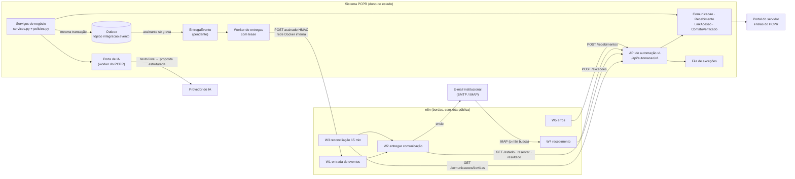
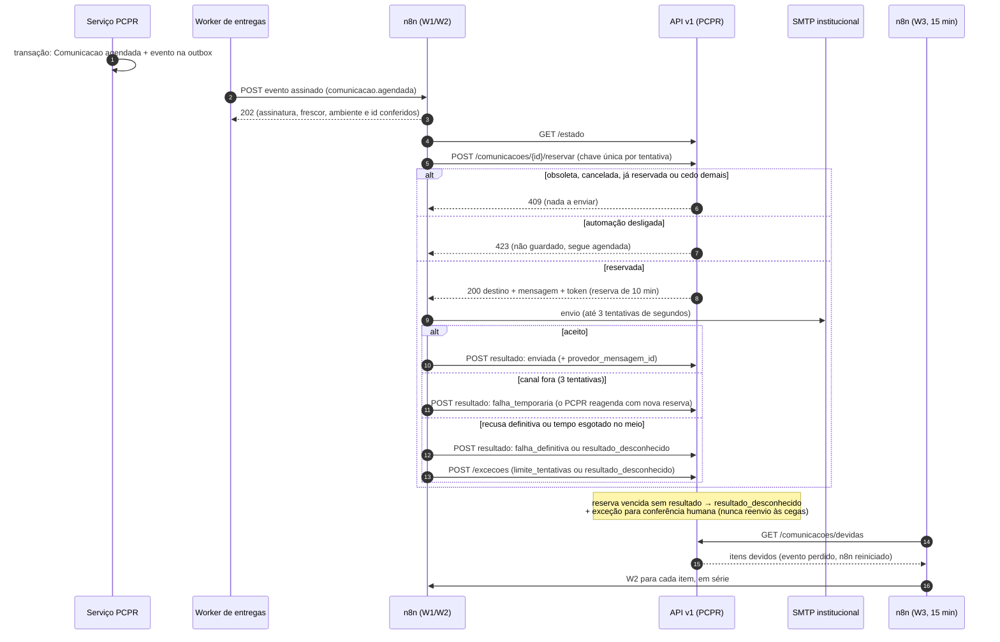

# Arquitetura de automação — PCPR, n8n, IA e canais

> **Escopo revisado em 18/10/2026:** [regra vigente do piloto](../product/automacao-whatsapp-testes.md). Este site é um sistema
> de testes independente, não oficial da polícia e sem operação com policiais. WhatsApp Business
> Cloud API é o canal principal planejado; portal é apoio e e-mail opcional. As classificações e
> restrições policiais de 17/10 abaixo são histórico do cenário institucional, sem bloquear
> automaticamente o piloto. Não houve implementação ou ativação real nesta revisão.

Desenho de 17/10/2026, construído sobre decisões já aceitas (ADR 0005 outbox, ADR 0019 integrações
atrás de portas) e propostas (ADR 0020 ferramentas com política e aprovação). Marcação usada:
**[existe]** código executando hoje no sistema novo · **[parcial]** · **[novo]** a desenvolver.

## 1. Quem faz o quê

| Componente | Responsabilidade | Nunca faz |
|---|---|---|
| **Sistema PCPR** | Cadastros, permissões (`policies.py`), regras e validações, estados, documentos e numeração, registros oficiais; **é dono do estado de cada comunicação e de cada recebimento**, dos links com token, da fila de exceções e da chave que desliga a automação | Depender do n8n para funcionar: desligado o n8n, tudo continua manual |
| **Outbox + worker do PCPR** [existe] | Efeitos transacionais internos (gerar PDF, e-mail de notificação) e o **registro** dos eventos de integração [novo]; um worker de entregas com lease [novo] leva os eventos ao n8n fora de transação | Regras de canal externo; HTTP dentro da transação |
| **n8n** | Agendamento e reconciliação; transporte por canal (e-mail institucional; plataforma oficial do WhatsApp **BLOQUEADA** para a PCPR, maturidade 5, com a integração pronta e desligada pela frente WA-3 do [plano](plano-implantacao.md), prioridade do usuário — [whatsapp-viabilidade.md](whatsapp-viabilidade.md)) com retentativa; recebimento por caixa postal; repasse de status de entrega; integrações periféricas (consultas de protocolo, monitoramento, resumos); alertas de falha | Gravar no banco; decidir regra de negócio; guardar documento; escolher destinatário; emitir, cancelar, assinar |
| **IA** | Interpretar texto livre, responder com contexto autorizado, redigir rascunhos, propor roteiros e apontar inconsistências — sempre devolvendo **proposta estruturada** que o sistema valida | Inventar dados (KM, distâncias, pagamento, atividades); executar ação irreversível; ler dados fora da permissão de quem pergunta |
| **Serviços existentes** | PDFs (WeasyPrint/LibreOffice), roteamento (OSRM/OpenRouteService/estimativa com cache) [existe], leitura e direcionamento de documentos (importação documental com OCR) [existe], conferência de vias assinadas (pypdf) [parcial] | — |

Ajuste ao ponto de partida da missão: **a orquestração interna do processo fica no PCPR** (estados,
prazos, "o que é devido"), porque já existe outbox transacional com agendamento (`disponivel_em`),
LISTEN/NOTIFY e rotinas diárias. O n8n é o **orquestrador das bordas**: fala com o mundo de fora
(canais, provedores, instituições) e devolve resultados ao PCPR. Isso evita duplicar regras em workflows
e mantém tudo testável no código.

## 2. Pontos de integração

| Ponto | Hoje | Necessário |
|---|---|---|
| Eventos de domínio na outbox | [parcial] só `viagens.documento.gerar`, `viagens.oficio.emitido` (só grava log), `plataforma.email.enviar`; **um assinante por tópico** (o segundo registro levanta `ValueError`, `outbox.py:44-45`); retentativa efetiva 10 s→640 s, ~21 min até `falhou` (o ADR 0005 diz "5 s→1 h"); sem tela de falhas nem reprocessamento genérico | [novo] tópicos de ciclo de vida (viagem confirmada/reagendada/cancelada, documento emitido/retificado/cancelado, comunicação agendada, km concluído, prestação…) e um tópico próprio `integracao.evento` cujo assinante só grava a entrega; tela de saúde da outbox; avisos hoje emitidos em `on_commit` (solicitações, viagem gerada) passam para a outbox |
| Entrega PCPR → n8n | inexistente | [novo] POST assinado (HMAC-SHA256 com carimbo de tempo) para o webhook do n8n **pela rede Docker interna, sem rota pública** — envelope em [`contratos/evento-integracao.schema.json`](contratos/evento-integracao.schema.json); cabeçalhos, assinatura, janela de ±5 min e respostas na seção `webhooks` de [`contratos/api-automacao.v1.yaml`](contratos/api-automacao.v1.yaml). **Não dentro do assinante da outbox**: o worker atual segura a transação aberta durante o assinante (`outbox.py:80-116`), o papel `pcpr_app` tem `idle_in_transaction_session_timeout=5min` e a auditoria serializa escritas por advisory lock global; um HTTP lento travaria o sistema. A outbox só grava a entrega pendente; um worker de entregas com **lease** (o padrão do importador, `viagens/importacao.py:161-183`) faz o HTTP fora de transação, com retentativa própria (horas, não minutos) |
| API para o n8n e a IA | inexistente (os `api/` atuais são JSON internos das telas, com sessão) | [novo] `/api/automacao/v1` com token de serviço, escopos e `Idempotency-Key` — [`contratos/api-automacao.v1.yaml`](contratos/api-automacao.v1.yaml) |
| Registro de ferramentas (ADR 0020) | planejado | [novo] `gestao/automacao/` com `PedidoAprovacao` e `ExecucaoFerramenta` |
| Comunicação com servidor | [existe] sino + e-mail opcional pela outbox; [parcial] link wa.me manual sem registro (vira o WhatsApp assistido com registro da frente WA-1, AUT-172) | [novo] entidade `Comunicacao` com estado, versão, destinatário verificado e histórico de entrega |
| Contato e identidade do servidor | [parcial] **servidores viajantes não são usuários do sistema**: `Servidor` tem telefone (único) e não tem e-mail (`cadastros/models.py:94-128`); o vínculo usuário↔servidor está pendente; o sino não os alcança. O e-mail de notificação sai num único envio com todos os destinatários no "Para" (`notificacoes.py:79-80`) | [novo] `ContatoVerificado` (servidor, canal, endereço, verificado_em, consentimento, origem) e acesso do servidor por link com escopo ("portal do servidor" mínimo); e-mail individual por destinatário |
| Link sem login | [existe] padrão de token com hash (feed ICS da agenda, `plataforma/assinatura.py`) | [novo] `LinkAcesso` com escopo, validade, revogação e registro de uso (KM, documentos para assinatura) |
| Recebimento de documentos | [existe] importação documental (fila `processar_importacoes`, OCR, identificação, revisão) | [novo] entrada por API em nome do servidor vinculado + estados de recebimento |
| Fila de exceções | inexistente | [novo] `ExcecaoAutomacao` visível no sistema, com dono, prazo e ação "resolver/repetir/fazer à mão" |

## 3. Confiabilidade (o que garante que nada se perde nem se repete)

1. **Evento só depois do commit.** `outbox.publicar` exige transação; o evento é gravado junto com a
   mudança de negócio ou não existe.
2. **Identificador e correlação.** Cada evento tem `id` estável (o mesmo em toda reentrega),
   `correlacao_id` do processo (`viagem:812`) e `recurso.versao`.
3. **Pelo menos uma vez + deduplicação.** O worker de entregas reentrega até receber 2xx. O n8n descarta `id` já
   visto (nó Remove Duplicates — economia, não garantia: é ler-alterar-gravar sem trava), mas **a proteção
   real é do PCPR**: a reserva é uma transição de estado (`agendada → enviando`) que só uma execução vence;
   as outras recebem 409. Por isso a `Idempotency-Key` da **reserva é única por tentativa e inclui o id da
   execução** (`reserva:<comunicacao>:v<versao>:exec<id da execução>`, contrato `reservar`). Motivo, da análise do protótipo: com uma chave estável sem
   a execução, uma segunda execução (evento + reconciliação ao mesmo tempo, ou reentrega que escapou da
   deduplicação) receberia a resposta guardada da primeira, com o mesmo token de reserva, e enviaria de novo.
   Nenhuma rodada executou a variante com chave estável; o que protege a regra é o T2c (evento com outro
   id para a mesma comunicação → reservar 409 `ja_processada`), que falharia com chave estável. Já o `resultado`, o
   `recebimento` (`receb:<canal>:<mensagem_id_canal>:<anexo_indice>`) e a `excecao` usam chaves estáveis
   (repetir não cria efeito novo; a resposta repetida vem marcada com `Idempotency-Replayed: true`).
4. **Fora de ordem.** Evento com `recurso.versao` menor que a atual é obsoleto; a reserva da comunicação
   revalida a versão e responde 409.
5. **Revalidar antes de agir.** `POST /comunicacoes/{id}/reservar` confere cancelamento, versão da viagem
   e do documento, destinatário ainda autorizado, contato verificado, canal ligado e chave geral — no
   momento do envio, não no momento do evento.
6. **Falha depois de execução parcial.** A comunicação passa `agendada → enviando` com prazo de reserva.
   Resultado registrado com o mesmo token. Se o envio foi feito e o registro do resultado falhou, a
   repetição do `resultado` é idempotente. Se o resultado é **desconhecido** (canal caiu no meio), o
   PCPR **não reenvia às cegas**: abre exceção para uma pessoa conferir (o custo de uma mensagem
   duplicada a um servidor é maior que o de um clique humano).
7. **Retentativas limitadas.** n8n: até 3 tentativas curtas por envio, de segundos, **dentro da reserva de
   10 min** (protótipo: ~1 s entre tentativas); depois `falha_temporaria`, e o PCPR reagenda com nova reserva
   e backoff até 4 h, por no máximo 24 h. Entrega de eventos: worker com lease e backoff até horas (quedas de
   SMTP/n8n duram mais que os ~21 min da outbox atual). Depois, exceção. Nunca laço infinito.
8. **Push + pull.** O evento dá latência baixa; a consulta `comunicacoes/devidas` a cada 15 min recupera
   o que um evento perdido ou um n8n reiniciado deixaram para trás. Consulta indexada, custo desprezível.
   Tolerância de relógio: o n8n antecipa em até 2 min o que está "devido agora" e a assinatura do evento
   aceita ±5 min (no protótipo, 0,2 s de diferença entre relógios deixou um envio "imediato" sem sair).
9. **Cancelamento e reagendamento.** Reagendar cria nova versão: a comunicação antiga é cancelada e uma
   nova é agendada com o novo horário; a reserva da antiga passa a dar 409.
10. **Desligamento.** Chave geral e por fluxo no PCPR (`/estado`). Com ela desligada, **só as operações que
    criam efeito novo** devolvem 423 (reservar, recebimentos, entradas, mensagens do assistente e
    ferramentas de preparação), e as comunicações ficam "agendadas" para envio manual ou posterior.
    `resultado`, `entrega` e `excecoes` **continuam aceitos**, porque registram fatos que já aconteceram:
    se a chave for desligada entre `reservar` e `resultado` (por exemplo, no meio de um incidente), o
    envio feito fica registrado com o `provedor_mensagem_id` e nada novo sai. Recebimento recusado com 423
    não se perde: a mensagem continua na caixa postal até a religação. O 423 não é guardado pela
    idempotência (repetir depois de religar funciona). Cenário de aceite a acrescentar ao protótipo e à
    etapa 1 (T5d): "desligada entre reservar e resultado → resultado registrado, nada novo sai". Para
    incidente com credencial (token vazado, link enviado errado) existe o **modo emergência por token**:
    recusa todas as chamadas daquele token, inclusive leituras, seguido do roteiro de resposta (revogar o
    token, revogar em massa os `LinkAcesso` emitidos no período, trocar o segredo HMAC). O n8n também pode
    ser parado sem perda: o PCPR guarda o que é devido.
11. **Continuidade manual.** Toda comunicação tem na tela as ações "enviar agora pelo portal/e-mail",
    "copiar mensagem" e "marcar como enviada por outro meio" — o operador nunca depende do n8n.
12. **Acompanhamento humano.** O usuário vê no sistema o estado do processo (agendada, enviada,
    entregue, lida, falhou, aguardando devolução, recebido, em revisão…), não execuções do n8n.
    Exceções aparecem numa fila com motivo legível e ação.

Não há promessa de "exatamente uma vez": há **efeito no máximo uma vez** para o que o PCPR controla
(reserva + chave de idempotência) e **conferência humana** onde o canal não permite saber se a
mensagem saiu.

## 4. Segurança e dados

- Token de serviço por integração (hash no banco, escopos mínimos declarados por operação no contrato,
  rotação, ambiente fixo). O n8n nunca recebe credencial do banco nem das contas dos usuários. O token de
  **transporte** do n8n só tem escopos de transporte (`estado:ler`, `comunicacoes:ler`,
  `comunicacoes:reservar`, `comunicacoes:resultado`, `comunicacoes:entrega`, `recebimentos:criar`,
  `recebimentos:ler`, `entradas:criar`, `assistente:mensagens`, `excecoes:criar`), sem ferramentas e sem
  delegação.
- **Agir em nome de uma pessoa nunca é declarado pelo chamador.** Não existe cabeçalho livre do tipo "usuário
  representado": quem tivesse um token com esse poder escolheria qualquer id, inclusive de administrador
  (*confused deputy*), e a trilha mostraria o humano como autor. A representação vem de uma **delegação
  emitida pelo PCPR no momento da ação humana** (por exemplo, "pedir rascunho" na tela): registro
  `Delegacao` com usuário, ferramenta(s), recurso, validade ≤ 15 min e uso único, referenciado por id
  opaco no evento ou no pedido (`X-PCPR-Delegacao`) e conferido pela API. Delegação de usuário com papel
  administrativo ou visão de todas as unidades por token de serviço é recusada. Fluxos de IA pelo n8n
  (alternativas de 11-1, 11-2 e 11-3) usam um token **separado**, com `ferramentas:executar` restrito à
  lista daquele fluxo e sempre com delegação. Clientes MCP usam credencial **por usuário** (token pessoal
  emitido pelo próprio usuário na tela, ou OAuth), nunca token de serviço com cabeçalho.
- Evento não carrega dados pessoais nem documentos (lista fechada de campos por tipo no esquema, validada
  ao publicar); o n8n busca o necessário no momento do envio, com autorização. Documentos ficam no
  armazenamento privado do PCPR; preferência por **link autenticado** (portal) em vez de anexo; quando o
  canal exigir arquivo, URL assinada de curta duração.
- Workflows de mensagem e de arquivo **não salvam execuções** (nem de sucesso nem de erro, sem salvar
  progresso nem execuções manuais): a resposta do `reservar` traz destino e link, que é credencial, e "só
  erros" guardaria o link a cada falha de SMTP, também nos backups do n8n. O diagnóstico vai pelo fluxo de
  erros só com metadados (nó, código, id da execução), e o PCPR mascara URLs, e-mails e tokens no `detalhe`
  de `/excecoes` antes de gravar. Achado do protótipo em tratamento (T13): no n8n 2.43.7, execuções
  disparadas por webhook do recebimento (W4) ficaram no banco com status `running` e o número do remetente
  mesmo sem salvar execução; recebimentos com dado pessoal devem preferir a entrada direta no PCPR ou a
  limpeza dessas execuções, a decidir com o protótipo da frente WA-3
  ([desempenho-e-custos §14.7](desempenho-e-custos.md)).
- **Sem rota pública para o n8n.** PCPR e n8n ficam no mesmo host: o worker de entregas posta no webhook
  pela rede Docker interna, e o e-mail entra por IMAP (o n8n busca). O editor só por túnel SSH ou VPN, com
  MFA. A API de automação também não é publicada no nginx público: aceita só a rede do n8n (defesa em
  profundidade contra token vazado). Se um dia houver provedor com webhook, libera-se só o caminho exato,
  com verificação da assinatura do provedor e limite de taxa; o resto responde 404.
- **Canal real só em produção.** No PREVIEW (DEMO, entrada sem senha) e nos demais ambientes que não são de
  produção, o canal de e-mail é **simulado** (caixa de saída interna, visível na tela): o processo não sobe
  com SMTP ou credencial real configurados (regra de startup análoga ao `exigir_pareamento` do eProtocolo,
  [13 §6.3](fluxos/13-integracoes-institucionais.md)), a instância n8n do PREVIEW não tem credencial real de
  SMTP nem de IMAP, e a saída SMTP (25/465/587) dos contêineres do PREVIEW é bloqueada no host. Critério de
  aceite: no PREVIEW, uma comunicação "enviada" não abre conexão SMTP. Em produção, SMTP com autenticação
  **por componente** (credenciais distintas para PCPR e n8n), nunca autorização por lista de IPs numa VPS
  compartilhada.
- Contato só vale depois de **verificado e vinculado a um servidor identificado** (código de confirmação
  enviado ao próprio canal, ou cadastro conferido por operador — esta segunda forma só em produção). Nome
  exibido no aplicativo ou número informado numa conversa não autorizam nada.
- IA: entrada do usuário, anexos e textos recuperados são **dados**, nunca instruções; ferramentas com a
  política do usuário da delegação; ações irreversíveis só por pedido de aprovação na tela.

## 5. Recursos (VPS KVM 2 medida)

n8n em modo normal, um processo `main` com runner de código externo (`n8nio/runners`), PostgreSQL 17 ou 18
em contêiner próprio na rede do n8n (o 16 do cluster existente é aceito pelo n8n só por compatibilidade e
o contêiner não alcança o `127.0.0.1` do host), dados binários em disco, `mem_limit` de **1 GB** no
principal e **0,5 GB** no runner (orçamento de 1,5 GB, a revisar depois de medir na VPS com PostgreSQL),
concorrência limitada explicitamente (`N8N_CONCURRENCY_PRODUCTION_LIMIT` ≤ 5; vem desligada por padrão),
poda de execuções. Detalhes e números: [desempenho-e-custos.md](desempenho-e-custos.md) §9.2 e §14 e
[`../ops/mudanca-hospedagem/hospedagem-n8n.md`](../ops/mudanca-hospedagem/hospedagem-n8n.md).

## 6. Diagramas

**Componentes e responsabilidades** (setas = quem chama quem; nada do n8n toca o banco do PCPR):

**Caminho de uma comunicação: evento → reserva → envio → resultado**, com reconciliação e exceção:

