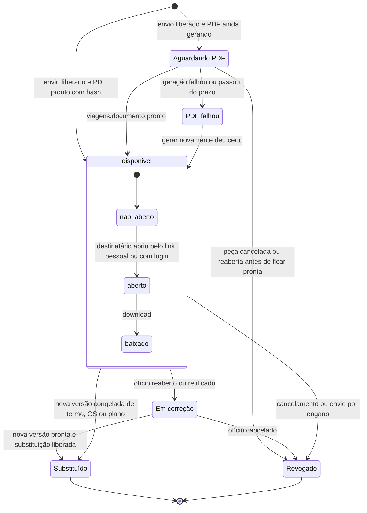
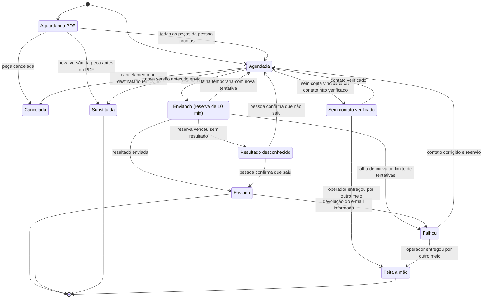
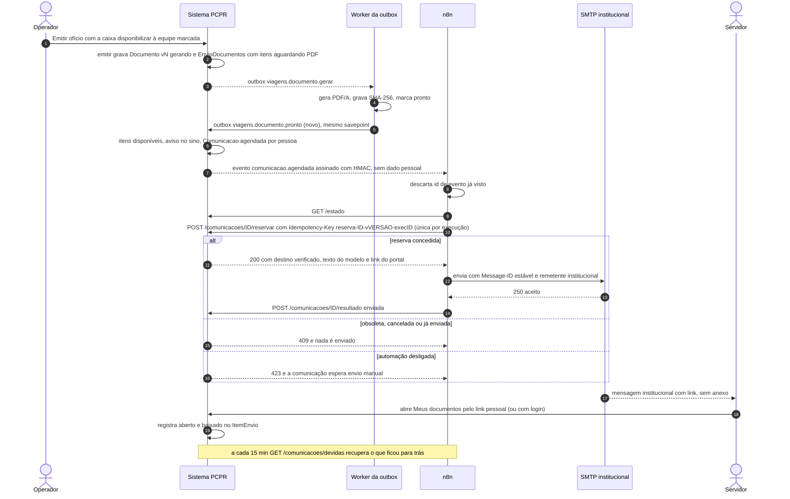
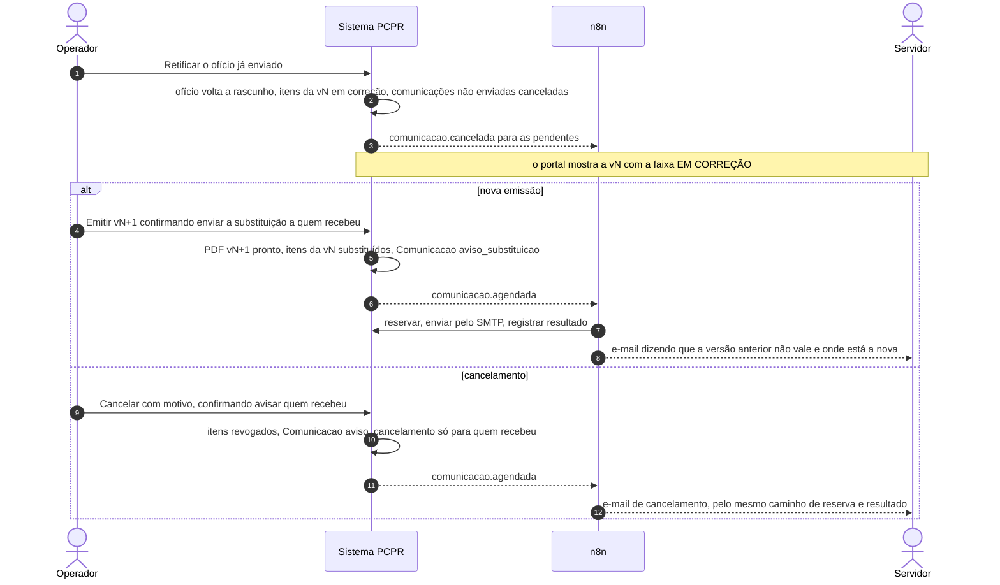

# 10.2 — Envio dos documentos da viagem aos servidores e destinatários

> **Fluxo manual vigente (18/10/2026):** por decisão posterior do usuário, a saída gera
> pendências no sino e em `/viagens/envios/`, agrupadas por servidor/prestação. Mensagem
> única com explicações; baixar ofício + RT próprio em PDF único ou ZIP e anexar manualmente.
> Somente KM vai como link pessoal. Abrir a conversa na mesma aba evita abas acumuladas;
> copiar permite usar uma conversa já aberta. Não há envio nem anexação automática.
> Ver [regra vigente](../../product/envios-manuais.md) e [ADR 0049](../../adr/0049-preparar-envios-manuais-agrupados.md).
> O desenho de envio automático abaixo permanece como alternativa futura, sem ativação.

> **Escopo revisado em 18/10/2026:** [regra vigente do piloto](../../product/automacao-whatsapp-testes.md). Este site é um sistema
> de testes independente, não oficial da polícia e sem operação com policiais. WhatsApp Business
> Cloud API é o canal principal planejado; portal é apoio e e-mail opcional. As classificações e
> restrições policiais de 17/10 abaixo são histórico do cenário institucional, sem bloquear
> automaticamente o piloto. Não houve implementação ou ativação real nesta revisão.

Desenho técnico de 17/10/2026 (Fase 2). Base: [arquitetura](../arquitetura.md),
[evento de integração](../contratos/evento-integracao.schema.json),
[API de automação v1](../contratos/api-automacao.v1.yaml) e
[plano de implantação](../plano-implantacao.md), etapa 2. Marcação usada: **[existe]** código
executando hoje · **[parcial]** · **[novo]** a desenvolver. Caminhos `caminho:linha` são do
repositório, conferidos neste desenho. `ref/gv` e `ref/ev-implantado` são as referências em
produção: servem para entender o processo e **não** são código-base.

Escopo: ofício de viagem, justificativa, termos de autorização (do servidor, da viatura e
genérico), Ordem de Serviço (OS) e Plano de Trabalho, **depois de emitidos ou gerados**.
Fora do escopo: emitir, assinar, protocolar no e-Protocolo (etapa 6), o envio de DB/RT para
assinatura (fluxo 10-5) e o recebimento das vias devolvidas (fluxo 10-6).

---

## 1. Objetivo e resultado para o usuário

**Hoje** o operador emite, baixa o ZIP ("Baixar documentos") e manda tudo por fora (e-mail,
WhatsApp pessoal), pessoa por pessoa no caso dos termos. Ninguém sabe depois quem recebeu
qual versão. Quando o ofício é retificado ou cancelado, quem já recebeu precisa ser avisado
de memória.

**Resultado esperado**

- **Operador:** com um clique ("Enviar à equipe", ou a caixa equivalente na emissão), cada
  pessoa recebe **só o que é dela**, na **versão corrente**, depois que o PDF ficou pronto. A
  tela da viagem mostra, por pessoa e por documento: *aguardando PDF*, *enviado*, *aberto*,
  *baixado*, *falhou* ou *sem contato*. Retificar e emitir de novo dispara a substituição com o
  aviso "a versão anterior não vale". Cancelar avisa quem recebeu. Nada disso depende do n8n
  para existir: com a automação desligada, o operador faz cada passo pela tela.
- **Servidor:** recebe um e-mail institucional padronizado com o link para **"Meus
  documentos"**: por padrão um link pessoal com escopo, validade e revogação (`LinkAcesso`,
  AUT-03), porque os servidores viajantes não são usuários do sistema (arquitetura §2); quem tem
  conta vinculada também vê o aviso no sino e entra com login (D-3). Não há anexo com CPF
  circulando por e-mail. No portal vê a versão em vigor; uma versão substituída ou cancelada
  aparece com faixa de aviso.
- **Gestor:** consegue responder "quem recebeu o ofício 131/2026 v2 e quando abriu" sem
  perguntar a ninguém.

---

## 2. Estado atual com evidências

### 2.1 Sistema novo

| Item | Situação | Evidência | Observação |
|---|---|---|---|
| Emissão do ofício gera `Documento` imutável por versão, com instantâneo `dados` | IMPLEMENTADO | `gestao/viagens/services.py:1034-1078`; `gestao/viagens/models.py:558-604` | Ofício sempre; justificativa só se houver texto (`services.py:1053-1055`) |
| PDF/A-2a assíncrono com SHA-256; `pronto` exige hash no banco | IMPLEMENTADO | `gestao/viagens/assinantes.py:24-43`; `models.py:594-595` (`documento_pronto_tem_hash`) | Estados `gerando → pronto | falhou` |
| Falha de geração e "gerar novamente" | IMPLEMENTADO | `assinantes.py:15-21`; `services.py:1003-1031`; `gestao/plataforma/outbox.py:34,72-73,108-111` | 8 tentativas, espera de 10 s a 640 s; `falhou` na 8ª (~21 min; o teto de 1 h do código nunca é atingido); regenerar reaproveita a mesma mensagem |
| Tópico `viagens.oficio.emitido` | PARCIAL | `services.py:1073-1074`; `assinantes.py:46-49` | Publicado **na mesma transação da emissão, antes do PDF existir**; o assinante só grava log |
| Evento "PDF pronto" | INEXISTENTE | `assinantes.py:34-43` marca `PRONTO` sem publicar nada | Necessário para não enviar link de documento ainda "gerando" |
| Seleção da versão corrente (ADR 0025) | IMPLEMENTADO (integração incremental) | `gestao/viagens/documentos_versoes.py:44-86`; `docs/adr/0025-projecao-de-versoes-documentais.md` | Maior versão sem filtrar "pronto"; nunca promove uma emissão antiga |
| Retificar / reabrir: volta a rascunho, `versao+1`, revoga vias assinadas | IMPLEMENTADO, sem evento | `services.py:1081-1118`; `gestao/viagens/assinados.py:300-307` | O PDF anterior continua guardado como histórico |
| Cancelar / reativar ofício | IMPLEMENTADO, sem evento | `services.py:1155-1201` | Número continua ocupado |
| Cancelar viagem em cascata (ofícios, termos, OS, planos) | IMPLEMENTADO, sem evento | `gestao/viagens/viagem.py:332-367` | Motivo "Viagem cancelada: …" |
| Termos: um por servidor, genérico e um por viatura; **gerados na hora** | IMPLEMENTADO | `gestao/viagens/termos.py:507-519, 522-528, 617-629` | Não há versão congelada; "Finalizar" só redireciona (`views_termos.py:519-524`) |
| Termo do servidor contém CPF, RG e telefone dele; assinam servidor e chefia | IMPLEMENTADO | `termos.py:566-567`; `templates/viagens/documentos/termo.html:78-81` | Documento **individual** |
| OS: "finalizar" fixa data e geração, mas continua editável; gerada na hora | IMPLEMENTADO | `gestao/viagens/ordens.py:444-456, 636-643`; `pacotes.py:176-190` | Baixar o PDF também "fixa" a geração |
| Plano: `GERADO` exige zero pendências, mas continua editável | IMPLEMENTADO | `gestao/viagens/planos.py:650-662, 713-731` | |
| Impressão SHA-256 dos dados (termo e OS) | IMPLEMENTADO | `assinados.py:92-96, 111-125, 203-207` | Base para "o assinado corresponde ao enviado" |
| Ofício leva CPF e RG de **todos** os viajantes | IMPLEMENTADO | `gestao/viagens/documentos/dados.py:105-110` | Documento coletivo com dado pessoal de terceiros |
| Motorista de fora da equipe (servidor cadastrado ou só nome) | IMPLEMENTADO | `models.py:248-269` | Só o cadastrado pode virar destinatário |
| Baixar documentos / ZIP da viagem (minuta para rascunho) | PARCIAL | `gestao/viagens/pacotes.py:1-10, 278-327`; `views.py:1129-1154`; `policies.py:153-156` | Exige sessão de quem prepara ofícios; nenhum registro de envio |
| Contato do servidor | INEXISTENTE | `gestao/cadastros/models.py:86-103` | `Servidor` tem só `telefone`; sem e-mail |
| Vínculo usuário ↔ servidor | INEXISTENTE | `gestao/identidade/models.py:25-34` (a docstring diz que o vínculo "fica no contexto de Cadastros"); `cadastros/models.py:322-335` (`Lotacao` liga usuário só à unidade) | Sem vínculo não há "portal do servidor" |
| E-mail institucional do usuário (único; domínio validado no cadastro) | IMPLEMENTADO | `identidade/models.py:34`; `config/settings/base.py:282`; `gestao/cadastros/forms.py:757` | É o contato naturalmente verificado de quem tem conta |
| Sino + e-mail opcional pela outbox | IMPLEMENTADO | `gestao/plataforma/notificacoes.py:37-61, 70-80`; `config/settings/base.py:268-278` | E-mail desligado por padrão; sem SMTP o backend é o console |
| Link por token (só o hash no banco) | IMPLEMENTADO só para a agenda | `gestao/plataforma/assinatura.py:28-62`; `plataforma/models.py:118` | Padrão reaproveitável para `LinkAcesso` |
| Portal do servidor / papel "servidor" | INEXISTENTE | `docs/product/permissions.md:17-43` | Papéis: operador, gestor, consulta, administrador |
| Registro de envio no histórico | INEXISTENTE | `models.py:735-747` (`Historico.Acao` sem "enviado") | |
| API de automação / `gestao/automacao/` | INEXISTENTE | `docs/adr/0020-automacao-ferramentas-e-aprovacao.md` (proposto) | Endpoints `api/` atuais são internos com sessão |
| Porta de webhooks em `gestao/integracoes/` | INEXISTENTE | só existe `gestao/integracoes/eprotocolo/` | Ver correções na seção 14.3 |
| Saúde da outbox | PARCIAL | `gestao/plataforma/management/commands/doctor.py:52-60`; `deploy/vps/monitorar.sh:58-66, 83-89`; `deploy/systemd/pcpr-monitor@.timer` | `doctor` sob demanda + monitor a cada 5 min que conta mensagens `falhou`, pendentes há mais de 15 min e documentos em `falhou`, com alerta operacional por webhook. Falta tela de falhas e aviso a quem emitiu |

### 2.2 O que a referência em produção já faz

- **GV (`ref/gv`)**: não envia ofício, termo, OS nem plano: o operador baixa e manda por fora.
  O único envio é o **link de assinatura** do RT/DB (token de 7 dias) aberto pelo WhatsApp do
  próprio operador (`wa.me` ou `intent://`), sem registro de envio
  (`ref/gv/prestacoes_contas/assinatura_services.py:93-148`;
  `ref/gv/static/js/components/signature-actions.js:32-38`).
- **EV implantado (`ref/ev-implantado`)**: também não envia documentos de viagem. Há um
  precedente útil em outro módulo: a OS do coffee break vai ao fornecedor **por e-mail
  institucional do próprio sistema**, com prévia editável, confirmação humana e registro no
  histórico de quem recebeu, quando e com quais anexos
  (`ref/ev-implantado/coffee_break/emails.py:1-9, 91-129`).

Conclusão: o envio automatizado dos documentos de viagem é **novo** nos dois sistemas. O
padrão "prévia → confirmação → registro" do EV é o comportamento a manter.

---

## 3. Gatilho e definição precisa do evento de conclusão

### 3.1 O que não dispara envio

- Rascunho, minuta ou prévia (`pacotes.py:1-10`, `views.py` rota `previa`): **nunca** saem
  por este fluxo.
- O tópico `viagens.oficio.emitido` **não serve de gatilho**: é publicado na transação de
  `emitir` (`services.py:1073-1074`), quando o `Documento` ainda está `gerando`. Usá-lo
  mandaria link para um PDF que pode falhar.
- Salvar ou "finalizar" termo, OS ou plano: são documentos gerados na hora e continuam
  editáveis. Sem congelar uma versão, não há como dizer o que foi enviado.

### 3.2 Gatilho (composto, sempre com ação humana)

1. **Liberação humana** (equivale à aprovação do ADR 0020, regra 3: "encaminhar" é
   irreversível). Duas portas, o mesmo serviço `envios.preparar` [novo]:
   - na janela de emissão do ofício, a caixa **"Disponibilizar à equipe quando o PDF ficar
     pronto"** (se ela vem marcada por padrão é decisão D-2);
   - o botão **"Enviar à equipe"** na viagem, no ofício, no termo, na OS e no plano, com prévia:
     destinatários por documento, texto da mensagem e quem está sem contato.
2. **Prontidão técnica**: cada peça do envio precisa estar `pronto` **com SHA-256** e ser a
   **versão corrente** (projeção do ADR 0025). Para termo, OS e plano, o envio primeiro
   **congela** uma versão (`DocumentoCongelado` [novo], seção 7), gerada pela outbox como o PDF
   do ofício.
3. **Evento interno que destrava**: `viagens.documento.pronto` [novo], publicado por
   `assinantes.gerar_documento` (e pelo gerador de congelados) no mesmo savepoint que marca
   `PRONTO`. O assinante `envios.liberar_por_documento` [novo] passa os itens daquele documento
   de `aguardando_documento` para `disponivel`, cria o aviso no sino e agenda a `Comunicacao`
   por destinatário.
4. **Evento de integração** para o n8n: `comunicacao.agendada` (já no contrato). O n8n não
   recebe documento nem dado pessoal: reserva a comunicação pela API e o PCPR revalida tudo.

### 3.3 Estado necessário de cada peça (revalidado na reserva)

| Peça | Fonte do arquivo | Estado exigido | Bloqueia se |
|---|---|---|---|
| Ofício | `Documento` tipo `oficio` | `Oficio.situacao = emitido`, não arquivado; `Documento` corrente `pronto` com `sha256` | ofício reaberto/retificado (voltou a rascunho), cancelado, versão superada |
| Justificativa | `Documento` tipo `justificativa` | idem; existir na emissão corrente | idem; justificativa retirada na nova emissão (ADR 0025) |
| Termo do servidor | `DocumentoCongelado` (termo, chave = id do servidor) [novo] | termo `ativo`; período e destino presentes (`dados_do_documento` sem erro) | termo cancelado; servidor saiu do efetivo; dados mudaram depois do congelamento (ver 9) |
| Termo da viatura | `DocumentoCongelado` (chave `viatura[-id]`) | idem | idem |
| Termo genérico | — | **não é enviado** (formulário para preencher à mão) | — |
| OS | `DocumentoCongelado` (ordem) | `ativa` e `documento_gerado_em` preenchido | OS cancelada; dados mudaram depois do congelamento |
| Plano | `DocumentoCongelado` (plano) | `GERADO`, não cancelado | plano cancelado; dados mudaram depois do congelamento |
| Qualquer | — | viagem (se houver) não `cancelada`; automação e fluxo ligados para o caminho automático | — |

### 3.4 Destinatários autorizados (documentos individuais × coletivos)

Regra geral (domínio puro, [novo] `gestao/viagens/dominio/envio_documentos.py`): o
destinatário sai **do instantâneo da versão enviada**, nunca de uma lista digitada. Ninguém
recebe documento em que não figura.

| Peça | Natureza | Quem recebe (proposta) | Dados pessoais no documento | A confirmar |
|---|---|---|---|---|
| Ofício | coletivo | viajantes do instantâneo (`Documento.dados["viajantes"][*].id`) e o motorista de fora **se** for servidor cadastrado (`motorista_externo_servidor`) | CPF e RG de **todos** os viajantes | D-4: participante pode receber o ofício com CPF/RG dos colegas? |
| Justificativa | coletivo/institucional | ninguém por padrão (dirige-se à autoridade) | nomes | D-5 |
| Termo do servidor | **individual** | só o servidor da chave (`chave == str(servidor.pk)`), verificado na reserva | CPF, RG e telefone dele | D-6: também a chefia imediata, que autoriza no termo? |
| Termo da viatura | coletivo restrito | quem vai naquela viatura (`TermoViatura.servidores`) | placa; servidor em branco | D-7 |
| Termo genérico | — | ninguém | — | — |
| OS | coletivo | `OrdemServico.servidores` | nomes e funções | D-8 |
| Plano | coletivo | coordenadores que sejam servidores cadastrados e a equipe dos ofícios ligados | nomes dos coordenadores, efetivo | D-9 |
| Destinatário institucional do ofício (`ConfiguracaoInstitucional.destinatario_*`) | institucional | **fora deste fluxo**: vai pelo e-Protocolo (etapa 6); o cadastro não tem e-mail (`cadastros/models.py:394-398`) | — | — |

Um servidor que está em dois ofícios da mesma viagem recebe **uma** comunicação com as peças
dele, não duas.

### 3.5 Eventos de conclusão (definições)

| Nível | Concluído quando | Quem registra |
|---|---|---|
| **Disponibilização** (`ItemEnvio`) | `disponivel`: a versão `pronto` com hash ficou acessível ao destinatário no portal | PCPR, no assinante de `viagens.documento.pronto` |
| **Comunicação** (`Comunicacao`) | `enviada`: o canal aceitou a mensagem (e-mail: resposta 250 do SMTP, com `Message-ID`). Ou estado terminal `cancelada` ou `feita_a_mao` | PCPR, pelo `resultado` do n8n ou pela ação manual |
| **Recebimento confirmado** | `primeiro_acesso_em` preenchido: a pessoa **autenticada** abriu o item no portal. `baixado_em`: fez download | PCPR, nas rotas do portal (nunca por pixel de rastreio nem por confirmação de leitura do e-mail) |
| **Envio** (`EnvioDocumentos`) | `concluido`: todas as comunicações em estado terminal. `concluido_com_pendencias`: sobrou exceção aberta | PCPR |

"Lida", no sentido do provedor de e-mail, **não é usada**: e-mail não informa leitura de forma
confiável e rastreamento oculto não combina com comunicação institucional.

---

## 4. Diagramas

### 4.1 Estados da disponibilização (`ItemEnvio`, por pessoa e por versão)

### 4.2 Estados da comunicação (`Comunicacao`, por pessoa, canal e envio)

Esta é a máquina comum da `Comunicacao` (AUT-01), usada com os mesmos nomes em 10-3, 10-4 e 10-5:
`agendada`, `sem_contato`, `enviando`, `enviada`, `falhou`, `desconhecido`, `cancelada`, `substituida` e
`feita_a_mao`; a `origem` (`automatica`, `pcpr_agora`, `outro_meio`) é um campo à parte, e entrega e leitura são
marcas de tempo, não estados. `aguardando_documento` é específico deste fluxo.

### 4.3 Sequência principal (emissão → disponibilização → e-mail → acesso)

### 4.4 Sequência da retificação e do cancelamento

---

## 5. Responsabilidades

| Quem | Faz | Não faz |
|---|---|---|
| **Sistema PCPR** | Decide **o que** vai, **para quem** e **em qual versão**; congela termo/OS/plano; espera o PDF pronto; cria itens, comunicações e avisos no sino; publica os eventos depois do commit; revalida tudo na reserva (versão corrente, peça não cancelada, destinatário ainda autorizado, contato verificado, chave ligada); monta o texto pelo modelo; guarda o arquivo e serve o portal (link com escopo ou login); registra acesso e download; abre exceções; oferece a continuação manual | Depender do n8n para disponibilizar no portal; enviar rascunho; enviar a quem não figura no documento |
| **n8n** | Recebe `comunicacao.agendada`, deduplica por `id`, consulta `/estado`, reserva, envia pelo SMTP institucional com `Message-ID` estável, devolve o resultado, lê devoluções (bounces) na caixa institucional e repassa como `entrega: falhou`, roda a reconciliação de 15 min, abre exceção quando esgota tentativas | Guardar documento ou link com token; escolher destinatário; montar texto; reenviar "às cegas" depois de resultado desconhecido; gravar no banco; anexar PDF por conta própria |
| **IA** | **Não participa** deste fluxo. A mensagem é modelo fixo aprovado; destinatários e versões são regras determinísticas | Redigir a mensagem, escolher quem recebe, decidir se um documento "parece pronto", resumir documento para o servidor |
| **Operador** | Libera o envio (caixa na emissão ou botão com prévia); confirma substituição e aviso de cancelamento; trata exceções (sem contato, falhou, resultado desconhecido); entrega por outro meio e marca como feito | Corrigir o estado da comunicação no banco; mandar documento individual a outra pessoa |
| **Gestor** | Define quem pode enviar e revogar; responde por envio por engano (incidente) | — |
| **Servidor (destinatário)** | Entra no portal (link pessoal ou login), abre e baixa; procura o operador se algo estiver errado | Encaminhar o link pessoal (dá acesso aos documentos dele; em caso de vazamento, o operador revoga e reenvia) |

---

## 6. Contratos

### 6.1 Eventos usados (do `evento-integracao.schema.json`)

| Tipo | Quando o PCPR publica | `recurso` | `dados` (sem dado pessoal) | Uso pelo n8n |
|---|---|---|---|---|
| `comunicacao.agendada` | comunicação passou a `agendada` (no `enviar_em`) | `comunicacao`, id, versão | `comunicacao_id`, `fluxo: "envio-documentos"`, `tipo_comunicacao`, `enviar_em` com `-03:00` | dispara a reserva |
| `comunicacao.cancelada` | cancelada antes de sair | `comunicacao` | `comunicacao_id`, `fluxo`, `motivo`: `cancelamento`, `substituicao`, `destinatario_removido`, `revogacao` | descarta execução em espera, se houver |
| `documento.emitido` | **só quando o PDF ficou `pronto` com hash** (não no momento de `emitir`) | `documento` ou `documento_congelado` [novo] | `peca`, `dono` (`oficio:131`), `versao`, `sha256` | informativo (métricas, outros fluxos) |
| `documento.retificado` / `documento.cancelado` | reabrir/retificar/cancelar (ofício) e cancelar (termo/OS/plano) | idem | `motivo_codigo` | informativo |
| `viagem.cancelada` | cancelamento em cascata | `viagem` | — | informativo |
| `automacao.desligada` / `automacao.religada` | chave geral ou do fluxo | `chave_automacao` | `fluxo` | pausa/retoma a reconciliação |

`correlacao_id`: `viagem:<id>` quando há viagem; senão `oficio:<id>`, `termo:<id>`,
`ordem:<id>` ou `plano:<id>`.

### 6.2 Endpoints usados (do `api-automacao.v1.yaml`)

| Endpoint | Uso neste fluxo | Idempotência |
|---|---|---|
| `GET /estado` | fluxo `envio-documentos` e canal `email` ligados | leitura |
| `GET /comunicacoes/devidas` | reconciliação a cada 15 min | leitura |
| `POST /comunicacoes/{id}/reservar` | revalida e entrega destino + mensagem | `Idempotency-Key: reserva:<id>:v<versao>:exec<id da execução>` — **única por tentativa** (estável dentro da execução, diferente entre execuções; contrato `reservar` e [arquitetura §3.3](../arquitetura.md)). Outra execução do mesmo evento recebe 409 `ja_processada` |
| `POST /comunicacoes/{id}/resultado` | `enviada`, `falha_temporaria`, `falha_definitiva`, `resultado_desconhecido` | `resultado:<id>:<token da reserva>` |
| `POST /comunicacoes/{id}/entrega` | devolução de e-mail (`falhou`) lida pelo n8n | `entrega:<id>:<provedor_mensagem_id>:<status>`; status nunca regride |
| `POST /excecoes` | esgotou tentativas, SMTP fora, resultado desconhecido | `excecao:envio-documentos:<comunicacao>:<motivo>` |

### 6.3 Extensões necessárias [novo]

| # | Nome | Campos / forma | Regra de idempotência |
|---|---|---|---|
| X1 | Tópico interno `viagens.documento.pronto` | `{documento_id}` ou `{congelado_id}`; publicado em `assinantes.gerar_documento` (e no gerador de congelados) no savepoint que marca `PRONTO` | chave `documento-pronto:<pk>` / `congelado-pronto:<pk>`; o assinante só move itens que ainda estão em `aguardando_documento` |
| X2 | Tópico interno `viagens.peca.congelar` | `{congelado_id}`; gera PDF/A de `DocumentoCongelado.dados` com `termos/ordens/planos.pdf_do_documento`; `ao_falhar` marca `falhou` (mesmo padrão de `assinantes.py:15-21`) | chave `congelar:<pk>`; versão `pronto` não é refeita |
| X3 | Tópico interno `integracao.evento` (AUT-100) | envelope do evento; o assinante **só grava** uma `EntregaEvento` pendente; o POST ao webhook do n8n com `X-PCPR-Assinatura: t=<epoch>,v1=<hmac-sha256>` sai do worker de entregas com lease (`processar_entregas`, AUT-101), **fora de transação** ([arquitetura §2](../arquitetura.md): HTTP dentro do assinante seguraria a transação do worker da outbox) | chave `integracao:<evento.id>`; `evento.id` gravado no payload (estável nas reentregas) |
| X4 | `recurso.tipo` += `documento_congelado`, `envio_documentos` | enum do envelope | — |
| X5 | `ComunicacaoResumo.tipo` += `documentos_disponiveis`, `aviso_substituicao` | Incorporado no rascunho 3 do contrato: `oficio_disponivel` deixou de existir (unificado em `documentos_disponiveis`) e `aviso_substituicao` absorveu o `documentos_substituidos` do [10-5](10-5-db-e-rt-para-assinatura.md); `aviso_cancelamento` já existia | — |
| X6 | `ComunicacaoReservada` += `itens[]`, `link_portal`, `cabecalhos`, `responder_para` | `itens[]`: `peca`, `titulo`, `numero`, `versao`, `sha256`, `individual`, `substitui: {versao, disponibilizada_em} | null`, `situacao`; `link_portal`: por padrão a URL do `LinkAcesso` de escopo `documentos` (AUT-03; o mesmo modelo de 10-4, 10-5 e 10-6) e, para quem tem conta vinculada, a URL com login (D-3); `cabecalhos`: `Message-ID` = `idempotencia_canal`, `Auto-Submitted: auto-generated`; `anexos` vazio por padrão | `idempotencia_canal = <pcpr-com-<id>-v<versao>@<domínio>>` |
| X7 | `ExcecaoAutomacao.motivo` += `documento_nao_pronto`, `destinatario_sem_acesso_portal`, `devolucao_canal` | enum de `POST /excecoes` | chave por comunicação + motivo |
| X8 | `GET /comunicacoes/{id}` | estado, versão, `enviada_em`, `provedor_mensagem_id` | leitura (escopo `comunicacoes:ler`); o n8n consulta antes de abrir exceção depois de reiniciar |
| X9 | `notificacoes.notificar(..., email: bool = True)` | o aviso no sino deste fluxo é criado com `email=False` | evita e-mail duplicado: com `NOTIFICACOES_POR_EMAIL` ligado, `notificar` já publicaria `plataforma.email.enviar` (`notificacoes.py:54-60`) além do e-mail da `Comunicacao` |
| X10 | `outbox.publicar(..., disponivel_em=None)` | hoje `publicar` sempre grava `timezone.now()` (`outbox.py:54-64`) | permite publicar `comunicacao.agendada` para a janela de envio/agregação |
| X11 | Rotas do portal | por link: `GET /p/documentos/<token>/` e `GET /p/documentos/<token>/itens/<id>/arquivo` (prefixo `/p/<escopo>/<token>/` comum às páginas do servidor, como `/p/assinatura/<token>/` do 10-5); com login: `GET /meus-documentos/`, `GET /meus-documentos/envios/<id>/`, `GET /meus-documentos/itens/<id>/arquivo`. O arquivo responde com `X-Content-SHA256`, como `views.py:1154` | acesso registra `primeiro_acesso_em` uma vez e incrementa `acessos`; GET de robô de pré-visualização não conta (AUT-03) |
| X12 | Serviços `gestao/viagens/envios.py` | `preparar`, `liberar_por_documento`, `marcar_em_correcao`, `preparar_substituicao`, `preparar_aviso_cancelamento`, `revogar_item`, `reenviar`, `marcar_feita_a_mao` | cada um em `transaction.atomic` com `select_for_update` do envio |
| X13 | Ganchos nos serviços existentes | `services.emitir` (aceita `liberar_envio`), `reabrir`, `retificar`, `cancelar`, `reativar`; `termos/ordens/planos.cancelar`; `viagem.cancelar` | o gancho só registra estado e publica com chave por `pk:versao`; nunca envia na transação |
| X14 | `Historico.Acao.ENVIADO` e item na trilha da viagem | "Ofício 131/2026 v2 disponibilizado a 5 pessoas" | um registro por envio liberado |

### 6.4 Mensagem acompanhante (modelo fixo, sem IA)

Modelos versionados em código (domínio puro `dominio/envio_documentos.py`), com texto
**aprovado pelo usuário** (D-12) e teste de *snapshot*. Variáveis: primeiro nome, peças
(título, número, versão), viagem (destino principal e período por extenso), link do portal,
unidade emissora. **Proibido**: CPF, RG, telefone, valores de diárias, conteúdo do documento.

| Tipo | Assunto (proposta a aprovar) | Corpo mínimo |
|---|---|---|
| `documentos_disponiveis` | `[PCPR] Documentos da viagem a <destino> (<período>)` | quais documentos, link "Meus documentos", "mensagem automática do sistema PCPR Gestão — <unidade>", como falar com a unidade |
| `aviso_substituicao` | `[PCPR] Ofício <nº> retificado — use a versão <v>` | "A versão <v-1>, disponibilizada em <data>, **não vale mais**. Use a versão <v> disponível em …" |
| `aviso_cancelamento` | `[PCPR] <Documento> cancelado` | "O documento <…> que você recebeu em <data> foi **cancelado** e não vale." Motivo só se o usuário decidir expor (D-13) |

Identidade institucional explícita: remetente e "responder para" institucionais (D-11), sem
disfarce de pessoa física. A plataforma oficial do WhatsApp está **bloqueada** para a PCPR pela
política oficial da Meta (maturidade 5; [whatsapp-viabilidade.md](../whatsapp-viabilidade.md)), mas o
WhatsApp é **prioridade do usuário** nas frentes do [plano](../plano-implantacao.md): já, a WA-1 (envio
assistido com registro, maturidade 2) usa a mesma mensagem mínima no link `wa.me` aberto pelo operador
no aparelho institucional e registra "enviado por WhatsApp manual"; a WA-3 deixa este conteúdo redigido
como modelo *utility* para aprovação, com a integração oficial pronta e **desligada** até o portão de
ativação (autorização escrita da Meta, pedida pela WA-2). Nenhum canal não oficial.

---

## 7. Modelo de dados [novo] e permissões

### 7.1 Entidades

**`DocumentoCongelado`** (`viagens`) — a versão enviada de termo, OS ou plano.

| Campo | Tipo / regra |
|---|---|
| `tipo` | `termo` · `ordem` · `plano` |
| `termo`, `ordem`, `plano` | FK PROTECT, exatamente uma conforme o tipo (como `via_assinada_um_dono_do_tipo`) |
| `chave` | termo: id do servidor, `viatura` ou `viatura-<id>`; vazio para OS e plano |
| `versao` | sequencial por dono + chave; único (dono, chave, versao) |
| `dados` | instantâneo de `dados_do_documento` (com o texto editado); OS com `fixar=True` |
| `impressao` | `assinados.impressao(dados)` — a mesma que vai em `ViaAssinada.impressao_dos_dados` |
| `arquivo`, `sha256`, `tamanho` | `pronto` exige `sha256` (constraint, como `documento_pronto_tem_hash`) |
| `situacao`, `erro`, `gerado_em` | `gerando` → `pronto` · `falhou` |
| `criado_por`, `criado_em` | — |

Congelar de novo com a mesma `impressao` da última versão `pronto` **reaproveita** a versão
(sem versão nova, sem reenvio).

**`EnvioDocumentos`** (`viagens`) — o pedido humano.

| Campo | Tipo / regra |
|---|---|
| `unidade` | escopo (policies) |
| `viagem` | FK null; `correlacao_id` (`viagem:<id>`, `oficio:<id>`…) |
| `motivo` | `inicial` · `reenvio` · `substituicao` · `cancelamento` |
| `substitui` | FK para o envio anterior (substituição/cancelamento) |
| `estado` | `aguardando_documento` · `liberado` · `concluido` · `concluido_com_pendencias` · `cancelado` |
| `modelo_mensagem` | código + versão do modelo usado |
| `solicitado_por`, `solicitado_em`, `liberado_em`, `concluido_em` | — |
| `chave_idempotencia` | única: `envio:<correlação>:<motivo>:<sha256 da lista ordenada (peça, id, versão, destinatário)>`; reenvio explícito acrescenta um contador |

**`ItemEnvio`** (`viagens`) — a disponibilização (o "recibo") por pessoa e versão.

| Campo | Tipo / regra |
|---|---|
| `envio` | FK |
| `destinatario` | FK `Servidor`; `usuario` FK null (resolvido pelo vínculo no momento) |
| `documento` / `congelado` | exatamente um (FK `Documento` ou `DocumentoCongelado`) |
| `individual` | bool (termo do servidor) |
| `estado` | `aguardando_documento` · `pdf_falhou` · `disponivel` · `em_correcao` · `substituido` · `revogado` |
| `disponivel_em`, `primeiro_acesso_em`, `baixado_em`, `acessos` | marcas do portal |
| `substituido_por`, `substituido_em` | FK para o item da nova versão |
| `revogado_em`, `revogado_por`, `motivo_revogacao` | — |
| Restrições | único (destinatario, documento) e (destinatario, congelado) — uma versão é disponibilizada uma vez por pessoa; individual ⇒ `chave == str(destinatario_id)` |

**`Comunicacao`**, **`ContatoVerificado`**, **`LinkAcesso`** e **`ExcecaoAutomacao`**: entidades
compartilhadas da etapa 1 (arquitetura, seção 2). Campos que este fluxo exige da
`Comunicacao`: `fluxo = "envio-documentos"`, `origem = "envio_documentos:<id>"`,
`destinatario_usuario`, `destinatario_servidor_id`, `canal`, `destino_usado` (gravado na
reserva), `enviar_em`, `estado`, `versao`, `tentativas`, `reserva_token_hash`,
`reserva_expira_em`, `provedor_mensagem_id`, `enviada_em`, `falhou_em`, `cancelada_em`,
`motivo_cancelamento`, `correlacao_id`; único (origem, destinatário, canal, tipo).

**Vínculo `Servidor` ↔ `Usuario`** (`cadastros`) [novo]: `VinculoServidorUsuario(servidor
OneToOne, usuario OneToOne, confirmado_por, confirmado_em, origem)`. Sem ele não há portal. O
contato de e-mail é o `Usuario.email` institucional da conta ativa. Como o vínculo é confirmado
é decisão D-3.

### 7.2 Permissões (policies)

| Policy [novo] | Regra |
|---|---|
| `pode_enviar_documentos(usuario, ancora)` | `pode_ver` da âncora + `edita_oficios` + permissão nova `viagens.enviar_documentos` (operador e gestor por padrão — D-1) |
| `pode_revogar_envio(usuario, envio)` | mesma permissão; revogar por **engano** pode exigir gestor (D-1) |
| `pode_ver_envios(usuario, viagem)` | `pode_ver_viagem` |
| `pode_abrir_item(usuario, item)` | `item.usuario == usuario`, vínculo vigente, conta ativa, item em `disponivel`, `em_correcao` ou `substituido` (com faixa); `revogado` mostra só o aviso, sem arquivo. **Não** depende de `view_oficio`: o servidor não precisa de perfil de Viagens |
| Escopos do token do n8n | `comunicacoes:reservar`, `comunicacoes:resultado`, `comunicacoes:ler`, `excecoes:abrir` |
| Domínio puro `destinatarios(peca, instantaneo)` e `pode_receber(peca, servidor)` | testes sem banco; reavaliado na reserva |

---

## 8. Regras de tempo (America/Sao_Paulo)

| Regra | Valor proposto | Observação |
|---|---|---|
| Fuso | eventos em UTC (`ocorrido_em` com `Z`); horários de negócio com `-03:00` | como o contrato |
| Agregação | `enviar_em = liberação + 10 min`; peças novas da mesma pessoa e viagem entram na comunicação ainda `agendada` | evita três e-mails quando o operador emite três ofícios seguidos; parâmetro técnico a confirmar |
| Janela de envio | imediato, 24 h por padrão | se o usuário quiser janela (ex.: 07h–20h), `enviar_em` vai para o início da próxima janela (D-10) |
| PDF não ficou pronto | exceção `documento_nao_pronto` se `gerando` por mais de 30 min ou `falhou` | o "gerar novamente" existente (`services.py:1003-1031`) destrava sozinho |
| Reserva | 10 min (contrato) | vencida sem resultado → `resultado_desconhecido`; toda retentativa do n8n precisa caber nela |
| Reconciliação | `GET /comunicacoes/devidas` a cada 15 min | |
| Tentativas | n8n: até 3 tentativas curtas, de segundos, **dentro da reserva** (como o W2 do protótipo: 3 × 1 s; a retentativa nativa do n8n aceita no máximo 5 s entre tentativas); depois devolve `falha_temporaria`, e o PCPR reagenda com novo `enviar_em` e nova reserva, com backoff de minutos a horas (até 4 h entre tentativas, no máximo 24 h) | depois, exceção `limite_tentativas`. Se um dia houver espera longa dentro do n8n (nó Wait), a reserva tem de ser maior que a soma das esperas |
| Saída próxima | se a saída é em menos de 24 h e há comunicação `sem_contato`/`falhou`, a exceção sobe para "urgente" no topo da fila | data de saída da viagem/ofício |
| Validade de link | `LinkAcesso` de escopo `documentos` com validade a definir (D-14) e revogação ao reenviar ou cancelar; o acesso com login não expira | |

---

## 9. Falhas e recuperação

| Cenário | Detecção | Efeito | Recuperação |
|---|---|---|---|
| **Evento duplicado** (reentrega da outbox ou do webhook) | n8n vê `id` repetido; PCPR vê reserva para comunicação já `enviando`/`enviada` | nenhum envio novo | n8n descarta; reserva devolve 409 `ja_processada`; a repetição de `resultado` devolve o mesmo registro |
| **Serviço indisponível** — SMTP | erro 4xx/conexão no envio | comunicação volta a `agendada` | 3 tentativas no n8n, depois backoff do PCPR; esgotou → exceção `canal_indisponivel`; disponibilização no portal e sino **não** são afetados |
| **Serviço indisponível** — n8n | o worker de entregas (AUT-101) não recebe 2xx do webhook | `EntregaEvento` fica pendente, com retentativa de horas no worker de entregas (a outbox atual, sozinha, faria 8 tentativas em ~21 min e marcaria `falhou`) | reconciliação de 15 min; com o n8n parado, a tela mostra "agendada" e oferece "enviar agora" (caminho interno) |
| **Serviço indisponível** — API do PCPR | n8n recebe erro/timeout na reserva | nada enviado (sem reserva não há destino nem texto) | n8n tenta de novo na próxima reconciliação |
| **PDF falhou** | `Documento`/`DocumentoCongelado` em `falhou` ou `gerando` > 30 min | itens em `pdf_falhou`, comunicação não sai | exceção `documento_nao_pronto`; "gerar novamente" publica `viagens.documento.pronto` e o envio segue |
| **Viagem reagendada** | data do ofício emitido muda só por retificação (nova versão) | comunicação pendente da versão antiga é cancelada; enviada fica `em_correcao` | substituição na nova emissão; reserva da antiga → 409 `obsoleta` |
| **Link expirado** | `LinkAcesso` vencido ou revogado | página diz que expirou, sem revelar o documento | "entre com seu login" ou o operador usa "reenviar" (gera novo link e revoga o anterior) |
| **KM parcial** | não se aplica a este fluxo | — | ver fluxo 10-4 |
| **Documento duplicado** (mesma versão, mesma pessoa) | restrição única de `ItemEnvio`; `chave_idempotencia` do envio | segundo pedido devolve o mesmo envio | nada a recuperar |
| **Documento incorreto** (termo de outra pessoa, peça errada) | invariante individual ⇒ chave = destinatário (bloqueia na reserva); se escapou, aviso do servidor | item com dado pessoal de terceiro exposto | "revogar por engano": arquivo deixa de abrir, comunicação de correção, **registro de incidente** para o encarregado de dados (D-15) |
| **Destinatário sem autorização** (saiu da equipe, termo de outro) | `pode_receber` falso na reserva | 409 `regra_violada`; nada sai | comunicação `cancelada` (`destinatario_removido`); item revogado |
| **Destinatário sem contato verificado / sem conta** | sem vínculo ativo ou contato não verificado | `sem_contato`; documento não sai por e-mail | exceção `destinatario_sem_acesso_portal`; operador baixa o pacote da pessoa e entrega por outro meio, depois "marcar como feita à mão" |
| **Retentativa após sucesso parcial** (4 de 6 saíram) | estados por comunicação | só as 2 pendentes voltam à fila | "reenviar pendentes" pega só quem não está `enviada`; quem recebeu não recebe de novo |
| **Reinício do n8n** no meio de um envio | reserva venceu sem `resultado` | `resultado_desconhecido` → exceção (não reenvia às cegas) | n8n consulta `GET /comunicacoes/{id}` (X8); operador confere a pasta de enviados da caixa institucional pelo `Message-ID` e marca "saiu" ou "não saiu" |
| **Resultado gravado falhou depois do envio** | n8n recebeu 250 mas `resultado` deu erro | estado ainda `enviando` | n8n repete `resultado` com a mesma chave (idempotente) |
| **Devolução do e-mail (bounce)** | n8n lê a caixa institucional e casa o `Message-ID` | `enviada → falhou` | exceção `devolucao_canal`; operador corrige o contato (cadastro de usuário) e reenvia |
| **Correção de dados após envio para assinatura** (termo/OS/plano) | `impressao` atual ≠ `DocumentoCongelado.impressao` | tela da viagem: "os dados mudaram depois do envio"; o portal **não** muda sozinho | operador congela a nova versão e libera a substituição; a via assinada que voltar com a impressão antiga recebe o aviso existente "assinado, mas os dados mudaram" (`assinados.py:203-207`) |
| **Correção do ofício já enviado** | `reabrir`/`retificar` | itens `em_correcao`; pendentes cancelados | substituição confirmada na nova emissão (4.4) |
| **Cancelamento** (ofício, termo, OS, plano ou viagem em cascata) | gancho nos serviços de cancelamento | pendentes `cancelada`; itens `revogado` | diálogo de cancelamento oferece "avisar as N pessoas que receberam" → `aviso_cancelamento`; **reativar não reenvia sozinho**: oferece "reenviar" |
| **Automação desligada** no meio | `/estado` ou 423 na reserva | nada sai pelo n8n | comunicações ficam `agendada`; "enviar agora" na tela ou religar |

---

## 10. Deduplicação, cancelamento, desligamento e continuação manual

**Deduplicação em camadas** (a proteção real é do PCPR):

1. `outbox.publicar` usa `get_or_create` pela chave (`outbox.py:59-62`): o mesmo fato não gera
   duas mensagens.
2. `EnvioDocumentos.chave_idempotencia`: duplo clique ou repetição do POST devolvem o mesmo envio.
3. `ItemEnvio` único por (pessoa, versão): uma versão é disponibilizada uma vez.
4. `Comunicacao` única por (envio, pessoa, canal, tipo); a reserva é atômica (`agendada →
   enviando` com `select_for_update`): duas execuções do n8n, só uma ganha.
5. `Message-ID` estável no e-mail: ajuda a localizar o envio na caixa institucional e, em
   alguns clientes, agrupa cópias; **não** é garantia, por isso o item 6.
6. Resultado desconhecido nunca vira reenvio automático: vai para uma pessoa conferir.

**Cancelamento**: todo cancelamento passa pelos serviços existentes (`services.cancelar`,
`termos.cancelar`, `ordens.cancelar`, `planos.cancelar`, `viagem.cancelar`) com o gancho X13.
Pendentes são canceladas na mesma transação; quem já recebeu só é avisado com a confirmação de
quem cancelou (o diálogo vem com a opção marcada ou não conforme D-13).

**Desligamento**: chave geral e do fluxo `envio-documentos` no PCPR (`/estado`). Desligada, a
disponibilização no portal e o sino **continuam** (não dependem do n8n); só o e-mail
automático para. O n8n pode ser parado a qualquer momento sem perda: o PCPR guarda o que é
devido e a reconciliação recupera ao voltar.

**Continuação manual** (sempre na tela da viagem, por pessoa):

- **Enviar agora**: usa o mesmo serviço de reserva e resultado, pelo SMTP do próprio PCPR
  (`plataforma.email.enviar`), sem passar pelo n8n — a mesma comunicação, então não duplica.
- **Copiar mensagem**: texto do modelo para mandar por outro meio.
- **Baixar o pacote desta pessoa**: só as peças dela (reaproveita `pacotes.montar`).
- **Marcar como entregue por outro meio**: `feita_a_mao`, com quem e quando.
- **Revogar** e **reenviar**.

---

## 11. Métricas

| Métrica | Como medir | Meta inicial |
|---|---|---|
| Tempo humano economizado | (a) linha de base: cronometrar 10 envios reais feitos à mão hoje (baixar, montar mensagem, anexar, enviar a cada pessoa), separando documento coletivo e termo individual; (b) depois: `comunicações enviadas automaticamente × tempo-base por destinatário − tempo de tratamento das exceções` (abertura → resolução, limitado a 15 min cada). **Hipótese a validar**, não dado: 2 min por destinatário em documento coletivo e 3 min por termo individual | relatório mensal |
| Latência emissão → PDF | `Documento.gerado_em − emitido_em` (p50/p95) | p95 < 2 min |
| Latência PDF → e-mail aceito | `Comunicacao.enviada_em − ItemEnvio.disponivel_em` descontada a agregação | p95 < 15 min |
| Latência e-mail → primeiro acesso | `primeiro_acesso_em − enviada_em` | acompanhar; alerta se a pessoa não abriu até a véspera da saída (só para o operador, D-16) |
| Taxa de falha | (`falhou` + `resultado_desconhecido` + `sem_contato`) ÷ comunicações | < 5% após o 1º mês |
| Cobertura de contato | servidores participantes com vínculo e conta ativa ÷ participantes | decide se `LinkAcesso` é necessário |
| Duplicidades | pares (pessoa, versão) com mais de uma comunicação `enviada` que não seja reenvio explícito; `Message-ID` repetido na caixa de enviados | **zero** |
| Rascunho enviado | itens apontando para documento que não é `pronto` com hash | **zero** (invariante; teste) |
| Exceções | abertas, tempo até resolver, por motivo | fila zerada diariamente |

---

## 12. Critérios de aceite

1. **Dado** um ofício emitido com a caixa "disponibilizar à equipe" marcada e o PDF ainda
   `gerando`, **quando** o worker ainda não terminou, **então** nenhum `comunicacao.agendada`
   existe e o portal não mostra o documento; **quando** o PDF fica `pronto` com SHA-256,
   **então** cada viajante do instantâneo tem um item `disponivel`, um aviso no sino e uma
   comunicação `agendada`.
2. **Dado** um ofício em rascunho, **quando** alguém tenta enviar pela tela ou pela API,
   **então** a ação não é oferecida e a API responde 409 `regra_violada`, sem item criado.
3. **Dado** o PDF `falhou` após 8 tentativas, **quando** passam 30 min, **então** abre a
   exceção `documento_nao_pronto`; **quando** o operador usa "gerar novamente" e dá certo,
   **então** o envio segue sem nova ação.
4. **Dado** o evento `comunicacao.agendada` entregue duas vezes e duas execuções do n8n,
   **quando** ambas reservam, **então** só uma recebe 200 e a pessoa recebe **um** e-mail.
5. **Dado** um termo com três servidores, **quando** o envio é liberado, **então** cada
   servidor recebe só o próprio termo (chave = id dele), e uma reserva forjada para entregar o
   termo de A a B devolve 409 sem conteúdo.
6. **Dado** um ofício v1 já enviado a 5 pessoas, **quando** é retificado, **então** os itens
   da v1 ficam `em_correcao` com a faixa no portal; **quando** a v2 é emitida com a
   substituição confirmada, **então** as 5 pessoas (mais quem entrou, menos quem saiu, conforme
   D-17) recebem `aviso_substituicao` dizendo que a v1 não vale, e os itens da v1 ficam
   `substituido`.
7. **Dado** uma viagem com documentos enviados, **quando** ela é cancelada com "avisar quem
   recebeu", **então** comunicações pendentes viram `cancelada`, os itens viram `revogado` (o
   arquivo deixa de abrir) e só quem tinha `enviada` recebe `aviso_cancelamento`.
8. **Dado** um participante sem conta vinculada, **quando** o envio é liberado, **então** a
   comunicação dele fica `sem_contato`, abre exceção com o nome e as peças, e "marcar como
   feita à mão" encerra a pendência registrando quem e quando.
9. **Dado** um envio para 6 pessoas em que 2 falham no SMTP, **quando** o operador usa
   "reenviar pendentes", **então** só as 2 recebem; as 4 já atendidas não recebem nada.
10. **Dado** o n8n reiniciado depois de enviar e antes de gravar o resultado, **quando** a
    reserva vence, **então** a comunicação vai para `desconhecido` (resultado desconhecido), a exceção aparece
    na fila e **nenhum** reenvio automático acontece.
11. **Dado** a chave do fluxo desligada, **quando** chega a hora de enviar, **então** a reserva
    responde 423, o portal e o sino continuam funcionando e "enviar agora" na tela envia pelo
    PCPR uma única vez.
12. **Dado** uma OS enviada (congelada) e depois editada, **quando** a viagem é aberta,
    **então** aparece "os dados mudaram depois do envio" e o portal continua mostrando a versão
    congelada até o operador liberar a substituição.
13. **Dado** um e-mail devolvido pelo servidor de destino, **quando** o n8n lê a devolução,
    **então** a comunicação passa de `enviada` para `falhou` e a exceção `devolucao_canal` é
    aberta.
14. **Dado** qualquer evento entregue ao n8n, **quando** o payload é inspecionado, **então**
    não contém nome, CPF, RG, e-mail, telefone nem conteúdo de documento.
15. **Dado** um servidor autenticado ou o portador do link pessoal de A, **quando** abre um item
    que não é dele (troca o id na URL), **então** recebe 404 e o acesso não é registrado.

---

## 13. Dependências, maturidade e esforço

| Parte | Depende de | Maturidade |
|---|---|---|
| Disponibilização no portal + sino + registro de envio + substituição/cancelamento | `EnvioDocumentos`, `ItemEnvio`, `DocumentoCongelado`, vínculo servidor↔usuário, rotas do portal, ganchos nos serviços, tópico `viagens.documento.pronto` | **2** — depende de desenvolvimento no sistema |
| E-mail pelo n8n (AUT-06) | fundação da etapa 1 (API v1, `Comunicacao`, exceções, entrega de eventos com HMAC); n8n instalado (D2 do plano); SMTP institucional e endereço remetente (hoje o backend é o console sem `EMAIL_HOST`: `config/settings/base.py:270-277`) | **3** — credencial/provedor |
| Leitura de devoluções (bounces) | acesso IMAP/OAuth a uma caixa dedicada à automação (AUT-08) | **4** — leitura de caixa postal institucional |
| Envio ao destinatário institucional do ofício | e-Protocolo com credencial e autorização (etapa 6) | **4** — integração institucional |
| WhatsApp | plataforma oficial: autorização escrita da Meta (WA-2) e portão de ativação da WA-3 | **5** — plataforma oficial BLOQUEADA pela política da Meta (autoridades policiais proibidas no Platform, 23/09/2026; não depende de autorização interna). Prioridade do usuário: WA-1, envio assistido com registro (**2**); WA-2, consulta formal (**4**); WA-3, integração pronta e desligada (**5** para ativar) — [plano](../plano-implantacao.md), [whatsapp-viabilidade.md](../whatsapp-viabilidade.md). O fluxo funciona sem ele |
| IA | — | não se aplica |

**Maturidade do fluxo: 2.** Tudo o que importa ao usuário (documento certo, para a pessoa
certa, com registro e aviso de substituição) fica pronto com desenvolvimento no PCPR; o
e-mail pelo n8n (3) só espera a credencial do SMTP institucional e a leitura de devoluções (4),
o acesso a uma caixa dedicada.

**Esforço: G.** Justificativa: (1) congelar termo/OS/plano é mudança de modelo de produto (hoje
são gerados na hora) com geração assíncrona e testes de PDF — M; (2) envio, itens, portal do
servidor e vínculo servidor↔usuário são telas e regras novas com policies, estados vazio/erro
e testes de navegador — M; (3) ganchos em sete serviços de ciclo de vida com testes de
idempotência e cascata — P/M; (4) workflows do n8n (envio, reconciliação, devoluções, erro) —
P. Se a fundação da etapa 1 (API v1, `Comunicacao`, exceções, entrega de eventos) já estiver
pronta por outro fluxo, o que é **específico** deste cai para **M**.

---

## 14. Decisões a confirmar e o que o usuário precisa informar

### 14.1 Decisões institucionais (o código não responde)

| # | Pergunta | Proposta para discussão |
|---|---|---|
| D-1 | Quem pode liberar envio e quem pode revogar "por engano"? | operador e gestor enviam; revogação por engano pelo gestor |
| D-2 | A caixa "disponibilizar à equipe" vem marcada na emissão, ou o envio é sempre um passo separado? | separado na primeira fase; marcada por padrão depois de um mês sem incidentes |
| D-3 | Decisão **comum aos fluxos de portal** (10-2, 10-4, 10-5, 10-6): o acesso do servidor é por `LinkAcesso` (padrão da arquitetura §2 e do AUT-03, já que os viajantes não são usuários), com login como alternativa para quem tem conta? Como o vínculo servidor↔usuário é confirmado? Documento com CPF/RG de colegas (D-4) pode ir por link? | `LinkAcesso` como padrão do portal mínimo, prefixo `/p/<escopo>/<token>/`; login para quem tem conta vinculada; o ofício coletivo por link depende de D-4 |
| D-4 | O participante pode receber o ofício completo, que traz CPF e RG dos colegas? | consultar o encarregado de dados; alternativa é só o termo individual e um resumo sem documentos de terceiros |
| D-5 | A justificativa vai aos servidores? | não, por padrão |
| D-6 | O termo do servidor vai também à chefia imediata, que assina "Autorização da Chefia"? Quem é e qual o contato dela? | não modelado hoje |
| D-7 | Quem recebe o termo da viatura? | quem vai na viatura, ou só o motorista |
| D-8 | A OS vai a toda a equipe? Pode sair com campos em branco (`ordens.faltando` não bloqueia)? | toda a equipe; bloquear envio se faltar algo |
| D-9 | Quem recebe o plano de trabalho? | coordenadores e equipe |
| D-10 | Há janela de horário para envio automático? | não para e-mail |
| D-11 | Qual endereço remetente e "responder para" institucional? | a informar (não inventado aqui) |
| D-12 | Textos dos três modelos de mensagem | aprovar os rascunhos da seção 6.4 |
| D-13 | No cancelamento, avisar quem recebeu é padrão? O motivo aparece na mensagem? | avisar sim; motivo não |
| D-14 | Validade do `LinkAcesso`, se adotado | até o fim da prestação de contas |
| D-15 | Procedimento quando um documento com CPF vai à pessoa errada (registro de incidente, comunicação ao encarregado) | a definir com a instituição |
| D-16 | Alertar o operador quando a pessoa não abriu até a véspera da saída? | sim, só no sino do operador |
| D-17 | Na retificação, quem saiu da equipe recebe aviso de que o documento não vale para ele? | sim, com `aviso_cancelamento` individual |

### 14.2 O que o usuário precisa informar

- Credenciais do SMTP institucional (host, porta, usuário) **só no ambiente**, nunca no Git;
  endereço remetente; uma caixa **dedicada à automação** para as devoluções, com credencial
  restrita a ela (a caixa da equipe nunca é conectada ao n8n; o remetente da equipe, se usado,
  entra como alias "enviar como", sem acesso de leitura).
- Lista de servidores que viajam com frequência e se têm e-mail institucional e conta.
- Respostas a D-1 … D-17 e a aprovação dos textos.
- Parecer do encarregado de dados sobre D-4 e D-15.

### 14.3 Correções aos achados anteriores (código conferido)

- A "porta de webhooks" citada no levantamento interno de 17/10/2026, não versionado
  (processo VIA-OFICIO-EMISSAO, `gestao/integracoes/webhooks`), **não existe**:
  `gestao/integracoes/` só tem `eprotocolo/`. A entrega ao n8n é o tópico novo
  `integracao.evento` com o worker de entregas (X3; AUT-100 e AUT-101), nos moldes do ADR 0019.
- "Outbox aceita `disponivel_em` (agendamento)": o campo existe e o worker o respeita
  (`plataforma/models.py:61`; `outbox.py:83-85`), mas `publicar()` **sempre** grava
  `timezone.now()` (`outbox.py:54-64`). Agendar exige a extensão X10.
- `viagens.oficio.emitido` é publicado **antes** do PDF existir (`services.py:1067-1074`): não
  pode ser o gatilho de envio; a chave usa a versão do `Documento`, não `Oficio.versao`.
- O levantamento interno (processo VIA-PACOTES-ENVIO) sugere a lista de destinatários a partir de
  `ConfiguracaoInstitucional.destinatario_*`: esses campos são o **endereçamento impresso** do
  ofício (tratamento, nome, cargo, órgão, cidade — `cadastros/models.py:394-398`), sem e-mail;
  não servem como contato.
- A docstring de `Usuario` diz que o vínculo com servidor "fica no contexto de Cadastros"
  (`identidade/models.py:28-30`), mas esse vínculo **não existe** no código; é pré-requisito
  deste fluxo.
- "Não há alerta operacional para mensagens FALHOU" (VIA-DOCUMENTO-PDF) **não procede**:
  `manage.py doctor` conta pendentes atrasadas e falhas definitivas sob demanda
  (`doctor.py:52-60`), e o monitor da VPS (`deploy/systemd/pcpr-monitor@.timer`, a cada 5 min)
  conta mensagens `falhou`, pendentes há mais de 15 min e documentos em `falhou`, e alerta pelo
  webhook operacional (`deploy/vps/monitorar.sh:58-66, 83-89`). O que falta é tela de falhas e
  aviso a quem emitiu.
- Backoff da outbox: o primeiro reagendamento é de 10 s (`5 × 2^1`), não 5 s; as esperas são
  10, 20, 40, 80, 160, 320 e 640 s e a mensagem vai a `falhou` na 8ª tentativa (~21 min). O teto
  de 1 h do código (`min(..., 3600)`) nunca é atingido (`outbox.py:34, 72-73, 108-111`).
