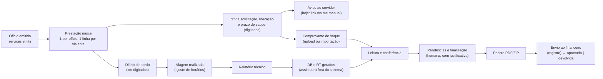
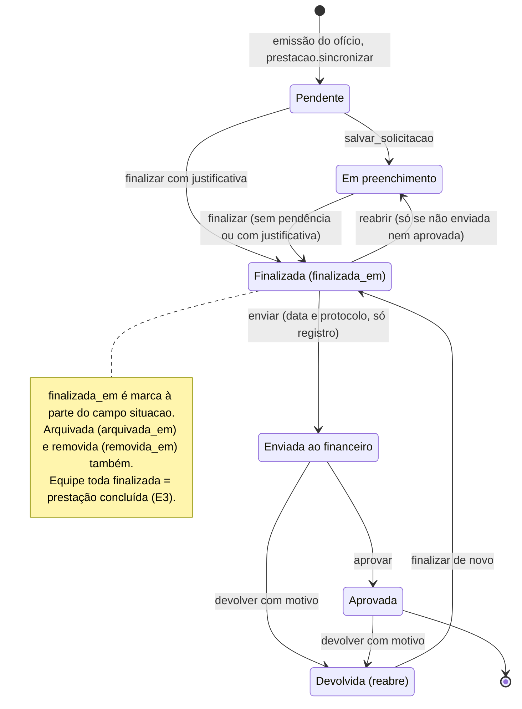
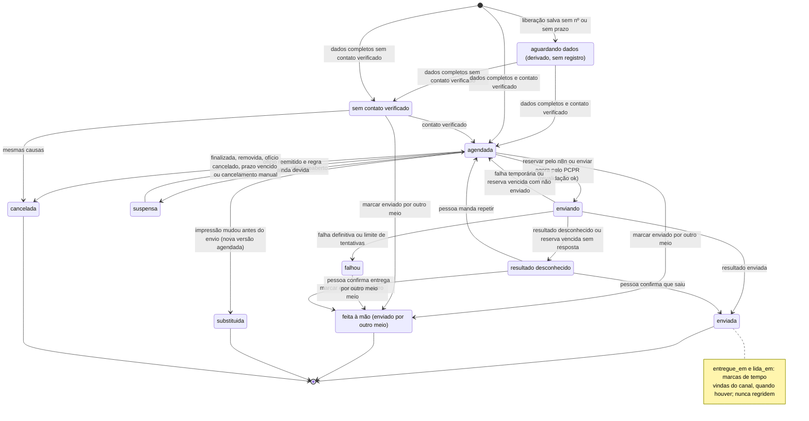
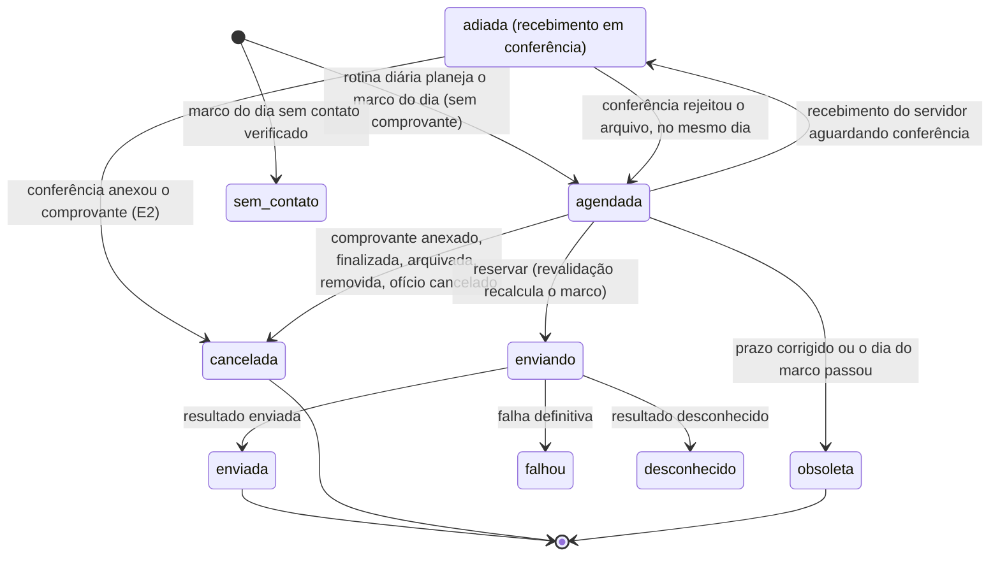
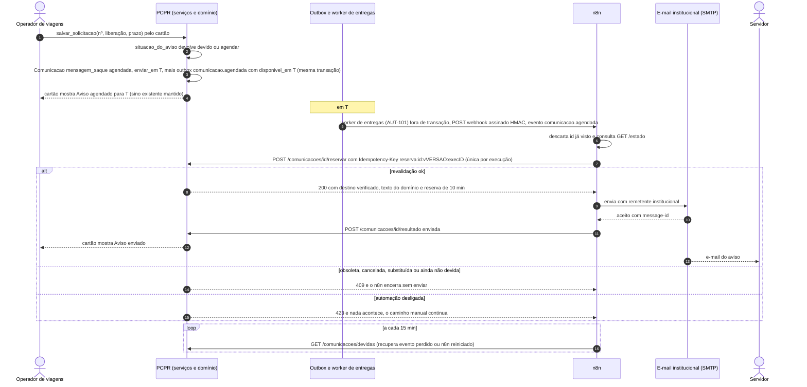
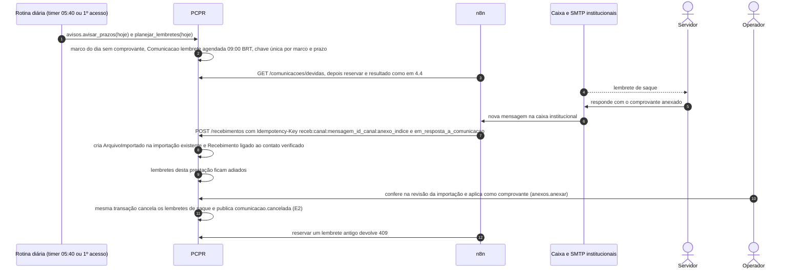

# 10.3 — Prestação de contas e aviso de liberação de diárias ("mensagem de saque")

> Fase 2 da missão de automação: desenho técnico de 17/10/2026. Bases: [arquitetura](../arquitetura.md),
> [envelope de evento](../contratos/evento-integracao.schema.json) e [API de automação](../contratos/api-automacao.v1.yaml).
> Marcação: **[existe]** código executando hoje · **[parcial]** · **[novo]** a desenvolver.
> Evidências `caminho:linha` foram conferidas no código em 17/10/2026. GV e EV são referências **somente
> leitura**, usadas só para entender o processo real: nenhum código, template ou texto foi copiado para o sistema.

**Resumo.** No código não há um objeto chamado "mensagem de saque". O que existe é o **aviso de liberação
de diárias**, montado como link `wa.me` que o operador abre à mão (`gestao/viagens/views_prestacao.py:176-191`).
O desenho mantém o **registro humano da liberação** como único gatilho (`prestacao.salvar_solicitacao`). O texto
passa a sair de uma **função de domínio testada, sem IA**. O PCPR decide quando o aviso fica devido e guarda o
estado de cada comunicação. O n8n só transporta pelo canal institucional (e-mail; a plataforma oficial do WhatsApp
está bloqueada para a PCPR pela política da Meta, maturidade 5, ver [whatsapp-viabilidade.md](../whatsapp-viabilidade.md)).
O WhatsApp é prioridade do usuário: já, o aviso sai também pela frente **WA-1** do
[plano](../plano-implantacao.md) (mesmo texto no `wa.me` aberto pelo operador no aparelho institucional, com registro
"enviado por WhatsApp manual"); a WA-2 consulta a Meta e a WA-3 deixa a integração oficial pronta e desligada. Os lembretes de
saque ao servidor terminam quando o **comprovante** é anexado. Em tudo há um caminho manual equivalente.

---

## 1. Objetivo e resultado para o usuário

**Objetivo:** cada servidor com diárias liberadas recebe pelo canal institucional, no dia em que o dinheiro fica
disponível, um aviso com os dados certos: nº do ofício, data de liberação, prazo limite de saque e o que fazer
depois. Enquanto não houver comprovante, ele recebe também lembretes antes do prazo vencer. O operador não
precisa lembrar de avisar ninguém, mas continua dono de cada dado e de cada decisão.

| Quem | Hoje | Com o fluxo |
|---|---|---|
| Operador de viagens | Digita nº/liberação/prazo; abre o menu ⋮ de cada servidor e envia pelo WhatsApp do próprio aparelho; lê no sino "saque vence em N dias" e cobra o servidor por fora | Digita os mesmos três campos. O cartão mostra "Aviso agendado/enviado/sem contato/falhou". As exceções vão para uma fila com ação. Ele pode enviar agora, copiar o texto ou marcar "enviado por outro meio" |
| Servidor | Recebe (ou não) uma mensagem informal, com texto que varia conforme o operador | Recebe pelo canal institucional verificado o texto aprovado, com identidade da instituição. Recebe lembretes só enquanto falta o comprovante |
| Gestão / auditoria | Nenhum registro de quem foi avisado, quando e com quais dados | Cada comunicação tem estado, versão, destinatário, canal, horário e texto enviado |

**Fora do escopo** (cada item tem fluxo próprio ou é decisão humana): inferir liberação, pagamento ou saque;
calcular o prazo de saque; finalizar a prestação; enviar ao financeiro; enviar DB/RT para assinatura; link de
quilometragem; redigir o RT.

---

## 2. Estado atual com evidências

### 2.1 Visão geral da prestação (do nascimento ao financeiro)



| Etapa | Estado | Evidência no sistema novo | Referência em produção |
|---|---|---|---|
| Nascimento na emissão do ofício (1 `PrestacaoContas` por ofício, 1 `PrestacaoServidor` por viajante; quem sai da equipe é apagado ou marcado `removida_em`) | IMPLEMENTADO | `gestao/viagens/services.py:1073-1077`, `gestao/viagens/prestacao.py:39-60` | Igual (GV/EV) |
| Evento `viagens.oficio.emitido` na outbox | PARCIAL: o assinante só registra log | `gestao/viagens/assinantes.py:46-49` | — |
| Nº da solicitação, liberação e prazo limite de saque, digitados no cartão (autosave), com regra prazo ≥ liberação | IMPLEMENTADO (manual) | `gestao/viagens/prestacao.py:262-284`, `gestao/viagens/views_prestacao.py:311-343`, `gestao/viagens/models.py:1450-1452`, `:1478-1482` | GV e EV também digitam; nenhum calcula o prazo |
| Sino "Diárias liberadas … Avise o servidor" para a equipe de viagens da unidade (menos o autor) | IMPLEMENTADO (só usuários internos) | `gestao/viagens/prestacao.py:276`, `:282-283`, `:424-442`; teste `gestao/viagens/tests/test_prestacao.py:133-150` | — |
| Aviso de liberação ao servidor | PARCIAL: link `wa.me` sem validação, sem registro e sem teste | `gestao/viagens/views_prestacao.py:176-191`, `:225`; `gestao/viagens/templates/viagens/prestacao/_cartao.html:97` | GV: validações + texto institucional; EV: texto simples (ver 2.3) |
| Rotina diária: saque vence em N≤3 dias / vencido (sem comprovante), prestação vencida (prazo + 3 dias úteis), documentos gerados/recebidos, equipe chegou | IMPLEMENTADO (só para a equipe interna) | `gestao/viagens/avisos.py:47-87`, `:90-114`; `gestao/viagens/apps.py:17-18`; `gestao/plataforma/rotinas.py:30-61`; `deploy/systemd/pcpr-rotinas@.timer:5`; `gestao/viagens/dominio/prestacao.py:17-18`, `:85-130` | EV: igual, mais "amanhã sai a viagem" (`ref/ev-implantado/viagens_prestacoes/avisos.py:124-166`) |
| Diário de bordo (km por trecho, motorista, viatura) | IMPLEMENTADO (o operador digita) | `gestao/viagens/diario.py`, `gestao/viagens/models.py:1500-1575` | EV: link de campo para o motorista (fluxo próprio) |
| Viagem realizada (recalcula a diária) | IMPLEMENTADO | `gestao/viagens/realizado.py:61-131` | — |
| Relatório técnico | IMPLEMENTADO | `gestao/viagens/models.py:1578-1602`, `gestao/viagens/relatorio.py` | — |
| DB e RT gerados sob demanda; envio para assinatura | IMPLEMENTADO / INEXISTENTE | `gestao/viagens/prestacao_texto.py`; nenhum estado de "enviado para assinar" | GV: assinatura por link (`ref/gv/prestacoes_contas/assinatura_services.py:1-9`); EV removeu |
| Comprovante (`AnexoPrestacao` tipo `comprovante`, com valor, data e operação) | IMPLEMENTADO; vindo da importação fica sem valor | `gestao/viagens/models.py:1605-1660`, `gestao/viagens/anexos.py:126-164`, `gestao/viagens/importacao.py:306-313` | — |
| Leitura e conferência (dados copiáveis, leitura do comprovante) | PARCIAL (só PDF com texto) | `gestao/viagens/views_prestacao.py:430-499`, `gestao/viagens/leitura_anexos.py:179-245` | — |
| Pendências e finalização (com justificativa) | IMPLEMENTADO | `gestao/viagens/prestacao.py:127-156`, `:298-328`, `:337-364` | Igual |
| Pacote final por servidor / ZIP da equipe | IMPLEMENTADO | `gestao/viagens/pacote_prestacao.py:28-158` | — |
| Envio ao financeiro, aprovação, devolução | IMPLEMENTADO (só registro) | `gestao/viagens/prestacao.py:367-420` | — |
| "Prestação concluída" | PARCIAL: derivada (equipe toda finalizada), sem evento | `gestao/viagens/prestacao.py:204-205`, `gestao/viagens/prestacao_equipe.py:78-91` | — |
| Eventos da prestação para fora do sistema | INEXISTENTE | `gestao/plataforma/outbox.py` só tem 3 tópicos em uso | — |
| Contato do servidor | PARCIAL: só telefone; `Servidor` não tem e-mail e não é usuário | `gestao/cadastros/models.py:86-103`; `gestao/identidade/models.py:25-31` (nenhum campo liga `Usuario` a `Servidor`) | GV/EV: telefone |
| E-mail | PARCIAL: só avisos a usuários internos, desligado por padrão, console sem SMTP | `gestao/plataforma/notificacoes.py:54-60`, `config/settings/base.py:266-278` | — |

### 2.2 O aviso de liberação no sistema novo [parcial]

- `_whatsapp(ps, diaria)` (`gestao/viagens/views_prestacao.py:176-191`) monta `https://wa.me/55<telefone>?text=…`.
  O texto diz: "Olá, <primeiro nome>. As diárias do Ofício <nº> (<valor>) foram liberadas em <data>; o prazo para
  saque é <data>. Depois do saque, envie o comprovante para a prestação de contas."
- O link aparece quando existem `Servidor.telefone` e `data_liberacao_diarias`. Ele **não** exige o nº da
  solicitação nem o prazo, **não** impede liberação futura e **não** confere os 11 dígitos: só tira o que não é
  dígito e põe 55 na frente (`:179-181`).
- O valor vem de `prestacao.diaria_liberada(ps)` (`gestao/viagens/prestacao.py:109-124`). É um valor
  **calculado**, por servidor: o realizado quando a viagem foi ajustada, senão `diarias_calculo.por_servidor` do
  ofício, senão o total ÷ equipe. O valor que o financeiro liberou de fato não existe no sistema.
- Nada registra que o aviso saiu. Nenhum teste cobre o texto (busca por `whatsapp`/`wa.me` em
  `gestao/viagens/tests/` sem resultado).
- **Estado financeiro conhecido:** o sistema sabe só que a liberação e o prazo foram **digitados** e se há
  comprovante anexado. Ele não sabe se houve pagamento nem saque, e este desenho não infere nenhum dos dois.

### 2.3 O que a referência em produção faz (somente leitura)

- **GV (produção):** o menu do servidor tem "Enviar WhatsApp", "WhatsApp Business" e "Copiar". Antes de montar o
  texto, ele exige **nº da solicitação, data de liberação e prazo preenchidos e liberação ≤ hoje** (hoje pelo
  relógio do navegador): `ref/gv/static/js/pages/prestacoes-diaria-wa.js:25-30`, `:43-68`. O texto institucional
  (`:87-94`) traz o título de liberação de diárias, o ofício e a unidade, o evento (destino e período), o nome, o
  valor, a data de liberação e o prazo limite com a marca **"PRAZO IMPRORROGÁVEL"**. Termina com o aviso de que o
  saque não fica disponível no mesmo dia do desbloqueio do cartão. O telefone só vale com 11 dígitos
  (`ref/gv/prestacoes_contas/presenters.py:27-30`). Sem telefone, a mensagem explica que falta celular válido
  (`prestacoes-diaria-wa.js:127-129`). O valor é a diária recebida (override) ou o `valor_diarias` do roteiro
  (`presenters.py:283`), um total calculado do roteiro (`ref/gv/roteiros/models.py:81-83`, `:210-223`). É preciso
  confirmar se esse total corresponde ao valor por servidor. Nada é registrado.
- **EV (implantado):** texto simplificado, sem a marca de prazo improrrogável e sem o aviso do cartão. Quando não
  há telefone, monta `wa.me/?text=` sem número (`ref/ev-implantado/viagens_prestacoes/cartoes.py:60-79`).

### 2.4 Divergências e lacunas encontradas na conferência

1. **Aba "Saque vencendo" sem filtro de comprovante.** `prestacao.filtrar(…, "saque_vencendo")`
   (`gestao/viagens/prestacao.py:206-208`) lista todo prazo ≤ hoje + 3, vencidos e quem já tem comprovante
   incluídos. Já o texto de vazio diz "sem comprovante" (`gestao/viagens/views_prestacao.py:51`), e o selo
   (`gestao/viagens/dominio/prestacao.py:102`) e a rotina (`gestao/viagens/avisos.py:61`) excluem quem tem
   comprovante. A regra de lembrete deste desenho segue o selo e a rotina, e a aba precisa ser alinhada a eles.
2. **O sino "Diárias liberadas" dispara com liberação futura** e pede "Avise o servidor" antes da hora
   (`gestao/viagens/prestacao.py:436-442`). Ele também só dispara na transição vazio → data (`:276`): trocar a data
   de X para Y não avisa, e apagar e redigitar avisa de novo.
3. **O autosave grava campo a campo** (`gestao/viagens/views_prestacao.py:335-343` chama
   `salvar_solicitacao` com os três campos a cada alteração). Por isso existem estados intermediários, como uma
   liberação digitada com o prazo ainda vazio. Daí a **carência** antes do envio (seção 8).
4. **Outbox** (`gestao/plataforma/outbox.py`): `publicar()` **não aceita** `disponivel_em` e grava sempre
   `timezone.now()` (`:54-62`), embora o worker respeite o campo (`:83-85`). O backoff efetivo é 10, 20, 40, 80,
   160, 320 e 640 s, e na 8ª falha a mensagem vira `FALHOU` (`:72-73`, `:92`, `:108-111`). A janela total fica em
   torno de **21 min**, e o teto de 1 h da fórmula nunca é atingido. Por isso a consulta de reconciliação
   (`/comunicacoes/devidas`) é obrigatória, não opcional.
5. **Prestação sem histórico de negócio:** os serviços de `prestacao.py` não gravam `Historico`; só a trilha de
   auditoria do banco registra as mudanças. Além disso, `prestacao.enviar` usa `.update()` (`:386-389`), o que
   inviabiliza uma "versão" baseada em `save()`.
6. **Não há canal institucional para o servidor:** `Servidor` só tem telefone (`gestao/cadastros/models.py:103`).
   Não há e-mail nem vínculo com `Usuario`, e o portal do servidor não existe.

---

## 3. Gatilho, regra de "devido" e eventos de conclusão

### 3.1 Gatilho real

O **único** gatilho do aviso é o **registro humano** da liberação pelo serviço existente
`prestacao.salvar_solicitacao(usuario, ps_pk, numero, liberacao, prazo)` (`gestao/viagens/prestacao.py:267-284`),
chamado pelo cartão (`views_prestacao._gravar_cartao`, `:311-318`). Nunca é inferido de datas, de e-mails do
financeiro, de leitura de documentos ou de IA. Se um dia houver importação da fonte oficial (seção 13), ela
**propõe** valores e uma pessoa confirma. O gatilho continua sendo o `salvar_solicitacao` dessa pessoa.

A rotina diária existente (`avisos.avisar_prazos`) é o gatilho dos **lembretes**. Ela só lê datas que uma pessoa
registrou e não cria fato novo.

### 3.2 Quando o aviso fica devido [novo — função de domínio]

Função pura em `gestao/viagens/dominio/aviso_liberacao.py` (sem Django), chamada **dentro da mesma transação** de
`salvar_solicitacao` e de todo serviço que mude uma das condições abaixo:

```python
def situacao_do_aviso(d: DadosAviso, hoje: date) -> SituacaoAviso: ...
# SituacaoAviso.estado ∈ {"devido", "agendar", "aguardando_dados", "bloqueado"}; .a_partir_de; .motivos
```

| # | Condição | Se falhar |
|---|---|---|
| 1 | `numero_solicitacao` preenchido (após `strip`) | `aguardando_dados` — "Falta o nº da solicitação" |
| 2 | `data_liberacao_diarias` preenchida | `aguardando_dados` — "Falta a data de liberação" |
| 3 | `prazo_limite_saque` preenchido (≥ liberação já garantido por constraint, `models.py:1478-1482`) | `aguardando_dados` — "Falta o prazo de saque" |
| 4 | liberação ≤ hoje (data local America/Sao_Paulo) | `agendar` para a data de liberação (seção 8). Não é bloqueio |
| 5 | prestação do servidor ativa: não removida, não finalizada, não arquivada (arquivada: a confirmar, decisão D9) | `bloqueado` |
| 6 | ofício `EMITIDO` (`policies.prestacoes_visiveis`, `gestao/viagens/policies.py:585-594`) | `bloqueado` (reaberto: suspensa até nova emissão; cancelado: cancelada) |
| 7 | prazo de saque ≥ hoje | `bloqueado`: "prazo já vencido". O aviso de liberação não sai depois do prazo, e o caso vai para o operador (decisão D7) |

`devido` = 1–7 atendidas. O **canal** não entra na regra: sem contato verificado, a comunicação nasce em
`sem_contato` (seção 4.2), e o caso aparece para o operador com as ações manuais.

### 3.3 Texto como função de domínio testada [novo]

```python
def mensagem_liberacao(d: DadosAviso, *, retifica: DadosAviso | None = None) -> Mensagem: ...
# Mensagem(assunto, blocos, variaveis); renderizadores: para_email(m), para_copiar(m), para_whatsapp(m)
# para_whatsapp: texto do wa.me da WA-1 (envio assistido com registro); envio pela plataforma oficial só após o portão da WA-3
def impressao(d: DadosAviso) -> str: ...  # sha256 dos campos INFORMADOS que entram no texto
```

- **Sem IA.** O texto é fixo, aprovado pelo usuário (decisão D1). O candidato é o do GV (2.3), adaptado ao canal: o
  e-mail sai sem a marcação `*negrito*` do WhatsApp. O conteúdo tem título, ofício e unidade emissora, evento
  (destino e período), nome, valor (decisão D2), data de liberação, prazo limite ("PRAZO IMPRORROGÁVEL"), aviso
  sobre o desbloqueio do cartão e a instrução de envio do comprovante (hoje só no texto do sistema novo; decisão D1).
- **Variáveis vêm do sistema:** `oficio.numero_formatado`, destinos e período (como `_bloco` monta,
  `views_prestacao.py:241-245`), `servidor.nome`, as três datas/nº e a unidade da configuração institucional. O
  texto **nunca** traz CPF, dados bancários ou telefone.
- **`impressao`** cobre só o que uma pessoa informou: nº, liberação e prazo, mais o valor **se** ele vier a ser um
  campo informado (D2). Uma mudança na diária **calculada** (viagem realizada, `realizado.py:126-131`) não altera
  o que foi liberado, então não gera "dados alterados após envio".
- **Testes de domínio [novo]:** snapshot do texto aprovado; sem nº → `aguardando_dados`; liberação amanhã →
  `agendar` com data; prazo vencido → `bloqueado`; nome com acento e ofício "12/2026" renderizados; impressão
  estável (mesmos dados → mesmo hash) e diferente quando o prazo muda; telefone de 10 dígitos → inválido para
  WhatsApp (regra do GV). O `_whatsapp` atual passa a usar essa função (paridade com o GV no caminho manual).

### 3.4 Lembretes ao servidor: quando ficam devidos [novo]

Função pura `marco_do_saque(prazo, hoje, *, tem_comprovante, finalizada, arquivada, dias_aviso) -> Marco | None`.
Ela usa as mesmas regras do selo existente (`dominio/prestacao.py:100-113`):

| Marco | Quando | Texto (a aprovar) |
|---|---|---|
| `saque_d{N}` | prazo − hoje = N, com N ∈ dias configurados (padrão do código: `DIAS_AVISO_SAQUE = 3`, `dominio/prestacao.py:18`) | "Seu prazo de saque das diárias do Ofício … vence em N dias (dd/mm)" |
| `saque_hoje` | prazo = hoje | "… vence hoje" |
| `saque_vencido` | prazo = ontem (uma vez só) | "… venceu em dd/mm; procure a equipe de viagens" (D6) |
| `prestacao_vencida` | `prazo_para_prestar(prazo) < hoje` (`dominio/prestacao.py:85-86`) | **Só interno** (sino existente), salvo decisão D6. A pendência pode ser do operador, não do servidor |

Regras: (a) com comprovante ativo (`AnexoPrestacao`, tipo `comprovante`, `removido_em` nulo), finalizada,
arquivada ou removida, **nenhum** marco; (b) no mesmo dia de um aviso de liberação agendado ou enviado, nenhum
lembrete, porque o aviso já traz o prazo; (c) um marco só é planejado **no próprio dia** e um marco passado nunca
sai atrasado; (d) com um recebimento do servidor aguardando conferência (seção 4.5), os lembretes ficam **adiados**.

### 3.5 Definição precisa dos eventos de conclusão

- **E1, aviso concluído:** existe uma `Comunicacao` tipo `mensagem_saque`, **vigente** (não substituída nem
  cancelada), em `enviada` (pelo canal ou pelo "enviar agora" do PCPR) ou em `feita_a_mao` ("enviado por outro
  meio", com o registro de quem marcou), cuja
  `impressao_dados` é **igual** à impressão atual. Se a impressão mudou depois do envio, o estado derivado é
  "enviado com dados anteriores" e o aviso deixa de estar concluído até uma pessoa enviar a retificação ou
  dispensá-la com motivo. "Entregue" e "lida" são informativos e não fazem parte da conclusão (o e-mail
  normalmente não informa).
- **E2, cobrança de saque encerrada:** passa a existir comprovante ativo da prestação do servidor, ou ela é
  finalizada, arquivada ou removida. Na **mesma transação** de `anexos.anexar`, `prestacao.finalizar`,
  `prestacao.arquivar` ou `prestacao.sincronizar`, os lembretes `agendada`/`sem_contato` dessa prestação viram
  `cancelada` com motivo. O comprovante prova **que há documento anexado**, não que o valor está certo. A
  divergência soma ≠ diária continua sendo pendência interna (`anexos.divergencia`, `anexos.py:99-109`).
- **E3, prestação concluída** (visão geral): a transição de "há `PrestacaoServidor` ativa sem `finalizada_em`"
  para "nenhuma", em `prestacao.finalizar` ou `acao_da_equipe`. Publica `prestacao.concluida` (tópico que já está
  no contrato) com a chave `prestacao-concluida:<prestacao_id>:<n>`, onde n conta quantas vezes a prestação foi
  concluída, para permitir reconclusão depois de reabrir ou devolver. Isso não muda a regra de finalização, que
  continua humana.

---

## 4. Diagramas

### 4.1 Estados da prestação do servidor (existente; o aviso não altera essas transições)



### 4.2 Estados da comunicação "aviso de liberação" [novo]

Os nomes seguem a máquina comum da `Comunicacao` (AUT-01; [10-2 §4.2](10-2-envio-de-documentos.md)):
`agendada`, `sem_contato`, `enviando`, `enviada`, `falhou`, `desconhecido`, `cancelada`, `substituida` e
`feita_a_mao`, com a `origem` (`automatica`, `pcpr_agora`, `outro_meio`) num campo à parte. Este fluxo acrescenta
`suspensa` (ofício reaberto) e, nos lembretes, `adiada` e `obsoleta` (seção 4.3); essas três ainda precisam entrar
na definição comum do AUT-01. Entrega e leitura são **marcas de tempo** (`entregue_em`, `lida_em`), não estados.



"Enviado com dados anteriores" é **derivado** (impressão atual ≠ impressão da enviada) e só abre a ação humana
"Enviar retificação", que cria outra `Comunicacao` com `substitui` apontando para a anterior.

### 4.3 Estados de um lembrete de saque [novo]



### 4.4 Sequência: aviso de liberação



### 4.5 Sequência: lembrete, comprovante e encerramento



---

## 5. Responsabilidades

| Componente | Faz | **Não** faz |
|---|---|---|
| **Sistema PCPR** | Guarda nº/liberação/prazo; decide pela função de domínio se o aviso está devido e quando; gera o texto; cria, versiona, suspende e cancela `Comunicacao`; revalida tudo na reserva; mantém contato verificado, fila de exceções e chave de desligamento; encerra lembretes quando entra o comprovante; mostra o estado no cartão | Depender do n8n para funcionar; inferir pagamento ou saque; calcular o prazo de saque; mandar mensagem a quem não é o titular |
| **Outbox/worker** [existe] + **worker de entregas** [novo, AUT-101] | A outbox grava o evento no tópico `integracao.evento`, cujo assinante só cria a `EntregaEvento`; o worker de entregas com lease (`processar_entregas`) faz o POST ao n8n fora de transação (pelo menos uma vez). A outbox também envia o e-mail no caminho manual "enviar agora" (`plataforma.email.enviar`) | Regra de canal; reter dados pessoais no payload; HTTP dentro da transação do assinante |
| **n8n** | Recebe o evento, consulta `devidas` a cada 15 min, reserva, envia pelo SMTP institucional com até 3 tentativas curtas, registra resultado e status de entrega, recebe respostas com anexo e repassa a `/recebimentos`, abre exceções, alerta falhas | Gravar no banco; montar ou alterar texto; escolher destinatário ou canal; decidir data de envio diferente da do PCPR; reenviar resultado desconhecido; guardar documento ou contato além da execução (retenção só de erros) |
| **IA** | Neste fluxo, **nada essencial**. O assistente pode responder "quem ainda não sacou?" com ferramentas de leitura e a política do próprio usuário (sessão ou token pessoal) ou do usuário de uma delegação emitida pelo PCPR (`X-PCPR-Delegacao`). No futuro (maturidade 4) pode **propor** nº/liberação/prazo lidos de um e-mail do financeiro, para uma pessoa confirmar | Redigir ou variar o aviso; inferir pagamento, liberação ou saque; decidir lembrete; ler comprovante com CPF ou dados bancários em provedor externo (ADR 0041); criar ou enviar comunicação |
| **Operador de viagens** | Digita os três dados a partir da fonte oficial; confere exceções; envia manualmente quando preciso; decide retificação; confere e anexa comprovantes; finaliza; registra o envio ao financeiro | — |
| **Servidor** | Confirma o próprio contato (código); saca ou transfere; devolve o comprovante pelo canal indicado | — |
| **Gestão/usuário** | Aprova o texto, a janela e os marcos; liga e desliga a automação por fluxo | — |

---

## 6. Contratos

### 6.1 Eventos usados (de `evento-integracao.schema.json`)

| Tipo | Quando o PCPR publica | `recurso` | `dados` (só para rotear) |
|---|---|---|---|
| `comunicacao.agendada` | `Comunicacao` criada ou reagendada em `agendada` (aviso ou lembrete) | `{tipo: comunicacao, id, versao}` | `comunicacao_id`, `fluxo`, `tipo_comunicacao` (`mensagem_saque` \| `lembrete_pendencia`), `enviar_em` com fuso -03:00 |
| `comunicacao.cancelada` | Substituída, suspensa, cancelada ou obsoleta | idem | `comunicacao_id`, `fluxo`, `motivo` (o contrato unificou o antigo `motivo_codigo` em `motivo`) |
| `prestacao.documento_recebido` | Comprovante anexado (opcional para observabilidade; o n8n não precisa dele para encerrar lembretes, porque o PCPR já cancela) | `{tipo: prestacao, id: PrestacaoContas, versao}` | `prestacao_servidor_id`, `tipo_documento: comprovante`, `origem` |
| `prestacao.concluida` | E3 | idem | `prestacoes_servidor: n` |
| `automacao.desligada` / `automacao.religada` | Chave geral ou do fluxo alterada | `chave_automacao` | `fluxo` |

O `correlacao_id` é `prestacao:<PrestacaoContas.id>`. Os eventos de aviso e lembrete usam `causa_id` para ligar
uma substituição à comunicação anterior.

### 6.2 Endpoints usados (de `api-automacao.v1.yaml`)

`GET /estado` · `GET /comunicacoes/devidas` · `POST /comunicacoes/{id}/reservar` ·
`POST /comunicacoes/{id}/resultado` · `POST /comunicacoes/{id}/entrega` · `POST /recebimentos` ·
`GET /recebimentos/{id}` · `POST /excecoes` (motivos `canal_indisponivel`, `resultado_desconhecido`,
`destinatario_sem_contato`, `contato_nao_verificado`, `limite_tentativas`) · `GET /ferramentas` e
`POST /ferramentas/{nome}/executar` (só ferramentas de leitura, abaixo).

### 6.3 Extensões necessárias [novo]

| Nome | Campos / forma | Regra de idempotência |
|---|---|---|
| `recurso.tipo` += `prestacao_servidor` | Permite eventos por servidor (o aviso é individual) | — |
| `ComunicacaoResumo` / `ComunicacaoReservada` += `alvo`, `marco`, `substitui` | `alvo: {tipo: "prestacao_servidor", id}`; `marco: saque_d{N} \| saque_hoje \| saque_vencido \| null`; `substitui: id \| null` | — |
| `Erro.codigo` += `ainda_nao_devida` | 409 na reserva antes de `enviar_em`, com `disponivel_em` na resposta | Repetir antes da hora devolve o mesmo 409 |
| `Erro.codigo` += `suspensa` | 409 quando o ofício está reaberto ou há recebimento em conferência | — |
| `EstadoAutomacao.fluxos` com as chaves `saque-aviso` e `saque-lembretes` | Interruptores independentes (sem mudança de esquema, só valores) | — |
| Evento `prestacao.liberacao_registrada` (**opcional**, para métricas e consumidores futuros; o n8n não precisa) | `recurso: {prestacao_servidor, id, versao}`; `dados: {campos_alterados: [numero\|liberacao\|prazo], primeira: bool, situacao_aviso, liberacao, prazo}` (datas de negócio, sem dado pessoal) | Chave da outbox `liberacao:<ps>:<impressao[:16]>`: regravar os mesmos dados não publica (já há retorno antecipado em `prestacao.py:273-275`) |
| `outbox.publicar(…, disponivel_em=None)` (interno) | Agenda a entrega do evento para `enviar_em` | A chave de idempotência continua a mesma. Reagendar = nova versão com nova chave `comunicacao:<id>:v<versao>:agendada` |
| Entrega ao n8n (comum a todos os fluxos): tópico `integracao.evento` → `EntregaEvento` → worker de entregas com lease (`processar_entregas`, AUT-100/AUT-101; [arquitetura §2](../arquitetura.md)) | O assinante do tópico só grava a `EntregaEvento`; o worker faz o POST assinado HMAC-SHA256 com carimbo de tempo **fora de transação** | `id` do evento estável nas reentregas |
| Chaves de idempotência deste fluxo | Reserva `reserva:<comunicacao>:v<versao>:exec<id da execução>` — **única por tentativa** (contrato `reservar`; arquitetura §3.3); resultado `resultado:<comunicacao>:<token da reserva>` (contrato; a ficha AUT-104 propõe usar `sha256(token)[:16]` para não guardar credencial na chave — proposta não incorporada ao rascunho 3); entrega `entrega:<comunicacao>:<provedor_mensagem_id>:<status>`; recebimento `receb:<canal>:<mensagem_id_canal>:<anexo_indice>` (o rascunho 3 descreve `mensagem_id_canal` como o `Message-ID`; o [10-6](10-6-recebimento-de-documentos.md) E1 propõe o identificador dado pelo servidor IMAP — proposta não incorporada); exceção `excecao:saque:<comunicacao>:<motivo>` | Resultado, entrega, recebimento e exceção: repetição devolve o mesmo registro, sem efeito novo (`Idempotency-Replayed: true`). Reserva: outra execução recebe 409 |
| Ferramenta de leitura `prestacao.aviso_liberacao` (ADR 0020) | Entrada `prestacao_servidor_id` → `{situacao, motivos, texto, impressao, comunicacao_vigente}` com a policy `pode_ver_prestacao` do usuário da sessão, do token pessoal ou da delegação | Leitura: sem efeito |
| Ferramenta de leitura `prestacao.pendencias_resumo` | `unidade_id` → pendências por equipe (reusa `prestacao.pendencias` e `prestacao_equipe.conferencia`), para o resumo diário opcional ao operador | Leitura |
| Ações de tela (sessão/CSRF, não API) | `prestacoes/<pk>/aviso/{enviar-agora,copiar,marcar-enviado,cancelar,retificar}/` | `enviar-agora` usa chave própria por requisição e passa pela mesma transição `agendada → enviando`: o n8n e a tela nunca enviam os dois |

---

## 7. Modelo de dados e permissões

### 7.1 Entidades [novo]

As entidades comuns ficam num app novo `gestao/automacao/`, que não importa `viagens`. As regras específicas do
fluxo ficam em `gestao/viagens/`, que registra um **revalidador** por tipo de comunicação, no mesmo padrão de
registro de assinantes da outbox (`outbox.assinante`). A direção dos imports precisa passar pelo import-linter.

| Entidade | Campos mínimos | Observações |
|---|---|---|
| `Comunicacao` (comum) | `tipo`, `estado`, `versao`, `alvo_tipo`/`alvo_id` (`prestacao_servidor`), `destinatario` (FK `cadastros.Servidor`), `contato` (FK `ContatoVerificado`, nulo em `sem_contato`), `canal`, `enviar_em`, `marco`, `chave_negocio` (única), `impressao_dados`, `variaveis` (JSON), `texto_enviado` (cópia do que saiu), `substitui` (FK self), `origem` (`automatica`\|`pcpr_agora`\|`outro_meio`), `registrado_por` (FK usuário, nulo se automática), `reserva_token_hash`, `reserva_expira_em`, `tentativas`, `provedor`, `provedor_mensagem_id`, `enviada_em`, `entregue_em`, `lida_em`, `cancelada_em`, `motivo`, `correlacao_id`, `criado_em` | Índice (`estado`, `enviar_em`) para `devidas`. Unicidade parcial: **uma** `mensagem_saque` vigente por `alvo` (`estado` fora de `substituida`/`cancelada`). `chave_negocio` dos lembretes: `lembrete-saque:<ps>:<marco>:<prazo>` |
| `ContatoVerificado` (comum) | `servidor`, `canal` (`email`; `whatsapp` com opt-in preparado pela frente WA-3, mas, com o canal `bloqueado`, nenhum contato desse canal é verificado para envio automático — whatsapp-viabilidade §5.2; a WA-1 usa o telefone do cadastro só para montar o `wa.me` aberto pelo operador), `endereco`, `verificado_em`, `metodo` (`codigo`\|`conferido_por_operador`), `verificado_por`, `consentimento_em`, `revogado_em`, `ultima_falha_em`, `origem` | Um endereço ligado a dois servidores bloqueia os dois (exceção). Endereço digitado numa conversa não autoriza nada |
| `ExcecaoAutomacao` (comum) | `fluxo` (`saque-aviso`\|`saque-lembretes`), `correlacao_id`, `comunicacao` (FK), `motivo`, `detalhe`, `dono` (grupo `OPERADOR_VIAGENS` da unidade), `prazo`, `estado` (`aberta`\|`resolvida`), `resolucao` (`repetir`\|`feito_a_mao`\|`dispensado`), `resolvido_por`, `execucao_orquestrador` | Também aparece no cartão do servidor |
| `ChaveAutomacao` (comum) | `fluxo` (ou geral), `ligada`, `motivo`, `alterada_por`, `parametros` (JSON: janela de envio, hora do aviso futuro, hora dos lembretes, carência, `dias_aviso`) | Os parâmetros ficam em dados, não em código, porque dependem das decisões D3–D5 |
| `Recebimento` (comum, compartilhado com o fluxo de recebimento) | `canal`, `mensagem_id_canal`, `contato`, `comunicacao` (em resposta a), `importacao` (FK `ArquivoImportado`), `estado`, `sha256` | Sugere o destino (a prestação do servidor) na revisão da importação, mas não aplica sozinho |
| Usuário de serviço da automação | `Usuario` técnico sem login interativo | `ArquivoImportado.usuario` é obrigatório (`gestao/viagens/models.py:1859`); o comprovante é aplicado pelo usuário humano que confere |
| `PrestacaoServidor.versao` (só se o evento opcional `prestacao.liberacao_registrada` for adotado) | inteiro incrementado nos serviços | Precisa ser incrementado também nos `.update()` (`prestacao.py:386-389`) com `F("versao") + 1` |

Nenhuma mudança é obrigatória em `PrestacaoServidor` nem em `AnexoPrestacao`: a revalidação compara a
`impressao_dados`, não uma versão da linha.

### 7.2 Serviços e ganchos [novo], em `gestao/viagens/comunicacoes_prestacao.py`

| Função | Chamada por (mesma transação) | Efeito |
|---|---|---|
| `planejar_aviso(ps)` | `prestacao.salvar_solicitacao` (depois do `save`), `prestacao.sincronizar` (reemissão), mudança em `ContatoVerificado` | Cria, substitui, suspende ou cancela a `mensagem_saque` vigente conforme `situacao_do_aviso` e `impressao`. Já existe enviada com a mesma impressão → nada |
| `planejar_lembretes(hoje)` | Rotina diária registrada ao lado de `avisos.avisar_prazos` (`apps.py:17-18`) | Para cada prestação aberta de ofício emitido: marco do dia → `Comunicacao` com `chave_negocio` única (`get_or_create`) |
| `encerrar_lembretes(ps, motivo)` | `anexos.anexar` e `anexos.restaurar` quando o tipo é `comprovante`, `prestacao.finalizar`, `prestacao.arquivar`, `prestacao.sincronizar` (removida) | `agendada`/`sem_contato`/`adiada` → `cancelada` + `comunicacao.cancelada` |
| `suspender_do_oficio(oficio)` / `cancelar_do_oficio(oficio)` | `services.reabrir` / `services.cancelar` (`gestao/viagens/services.py:1082`, `:1156`) | `agendada` → `suspensa` / `cancelada` |
| `revalidar(comunicacao)` (registrado no app `automacao`) | `POST /reservar` e a ação "enviar agora" | Recalcula situação, impressão, marco, destinatário, contato, chave e recebimento pendente → conteúdo ou 409 |

`anexos.remover` de um comprovante **não** recria lembretes na hora: a rotina do dia seguinte planeja o marco
corrente, se ainda houver.

### 7.3 Permissões (policies) [novo]

Em `gestao/viagens/policies.py`, reaproveitando as existentes (`:585-626`):

```python
def pode_ver_comunicacoes_prestacao(usuario, ps) -> bool:
    return pode_ver_prestacao(usuario, ps)

def pode_comunicar_servidor(usuario, ps) -> bool:  # enviar agora, copiar, marcar, cancelar, retificar
    return pode_editar_prestacao(usuario, ps)      # change_prestacaoservidor + unidade + EMITIDO + ativa
```

Em `gestao/cadastros/policies.py`: `pode_registrar_contato(usuario, servidor)` = `cadastros.change_servidor`. O
contato só vale depois de verificado pelo próprio titular (código) ou conferido por operador (D8). Token de serviço
do n8n (token de transporte do contrato): escopos `estado:ler`, `comunicacoes:ler`, `comunicacoes:reservar`,
`comunicacoes:resultado`, `comunicacoes:entrega`, `recebimentos:criar`, `recebimentos:ler` e `excecoes:criar`. Ele **não** tem escopo para `salvar_solicitacao`,
anexos ou finalização. O destinatário é sempre o titular da `PrestacaoServidor`, nunca outra pessoa.

### 7.4 Tela [novo]

No cartão do servidor (`templates/viagens/prestacao/_cartao.html`), o item "Avisar por WhatsApp" passa a ser o envio
assistido da WA-1 (abre o `wa.me` com o texto de A1 e pede a confirmação que registra o envio) e ganha ao lado um
chip "Aviso ao servidor" (aguardando dados / agendado para … / enviado em … / enviado com dados anteriores / sem
contato / falhou), com as ações da seção 10. O componente nasce no UI Lab, ganha estados vazio e erro, passa no
axe e cabe de 360 a 1440 px. As comunicações entram em `gestao/viagens/demonstracao.py` para avaliação no preview.

---

## 8. Regras de tempo (America/Sao_Paulo)

- **Datas de negócio** (`hoje`) vêm de `timezone.localdate()` com `TIME_ZONE = "America/Sao_Paulo"`
  (`config/settings/base.py:167`), no servidor e não no navegador (diferente do GV). Instantes são gravados em UTC
  e os eventos levam o fuso -03:00 explícito em `dados`. O código usa `zoneinfo` mesmo sem horário de verão.
- **Aviso com liberação ≤ hoje:** `enviar_em = agora + carência` (proposta: **15 min**, parâmetro), para que
  correções feitas durante o autosave substituam a versão antes do envio. Fora da janela de envio, vale o início
  da próxima janela.
- **Aviso com liberação futura:** `enviar_em = liberação às HH:MM` (proposta **08:00**, D3), ajustado à janela.
- **Janela de envio:** parâmetro (proposta: todos os dias, 08:00–20:00, porque o prazo é improrrogável; D4). Nunca
  de madrugada.
- **Lembretes:** a rotina roda às 05:40 **no fuso do host** (`deploy/systemd/pcpr-rotinas@.timer:5`; em UTC
  seriam 02:40 BRT, a confirmar) ou no primeiro acesso do dia (`gestao/plataforma/rotinas.py:45-61`). Ela só
  **planeja**: `enviar_em` = hoje às 09:00 BRT (proposta, D5) ou `agora + carência` se já passou, sempre dentro da
  janela. O fuso do host deixa de importar para o envio.
- **Marcos:** `saque_d{N}` com N em `dias_aviso` (padrão 3, `dominio/prestacao.py:18`); `saque_hoje`;
  `saque_vencido` em D+1. Cada marco vale só no próprio dia: se o envio não acontecer até 23:59 do dia, a reserva
  dá 409 e o marco fica `obsoleta`.
- **Prazo para prestar** = prazo de saque + 3 dias úteis, com sábado, domingo e feriados nacionais fixos e móveis
  (`dominio/prestacao.py:17`, `:38-43`, `:85-86`). Feriados estaduais e municipais não entram, porque o cadastro
  não existe (D12).
- **Reserva:** 10 min (contrato). **Reconciliação:** a cada 15 min. Latência esperada: p95 ≤ 20 min depois de
  `enviar_em`.

---

## 9. Falhas e recuperação

| Cenário | Detecção | Efeito | Recuperação |
|---|---|---|---|
| **Evento duplicado** (o worker de entregas reentrega `comunicacao.agendada`) | O n8n já viu o `id`; senão, a segunda execução chega a `reservar` com outra `Idempotency-Key` (a chave inclui o id da execução) e encontra a comunicação já `enviando`/`enviada` | Nenhum | O n8n descarta. Se não descartar, `reservar` devolve 409 `ja_processada` à segunda execução (cenário T2c do protótipo) e ela encerra sem enviar: uma mensagem só. Uma chave estável devolveria a mesma reserva às duas execuções, e as duas enviariam |
| **Serviço indisponível: PCPR** | O n8n recebe 5xx ou tempo esgotado | A comunicação continua `agendada` | O n8n tenta 3 vezes e espera a próxima consulta `devidas`. Acima de 2 h de atraso, alerta de monitoramento |
| **Serviço indisponível: SMTP/canal** | O n8n registra `resultado = falha_temporaria` | Volta a `agendada` com backoff | No limite de tentativas: `falhou` + exceção `canal_indisponivel`; o cartão oferece "enviar agora" e "copiar" |
| **Serviço indisponível: webhook do n8n** | O worker de entregas (AUT-101) não recebe 2xx; a `EntregaEvento` fica pendente, com retentativa de horas (a outbox atual, sozinha, desistiria em ~21 min). O monitor da VPS já alerta mensagens de outbox paradas ou em `falhou` (`deploy/vps/monitorar.sh:58-66`) | Nenhuma perda: o estado está na `Comunicacao` | `devidas` recupera quando o n8n voltar |
| **Reinício do n8n** (no meio de uma execução) | A reserva vence sem resultado | Sem resultado, não há como saber se saiu | `resultado_desconhecido` + exceção. **Não reenvia às cegas**: uma pessoa confere a caixa de saída e marca "saiu" ou "repetir" |
| **Retentativa após sucesso parcial** (SMTP aceitou e o `resultado` falhou) | O n8n repete o `resultado` com a mesma chave | Idempotente: registra uma vez | Se a reserva já venceu (409), o n8n abre a exceção `resultado_desconhecido` com o `provedor_mensagem_id` e uma pessoa confirma |
| **Viagem reagendada / ofício retificado** | `services.reabrir` muda o ofício para rascunho | `agendada` → `suspensa`; a reserva dá 409 `suspensa` | Na reemissão, `prestacao.sincronizar` → `planejar_aviso`: mesmos dados → volta a `agendada`; dados do texto mudaram → nova versão. Datas da viagem não alteram liberação nem prazo |
| **Cancelamento** (ofício cancelado, servidor removido da equipe, cancelamento manual) | `services.cancelar` / `sincronizar` / ação na tela | `agendada`/`sem_contato`/`suspensa` → `cancelada` + `comunicacao.cancelada` | Se o aviso **já saiu**, nada é enviado automaticamente: exceção "aviso enviado e ofício cancelado" para uma pessoa decidir o que comunicar (D10) |
| **Correção de dados depois do envio** (nº, liberação ou prazo corrigido depois do aviso; equivale à correção depois do envio para assinatura) | `impressao` atual ≠ impressão da `enviada` | Estado derivado "enviado com dados anteriores"; lembretes pendentes replanejados com o novo prazo | Ação humana "Enviar retificação" (texto de retificação do domínio) ou "Dispensar" com motivo. Nunca automático (D11). O caso da assinatura de DB/RT fica no fluxo de assinatura |
| **Link expirado** (link do portal para enviar o comprovante, quando existir) | `LinkAcesso` vencido ou revogado | A página diz "link expirado" sem mostrar dados | O servidor pede um novo, ou o operador gera outro (o anterior é revogado). Não se aplica ao aviso em si, que não carrega link obrigatório |
| **Destinatário sem contato verificado** | `planejar_aviso` não acha `ContatoVerificado` ativo | `sem_contato`; o n8n nunca recebe o destino | Exceção `destinatario_sem_contato` (uma por prestação); o operador copia o texto, envia e marca "por outro meio", ou cadastra o contato para verificação |
| **Destinatário sem autorização** (contato revogado, endereço de outro servidor, pessoa que saiu da equipe) | A revalidação na reserva confere titular e contato | 409; nada sai | Exceção `contato_nao_verificado`; o contato fica bloqueado até nova verificação |
| **E-mail devolvido (bounce)** | `POST /entrega` com status `falhou` | `ContatoVerificado.ultima_falha_em` preenchido | Exceção; reverificar o contato. Os próximos envios ficam em `sem_contato` |
| **Documento duplicado** (o servidor manda o comprovante duas vezes) | Mesmo SHA-256: `ParteImportada` "repetido" (`gestao/viagens/importacao.py:298-300`) e unicidade `usuario+sha256` (`gestao/viagens/models.py:1876-1877`) | Nenhum anexo novo | Resposta padronizada "já recebido" (opcional) |
| **Documento incorreto** (foto que não é comprovante, comprovante de outro servidor ou ofício) | A revisão humana da importação | Os lembretes ficam `adiados` até a conferência | Rejeitar: os lembretes voltam no mesmo dia. Anexado por engano: `anexos.remover` e a rotina replaneja o marco seguinte |
| **KM parcial** (fora do aviso; pertinente à finalização) | Pendência do diário (`gestao/viagens/diario.py:37`) | Bloqueia a finalização sem justificativa | O fluxo não preenche km por distância estimada nem cobra km do servidor. O link de km é do fluxo próprio |
| **Liberação digitada errada** (ano errado, data distante) | Aviso de domínio não bloqueante: "liberação a mais de 30 dias de hoje" | O aviso fica agendado longe | O operador corrige e a versão é substituída antes do envio |
| **Automação desligada** (chave geral ou do fluxo) | `GET /estado` / 423 na reserva | Nada sai pelo n8n | As comunicações ficam `agendada`. O cartão avisa e oferece "enviar agora pelo PCPR" e as ações manuais |

---

## 10. Deduplicação, cancelamento, desligamento e continuação manual

- **Deduplicação em camadas:** (1) o n8n descarta `id` de evento já visto; (2) unicidade parcial de uma
  `mensagem_saque` vigente por prestação do servidor e `chave_negocio` única por marco e prazo dos lembretes;
  (3) reserva como transição `agendada → enviando` (`select_for_update`), em que só uma execução ganha; a
  `Idempotency-Key` da reserva é única por tentativa (inclui o id da execução; arquitetura §3.3), então uma
  segunda execução recebe 409; (4) "já existe enviada com a mesma impressão → nada a fazer"; (5) "enviar agora"
  na tela usa chave própria por requisição, e a exclusividade vem da mesma transição `agendada → enviando`, então
  n8n e operador não enviam os dois. A métrica de duplicidade (seção 11) confere tudo isso.
- **Cancelamento:** sempre pelo PCPR, na transação da mudança de negócio (seção 7.2), com motivo legível. O n8n
  só fica sabendo por `comunicacao.cancelada` ou pelo 409 da reserva.
- **Desligamento:** as chaves `saque-aviso` e `saque-lembretes` são independentes da chave geral. Com uma
  desligada, as escritas da API devolvem 423, o PCPR **continua planejando** (o estado não se perde) e o cartão
  mostra "automação desligada". Ao religar, só sai o que ainda estiver devido: marcos de dias passados ficam
  `obsoleta` e avisos cujo prazo de saque venceu ficam bloqueados.
- **Continuação manual** (no cartão, com `pode_comunicar_servidor`):
  - **Enviar agora pelo PCPR:** reserva + e-mail pela outbox existente (`plataforma.email.enviar`) para o contato
    verificado, com origem `pcpr_agora`.
  - **Copiar mensagem:** o texto aprovado (`para_copiar`), sem efeito.
  - **Marcar como enviado por outro meio:** pede o meio (telefone, pessoalmente ou WhatsApp assistido pela
    WA-1, no aparelho institucional definido pela D4a do plano — whatsapp-viabilidade §7.3, opção B), passa a `feita_a_mao` com origem
    `outro_meio`, registra quem marcou e conclui E1.
  - **Cancelar este aviso** (motivo) e **Enviar retificação** (seção 9).
- **Sem n8n**, o processo continua: o operador vê o que está devido no cartão e na fila de exceções e usa as
  ações acima. Os lembretes internos (sino) seguem como hoje.

---

## 11. Métricas

| Métrica | Como medir | Meta inicial |
|---|---|---|
| **Tempo humano economizado (estimado)** | Linha de base: cronometrar 20 avisos manuais (abrir menu → WhatsApp → enviar) e 20 cobranças de comprovante antes da implantação. Depois: (avisos automáticos + lembretes automáticos) × tempo médio medido − minutos gastos em exceções (registrados ao resolver) | Publicar o número medido; não presumir |
| **Latência** | `enviada_em − enviar_em` (p50/p95) por tipo; atraso da outbox (`processada_em − disponivel_em`) | p95 ≤ 20 min |
| **Taxa de falha** | (`falhou` + `resultado desconhecido`) ÷ reservadas, por semana; exceções abertas há mais de 24 h | < 2 %; 0 exceções sem dono |
| **Duplicidades** | SQL: `Comunicacao` enviadas com o mesmo (`alvo`, `tipo`, `impressao_dados`) > 1; `provedor_mensagem_id` distintos por comunicação > 1 | 0 |
| **Cobertura de contato** | % de prestações de servidor cujo aviso caiu em `sem_contato` | Acompanhar (depende de D8) |
| **Efeito no processo** | Mediana de dias entre liberação e comprovante anexado; contagem das abas "Prestação vencida" e de saques vencidos sem comprovante (abas existentes, `prestacao.py:159-230`), antes e depois | Queda; sem meta inventada |
| **Correções depois do envio** | Avisos "enviado com dados anteriores" ÷ enviados | Mede a qualidade da digitação da fonte |

---

## 12. Critérios de aceite

1. **Dado** um servidor com contato verificado, ofício emitido e prestação aberta, **quando** o operador salva nº,
   liberação = hoje e prazo, **então** existe uma `Comunicacao` `mensagem_saque` `agendada` para agora +
   carência, um `comunicacao.agendada` na outbox (mesma transação) e o sino "Diárias liberadas" continua igual.
2. **Dado** liberação amanhã, **quando** o operador salva, **então** `enviar_em` = amanhã às 08:00 BRT, `devidas`
   não lista a comunicação antes disso e `reservar` antes da hora devolve 409 `ainda_nao_devida`.
3. **Dado** só a liberação preenchida (sem nº ou sem prazo), **quando** o autosave grava, **então** nenhuma
   `Comunicacao` é criada e o cartão mostra "Aviso ao servidor: falta …". Ao completar os dados, o aviso é agendado.
4. **Dado** um aviso agendado, **quando** o operador corrige o prazo antes do envio, **então** a versão anterior
   fica `substituida` (reserva → 409), a nova sai com o novo prazo e o servidor recebe **uma** mensagem.
5. **Dado** um aviso já enviado, **quando** o prazo é corrigido, **então** nada é enviado automaticamente, o
   cartão mostra "enviado com dados anteriores" com a ação "Enviar retificação" e os lembretes pendentes são
   replanejados pelo novo prazo.
6. **Dado** o mesmo evento entregue duas vezes e processado por duas execuções do n8n, **quando** ambas chamam
   `reservar` (cada uma com a própria chave, que inclui o id da execução), **então** só uma recebe 200, a outra
   recebe 409 `ja_processada` e sai uma única mensagem. **Dado** a mesma `Idempotency-Key` repetida **dentro da
   mesma execução** (retentativa HTTP) em `reservar` ou `resultado`, **então** a resposta é a mesma, com
   `Idempotency-Replayed: true`, sem efeito novo.
7. **Dado** servidor sem contato verificado, **quando** o aviso fica devido, **então** a comunicação fica em
   `sem_contato`, abre-se **uma** exceção `destinatario_sem_contato`, nenhum dado de destino vai ao n8n e o cartão
   oferece "Copiar mensagem" e "Marcar como enviado por outro meio".
8. **Dado** o SMTP fora do ar, **quando** o n8n tenta enviar, **então** a comunicação volta a `agendada` com
   backoff. No limite de tentativas vira `falhou` com exceção `canal_indisponivel`, sem duplicar.
9. **Dado** o n8n reiniciado com uma reserva aberta, **quando** a reserva vence sem resultado, **então** a
   comunicação fica em resultado desconhecido com exceção, e nada é reenviado até uma pessoa decidir.
10. **Dado** o n8n parado por 2 h, **quando** volta, **então** a consulta `devidas` recupera e envia cada aviso
    devido uma vez, e avisos de liberação futura não saem antes da data.
11. **Dado** a chave `saque-aviso` desligada, **quando** o n8n tenta reservar, **então** recebe 423, nada
    acontece e o operador consegue "Enviar agora pelo PCPR" ou "Marcar como enviado por outro meio".
12. **Dado** prazo de saque em 3 dias e nenhum comprovante, **quando** a rotina roda às 05:40 do host (inclusive se
    isso for 02:40 BRT), **então** um lembrete `saque_d3` é agendado para 09:00 BRT, uma única vez para esse prazo.
13. **Dado** um lembrete agendado, **quando** um comprovante é anexado (upload ou importação conferida),
    **então** os lembretes agendados da prestação viram `cancelada` na mesma transação, a reserva devolve 409 e
    nenhum lembrete posterior é planejado.
14. **Dado** um recebimento do servidor aguardando conferência, **quando** chega a hora de um lembrete,
    **então** ele fica `adiado` e não é enviado.
15. **Dado** ofício reaberto para retificação, **quando** há aviso agendado, **então** ele fica `suspensa`. Depois
    da reemissão volta a `agendada`, ou ganha nova versão se nº, liberação ou prazo mudaram. **Dado** ofício
    cancelado ou servidor removido da equipe, **então** as comunicações pendentes viram `cancelada`.
16. **Dado** a função `mensagem_liberacao`, **quando** os testes de domínio rodam, **então** o snapshot do texto
    aprovado confere, prazo vencido → `bloqueado`, telefone de 10 dígitos → inválido para WhatsApp, e nenhum texto
    contém CPF.
17. **Dado** um pedido ao assistente de IA "avise o servidor X", **quando** ele usa as ferramentas, **então** só
    obtém a situação e o texto (`prestacao.aviso_liberacao`, leitura). O envio só acontece pela regra do sistema
    ou por ação humana na tela.
18. **Dado** prestação finalizada ou arquivada, **quando** a rotina roda, **então** nenhum lembrete é planejado.
    A aba "Saque vencendo" não lista quem já tem comprovante (correção da divergência 2.4-1).

---

## 13. Dependências, maturidade e esforço

| Parte | Depende de | Maturidade | Esforço |
|---|---|---|---|
| **A1.** Função de domínio (situação, texto, impressão, marcos) + testes; `_whatsapp` e "Copiar" passam a usá-la; correção da aba "Saque vencendo" | Texto aprovado (D1, D2) | **2** | **P**: funções puras e testes, sem infraestrutura nova |
| **A2.** `Comunicacao` e estado no cartão, "marcar enviado por outro meio", "copiar", cancelar e retificar; ganchos nos serviços; dados de demonstração | A1; modelo comum `Comunicacao` (fundação compartilhada com os demais fluxos) | **2** | **M**: modelo, serviços em 6 pontos de gancho, componente no UI Lab, testes de transação |
| **B1.** "Enviar agora pelo PCPR" por e-mail | `ContatoVerificado` com e-mail; SMTP institucional configurado (`EMAIL_HOST`, `DEFAULT_FROM_EMAIL`; hoje console por padrão) | **3** | **P** sobre A2 |
| **B2.** Envio automático pelo n8n (aviso + lembretes) | Entrega de eventos com HMAC, `outbox.publicar(disponivel_em)`, API `/api/automacao/v1` (comunicações, estado, exceções), token de serviço, n8n hospedado, SMTP | **3** | **M** sobre a fundação comum (workflow n8n P; revalidadores e planejamento de lembretes M). **G** se a fundação comum for feita só para este fluxo |
| **C1.** Comprovante por resposta de e-mail → importação | Caixa postal **dedicada à automação** lida pelo n8n (AUT-08; credencial IMAP/OAuth concedida pela TI); `POST /recebimentos`; `Recebimento`; usuário de serviço; regras de autenticação do remetente e de quarentena do [10-6](10-6-recebimento-de-documentos.md) | **4** (leitura de caixa postal institucional, como AUT-08 e 10-6) | **M** |
| **C2.** Página do servidor (situação + envio do comprovante) por `LinkAcesso` | Padrão de token com hash existente (`gestao/plataforma/assinatura.py`); decisão de identidade (D8) | **2** (link por e-mail verificado) / **4** (login gov.br) | **M–G** |
| **WA-1.** WhatsApp assistido com registro (frente do [plano](../plano-implantacao.md); AUT-172): o texto de A1 no `wa.me`, aberto pelo operador no aparelho institucional, e registro "enviado por WhatsApp manual" (`origem = outro_meio`) | A1, A2; decisão D4a do plano (aparelho/número institucional, nunca pessoal); perguntas P3/P4 da viabilidade | **2** | **P** sobre A2 |
| **D1.** WhatsApp oficial como canal adicional | Resposta escrita da Meta (frente WA-2, maturidade 4) e portão de ativação da WA-3 (integração pronta e desligada) | **5** — plataforma oficial BLOQUEADA pela política (whatsappbusiness.com/policy, 23/09/2026, consultada em 17/10/2026: autoridades policiais proibidas); só uma nova versão da política ou resposta escrita da Meta registrada em ADR reabre. É prioridade do usuário: a WA-3 deixa o envio pronto e desligado; ver [whatsapp-viabilidade.md](../whatsapp-viabilidade.md) | — |
| **D2.** Importar nº/liberação/prazo da fonte oficial (proposta + confirmação humana) | Saber qual sistema emite esses dados e se há API ou arquivo | **4** | M–G |
| **D3.** Juntar o pacote ao processo no eProtocolo | Integração institucional (outra área) | **4** | G |

**Maturidade do fluxo como desenhado: 3.** O núcleo (A1+A2) é 2 e já entrega paridade com o GV, registro e
continuação manual. O envio automático ao servidor depende de SMTP institucional e de e-mails verificados (3).
A devolução do comprovante por resposta de e-mail (C1) é 4, porque depende da leitura de uma caixa postal
institucional. A plataforma oficial do WhatsApp está bloqueada (5; [whatsapp-viabilidade.md](../whatsapp-viabilidade.md));
o WhatsApp assistido com registro (WA-1) é 2 e anda junto com A1/A2.

**Esforço total: M.** A1 é P, A2 é M e B2 é M sobre a fundação comum. Fica G se a fundação comum (`Comunicacao`,
`ContatoVerificado`, API de automação, entrega ao n8n) tiver de ser construída só para este fluxo.

**Ordem sugerida:** A1 → A2 (+ WA-1) → B1 → B2 → C1 → (C2) → D2/D3 quando as decisões institucionais existirem (D1
fica pronta e desligada pela WA-3 enquanto o bloqueio da política valer).

---

## 14. Decisões a confirmar com o usuário

| # | Pergunta (o código não responde) | Por que importa | Proposta do desenho |
|---|---|---|---|
| D1 | Qual é o **texto oficial** do aviso? Mantém "PRAZO IMPRORROGÁVEL" e o aviso de desbloqueio do cartão (GV)? Inclui a instrução de envio do comprovante (sistema novo)? A unidade é a da configuração institucional ou a do ofício? | O texto vira snapshot de teste | Texto do GV + instrução do comprovante; unidade da configuração |
| D2 | O aviso deve trazer **valor**? Qual: a diária calculada por servidor (`diaria_liberada`), um valor informado pelo operador (campo novo) ou nenhum? | O sistema não sabe o valor liberado de fato; o calculado muda com a viagem realizada | Sem valor, ou com valor informado (campo novo), nunca o calculado |
| D3 | A que **hora** sai o aviso de liberação futura? | `enviar_em` | 08:00 BRT |
| D4 | **Janela de envio** e dias: inclui sábado, domingo e feriado? | O prazo é improrrogável; atrasar pode prejudicar o servidor | Todos os dias, 08:00–20:00 |
| D5 | **Lembretes ao servidor:** quais marcos (D−3? D−1? dia do vencimento? vencido?), a que hora, e se existem ou ficam só internos como hoje | Hoje só o operador é avisado | `saque_d3` + `saque_hoje` às 09:00; `saque_vencido` uma vez |
| D6 | "Prestação vencida" deve ir ao **servidor**? Só quando a única pendência é dele (comprovante)? | A pendência pode ser do operador | Só interno, salvo decisão |
| D7 | Liberação registrada depois do **prazo de saque já vencido**: avisa o servidor assim mesmo? | Regra 7 da seção 3.2 | Não; vira pendência do operador |
| D8 | Os servidores têm **e-mail institucional**? De onde vem (diretório, cadastro)? Basta conferência do operador ou o titular confirma por código? Quem pode cadastrar contato? | Sem isso, todo aviso cai em `sem_contato` | Código de confirmação enviado ao próprio e-mail |
| D9 | Prestação **arquivada** recebe aviso e lembretes? | Paridade com a rotina, que exclui arquivadas | Não recebe |
| D10 | Ofício **cancelado** depois do aviso: o que se comunica ao servidor? (Devolução de diária é regra institucional desconhecida.) | Evita mensagem errada | Só exceção para uma pessoa decidir |
| D11 | Correção depois do envio: **retificação** sempre humana ou automática com texto aprovado? | Mensagem duplicada ou contraditória | Humana |
| D12 | O prazo para prestar considera **feriados estaduais e municipais**? Quem mantém o cadastro? | Hoje só os nacionais entram | Cadastro de feriados por unidade (outro trabalho) |
| D13 | Em que **fuso** está o host da VPS (timer 05:40)? | Só documentação: o desenho torna o envio independente disso | — |
| D14 | O servidor pode **devolver o comprovante** respondendo o e-mail? Ou só pelo portal ou pelo operador? | Define C1/C2 | Resposta por e-mail + portal quando existir |
| D15 | **Remetente e assinatura:** qual caixa institucional e por quanto tempo se guarda o texto enviado (LGPD)? | Identidade institucional visível, retenção e o que o n8n consegue ler | Caixa **dedicada à automação** (envio e leitura das respostas), com credencial restrita a ela; a caixa da equipe de viagens **nunca** é conectada ao n8n e, se for o remetente visível, entra só como alias "enviar como", sem acesso de leitura (mesma regra de 10-1 D-13 e 10-6); retenção a definir |
| D16 | O **link `wa.me` manual** continua permitido, e por qual aparelho? **Respondido em parte pelo usuário (17/10/2026):** o WhatsApp é prioridade, e a frente WA-1 do plano adota a opção B da whatsapp-viabilidade §7.3 (texto mínimo + `wa.me` + registro). Falta a decisão D4a do plano (aparelho/número institucional, nunca pessoal) | Hoje é a prática, sem registro | WA-1 com o aparelho institucional; até a D4a, só "Copiar" + "marcar enviado por outro meio" |

**O que o usuário precisa informar:** o texto aprovado (D1) e a decisão sobre valor (D2); hora, janela e marcos
(D3–D6); a origem dos e-mails dos servidores e o método de verificação (D8); a caixa remetente, as credenciais
SMTP (só em variável de ambiente, nunca no Git) e a política de retenção (D15); se existe sistema ou arquivo
oficial com nº da solicitação, liberação e prazo (D2 da seção 13); o aparelho/número institucional da WA-1 (D16;
D4a do plano).
