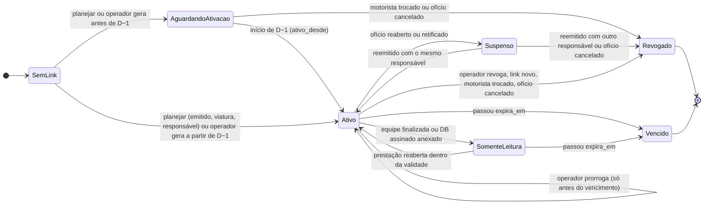
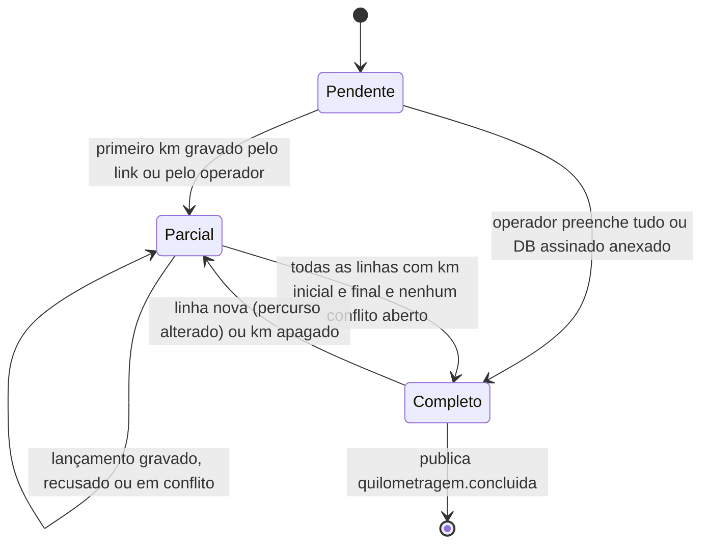
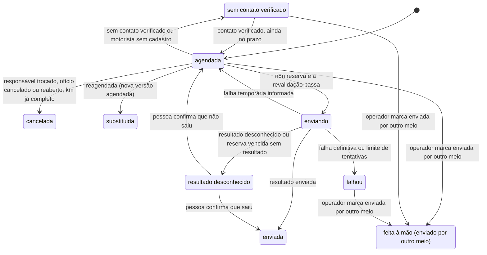
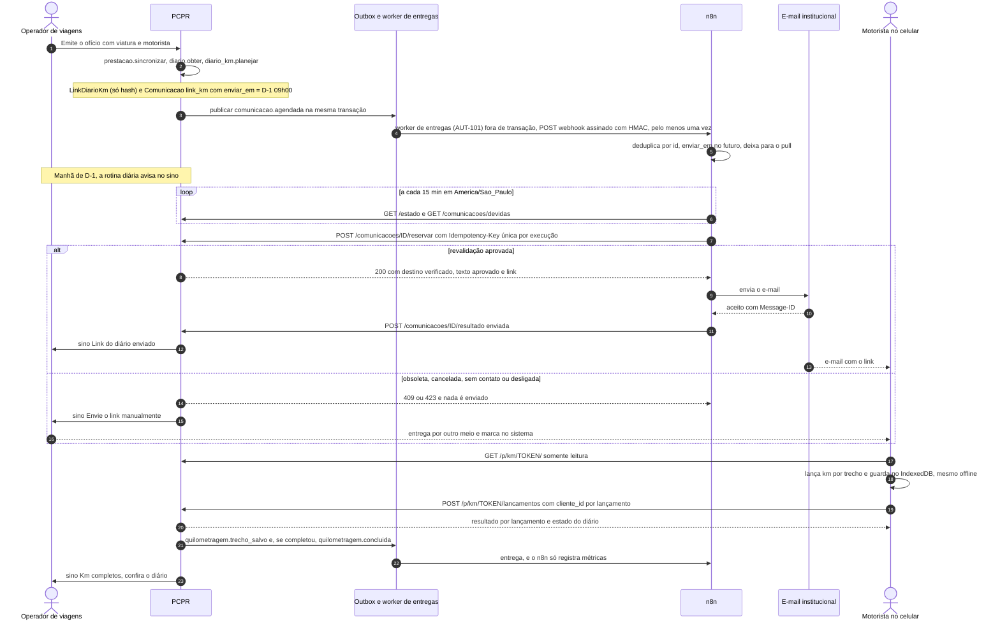

# 10.4 — Link de quilometragem na véspera e lançamento por trecho no Diário de Bordo

> **Escopo revisado em 18/10/2026:** [regra vigente do piloto](../../product/automacao-whatsapp-testes.md). Este site é um sistema
> de testes independente, não oficial da polícia e sem operação com policiais. WhatsApp Business
> Cloud API é o canal principal planejado; portal é apoio e e-mail opcional. As classificações e
> restrições policiais de 17/10 abaixo são histórico do cenário institucional, sem bloquear
> automaticamente o piloto. Não houve implementação ou ativação real nesta revisão.

Desenho técnico de 17/10/2026, Fase 2 do plano de automação. Base:
[`../arquitetura.md`](../arquitetura.md), [`../contratos/evento-integracao.schema.json`](../contratos/evento-integracao.schema.json)
e [`../contratos/api-automacao.v1.yaml`](../contratos/api-automacao.v1.yaml).

**Situação:** funcionalidade **futura, ainda a especificar**. No sistema novo o fluxo não existe:
ficou de fora por decisão registrada (`docs/migration/decisoes.md:205`). O EV em produção tem o
fluxo m096. Este documento especifica o porte do m096 com as melhorias apontadas. Nada aqui está
implementado.

Marcação: **[existe]** código que roda hoje · **[parcial]** · **[novo]** a desenvolver ·
**[decisão]** depende de resposta do usuário (seção 14). As evidências refletem o disco em
17/10/2026, com a árvore de trabalho cheia de alterações não commitadas, então os números de
linha podem mudar.

---

## 1. Objetivo e resultado para o usuário

**Problema de hoje.** Quem preenche o Diário de Bordo é o operador de viagens, campo a campo
(`gestao/viagens/views_diario.py:113-124`). O motorista passa os km depois da viagem, de memória,
num papel ou por mensagem, e o operador digita trecho a trecho. Os erros mais comuns são o
hodômetro que "volta para trás", o km fora da distância prevista e o diário que fica pendente
e trava a finalização (`gestao/viagens/prestacao.py:143-144`).

**Resultado esperado.**

- **Motorista.** Na véspera da saída recebe um link pessoal pelo canal institucional. O link abre
  no celular sem login e funciona sem sinal. Em cada trecho ele anota o km do painel na saída e na
  chegada e diz se abasteceu. A tela mostra o que já foi salvo no sistema, o que está guardado só
  no celular e o que ainda falta.
- **Operador.** Recebe o diário preenchido na chegada da equipe, com os avisos de hodômetro já
  calculados. Só confere, resolve as exceções (recusas e conflitos) e gera o documento para
  assinatura. Não precisa mais "caçar" o km.
- **Gestão.** Vê se o link saiu, quando o motorista lançou e o que ficou pendente. Pode desligar a
  automação sem perder nada, porque o processo continua manual.

**Fora do escopo.**

- Assinatura do DB (fluxo próprio).
- Ajuste de horários realizados a partir do horário dos lançamentos. Fica como sugestão futura,
  sempre confirmada por uma pessoa, porque muda diárias (`gestao/viagens/realizado.py:81-107`).
- Leitura de foto do painel por IA (ver seção 5.3).

---

## 2. Estado atual com evidências

### 2.1 Sistema novo

| Peça | Estado | Evidência | Observação |
|---|---|---|---|
| Diário por prestação (= por ofício = por viatura), uma linha por trecho, km inicial/final e abastecimento | IMPLEMENTADO | `gestao/viagens/models.py:1500-1575` | Um `DiarioBordo` por `PrestacaoContas` (OneToOne). Ofício tem uma viatura (`models.py:208`) e um motorista no máximo (`models.py:365`, `um_motorista_por_oficio`) |
| Linhas acompanham os trechos (do ofício ou realizados) | IMPLEMENTADO | `gestao/viagens/diario.py:70-112` | **Atenção:** se não houver linha da mesma chave, a linha é reaproveitada **por posição** (`diario.py:104-105`), e as linhas que sobram são **apagadas com o km** (`diario.py:111`). Isso pesa no desenho (seção 9) |
| Diário criado sob demanda | PARCIAL | `gestao/viagens/diario.py:61-67` | Nasce na primeira visita da folha ou do pacote. Antes da viagem pode não existir |
| Gravação das linhas | IMPLEMENTADO | `gestao/viagens/diario.py:291-320` | `salvar_linhas(usuario, diario_pk, {linha: campos})`. Exige usuário com `pode_editar_equipe_prestacao` (`diario.py:281-288`, `policies.py:624-626`). Não aceita o link como credencial |
| Conferência do hodômetro (avisos que não bloqueiam) | IMPLEMENTADO | `gestao/viagens/dominio/diario.py:58-87` | Hodômetro que volta, desvio de ±20 % (mínimo 10 km) da distância prevista, km abaixo do último da viatura (`diario.py:169-203`). O único bloqueio é km final < inicial (constraint em `models.py:1567-1571`) |
| Limite máximo de km | INEXISTENTE | `gestao/viagens/dominio/diario.py:29-32` | `numero_do_km` aceita qualquer quantidade de dígitos. Um valor fora da faixa de `integer` provavelmente vira erro de banco em vez de mensagem. O EV limita a 9.999.999 |
| Trava com a equipe toda finalizada | IMPLEMENTADO | `gestao/viagens/diario.py:46-48`, `284-285` | Válida também para o link |
| Motorista e viatura do diário (podem ser trocados só no diário) | IMPLEMENTADO | `gestao/viagens/diario.py:207-258`, `326-381` | O responsável pelo km é `diario.motorista(diario)` (o do ofício, outro servidor da equipe ou "de outro ofício" com nome e CPF digitados) |
| Emissão com viatura exige viatura e motorista | IMPLEMENTADO | `gestao/viagens/services.py:525-532` | Todo ofício elegível (viatura, emitido) tem motorista definido |
| "Preencher pelas distâncias" | IMPLEMENTADO | `static/js/componentes/diario-distancias.js:1-36` | É estimativa acionada por uma pessoa e só escreve em campo vazio. Não deve ser reproduzido no link (seção 5) |
| Padrão de link sem login com token só em hash | IMPLEMENTADO (para a agenda) | `gestao/plataforma/assinatura.py:20-59`, `gestao/painel/views_agenda.py:167-186`, `gestao/painel/urls.py:18` | Usa `secrets.token_urlsafe(32)` e SHA-256 no banco. O 404 não diz o motivo. Mascaramento do token nos logs em `gestao/plataforma/logs.py:9`, `deploy/proxy/nginx-site.conf.modelo:5-18` e `deploy/proxy/site.caddy.modelo:38-44` |
| Link de km, página pública, PWA offline | INEXISTENTE | `docs/migration/decisoes.md:205`, `docs/migration/prestacao.md:46,184` | Previsto em `docs/product/workflows.md:158-159` |
| Aviso "Amanhã sai a viagem" | INEXISTENTE (de propósito) | `gestao/viagens/avisos.py:12` | Existem "chegada" (`avisos.py:90-114`) e prazos, só no sino dos operadores (`avisos.py:32-36`) |
| Rotina diária | IMPLEMENTADO | `gestao/plataforma/rotinas.py:25-61`, `deploy/systemd/pcpr-rotinas@.timer:5` | Roda às 05:40 no fuso do host ou no 1º acesso do dia. A data vem de `timezone.localdate()` (America/Sao_Paulo, `config/settings/base.py:167`). Não serve para um disparo às 09:00 |
| Outbox | IMPLEMENTADO | `gestao/plataforma/outbox.py:34-117` | Um assinante por tópico (`outbox.py:44-45`), 8 tentativas, espera de 10 s a 640 s, `falhou` na 8ª (~21 min; o teto de 1 h do código nunca é atingido; `outbox.py:34, 72-73, 108-111`). **`publicar()` não recebe `disponivel_em`**: grava o momento atual (`outbox.py:59-62`), e repetir a chave não reagenda |
| Eventos de diário ou km | INEXISTENTE | `gestao/plataforma/outbox.py` (tópicos atuais) | Só existem `viagens.documento.gerar`, `viagens.oficio.emitido` e `plataforma.email.enviar` |
| Contato do motorista | PARCIAL | `gestao/cadastros/models.py:86-103` | `Servidor` tem só `telefone` (11 dígitos). Não tem e-mail nem vínculo com `Usuario`: o e-mail institucional está em `gestao/identidade/models.py:34`, e `Lotacao` só liga usuário a unidade (`cadastros/models.py:322-327`). O motorista "pessoa não cadastrada" não tem contato |
| Envio por mensageiro | PARCIAL (outro fluxo) | `gestao/viagens/views_prestacao.py:176-191` | Só um link `wa.me` montado para a liberação de diárias. Nada é enviado pelo sistema |
| Auditoria das tabelas do diário | IMPLEMENTADO | `gestao/viagens/migrations/0031_diario_auditoria.py:11-12`, `gestao/plataforma/middleware.py:24-42` | O trigger grava `usuario_id`, `ip` e `requisicao_id` do contexto. Sem login, grava `usuario_id` nulo: o dado não se perde, falta **atribuir** o autor (seção 7.4) |
| Limite de tentativas | IMPLEMENTADO (para o login) | `gestao/identidade/models.py:69`, `gestao/identidade/forms.py:58-68` | Contador no banco. Não há `CACHES` configurado, então o cache padrão é por processo |
| API de automação, `Comunicacao`, `LinkAcesso`, `ContatoVerificado`, fila de exceções | INEXISTENTE | `docs/adr/0020-automacao-ferramentas-e-aprovacao.md` (proposto), `docs/automacao/arquitetura.md` §2 | Infraestrutura comum aos fluxos da Fase 2 |
| Feriados (dia útil) | PARCIAL | `gestao/viagens/dominio/prestacao.py:38-68` | Só nacionais e móveis. Estaduais e municipais não existem |

### 2.2 O que as referências em produção já fazem (só leitura, não copiar)

**EV (m096), `ref/ev-implantado/viagens_prestacoes/`:**

- **Link.** `LinkDiarioCampo` (`models.py:515-543`). Há um link ativo por diário: gerar um novo
  revoga o anterior (`campo_services.py:100-112`). Vale até 5 dias depois do retorno, ou 30 dias se não houver
  retorno (`campo_services.py:39-43`, `84-92`). Recusa link revogado, vencido ou de ofício cancelado
  (`campo_services.py:115-133`).
- **Lançamentos.** `LancamentoDiarioCampo` é único por (diário, id gerado no celular)
  (`models.py:546-570`). Até 50 lançamentos por envio, km máximo de 9.999.999
  (`campo_services.py:44-47`). Cada lançamento grava num savepoint próprio, pela mesma rotina do
  autosave (`campo_services.py:327-385`).
- **Página.** Mostra trechos, placa e nome, sem CPF e sem a equipe (`campo_services.py:229-264`).
- **Envio.** O POST é só JSON, com cabeçalho próprio, verificação de `Origin`, limite de tamanho e
  limite de taxa.
- **Cabeçalhos.** `Referrer-Policy: no-referrer` e `noindex` (`campo_views.py:49-55`).
- **Offline.** O service worker guarda a página, e a fila fica no IndexedDB
  (`templates/pages/campo/sw.js:1-60`).
- **Mensagem.** Texto pronto para o WhatsApp via `wa.me`, montado pelo operador
  (`campo_services.py:160-189`).
- **Aviso no sino.** "Amanhã sai a viagem… envie o link do diário ao motorista"
  (`avisos.py:124-152`).

**Requisitos do novo desenho para a página do link** (a comparação detalhada com a referência, com
arquivo e linha, fica no inventário privado, fora deste repositório público):

1. Token só em hash no banco, também em chaves de cache e nos logs (seção 7.1).
2. GET sem efeito: abrir a página não grava acesso nem sincroniza linhas. A pré-visualização de um
   mensageiro ou o antivírus de e-mail "abrem" o link e não podem mexer no banco.
3. Nenhuma sugestão de km de chegada pela distância do trecho: uma estimativa não pode virar
   "leitura" do hodômetro.
4. Concorrência por campo: um km digitado offline ontem não sobrescreve a correção do operador
   feita hoje (seção 7.3).
5. Conferência por trecho: o lançamento confere se a linha ainda é o mesmo trecho, não só a linha
   (seção 7.3).
6. Limite de taxa compartilhado entre processos (proxy e banco), nunca só no cache local.

**GV, `ref/gv/prestacoes_contas/`:** não tem link de km. Tem link de assinatura com busca por hash,
precedente para este desenho (aqui só o hash fica no banco, seção 7.1).

---

## 3. Gatilho e definição precisa do evento de conclusão

### 3.1 Elegibilidade (calculada pelo PCPR)

Um diário tem link de km quando **todas** as condições valem:

1. `Oficio.situacao == EMITIDO` e não arquivado.
2. `Oficio.tipo_transporte == VIATURA`. Outros meios só com **[decisão]** (seção 14, item 6).
3. Existe responsável identificado (seção 3.2).
4. A prestação não está com a equipe toda finalizada (`diario.equipe_finalizada`).
5. A viagem não terminou há mais de N dias (validade, seção 8).

### 3.2 Responsável pelo preenchimento

O responsável é **o motorista que o diário reconhece**, na mesma resolução de
`diario.motorista()` (`diario.py:219-224`):

| Situação no diário | Responsável | Link | Envio automático |
|---|---|---|---|
| `motorista_modo=oficio`, motorista da equipe (`Viajante.motorista`) | esse `Servidor` | sim | sim, se houver contato verificado |
| `motorista_modo=oficio`, `motorista_externo=servidor` (servidor de outro ofício) | `Oficio.motorista_externo_servidor` | sim | sim, se houver contato verificado |
| `motorista_modo=oficio`, `motorista_externo=manual` (pessoa não cadastrada) | só o nome, sem `Servidor` | sim, **gerado e entregue pelo operador** | não (sem cadastro não há contato verificável) |
| `motorista_modo=servidor` (outro servidor da equipe, trocado no diário) | `DiarioBordo.motorista_servidor` | sim | sim, se houver contato verificado |
| `motorista_modo=outro_oficio` (nome e CPF digitados) | só o nome | sim, entregue pelo operador | não |

**Vários veículos.** Cada ofício tem uma viatura e um diário. Uma viagem com dois ofícios e duas
viaturas tem **dois diários, dois links e dois destinatários**. Um link nunca alcança mais de um
diário.

**Casos que dependem de decisão:**

- Mesmo motorista e mesma viatura em dois ofícios (motorista "de outro ofício"): por padrão, um link
  por diário. O link agrupado fica em [decisão], item 5.
- Servidor que dirige veículo particular: **não é modelado**. `MeioTransporte` não tem esse caso
  (`models.py:144-159`). Fora do escopo até [decisão], item 6.
- Revezamento de direção: o link é do responsável. Se outro servidor lançar com o mesmo aparelho ou
  link, o lançamento fica registrado como "pelo link enviado a X" (seção 7.4). Se a instituição
  quiser links por condutor, é [decisão], item 1.

### 3.3 Gatilhos

| Gatilho | Onde (todos dentro da transação do serviço) | Efeito |
|---|---|---|
| Ofício emitido ou reemitido | `services.emitir` → `prestacao.sincronizar` (`services.py:1073-1077`) → **[novo]** `diario_km.planejar(prestacao)` | Pré-cria o diário (`diario.obter`), cria ou reaproveita o link e agenda a comunicação `link_km` |
| Ofício reaberto ou retificado | `services.reabrir`/`retificar` (`services.py:1082-1118`) | O link fica **suspenso** e a comunicação pendente é cancelada |
| Ofício cancelado ou reativado | `services.cancelar`/`reativar` (`services.py:1156-1200`), também em cascata por `viagem.cancelar` | Cancelado: link revogado e comunicação cancelada. Reativado: replaneja |
| Motorista ou viatura trocados no diário | `diario.trocar_motorista_e_viatura` (`diario.py:326-381`) | Outro responsável: revoga e cria link e comunicação novos. Só a viatura muda: mantém o link e abre a pendência "viatura trocada após lançamentos", se houver km |
| Horários realizados ajustados ou desfeitos | `realizado.salvar`/`desfazer` (`realizado.py:81-123`) | Replaneja (validade e lembretes) |
| Contato do servidor verificado | **[novo]** serviço de `ContatoVerificado` | Comunicação em `sem_contato` volta a `agendada`, se ainda estiver no prazo |
| Rede de segurança diária | **[novo]** rotina `diario_km.reconciliar(hoje)` registrada em `plataforma.rotinas` | Revisa ofícios emitidos com saída entre hoje e hoje + 2 e corrige o que um gancho deixou passar. Idempotente |

`planejar` calcula o **estado desejado** (responsável, saída, chegada, `enviar_em`, `expira_em`) e
o compara com o atual. Se nada mudou, não faz nada. Se mudou, cancela o que ficou obsoleto e cria
o novo. Chamar duas vezes dá o mesmo resultado.

### 3.4 Definição do evento de conclusão

- **`quilometragem.concluida`** é publicado na transação em que `diario.preenchido(prestacao)`
  (`diario.py:141-147`, `dominio/diario.py:90-93`) **passa de falso para verdadeiro**, qualquer que
  seja a origem (link ou operador), **e** não há `LancamentoKm` em `conflito` sem resolução. Chave:
  `km-concluida:<diario_id>:v<DiarioBordo.versao>`. Se uma linha nova (percurso alterado) tornar o
  diário incompleto, uma conclusão posterior gera um evento novo (versão nova).
- Concluída **não é** conferida (o operador ainda revisa os avisos) nem assinada (o DB assinado
  é outro anexo).
- Efeitos da conclusão:
  - cancela os lembretes pendentes;
  - avisa o operador no sino ("Km do Ofício N completos: confira o diário");
  - **não** revoga o link: o motorista ainda pode corrigir até o diário ficar só leitura ou
    vencer.
- **Encerramento sem conclusão:** o link venceu ou foi revogado com linhas sem km. A pendência
  `diario.PENDENCIA` continua na prestação e o operador é avisado no sino. Não é falha da automação
  e não abre exceção.

---

## 4. Diagramas

### 4.1 Estados do link (derivados: só `ativo_desde`, `revogado_em` e `expira_em` são gravados)



Um link **vencido não volta a valer**: o token pode ter vazado depois do vencimento (caixa
compartilhada, celular trocado). Para continuar, o operador gera um link novo (token novo) e o
reenvia.

### 4.2 Estados da quilometragem do diário



### 4.3 Estados da comunicação `link_km` (entidade `Comunicacao` da arquitetura)

Mesma máquina comum da `Comunicacao` (AUT-01; [10-2 §4.2](10-2-envio-de-documentos.md)). Com a
automação desligada a comunicação **continua `agendada`** (a reserva responde 423) e o cartão
oferece o envio manual (arquitetura §3, item 10). Entrega é marca de tempo (`entregue_em`), não
estado.



### 4.4 Sequência PCPR ↔ n8n ↔ canal ↔ pessoa



---

## 5. Responsabilidades

### 5.1 Sistema PCPR (dono do estado)

**Faz:**

- Decide a elegibilidade e o responsável (seção 3).
- Pré-cria o diário.
- Gera, deriva, exibe, prorroga e revoga o link.
- Calcula `enviar_em`, `expira_em` e os lembretes no fuso America/Sao_Paulo.
- Cria, cancela e revalida a `Comunicacao`.
- Serve a página pública e recebe os lançamentos.
- Valida o km: formato, máximo, km final ≥ inicial, concorrência por campo e mesmo trecho.
- Calcula os avisos de hodômetro.
- Aplica as travas (finalizada, DB assinado, ofício fora de "emitido").
- Registra autoria e auditoria.
- Avisa o operador no sino e publica os eventos.
- Guarda a chave que desliga o fluxo.

**Não faz:**

- Estima ou completa km por distância sem a ação de uma pessoa.
- Escolhe quem dirige: usa o que o ofício ou o diário dizem.
- Envia por canal externo: isso é do n8n, ou do operador manualmente.
- Revoga o link por conta própria fora das regras da seção 3.3.

### 5.2 n8n (bordas)

**Faz:**

- Recebe `comunicacao.agendada` e `comunicacao.cancelada`.
- Consulta `comunicacoes/devidas` a cada 15 min.
- Reserva, envia pelo e-mail institucional, registra o resultado e repassa a devolução do
  provedor (`/entrega`) quando houver caixa de retorno.
- Abre exceção quando esgota as tentativas e alerta sobre falhas do próprio workflow.
- Registra métricas de `quilometragem.*`, sem agir.

**Não faz:**

- Gera, guarda ou registra o link em histórico de execução: o workflow de mensagem não guarda
  execução nenhuma, nem de sucesso nem de erro (`saveDataSuccessExecution` e
  `saveDataErrorExecution` = `none`, sem progresso nem execuções manuais; ver
  [n8n/README.md](../n8n/README.md), "Retenção de execuções"). "Só erros" não bastaria: uma falha
  de SMTP reteria o link-credencial. O diagnóstico vai pelo workflow de erro, só com metadados.
- Decide horário, destinatário ou texto.
- Reenvia às cegas depois de resultado desconhecido.
- Grava km.
- Chama IA.
- Envia fora da reserva.

### 5.3 IA

**Nenhum papel no caminho crítico deste fluxo.** É proibido, por desenho e por teste:

- preencher, sugerir ou "corrigir" km;
- trocar km real por distância estimada;
- inferir abastecimento;
- redigir a mensagem ao motorista (o texto é modelo aprovado);
- escolher o destinatário;
- decidir conflito entre o valor do operador e o do motorista.

A leitura de foto do painel (OCR/IA) ficou de fora. É leitura de um valor real e poderia um dia
ser só uma **proposta que o motorista confirma**, com a foto como evidência. Isso exigiria ADR,
análise de LGPD e um provedor, e não é recomendado agora (maturidade 5, inadequada ou inviável
atualmente; AUT-62).

### 5.4 Pessoas

| Pessoa | Faz | Não faz |
|---|---|---|
| **Motorista** | Abre o link com internet antes de sair. Lança o km do painel na saída e na chegada de cada trecho e o abastecimento. Corrige o que foi recusado. Avisa o setor se o link não é dele ou se a viatura está errada | Altera trechos, motorista ou viatura. Vê CPF, telefone ou dados de outras pessoas |
| **Operador de viagens** | Confere motorista e viatura antes da véspera. Gera ou mostra o link quando é preciso entregar à mão. Marca "enviado por outro meio". Resolve recusas e conflitos. Revoga link vazado. Preenche à mão quando o motorista não usa o link. Gera o DB para assinatura | Precisa do n8n para nada disso |
| **Gestor de viagens** | Liga e desliga o fluxo. Aprova o texto da mensagem. Decide as regras da seção 14 | — |
| **TI/infra** | Chave de derivação dos links, SMTP institucional, limites e mascaramento no proxy, n8n | Acessa os tokens: só os hashes ficam no banco |

---

## 6. Contratos

### 6.1 Eventos do contrato usados

| Evento | Quando o PCPR publica | `recurso` | `dados` (sem dado pessoal) | Chave da outbox | O que o n8n faz |
|---|---|---|---|---|---|
| `comunicacao.agendada` | `planejar` cria a comunicação `link_km` ou um lembrete | `comunicacao`, id, versão | `{"comunicacao_id":37,"fluxo":"km-vespera","tipo_comunicacao":"link_km","enviar_em":"2026-11-09T09:00:00-03:00","finalidade":"diario_km"}` (nomes do contrato rascunho 3; `aviso` opcional com o código da regra da véspera) | `comunicacao-agendada:<id>:v<versao>` | Se `enviar_em` ≤ agora + 1 min, reserva já. Senão ignora e deixa para o pull (evita execuções longas com espera no n8n) |
| `comunicacao.cancelada` | Reagendamento, troca de responsável, cancelamento ou reabertura do ofício, km completo, revogação | `comunicacao` | `{"comunicacao_id":37,"fluxo":"km-vespera","motivo":"reagendada"\|"responsavel_trocado"\|"oficio_cancelado"\|"oficio_reaberto"\|"km_completo"\|"link_revogado"\|"manual"}` | `comunicacao-cancelada:<id>:v<versao>` | Descarta o que tiver em fila. A proteção real é o 409 da reserva |
| `quilometragem.trecho_salvo` | **Um por requisição** que gravou algo (link ou operador), não um por campo | `diario` **[novo tipo]** | `{"linhas_alteradas":2,"origem":"link"\|"operador","completas":3,"total":5}` | `km-salvo:<diario>:v<versao>` | Só métricas. Nenhuma ação |
| `quilometragem.concluida` | Seção 3.4 | `diario` | `{"origem_ultima":"link"\|"operador"}` | `km-concluida:<diario>:v<versao>` | Só métricas. O PCPR já cancelou os lembretes |
| `automacao.desligada` / `automacao.religada` | Chave geral ou do fluxo `km-vespera` | `chave_automacao` | `{"fluxo":"km-vespera"}` | `automacao:<fluxo>:<n>` | Para ou retoma o pull |

`correlacao_id` vale `viagem:<id>` quando o ofício tem viagem, senão `oficio:<id>`.

Os eventos `viagem.reagendada`, `viagem.veiculo_alterado`, `viagem.participantes_alterados`,
`viagem.cancelada` e `documento.*` **não são necessários aqui**. A reação a essas mudanças é
interna ao PCPR (`planejar`), e o n8n só vê o resultado (`comunicacao.cancelada` e uma nova
`comunicacao.agendada`).

### 6.2 Endpoints da API de automação usados (sem mudança de forma)

| Endpoint | Uso neste fluxo | Idempotência |
|---|---|---|
| `GET /estado` | Antes de cada ciclo: fluxo `km-vespera` ligado? canal `email` ligado? | leitura |
| `GET /comunicacoes/devidas` | Pull a cada 15 min, filtrando `tipo in (link_km, lembrete_pendencia)` | leitura |
| `POST /comunicacoes/{id}/reservar` | Revalida e libera destino, texto e link | `Idempotency-Key: reserva:<id>:v<versao>:exec<id da execução>` — **única por tentativa** (contrato `reservar`; [arquitetura §3.3](../arquitetura.md)); outra execução recebe 409 |
| `POST /comunicacoes/{id}/resultado` | `enviada`, `falha_temporaria`, `falha_definitiva`, `resultado_desconhecido` | `resultado:<id>:<reserva_token>` |
| `POST /comunicacoes/{id}/entrega` | Devolução (bounce) da caixa institucional, se houver | `entrega:<id>:<provedor_mensagem_id>:<status>` |
| `POST /excecoes` | `fluxo: "km-vespera"`, motivos já previstos: `canal_indisponivel`, `resultado_desconhecido`, `destinatario_sem_contato`, `contato_nao_verificado`, `limite_tentativas` | `excecao:km-vespera:<comunicacao>:<motivo>` |

**Revalidação na reserva específica do `link_km`**, além das regras gerais do contrato. Responde
409 com `estado_atual` legível se qualquer item falhar:

- link ainda ativo (não revogado, não vencido, ofício emitido);
- responsável atual igual ao `servidor` do link;
- `versao` da comunicação igual à atual;
- diário ainda incompleto (se completo, cancela a comunicação com `km_completo`);
- `ContatoVerificado` de e-mail ativo para o responsável;
- dentro da janela de envio (seção 8).

### 6.3 Extensões necessárias [novo]

| # | Extensão | Campos e regra | Idempotência |
|---|---|---|---|
| E1 | `recurso.tipo` ganha **`diario`** no esquema do evento | `recurso.id` = `DiarioBordo.pk`; `recurso.versao` = **novo** `DiarioBordo.versao` (seção 7) | Evento com versão menor que a atual é obsoleto |
| E2 | `dados` de `quilometragem.*` fixados como na tabela 6.1 | Sem nomes, placas ou km no evento: o n8n não precisa deles | Chaves da tabela 6.1 |
| E3 | `ComunicacaoResumo` e `ComunicacaoReservada` ganham **`finalidade`** (`"diario_km"`) | Distingue o `lembrete_pendencia` de km dos outros lembretes sem criar outro tipo | — |
| E4 | `ComunicacaoReservada.mensagem.variaveis` do `link_km` | `primeiro_nome`, `link_url`, `valido_ate` ("20/11/2026"), `unidade`. **Sem** placa, horário, local de saída ou número do ofício: a mensagem passa pelo n8n e pelos filtros do provedor de e-mail e não deve antecipar qual viatura sai, quando e de onde | — |
| E5 | `ComunicacaoReservada.conteudo_sensivel: true` | Marca que o corpo leva credencial (o link). O n8n Community não tem redação por campo, então a proteção é **não guardar execuções** do workflow de mensagem (seção 5.2); a marca serve para o PCPR mascarar URL, e-mail e token no `detalhe` de `/excecoes` antes de gravar | — |
| E6 | `outbox.publicar(..., disponivel_em=None)` (interno) | Permite agendar a entrega. Hoje o agendamento só existe no worker (`outbox.py:84`), não na API (`outbox.py:54-62`) | A chave muda por versão, porque `get_or_create` não reagenda |
| E7 | Fluxos na chave de `/estado`: `km-vespera` (envio do link) e `km-lembretes` | Desligáveis em separado | — |
| E8 | **Rotas públicas do link** (contrato PWA ↔ PCPR, fora da API de automação) | Seção 6.4 | `LancamentoKm` único por (`diario`, `cliente_id`) |
| E9 | **Ações internas do operador** (sessão + CSRF, `policies.py`) | `POST .../diario/link/gerar`, `.../revogar`, `.../prorrogar`, `.../mostrar` (exibe o link e registra quem viu), `.../comunicacao/<id>/enviada-por-outro-meio`, `.../lancamentos/<id>/resolver` (`usar_do_motorista` ou `manter_atual`) | `gerar` reaproveita o ativo do mesmo responsável. As demais são idempotentes por estado |

### 6.4 Rotas públicas do link [novo]

Prefixo `/p/km/`, fora de `/viagens/`, com `@login_not_required` (precedente: `views_agenda.py:167`). O prefixo
`/p/<escopo>/<token>/` é comum às páginas do servidor (10-2 X11 e D-3, `/p/assinatura/` do 10-5, devolução do
10-6), o que permite uma única máscara de token nos logs e um único `limit_req` no proxy.

| Rota | Método | Efeito | Respostas |
|---|---|---|---|
| `/p/km/<token>/` | GET | Página do diário. **Somente leitura:** não chama `diario.obter`, não sincroniza linhas, não grava acesso. Monta a projeção das linhas atuais sem escrever | 200. 404 seco para token malformado ou desconhecido. 410 com explicação para revogado ou vencido. 200 com aviso "somente leitura" para suspenso ou travado. Antes de `ativo_desde`: 200 com "este link fica disponível a partir de dd/mm", sem nenhum dado da viagem |
| `/p/km/<token>/estado.json` | GET | Mesma projeção em JSON, para a página atualizar sem recarregar | 200 / 404 / 410 |
| `/p/km/<token>/lancamentos` | POST | Aplica até 50 lançamentos | 200 com resultado por item. 400 formato. 403 `Origin` estranho. 404/410. 409 `travado` ou `suspenso`. 413 acima de 32 KB. 415 se não for JSON. 429 com `Retry-After`. 503 se o recurso público estiver desligado |
| `/p/km/<token>/` | POST (formulário, sem JS) | Grava as linhas de um trecho por formulário comum (CSRF por cookie) e redireciona (PRG) | Mesmas regras |
| `/p/km/sw.js` | GET | Service worker com escopo `/p/km/` | — |
| `/p/km/<token>/manifest.webmanifest` | GET | Opcional (instalar na tela inicial) | — |

**Corpo do POST JSON** (`Content-Type: application/json` + cabeçalho `X-PCPR-Km: 1`):

```json
{
  "versao_cliente": 1,
  "aparelho_id": "b6f1c2e0-3c5e-4a8e-9f1a-2d7c4e9b1a00",
  "lancamentos": [
    {
      "id": "0f8e7a54-6f0c-4e5d-8a3b-5b2c9d1e7f10",
      "linha": 812,
      "chave_trecho": "t:4411",
      "campos": {"km_inicial": 45210},
      "anteriores": {"km_inicial": null},
      "digitado_em": "2026-11-10T06:41:12-03:00"
    }
  ]
}
```

**Resposta:** `{"ok": true, "resultados": [{"id": "...", "situacao": "gravado|recusado|conflito",
"mensagem": "..."}], "estado": {...}}`. `estado` tem as linhas (municípios de origem e destino e
data do trecho, sem horário; distância prevista como referência; km atuais; abastecimento), a
viatura só pelos últimos 3 caracteres da placa, os avisos de hodômetro, o total rodado, quantas
linhas estão completas, `somente_leitura` e `valido_ate`. Quem tiver o link vê o itinerário até o
vencimento; por isso a página mostra o mínimo para o motorista reconhecer cada trecho.

**Regra de idempotência.** Um `id` (cliente_id) já recebido devolve **o mesmo resultado**, sem
gravar de novo, mesmo que o conteúdo tenha vindo diferente. A divergência fica registrada em log.

---

## 7. Modelo de dados [novo] e permissões

### 7.1 Token: só hash no banco (requisito 1 da seção 2.2)

Mecanismo genérico em **`gestao/plataforma/links.py`** [novo]. Não tem modelo de negócio, então
respeita a regra de que a plataforma não importa os contextos.

- **Derivação.** `token = base64url(HMAC-SHA256(CHAVE_LINKS, "link-km:v1:<link.id>:<link.semente>"))`,
  com 43 caracteres e 256 bits. `CHAVE_LINKS` vem do ambiente e **não** é a `SECRET_KEY`.
- **No banco:** `token_hash = sha256(token)` (índice único) e `semente` (aleatória, 32 bytes).
  Busca pelo hash, comparação com `hmac.compare_digest`.
- **Por que derivar e não "mostrar uma vez"** (como `assinatura.py`): o operador precisa recopiar o
  link durante a viagem, para reenviar por outro meio, sem revogar o que o motorista já guardou no
  celular para usar offline. Quem tem só o banco vazado não consegue montar tokens: falta a chave.
  Trocar a chave **não derruba** os links emitidos (a busca é pelo hash), só impede exibi-los de
  novo. Nesse caso, gera-se um novo. Pela mesma razão, **vazamento da `CHAVE_LINKS` junto com a
  leitura do banco** (que tem as sementes) permite reconstruir todos os tokens ativos, e trocar a
  chave não os invalida: a resposta é revogação em massa (seção 9). O mecanismo de
  `plataforma/links.py` é genérico; o mesmo procedimento vale para o `LinkAcesso` comum.
- **Rastro.** Cada exibição do link ao operador é um POST que registra `exibido_em` e
  `exibido_por`, com auditoria pelo trigger.

### 7.2 Entidades

**`LinkDiarioKm`** (contexto `viagens`, tabela auditada)

| Campo | Tipo | Regra |
|---|---|---|
| `diario` | FK `DiarioBordo` (PROTECT) | |
| `servidor` | FK `Servidor`, nulo | Responsável cadastrado. Nulo para motorista não cadastrado |
| `destinatario_nome` | texto | Retrato do nome na geração |
| `token_hash` | char(64), único | SHA-256 do token |
| `semente` | char(64) | Entrada da derivação |
| `origem` | `automatica` \| `manual` | |
| `criado_em`, `criado_por` | data, FK usuário nulo | Nulo = planejamento automático |
| `ativo_desde` | data e hora | Início de D−1 (seção 8); antes disso a página não mostra dados |
| `expira_em` | data e hora | Seção 8 |
| `revogado_em`, `revogado_por`, `motivo_revogacao` | | `link_novo`, `responsavel_trocado`, `oficio_cancelado`, `vazamento`, `manual` |
| `viatura_ref` | texto | Placa no momento da geração, para detectar troca |
| `exibido_em`, `exibido_por` | | Última exibição ao operador |
| `primeiro_lancamento_em`, `ultimo_lancamento_em` | | Sinais fortes de uso. Não há "aberto em", porque o GET não grava nada |

Restrição: **um link não revogado por diário**, com índice único parcial em `diario` quando
`revogado_em IS NULL`.

**`LancamentoKm`** (contexto `viagens`, tabela auditada)

| Campo | Tipo | Regra |
|---|---|---|
| `diario`, `link` | FK | |
| `cliente_id` | char(64) | `^[A-Za-z0-9_-]{8,64}$`. **Único por (`diario`, `cliente_id`)** |
| `linha` | FK `DiarioBordoTrecho`, SET_NULL | |
| `chave_trecho` | char(24) | `t:<trecho_id>` ou `r:<realizado_id>`, vista pelo celular. Precisa bater com a chave atual da linha |
| `campos`, `anteriores` | JSON | Valores pedidos e os valores que o celular via antes de editar |
| `situacao` | `gravado` \| `recusado` \| `conflito` \| `resolvido` | |
| `mensagem` | texto ≤ 255 | Motivo legível |
| `digitado_em` | data e hora | Relógio do celular, **só informativo** (nunca ordena nem decide) |
| `recebido_em` | data e hora | Relógio do servidor |
| `requisicao_id` | texto | O mesmo gravado pelo trigger na alteração da linha (seção 7.4) |
| `aparelho_id` | char(64) | Id aleatório guardado no celular. Detecta "mais de um aparelho" |
| `resolvido_por`, `resolvido_em`, `resolucao` | | Para conflitos |

**`DiarioBordo.versao`** [novo campo]: inteiro, incrementado a cada alteração de linha,
motorista ou viatura. Dá a versão dos eventos `quilometragem.*` e permite concorrência otimista.

**`dominio/diario.py`** [novo]: `KM_MAXIMO = 9_999_999`, aplicado ao link **e** ao operador.
Corrige a lacuna da seção 2.1.

**Infraestrutura comum** (definida na arquitetura, compartilhada com outros fluxos):

- `Comunicacao` (`tipo=link_km|lembrete_pendencia`, `finalidade=diario_km`, `referencia` →
  link, `destinatario` → servidor, `canal`, `enviar_em`, `versao`, `estado` da seção 4.3);
- `ContatoVerificado`;
- `ExcecaoAutomacao`;
- a chave do fluxo `km-vespera` e `km-lembretes`.

**Limite de taxa:** `limit_req` no proxy para `/p/` mais um contador no banco por IP para tokens
inválidos, no padrão `TentativaAcesso` (`identidade/models.py:69`). Não vale confiar no cache
local, porque não há `CACHES` compartilhado.

### 7.3 Serviços [novo] (`gestao/viagens/diario_km.py`)

- `planejar(prestacao)`, `reconciliar(hoje)`: seção 3.3.
- `gerar_ou_reaproveitar(usuario|None, diario)`, `revogar(usuario, link, motivo)`,
  `prorrogar(usuario, link, ate)` (recusa link já vencido: aí só um link novo), `mostrar(usuario, link) -> url`.
- `aplicar_lancamentos(link, lancamentos, *, requisicao_id, aparelho_id) -> resultados`: trava o
  diário (`select_for_update`), sincroniza as linhas **aqui** (no POST, nunca no GET), valida cada
  item e grava num savepoint próprio.
- **Refatoração mínima em `diario.py`:** `salvar_linhas` passa a ser
  `policy + _gravar_linhas(diario, valores)`. O link usa `_gravar_linhas` com a autorização da
  policy do link. Assim a validação (`numero_do_km`, constraint, `KM_MAXIMO`) é **a mesma** do
  autosave.

**Concorrência por campo** (requisito 4 da seção 2.2):

- O campo é aplicado se o valor atual for igual a `anteriores[campo]`, ou se o atual já for igual ao
  novo (nada a fazer).
- Se for diferente, o lançamento vira `conflito`, não é aplicado e o operador é avisado no sino e
  na folha do diário.
- Do lado do celular:
  - um lote em voo por vez;
  - lançamentos ainda não enviados do mesmo campo se fundem;
  - `anterior` é o último valor confirmado pelo servidor ou o que está em voo.

**Mesmo trecho** (requisito 5 da seção 2.2): se `chave_trecho` não for mais a chave da linha (o
percurso mudou e a linha foi reaproveitada por posição, `diario.py:104-105`), o lançamento é
recusado com "O roteiro desta viagem mudou: recarregue a página", e o valor fica no histórico do
lançamento.

### 7.4 Autoria e auditoria sem usuário logado

- **Hoje:** o trigger lê `app.usuario_id`, `app.ip` e `app.requisicao_id` do middleware
  (`middleware.py:34-42`). Sem login, grava `usuario_id` nulo. Nada falha, mas a linha do tempo não
  sabe quem foi.
- **Proposta, sem mexer no trigger nem no hash da cadeia:** cada `LancamentoKm` grava o
  `requisicao_id` da requisição. A alteração em `viagens_diariobordotrecho` feita na mesma
  requisição tem o mesmo `requisicao_id` na `auditoria_evento`. A linha do tempo (`passos_do_registro`)
  passa a mostrar, para eventos com `usuario_id` nulo e `requisicao_id` igual ao de um
  `LancamentoKm`: **"<nome do responsável> pelo link enviado em dd/mm"**. A autoria fica
  declarada como "portador do link", não como identidade comprovada.
- **Alternativa descartada por ora:** uma coluna `ator` no `auditoria_evento` (por exemplo
  `link-km:123` via `app.ator`). Exige mudar a função do trigger e o texto canônico do hash
  (`auditoria_conteudo`), o que afeta a verificação da cadeia. Só vale com ADR, se outros fluxos sem
  login também precisarem.
- **Conflitos:** a resolução pelo operador passa por `salvar_linhas` com o usuário dele, o que dá
  autoria normal.

### 7.5 Permissões (`gestao/viagens/policies.py`) [novo]

| Função | Regra |
|---|---|
| `pode_gerar_link_km(usuario, prestacao)` | `pode_editar_equipe_prestacao` (`policies.py:624-626`) e equipe não finalizada e ofício elegível |
| `pode_revogar_link_km`, `pode_prorrogar_link_km`, `pode_mostrar_link_km` | Mesma base. Mostrar fica registrado |
| `pode_resolver_lancamento_km(usuario, prestacao)` | `pode_editar_equipe_prestacao` |
| `pode_ver_link_km(usuario, prestacao)` | `pode_ver_equipe_prestacao` (`policies.py:619-621`): estado do link e dos lançamentos, sem exibir o link |
| `link_km_aceita_lancamento(link, agora)` → (bool, motivo) | Não revogado, não vencido, ofício `EMITIDO` (senão `suspenso`), equipe não finalizada, DB assinado não anexado ([decisão] item 7), responsável atual igual a `link.servidor` (ou mesmo nome, se não cadastrado) |
| `link_km_pode_ver(link, agora)` | Como acima, mas aceita somente leitura (finalizada ou DB assinado) |
| `pode_alterar_automacao(usuario, fluxo)` | **[decisão]** item 10. Proposta: gestor de viagens |

As views (públicas e internas) **só chamam essas funções**. Nunca checam papel por conta própria.

---

## 8. Regras de tempo (America/Sao_Paulo)

As datas são calculadas com `zoneinfo("America/Sao_Paulo")`, nunca com deslocamento fixo `-03:00`
(se o horário de verão voltar, a regra continua certa). Definições:

- **Saída** = menor saída entre as linhas do diário, pela fonte que o diário usa (realizado, se
  houver ajuste, senão o trecho do ofício; `diario.fonte`, `diario.py:121-123`).
- **D** = data local da saída.
- **Chegada final** = maior chegada.

Isso corrige, para este fluxo, a lacuna de `avisar_chegadas`, que ignora os realizados
(`avisos.py:94-97`).

| Regra | Proposta (valores marcados com [decisão]) | Exemplo |
|---|---|---|
| Envio do link | **D−1 às 09:00** [decisão, item 3] | Saída 10/11 06:30 → envio 09/11 09:00 |
| Janela de envio automático | 07:00–21:00 [decisão]. Fora dela, o envio vai para as 07:00 seguintes, salvo se a saída for antes disso + 1 h: então sai imediatamente e o operador é avisado | Emitido 09/11 22:30, saída 10/11 08:00 → 10/11 07:00. Emitido 09/11 22:30, saída 10/11 06:30 → imediato e sino |
| Cadastrado em cima da hora | Se agora ≥ D−1 09:00 e agora < saída: envio imediato, respeitando a janela | Emitido 09/11 15:10, saída 10/11 06:30 → 15:10 |
| Saída de madrugada (00:00–06:59) | Nada muda: D−1 09:00 dá o dia anterior inteiro para abrir o link com internet | Saída 10/11 04:00 → 09/11 09:00 |
| Viagem já iniciada (emitida depois da saída, convalidação) | Antes da chegada final: envio imediato (na janela). Depois da chegada final: **sem envio automático**, o operador gera e entrega se quiser | Emitido 11/11, trechos de 10/11 a 12/11 → imediato |
| Fim de semana e feriado | D−1 vale mesmo em sábado, domingo ou feriado [decisão]. A alternativa é antecipar para o último dia útil (`dominio/prestacao.py:63` cobre só feriados nacionais) | Saída segunda 06:30 → domingo 09:00 |
| Ativação do link | **A partir de 00:00 local de D−1** (`ativo_desde`) [decisão, item 2]. Gerado depois disso: ativo na hora. Antes, a página só informa a data de início | Saída 10/11 06:30 → ativo desde 09/11 00:00 |
| Validade do link | Até **23:59:59 local de (data da chegada final + 5 dias)** [decisão, item 2; igual ao EV]. Gerado depois disso: agora + 5 dias. Sem chegada definida: nunca acontece aqui, porque a emissão exige trechos (`services.py:535-536`) | Chegada 12/11 18:00 → vale até 17/11 23:59:59 |
| Lembrete 1 | Se faltar km: **dia seguinte à chegada final às 09:00** [decisão, item 9] | Chegada 12/11 → 13/11 09:00 |
| Lembrete 2 | Se ainda faltar: **véspera do vencimento às 09:00**, só se o lembrete 1 saiu há mais de 24 h. No mesmo horário, sino ao operador "link vence amanhã" | Vence 17/11 → 16/11 09:00 |
| Silêncio durante o deslocamento | **Nenhum lembrete** entre a saída do 1º trecho e a chegada do último (quem recebe está dirigindo) | — |
| Aviso interno de véspera | A rotina diária [novo] `avisos.avisar_vespera(hoje)`, com saída em hoje + 1, avisa no sino do operador na manhã de D−1 (05:40 ou 1º acesso). Mensagem conforme o caso: "o link será enviado às 09:00 para <nome>", ou "envie o link manualmente: <motivo>", ou "link já enviado" | — |
| Reagendamento | Mudança de saída ou chegada gera uma nova versão: a comunicação antiga é cancelada (`reagendada`), uma nova é agendada e `expira_em` é recalculada. **O link (token) é mantido** enquanto o responsável não muda | Saída 10/11 → 12/11: envio passa para 11/11 09:00, o mesmo link vale até 19/11 |
| Pull do n8n | A cada 15 min com `GENERIC_TIMEZONE=America/Sao_Paulo`. Latência máxima de 15 min além de `enviar_em` quando o push não for imediato | — |

O agendamento **não depende** do fuso do host da VPS (a dúvida sobre `pcpr-rotinas@.timer` continua
aberta). `enviar_em` é um instante absoluto gravado pelo PCPR.

---

## 9. Falhas e recuperação

| Cenário | Detecção | Efeito | Recuperação |
|---|---|---|---|
| **Evento duplicado** (o worker de entregas reentrega `comunicacao.agendada`, webhook chamado duas vezes) | `id` do evento repetido. Se escapar da deduplicação, a segunda execução reserva com outra `Idempotency-Key` (a chave inclui o id da execução) | Nenhum envio a mais: a segunda execução recebe 409 (`ja_processada` ou `obsoleta`) e encerra sem enviar | Automática |
| **Lançamento duplicado** (o celular reenvia porque a resposta se perdeu) | `cliente_id` já existe para o diário | Devolve o resultado original sem gravar | Automática. A fila do celular só apaga o item com resposta definitiva |
| **PCPR indisponível** para o celular | Falha de rede, 5xx ou 503 | O lançamento fica no IndexedDB. A tela mostra "guardado no celular, será enviado" | Reenvio ao voltar a conexão, a cada 30 s enquanto houver pendência e ao abrir a página. Sem Background Sync, que o iOS não tem |
| **n8n indisponível ou reiniciado** | O worker de entregas (AUT-101) não recebe 2xx (retentativa de horas; a outbox atual, sozinha, desistiria em ~21 min) e pull parado | Atraso no envio. Nada se perde: o PCPR guarda `enviar_em` | No retorno, o pull de `devidas` recupera tudo. A comunicação vencida há muito (passou a saída) só segue se ainda estiver elegível, conforme a janela da seção 8 |
| **SMTP institucional indisponível** | Erro no nó de e-mail | `falha_temporaria`, até 3 tentativas curtas | Depois: `falha_definitiva`, exceção `canal_indisponivel`, comunicação em `falhou` (com as ações manuais) e sino ao operador |
| **Resultado desconhecido** (caiu no meio do envio) | Reserva venceu sem resultado, ou `resultado_desconhecido` | Exceção. **Não reenvia às cegas** | O operador confere a caixa de saída e marca "enviada" ou "não enviada" (volta a `agendada`) |
| **Viagem reagendada** | `planejar` vê saída ou chegada diferentes | Comunicação antiga cancelada (409 na reserva), nova agendada, validade recalculada. **O token não muda** | Automática |
| **Link expirado** | 410 na página e no POST | A página explica e mostra os lançamentos que ficaram no celular com "copiar lançamentos" | O operador gera um link novo (token novo; o vencido não volta a valer) e o reenvia, ou digita os valores copiados |
| **KM parcial** | Diário incompleto depois da chegada | Pendência na prestação, lembretes da seção 8, sino | O motorista completa pelo link, ou o operador completa à mão |
| **Km incorreto ou trecho errado** | Recusa (km final < inicial, fora do máximo, formato) ou aviso (voltou, ±20 %, último km da viatura) | Recusa: item `recusado`, campo em erro na tela, nada gravado. Aviso: gravado e sinalizado | O motorista corrige e gera um lançamento novo. O operador vê os avisos na conferência |
| **Percurso alterado** depois de a página carregar | `chave_trecho` ≠ chave atual da linha | Item recusado ("o roteiro mudou") | A página recarrega o estado. O valor fica no histórico do lançamento para o operador |
| **Conflito com o operador** (offline antigo × correção recente) | `anteriores` ≠ valor atual | `conflito`, não aplicado. Sino e faixa na folha do diário | O operador escolhe "usar o do motorista" ou "manter o atual" |
| **Destinatário sem autorização** (responsável trocado) | Reserva compara o responsável atual com `link.servidor` | 409. Link antigo revogado (`responsavel_trocado`), POST do link antigo recebe 410 | Link e comunicação novos para o novo responsável |
| **Destinatário sem contato verificado** ou motorista não cadastrado | Reserva ou `planejar` | Comunicação em `sem_contato`, sino ao operador na véspera | O operador usa "mostrar link" ou "copiar mensagem" e marca "enviado por outro meio". Ao verificar o contato, a comunicação volta a `agendada` se ainda estiver no prazo |
| **Link encaminhado ou vazado** | Lançamentos de mais de um `aparelho_id`, ou relato | Não bloqueia (revezamento legítimo existe). Pendência "lançamentos de mais de um aparelho" | O operador revoga (`vazamento`), gera link novo e confere os valores. O escopo de dano é **só os km deste diário até o vencimento** |
| **Pré-visualização do mensageiro, antivírus de e-mail, robô** | GET em `/p/km/<token>/` | **Nenhum**: o GET não grava, não consome e não "marca como aberto". O título da página é genérico ("Diário de bordo — PCPR"), sem dados em Open Graph | — |
| **Retentativa depois de sucesso parcial** (lote de 10 com 7 gravados) | Resultado por item | Os 7 gravados viram `gravado` e repetir devolve o mesmo. Os outros são `recusado` ou `conflito` ou não chegaram | A fila reenvia só o que não teve resposta definitiva |
| **Retentativa depois de sucesso parcial no envio** (e-mail saiu, registro do resultado falhou) | `resultado` repetido com o mesmo `reserva_token` | Idempotente | Automática |
| **Correção de dados depois do envio para assinatura** | DB assinado anexado (`AnexoPrestacao` `db_assinado`) | Link vira **somente leitura** [decisão, item 7]. Km mudado no documento assinado causaria divergência | O operador reabre (anexo) ou corrige e pede nova assinatura. Corrigir no sistema não altera o assinado |
| **Cancelamento** (ofício ou viagem) | `services.cancelar` / `viagem.cancelar` | Link revogado (`oficio_cancelado`), comunicações canceladas, página 410 "viagem cancelada" | Se for reativado, `planejar` cria link novo (o antigo continua revogado) |
| **Ofício reaberto ou retificado** | `situacao` volta a rascunho | Link **suspenso**: a página fica somente leitura com "a viagem está sendo corrigida". Comunicação pendente cancelada | Na reemissão, `planejar` reativa ou reagenda |
| **Prestação finalizada** com fila ainda no celular | POST com 409 `travado` | Itens ficam "não enviados" no celular | "Copiar lançamentos" para o operador, que decide se reabre |
| **Relógio do celular errado** | `digitado_em` incoerente | Nenhum: o servidor não usa esse horário para nada além de exibição | — |
| **Chave de derivação perdida ou trocada** | Exibir o link falha na verificação | Links emitidos **continuam valendo** (busca por hash). Só não é possível exibi-los de novo | Gerar link novo quando for preciso reenviar |
| **Vazamento da `CHAVE_LINKS`** (com ou sem leitura do banco) | Incidente de segurança relatado ou suspeito | Com a chave e as sementes do banco, todos os tokens ativos podem ser reconstruídos; trocar a chave não os invalida (seção 7.1) | `revogar_links_km --todos --motivo vazamento`, nova `CHAVE_LINKS` no ambiente, links novos gerados e reenviados aos contatos verificados; o mesmo procedimento para o `LinkAcesso` comum |

---

## 10. Deduplicação, cancelamento, desligamento e continuação manual

**Deduplicação em camadas.** Nenhuma depende do n8n.

1. Outbox: `chave` por versão (`get_or_create`, `outbox.py:59-62`).
2. Evento: `id` estável, que o n8n descarta se já viu.
3. Reserva: transição `agendada → enviando`, com uma execução vencedora; `Idempotency-Key:
   reserva:<id>:v<versao>:exec<id da execução>` (única por tentativa), então outra execução recebe 409.
4. Comunicação: única por (`tipo`, `referencia=link`, `versao_agenda`). Replanejar com os mesmos
   dados não cria outra.
5. Link: um não revogado por diário (índice parcial). `gerar_ou_reaproveitar` devolve o ativo do
   mesmo responsável.
6. Lançamento: único por (`diario`, `cliente_id`).
7. Sino: o título leva ofício e data. Hoje a deduplicação por título + link é frágil
   (`avisos.py:32-36`). Para os avisos novos, deduplicar por chave estável num campo próprio, ou
   pela `Comunicacao`.

**Cancelamento.** Só o PCPR cancela, por regra (seção 3.3) ou por ação do operador. A comunicação
cancelada responde 409 na reserva. O link revogado responde 410.

**Desligamento.**

- **Chave do fluxo `km-vespera`** (e `km-lembretes`) em `/estado`. Desligada, as escritas da API
  respondem 423, o PCPR **continua** gerando link e comunicação, e a comunicação fica `agendada`
  com o envio manual oferecido no cartão. O aviso de véspera no sino diz "envie manualmente".
- **Chave do recurso público** [novo] `LINK_KM_PUBLICO` (configuração, separada da automação). Para
  um incidente: as rotas `/p/km/` respondem 503 "temporariamente indisponível" sem revelar nada. Os
  dados e as filas nos celulares ficam como estão, e o operador volta a digitar.
- **Revogação em massa** [novo]: o comando `revogar_links_km --unidade X | --todos --motivo`
  revoga, não apaga, e fica registrado. Permitido em produção com confirmação, porque não é
  destrutivo. É o procedimento de resposta a vazamento da `CHAVE_LINKS` (seção 9).
- Parar o n8n não perde nada (seção 9).

**Continuação manual.** Na folha do diário, um cartão "Link do motorista", com componente
primeiro no UI Lab:

- estado do link (não gerado, ativo até dd/mm, suspenso, somente leitura, vencido, revogado);
- estado da comunicação (agendada para dd/mm 09:00, enviada, aguardando envio manual com o motivo);
- ações: **gerar**, **mostrar link** (registrado), **copiar mensagem** (o texto aprovado),
  **marcar enviado por outro meio** (canal livre: pessoalmente, e-mail pessoal, telefone),
  **prorrogar** (só antes do vencimento), **revogar**;
- lista de lançamentos recebidos (gravado, recusado, conflito), com as ações de resolução;
- o operador continua podendo preencher tudo à mão, como hoje.

---

## 11. Métricas

Todas calculadas pelo PCPR, a partir de `LinkDiarioKm`, `LancamentoKm`, `Comunicacao` e da
auditoria. O n8n só repassa contagens das suas execuções.

| Métrica | Como medir | Meta inicial (a confirmar com uso) |
|---|---|---|
| **Tempo humano economizado** | Antes: cronometrar uma amostra de 10–15 diários (pedir o km ao motorista, esperar, digitar, corrigir avisos). Depois: (diários com todas as linhas vindas do link) × tempo médio medido − tempo gasto resolvendo recusas e conflitos (do registro de resolução). **Sem número inventado:** a hipótese de alguns minutos por diário precisa da medição | Medir no 1º mês |
| Adoção | % dos diários elegíveis com ≥1 `LancamentoKm` gravado. % de linhas preenchidas pelo link × pelo operador (cruzando `requisicao_id` com a auditoria) | Acompanhar a tendência |
| Diário pronto na chegada | % dos diários completos até a chegada final + 24 h. Mediana do tempo entre a chegada final e `quilometragem.concluida` | Menor que a linha de base (medir a atual pela auditoria do diário) |
| Latência de envio | `enviada_em − enviar_em` (p50, p95) | p95 ≤ 15 min |
| Envio a tempo | % das comunicações `link_km` enviadas antes da saída | ≥ 95 % das elegíveis com contato verificado |
| Taxa de falha | Comunicações `falhou` ou `desconhecido` ÷ reservadas. Falhas de POST do link (5xx) ÷ POSTs | < 2 % e < 0,5 % |
| Duplicidades | Comunicações `link_km` **enviadas** duas vezes para o mesmo link e versão (meta **0**). `LancamentoKm` repetidos recebidos, que mostram a saúde da fila e não são erro | 0 envios duplicados |
| Qualidade | Recusados ÷ lançamentos. Conflitos ÷ lançamentos. Diários com aviso de hodômetro no link × no preenchimento manual | Acompanhar |
| Sem contato | % das comunicações em `sem_contato` | Indica a urgência do cadastro de contato |
| Segurança | Respostas 404/429 por IP em `/p/km/`. Links revogados por `vazamento`. Diários com mais de um `aparelho_id` | Alerta se houver pico |

---

## 12. Critérios de aceite

1. **Dado** um ofício com viatura, motorista da equipe com e-mail verificado e saída em 10/11 às 06:30,
   **quando** ele é emitido, **então** existe um `LinkDiarioKm` ativo só com hash, válido até
   17/11 23:59:59 (chegada 12/11), e uma `Comunicacao` `link_km` agendada para 09/11 09:00
   America/Sao_Paulo, com um único `comunicacao.agendada` na outbox.
2. **Dado** o mesmo ofício, **quando** `planejar` roda de novo (rotina de reconciliação ou reemissão
   sem mudança), **então** nenhum link, comunicação ou evento novo é criado.
3. **Dado** um link válido, **quando** um robô de pré-visualização faz GET em `/p/km/<token>/`,
   **então** a resposta é 200 e nenhuma linha de nenhuma tabela é inserida ou alterada. O teste
   confere zero INSERT/UPDATE nas consultas capturadas.
4. **Dado** um POST com 3 lançamentos (um válido, um com km final < inicial e um com
   `chave_trecho` desatualizada), **quando** é processado, **então** só o primeiro grava, os outros
   voltam `recusado` com motivo legível, e repetir o mesmo POST devolve os mesmos 3 resultados sem
   gravar nada.
5. **Dado** que o operador corrigiu o km inicial do trecho 2 para 45.300, **quando** chega do
   celular um lançamento offline com `anteriores.km_inicial = null` e valor 45.210, **então** o
   lançamento fica `conflito`, o valor do operador é mantido e a folha do diário mostra a escolha.
6. **Dado** um link e o celular sem conexão, **quando** o motorista lança os km de 4 trechos e a
   conexão volta, **então** a fila envia em lote, cada item mostra "salvo no sistema" e o diário
   fica completo (E2E com o navegador offline e online).
7. **Dado** que o ofício foi retificado e a saída mudou de 10/11 para 12/11, **quando** é
   reemitido com o mesmo motorista, **então** a comunicação de 09/11 é cancelada (a reserva
   responde 409), uma nova é agendada para 11/11 09:00, o token continua o mesmo e `expira_em` é
   recalculada.
8. **Dado** que o motorista foi trocado no diário, **quando** a troca é salva, **então** o link
   anterior é revogado (`responsavel_trocado`), um POST com ele recebe 410, e um link e uma
   comunicação novos são criados para o novo responsável.
9. **Dado** um motorista sem contato verificado, **quando** chega D−1, **então** a comunicação está
   em `sem_contato`, o sino do operador diz "envie o link manualmente: motorista sem contato
   verificado", e "copiar mensagem" e "marcar enviado por outro meio" funcionam sem o n8n.
10. **Dado** o fluxo `km-vespera` desligado, **quando** o n8n tenta reservar, **então** recebe 423,
    nada é enviado e as comunicações ficam `agendada`, com o envio manual oferecido no cartão.
    Religado, o pull envia as que ainda estiverem no prazo; as que passaram da janela respondem 409
    na reserva e ficam para o operador.
11. **Dado** que o n8n caiu às 08:00 de D−1 e voltou às 10:30, **quando** o pull roda, **então** a
    comunicação das 09:00 é reservada e enviada uma única vez.
12. **Dado** que a reserva venceu sem resultado (canal caiu no meio), **quando** o prazo passa,
    **então** a comunicação vai para `desconhecido`, abre-se `ExcecaoAutomacao`
    (`resultado_desconhecido`) e ela **não** volta sozinha para `agendada`.
13. **Dado** um ofício cancelado, **quando** o motorista abre o link, **então** recebe 410 "Esta
    viagem foi cancelada", sem detalhes, e as comunicações pendentes estão canceladas.
14. **Dado** a equipe toda finalizada, **quando** chega um POST do link, **então** a resposta é 409
    `travado`, nada é gravado e a página mostra os lançamentos não enviados com "copiar".
15. **Dado** um km de 12.345.678, **quando** chega pelo link ou pelo autosave do operador, **então**
    é recusado com "km fora do limite", sem erro 500.
16. **Dado** 40 tokens aleatórios enviados por um IP em um minuto, **quando** passam do limite,
    **então** recebem 429. Nenhuma resposta distingue token malformado de inexistente, e o token
    não aparece nos logs do proxy nem da aplicação (máscara `[token]`).
17. **Dado** o diário completo pelo link, **quando** o último km é gravado, **então** é publicado
    um único `quilometragem.concluida`, os lembretes pendentes são cancelados e o operador recebe
    "Km completos, confira o diário".
18. **Dado** um link vencido, **quando** o operador tenta prorrogá-lo, **então** a ação é recusada e
    só "gerar link novo" fica disponível; o token vencido continua respondendo 410.
19. **Dado** um link gerado na emissão, 5 dias antes de D−1, **quando** é aberto, **então** a página
    diz a data a partir da qual fica disponível e não mostra trecho, placa nem horário.
20. **Dado** a página pública em 360 px e em 1440 px, **quando** é testada, **então** não há rolagem
    horizontal, os alvos têm ≥ 44 px no celular, o axe não aponta violações, não há script nem
    estilo inline (CSP com nonce) e, sem JavaScript, o formulário por trecho grava pelo POST
    comum.

---

## 13. Dependências, maturidade e esforço

**Dependências.**

| Item | Tipo | Situação |
|---|---|---|
| ADR nova "link público de km" | Decisão de arquitetura | Exceção ao login, como o feed ICS. Registra token derivado com hash, GET sem efeito, autoria por `requisicao_id` |
| `LinkDiarioKm`, `LancamentoKm`, `DiarioBordo.versao`, `KM_MAXIMO`, `plataforma/links.py`, rotas `/p/km/`, PWA (service worker e IndexedDB, sem bundler, CSP com nonce), cartão do operador no UI Lab, dados no `demonstracao.py` para o PREVIEW | Desenvolvimento no sistema | Inexistente |
| Máscara do token `/p/<escopo>/<token>` em `plataforma/logs.py`, `nginx-site.conf.modelo` e `site.caddy.modelo`, mais `limit_req` | Infra | Padrão existe para `/agenda/ics/` |
| `Comunicacao`, `ContatoVerificado`, `ExcecaoAutomacao`, chave de automação, API `/api/automacao/v1`, entrega ao n8n (tópico `integracao.evento` → `EntregaEvento` → worker de entregas com lease `processar_entregas`, AUT-100/AUT-101) | Infraestrutura comum da Fase 2 | Inexistente (ADR 0020 proposta) |
| E-mail institucional dos motoristas e consentimento | Dado institucional | `Servidor` não tem e-mail [decisão, item 4] |
| SMTP institucional usado pelo n8n | Credencial | Não confirmado (hoje o PCPR envia por `send_mail` com backend do ambiente, console por padrão, `notificacoes.py:69-80`) |
| WhatsApp | Plataforma oficial bloqueada; prioridade do usuário | Plataforma oficial BLOQUEADA: a política oficial do WhatsApp Business (atualizada em 23/09/2026, consultada em 17/10/2026) proíbe autoridades policiais; nenhuma autorização interna muda isso, só uma nova versão da política ou resposta escrita da Meta registrada em ADR. Mas o WhatsApp é **prioridade do usuário** (frentes do [plano](../plano-implantacao.md)): já, a WA-1 entrega o link pelo `wa.me` aberto pelo operador no aparelho institucional, com registro (o mesmo "mostrar link" + "enviada por outro meio" de E9); a WA-2 é a consulta formal à Meta; a WA-3 deixa o envio oficial pronto e desligado. Ver [whatsapp-viabilidade.md](../whatsapp-viabilidade.md) |

**Maturidade.**

| Parte | Nível | Por quê |
|---|---|---|
| Link de km, página offline, aviso de véspera no sino, entrega manual pelo operador | **2** | Só desenvolvimento no sistema. Não depende de n8n nem de provedor |
| Envio automático do link e lembretes por e-mail institucional via n8n (AUT-41) | **3** | Depende de credencial de SMTP institucional e de e-mail verificado dos motoristas, além da infraestrutura comum |
| WhatsApp assistido com registro (WA-1): link pelo `wa.me` do aparelho institucional, registro "enviado por WhatsApp manual" | **2** | Só desenvolvimento (a entrega manual registrada já está no núcleo); depende da decisão D4a do plano (aparelho/número institucional) |
| Canal WhatsApp oficial (envio automático) | **5** (bloqueado) | Política oficial da Meta proíbe autoridades policiais ([whatsapp-viabilidade.md](../whatsapp-viabilidade.md)). Prioridade do usuário: consulta formal (WA-2, **4**) e integração pronta e desligada (WA-3, **5** para ativar). Integração não oficial é vetada |
| Leitura do painel por foto (IA) | **5**, não recomendado (AUT-62) | Seção 5.3 |
| **Fluxo como um todo** | **2** | |

**Esforço: G.**

- **Núcleo (G):** dois modelos auditados com migração e trigger; serviço com regras de tempo e
  replanejamento; refatoração de `salvar_linhas`; rotas públicas endurecidas (limite, `Origin`,
  tamanho, cabeçalhos, máscara); página PWA offline com fila idempotente e concorrência por campo,
  que é a parte mais cara de acertar e testar; cartão do operador com resolução de conflitos; testes
  unitários de tempo com relógio fixo, testes de serviço (idempotência, travas, conflitos), teste de
  GET sem escrita, E2E offline e online no Playwright, axe e 360/1440 px.
- **Automação por cima (P):** se a infraestrutura comum já existir (comunicação, API, worker de entregas,
  fila de exceções), são um workflow n8n com webhook, pull, reserva, e-mail, resultado e exceção, e
  as extensões E1–E7. **Sem essa infraestrutura, +M**, porque este seria o primeiro fluxo a
  construí-la.

---

## 14. Decisões a confirmar com o usuário

O código não responde a estas perguntas. O que o usuário precisa informar vem em negrito.

1. **Quem preenche:** só o motorista reconhecido pelo diário (proposta), ou qualquer servidor da
   equipe? Revezamento de direção pede link por condutor? **Informar a regra institucional.**
2. **Validade do link:** chegada final + 5 dias, como no EV, está bom? O link abre **a partir de
   D−1** (proposta: dá o dia anterior para instalar e conferir com internet, sem expor o itinerário
   desde a emissão), ou só a partir do dia da saída?
3. **Horário e calendário:** D−1 às 09:00? Janela de envio 07:00–21:00? Em fim de semana e feriado,
   mandar em D−1 mesmo, ou no último dia útil antes? **Informar horário e janela.**
4. **Canal e contato:** os motoristas têm e-mail institucional? Qual o domínio? Quem cadastra e
   verifica o contato (código enviado ao e-mail ou conferência do operador)? Há base legal ou
   consentimento registrado para o envio (LGPD)? Existe SMTP institucional que o n8n possa usar?
   **Informar o domínio, a conta remetente e quem responde pelo cadastro.**
5. **Motorista de outro ofício com a mesma viatura:** um link por diário (proposta), ou um link que
   preencha os dois diários? O motorista "pessoa não cadastrada" recebe o link só pelo operador?
6. **Meios elegíveis:** só viatura oficial (proposta)? "Veículo oficial de outro órgão" e
   "veículo fretado" têm Diário de Bordo? Servidor com veículo particular existe no processo
   (hoje não é modelado)?
7. **Depois do DB assinado anexado**, o link vira somente leitura (proposta)? E com a prestação
   "enviada" ao financeiro?
8. **Sugestão de km pela distância:** o EV sugere o km de chegada pela distância do trecho. A
   proposta é **não** sugerir no link (só mostrar a distância como referência e sugerir o km de
   saída do trecho seguinte = km de chegada do anterior, que é leitura real). Confirmar. Confirmar
   também se o "Preencher pelas distâncias" do operador deve marcar que os valores são estimados.
9. **Lembretes:** quantos e quando (proposta: dia seguinte à chegada às 09:00 e véspera do
   vencimento)? O operador deve receber cópia?
10. **Quem liga e desliga** o fluxo `km-vespera` e o recurso público `LINK_KM_PUBLICO` (proposta:
    gestor de viagens)?
11. **Verificação extra no link** (por exemplo, os últimos dígitos do CPF)? A proposta é **não**,
    pelo baixo risco do dado e pelo atrito, contando com escopo mínimo, revogação e o alerta de
    "mais de um aparelho".
12. **Texto da mensagem:** aprovar o modelo institucional. Rascunho para revisão:
    - **Assunto:** "Diário de bordo — link para lançar a quilometragem" (sem número do ofício,
      placa, local ou horário).
    - **Corpo:** "Olá, {primeiro_nome}. Este é o link para lançar a quilometragem da sua próxima
      viagem com viatura: {link_url}. Abra uma vez com internet antes de sair. Em cada trecho, anote o km do painel na saída e na chegada e se
      precisou abastecer. Sem sinal, fica guardado no celular e é enviado quando a internet
      voltar. O link é pessoal, só dá acesso a este diário e vale até {valido_ate}. Setor de
      viagens — {unidade}."
13. **Retenção:** por quanto tempo guardar `LancamentoKm` e os links revogados ou vencidos
    (proposta: o mesmo prazo da prestação de contas)?
