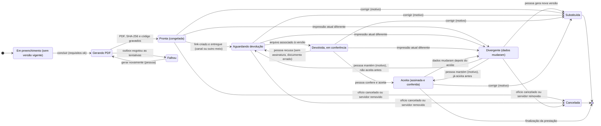
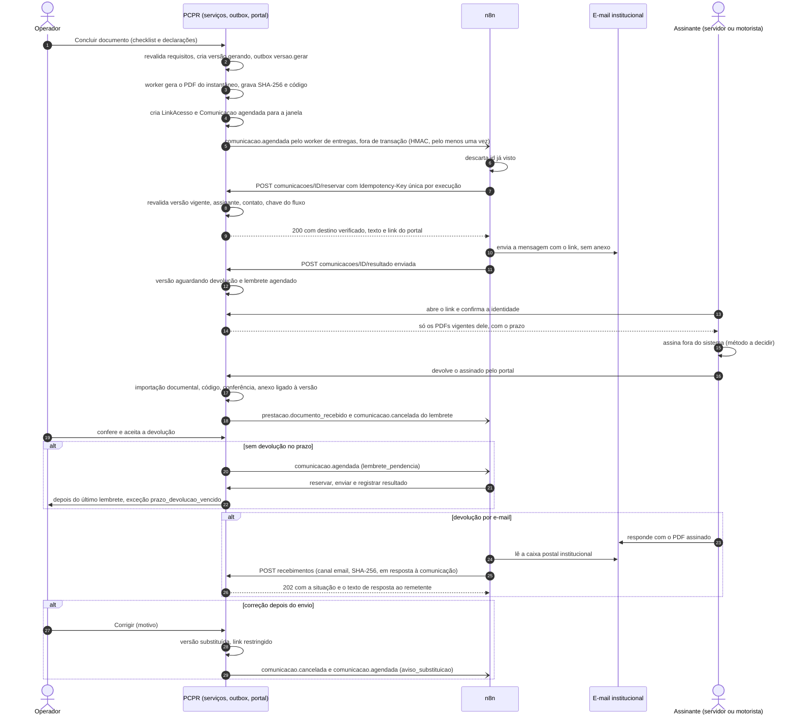

# 10.5 — Diário de Bordo e Relatório Técnico prontos para assinatura

Desenho técnico da Fase 2 (17/10/2026). Base obrigatória: [arquitetura](../arquitetura.md),
[evento de integração](../contratos/evento-integracao.schema.json) e
[API de automação](../contratos/api-automacao.v1.yaml). Marcação: **[existe]** código executando
hoje no sistema novo · **[parcial]** · **[novo]** a desenvolver. Tudo o que não está marcado
[existe] é desenho, não implementação. Evidências `caminho:linha` relativas à raiz do repositório
(`gestao/…`) ou às referências somente leitura (`ref/gv/…`, `ref/ev-implantado/…`).

---

## 1. Objetivo e resultado para o usuário

**Objetivo.** Quando uma pessoa declarar concluído e conferido o preenchimento de um Diário de
Bordo (DB) ou de um Relatório Técnico (RT), o PCPR revalida os requisitos, gera o PDF pelos
serviços que já existem, **congela uma versão** (instantâneo dos dados, SHA-256 dos dados e do
PDF, código curto), identifica quem assina pela regra do próprio documento, disponibiliza o PDF ao
assinante por **link autenticado** (avisando por canal institucional), acompanha a devolução do
assinado, liga o que voltou à versão certa e trata correções sem deixar uma versão vencida passar
como válida.

**Resultado para cada pessoa.**

| Quem | Hoje | Com o fluxo |
|---|---|---|
| Operador de viagens | Baixa PDF/DOCX servidor a servidor, manda por WhatsApp/e-mail por fora, cobra, recebe, renomeia, importa ou anexa (PREST-DOCS-ENVIO-ASSINATURA, `trabalho_manual_hoje`) | Conclui cada documento numa tela com checklist; vê por documento a versão, o assinante, a situação e o prazo; age só nas exceções |
| Servidor (RT) e motorista (DB) | Recebe arquivo solto, sem prazo nem confirmação | Recebe aviso institucional com link só para os documentos dele, prazo explícito, devolve pelo mesmo link (ou responde o e-mail) e recebe confirmação de recebimento |
| Gestão / conferência | Não há como afirmar que o assinado corresponde ao que foi preparado (lacuna PREST-DOCS-GERACAO) | Cada devolução é ligada a uma versão congelada; dados que mudaram depois ficam visíveis e exigem decisão |

**O fluxo não faz:** assinar por ninguém; trocar o assinante que o documento imprime; preencher ou
estimar km; inferir diária recebida, pagamento ou liberação; inventar atividades; finalizar a
prestação; decidir a validade jurídica de uma assinatura; enviar pela plataforma oficial do WhatsApp (bloqueada
para a PCPR pela política da Meta, maturidade 5, ver [whatsapp-viabilidade.md](../whatsapp-viabilidade.md);
nunca integração não oficial). O WhatsApp é prioridade do usuário: o aviso de documentos para assinatura
pode sair pelo WhatsApp assistido com registro (frente WA-1 do [plano](../plano-implantacao.md), aberto pelo
operador no aparelho institucional), e a WA-3 deixa o envio oficial pronto e desligado.

---

## 2. Estado atual com evidências

### 2.1 Sistema novo

| Item | Estado | Evidência | Observação |
|---|---|---|---|
| DB: uma linha por trecho (ofício ou realizado), km inicial/final, abastecimento, troca de motorista e viatura | IMPLEMENTADO | `gestao/viagens/diario.py:61-112`, `:291-320`, `:326-381`; `gestao/viagens/models.py:1500-1575` | Autosave por campo; um diário por prestação (da equipe) |
| Conferência do hodômetro | IMPLEMENTADO (só aviso) | `gestao/viagens/dominio/diario.py:58-87`; `diario.py:200-203` | Voltou para trás; ±20 % (mín. 10 km) da prevista; menor que o último km da viatura |
| "Preencher pelas distâncias" | IMPLEMENTADO, **sem marca de origem** | `static/js/componentes/diario-distancias.js:1-33`; `gestao/viagens/templates/viagens/diario/_trechos.html:25` | Grava a estimativa como se fosse digitação; o sistema não distingue km do hodômetro de km estimado |
| Abastecimento nasce "Sim" | IMPLEMENTADO | `models.py:1557-1558`; `diario.py:107` | O PDF sai "( X ) Sim" sem que alguém tenha confirmado |
| RT: 5 textos, custeio, diária recebida por servidor | IMPLEMENTADO | `models.py:1578-1602`; `gestao/viagens/relatorio.py:269-321`; `dominio/relatorio.py:17-31`, `:73-82` | Diária recebida nunca acima da liberada |
| RT nasce com os textos prontos padrão | IMPLEMENTADO | `relatorio.py:236-256` (aplicação em `:249-254`) | "Preenchido" (`dominio/relatorio.py:112-114`) pode ser verdadeiro sem ninguém ter escrito nada |
| Marcador desconhecido fica no texto | IMPLEMENTADO | `dominio/relatorio.py:107-109` | Um `{marcador}` errado sai impresso |
| Data do RT = hoje, entre o retorno e retorno + 3 dias úteis | IMPLEMENTADO | `relatorio.py:338`; `dominio/relatorio.py:94-101` | O mesmo RT gerado em dias diferentes sai com datas diferentes — por isso a versão precisa ser congelada |
| Sugestões e "Sugerir texto" (regra local, sem IA) | IMPLEMENTADO | `relatorio.py:69-127`; `dominio/relatorio.py:117-220`; `gestao/viagens/resultados.py:99-115` | Usa motivo do ofício, descrição da viagem e resultados do plano |
| Resultados do plano de trabalho (realizado por atividade) | IMPLEMENTADO | `resultados.py:41-50`; `models.py:1372-1387` | Lançamento manual por quem edita o plano; sem lembrete |
| Geração do DB (PDF/XLSX) e do RT (PDF/DOCX), na hora, por GET | IMPLEMENTADO | `gestao/viagens/views_diario.py:211-230`; `gestao/viagens/prestacao_texto.py:53-127`; `diario.py:390-442`; `relatorio.py:332-382` | Sem instantâneo, sem hash, sem estado "enviado"; o GET ainda cria o diário se faltar (`views_diario.py:216-217`) |
| Texto editado com versões (EdicaoPrestacao, ADR 0018) | IMPLEMENTADO | `models.py:1782-1819`; `prestacao_texto.py:150-207` | Regiões editáveis: "corpo" (DB) e "corpo"/"assinatura" (RT) — a linha de assinatura pode ser reescrita à mão |
| Pendências da finalização: DB "preenchido **ou** assinado"; RT idem | IMPLEMENTADO | `gestao/viagens/prestacao.py:127-156` (`:144-147`); `diario.py:37-38`; `dominio/relatorio.py:30-31` | O assinado **não** é exigido para finalizar |
| Travas | IMPLEMENTADO | `diario.py:46-48`, `:281-288`; `relatorio.py:259-266`; `gestao/viagens/anexos.py:113-123` | DB e RT travam com a equipe toda finalizada; o RT assinado do servidor trava quando **ele** finaliza |
| Aviso "Documentos gerados — envie ao servidor para assinar" | IMPLEMENTADO (sino interno, inferido) | `gestao/viagens/avisos.py:76-86` | Inferido de "preenchido"; só operadores; nada é enviado |
| Envio para assinatura, destinatário, prazo, estado "enviado" | INEXISTENTE | `avisos.py:82-86` (só o texto do aviso) | — |
| Volta do assinado (upload ou importação documental) | IMPLEMENTADO | `anexos.py:126-164`; `gestao/viagens/importacao.py:285-325`; `dominio/importacao.py:9-28` | `rt_assinado`/`db_assinado` são únicos (anexar de novo substitui, com confirmação na importação); mesmo SHA-256 = "repetido"; **sem vínculo com versão** |
| Conferência de assinatura por pypdf (ADR 0022) | PARCIAL — não cobre DB/RT | `gestao/viagens/assinados.py:146-149`, `:237-268`; `gestao/viagens/documentos/leitura.py:75-124` | Só ViaAssinada (ofício, justificativa, termo, OS); AnexoPrestacao não tem campo de conferência |
| Leitura do texto do RT/DB assinado | IMPLEMENTADO | `gestao/viagens/leitura_anexos.py:208-221` | Base para comparar o que voltou com a versão congelada |
| "Impressão dos dados" (SHA-256) para avisar "dados mudaram" | IMPLEMENTADO para termo/OS | `assinados.py:92-96`, `:111-125`; `models.py:636` | Princípio a reaproveitar para DB/RT |
| Eventos de outbox da prestação/diário/RT | INEXISTENTE | `gestao/plataforma/outbox.py:54-64`; `gestao/viagens/services.py:1067-1073` | Só `viagens.documento.gerar`, `viagens.oficio.emitido`, `plataforma.email.enviar` |
| Agendamento na outbox | PARCIAL | `gestao/plataforma/models.py:61`; `outbox.py:59-62`, `:111` | O campo `disponivel_em` existe e é usado no backoff, mas `publicar()` não aceita agendar |
| API de automação (`/api/automacao/v1`) | INEXISTENTE | arquitetura §2 | Os `api/` atuais são JSON internos com sessão/CSRF |
| Contato e portal do servidor | INEXISTENTE | `gestao/cadastros/models.py:86-103` (Servidor sem e-mail); `gestao/identidade/models.py:25-31`; `cadastros/models.py:322-335` | Servidor não é usuário; o vínculo usuário↔servidor citado na docstring não existe em modelo |
| Link com token só em hash (padrão reutilizável) | IMPLEMENTADO (feed da agenda) | `gestao/plataforma/assinatura.py:28-59` | Modelo para `LinkAcesso` |
| Relato do servidor | INEXISTENTE | — | — |
| Pacote final | IMPLEMENTADO | `gestao/viagens/pacote_prestacao.py:83-92` | Usa o assinado anexado; senão **gera de novo** (e cria RT/diário se faltam) |
| Assinante configurável de DB/RT | INEXISTENTE (por desenho) | `templates/viagens/documentos/diario_bordo.html:95-99`; `templates/viagens/documentos/relatorio_tecnico.html:82-89`; `cadastros/models.py:467-471` | O DB imprime o motorista; o RT, o próprio servidor; substituições só valem para ofício, justificativa e plano |

### 2.2 O que a referência em produção já faz

**GV (implantado)** — assinatura eletrônica *simples* por link, sem certificado:

- `AssinaturaDocumento`, um por (prestação, tipo); RT por servidor, DB por prestação
  (`ref/gv/prestacoes_contas/models.py:724-806`).
- Link de 7 dias com busca por hash; envio **manual** por `wa.me` com texto fixo
  (`signature_views.py:35-44`).
- Identidade: confirmação do nome e do **CPF completo**, com tentativas limitadas e bloqueio
  temporário. Os parâmetros e os pontos de melhoria de segurança da referência ficam no inventário
  privado, fora deste repositório público.
- Assinatura desenhada ou nome em fonte manuscrita, PNG carimbado no PDF de origem com legenda
  "Assinado eletronicamente por … — cód …", SHA-256 do PDF de origem (`assinatura_services.py:1-9`,
  `:222-307`).
- Assinantes: RT = servidor da linha; DB = `oficio.motorista` (`assinatura_services.py:39-46`) —
  **ignora** a troca de motorista feita no diário e o motorista digitado à mão
  (`diario_services.py:353-363`).
- Não invalida a assinatura quando os dados mudam; cancelar é manual
  (`signature_views.py:150-163`); o pacote usa o assinado se houver (`services.py:727-748`).

**EV (implantado)** removeu o recurso (`viagens_prestacoes/migrations/0006_remove_assinatura_eletronica.py`,
15/09/2026). **Inconsistência documental:** `docs/migration/prestacao.md:185` diz que a assinatura
eletrônica do DB/RT "nem a referência tem" — vale para o EV, não para o GV.

**O que aproveitar do GV (como ideia, sem copiar código):** PDF de origem congelado com hash,
link de validade curta, tentativas limitadas, assinante resolvido pelo sistema. **O que não
repetir:** assinatura desenhada sem decisão jurídica; assinante do DB tirado do ofício ignorando o
diário; nenhuma reação a dados alterados depois. **Requisito do novo:** só o hash do token no banco.

**Nenhum dos dois** tem assinatura com validade reconhecida (gov.br, ICP-Brasil, assinatura
avançada do eProtocolo) feita pelo sistema; no novo, a assinatura é sempre externa e a conferência
pypdf não alcança DB/RT.

---

## 3. Gatilho e definição precisa do evento de conclusão

### 3.1 O que **não** conclui

| Sinal que já existe | Onde | Por que não serve como conclusão |
|---|---|---|
| Salvar um trecho ou um campo (autosave) | `diario.salvar_linhas` (`diario.py:291-320`); `relatorio.salvar` (`relatorio.py:269-292`) | Gravação parcial, acontece dezenas de vezes por documento |
| Diário "preenchido" (todos os km) | `dominio/diario.py:90-93`; `diario.py:141-157` | Os km podem ser estimativas do botão; não cobre motorista, CPF, viatura, abastecimento; não diz que alguém conferiu |
| RT "preenchido" (motivo, atividade, conclusão) — exigência da finalização | `dominio/relatorio.py:112-114`; `relatorio.py:172-181` | É o **mínimo da finalização**, não da assinatura; pode vir só dos textos padrão; não cobre custeio, diária recebida, medidas, marcadores |
| Aviso "Documentos gerados" | `avisos.py:82-86` | Inferência diária para o sino; não congela nada |
| `diario.equipe_finalizada` | `diario.py:46-48` | Tarde demais: trava diário, RT e anexos; o assinado que voltar não pode mais ser anexado sem reabrir |
| PREST-CONCLUSAO (prestação concluída) | `prestacao.py:93-105`; `prestacao_equipe.py:78-91` | Fim do processo (finalização e envio), derivado; a assinatura acontece antes |
| Gerar/baixar o PDF | `views_diario.py:211-230` | Leitura repetível, sem estado |

### 3.2 Definição

**Conclusão do preenchimento** = chamada bem-sucedida de
`para_assinatura.concluir(usuario, prestacao_id, chave, confirmacoes)` **[novo]**
(`gestao/viagens/para_assinatura.py`), em que uma pessoa com `pode_concluir_para_assinatura`
declara, para **um** documento — `chave = "diario"` ou `"rt-<pk da PrestacaoServidor>"`, a mesma
convenção de `prestacao_texto.py:20-32` —, que o preenchimento está concluído e conferido. Numa
transação com `select_for_update` da `PrestacaoContas`, o serviço:

1. reavalia **naquele instante** todos os requisitos R-DB ou R-RT (§3.3, §3.4) com os mesmos
   serviços das telas (`diario.*`, `relatorio.*`, `prestacao.pendencias`);
2. recusa, devolvendo a lista legível do que falta, se algum requisito bloqueante falhar;
3. registra as ciências dos avisos e as declarações (quem, quando, o quê) em `confirmacoes`;
4. cria `VersaoParaAssinatura(numero = n + 1, situacao = "gerando")` com o instantâneo de
   `prestacao_texto.dados_do_documento(prestacao, chave)` — texto editado vigente incluído e
   **data do documento fixada** — e a `impressao_dados` (SHA-256 canônico, mesmo princípio de
   `assinados.impressao`);
5. incrementa `PrestacaoContas.versao_documentos` **[novo]** e publica na outbox o tópico interno
   `viagens.prestacao.versao.gerar` **[novo]**, chave `versao-assinatura:<id>` (mesmo padrão de
   `viagens.documento.gerar`, `services.py:1067-1068`).

O **fato de negócio** "conclusão" é o commit dessa transação. O **evento de integração**
`prestacao.documentos_gerados` só sai quando o PDF da versão fica pronto (§3.7, passo P3).

Propriedades:

- **Humana e explícita.** O sistema pode *sugerir* "pronto para concluir" (sino, selo na folha),
  nunca concluir sozinho; nenhum autosave conclui.
- **Por documento.** O DB (da equipe) e cada RT (por servidor) concluem de forma independente; o DB
  pode seguir antes dos RTs. "Concluir todos os prontos" chama o serviço documento a documento e
  informa quem ficou de fora, como `prestacao.acao_da_equipe` (`prestacao.py:337-364`).
- **Idempotente.** Se já existe versão vigente com a **mesma** impressão, devolve a mesma versão
  (duplo clique, reenvio). Se existe vigente com impressão **diferente**, recusa: "Já existe a
  versão N com o assinante — use *Corrigir*" (§3.9).
- **Não** finaliza a prestação, não muda `PrestacaoServidor.situacao`, não envia nada por si.

### 3.3 Requisitos do Diário de Bordo (R-DB)

B = bloqueia a conclusão · C = exige ciência registrada (a pessoa lê e confirma).

| Código | Regra | Tipo | Fonte |
|---|---|---|---|
| R-DB-1 | Ofício EMITIDO, prestação com servidor ativo, usuário pode editar a equipe | B | `policies.py:623-626`; `prestacao.py` `ativos` |
| R-DB-2 | Equipe **não** finalizada (senão o assinado não poderá ser anexado) | B | `diario.py:46-48`; `anexos.py:113-116` |
| R-DB-3 | Viagem terminada: chegada do último trecho (realizado, senão do ofício) ≤ agora | B | `diario.py:121-123`; `realizado.trechos` |
| R-DB-4 | Todas as linhas com km inicial e km final, km final ≥ inicial | B | `dominio/diario.py:90-93`; `models.py:1567-1571` |
| R-DB-5 | Nenhuma linha com km de origem "sugerido pela distância" sem confirmação linha a linha ("confere com o hodômetro") ou redigitação | B | `DiarioBordoTrecho.origem_km` **[novo]** |
| R-DB-6 | Motorista identificado com nome e CPF de 11 dígitos | B | `diario.motorista` (`diario.py:219-224`) |
| R-DB-7 | Viatura com modelo e placa | B | `diario.viatura` (`diario.py:251-258`) |
| R-DB-8 | Todas as linhas com data/hora de saída e de chegada | B | `diario.dados_do_documento` (`diario.py:406-420`) |
| R-DB-9 | Avisos da conferência do hodômetro | C | `dominio/diario.py:58-87` |
| R-DB-10 | Abastecimento nunca alterado desde o padrão "Sim" | C | `models.py:1557-1558` |
| R-DB-11 | Motorista "de outro ofício" sem nº/protocolo (o importador pode direcionar a devolução ao ofício errado) | C | `diario.py:397-401` |
| R-DB-12 | Região "corpo" editada à mão (a linha do motorista pode ter mudado no texto) | C | `prestacao_texto.regioes_vigentes` |

### 3.4 Requisitos do Relatório Técnico (R-RT), por servidor

**KM completo não basta para o RT.** O RT não imprime km; ele depende de relato, custeio, diária
recebida e resultados — dados que o diário não tem.

| Código | Regra | Tipo | Fonte |
|---|---|---|---|
| R-RT-1 | Ofício EMITIDO; servidor ativo na equipe e **não** finalizado; equipe não finalizada | B | `relatorio.py:259-266`; `anexos.py:113-116` |
| R-RT-2 | Viagem terminada (como R-DB-3) | B | `relatorio.retorno` (`relatorio.py:47-49`) |
| R-RT-3 | Descrição do evento, objetivo e conclusão não vazios | B | `dominio/relatorio.py:112-114` |
| R-RT-4 | Nenhum `{marcador}` remanescente nos textos e nas regiões editadas | B | `dominio/relatorio.py:107-109` |
| R-RT-5 | Declaração "texto revisado" sobre a impressão **atual** dos textos (qualquer edição posterior exige nova declaração) — necessária porque o RT nasce com textos padrão | B | `relatorio.py:249-254`; `confirmacoes` **[novo]** |
| R-RT-6 | Servidor com nome e CPF de 11 dígitos | B | `relatorio.py:339-341` |
| R-RT-7 | Diária: recebida informada (override) **ou** declaração "recebida = liberada"; valor impresso não vazio | B | `relatorio.py:226-232`; `dominio/relatorio.py:73-82` |
| R-RT-8 | Custeio (translado, combustível, passagem) confirmado — os padrões "Não houve / Cartão Prime / Não houve" não podem valer por omissão | B | `dominio/relatorio.py:17-21` |
| R-RT-9 | Plano de trabalho da viagem com atividades previstas e nenhum resultado lançado | C (bloqueio a decidir, D-08) | `relatorio.plano_da_viagem`; `resultados.linhas` |
| R-RT-10 | Medidas ou informações complementares vazias | C (obrigatoriedade a decidir, D-08) | `models.py:1592-1593` |
| R-RT-11 | Relato do servidor solicitado e não respondido / não aplicado | C | `RelatoServidor` **[novo]** |
| R-RT-12 | Data que sairá no documento (avisa quando hoje > retorno + 3 dias úteis e a data fica limitada) | C | `dominio/relatorio.py:94-101` |
| R-RT-13 | Região "assinatura" editada à mão | C | `prestacao_texto.py:23-24` |

### 3.5 Dados exigidos por documento

| Documento | Campo impresso | Fonte no sistema | Quem fornece quando falta |
|---|---|---|---|
| DB | Unidade (cabeçalho) | `ConfiguracaoInstitucional.nome_extenso` (`diario.py:423`) | Gestão (dados da unidade) |
| DB | Ofício de referência e e-protocolo | Ofício, ou ofício/protocolo do motorista de outro ofício (`diario.py:397-404`) | Operador |
| DB | Viatura (modelo/tipo), placa oficial, combustível | `diario.viatura` | Operador |
| DB | Placa reservada | Sempre em branco (no GV também) | — |
| DB | Por trecho: data/hora de saída e chegada, origem, destino | `TrechoRealizado` ou `Trecho` do ofício | Operador (viagem realizada) |
| DB | Km inicial e final | `DiarioBordoTrecho` | Motorista (hoje por fora; pelo link de km se o fluxo da véspera existir) → operador. **Nunca** estimativa sem confirmação humana; a IA não propõe km |
| DB | Abastecimento | `DiarioBordoTrecho.abastecimento` (padrão Sim) | Motorista → operador |
| DB | Motorista: nome, CPF, assinatura | `diario.motorista` | Cadastro; assinatura do próprio motorista |
| RT | Ref. ao ofício, sede, data por extenso | Ofício, `ConfiguracaoInstitucional.sede`, `data_do_documento` | Sistema (data congelada na versão) |
| RT | Nome e CPF | `PrestacaoServidor.servidor` | Cadastro |
| RT | Diária | Override recebido > `rt.diaria` > liberada (`relatorio.py:226-232`) | Servidor declara (relato) ou comprovante → operador confirma; nunca inferida de datas |
| RT | Translado, combustível, passagem | `RelatorioTecnico` | Servidor (relato) → operador confirma |
| RT | Descrição do evento | `rt.motivo` ou `oficio.motivo` | Sugestão do ofício/plano → operador |
| RT | Objetivo da participação | `rt.atividade` | Descrição da viagem, resultados do plano, relato → operador |
| RT | Conclusão | `rt.conclusao` | Resultados do plano, relato, sugestão local ou rascunho de IA → revisão humana |
| RT | Medidas a serem adotadas | `rt.medidas` | Relato, sugestão → revisão humana |
| RT | Informações complementares | `rt.info_complementares` | Texto dos ajustes, automático só se vazio (`relatorio.py:192-223`); relato |
| RT | Resultados do plano (entram pelas sugestões) | `ResultadoAtividade` | Quem edita o plano (`pode_editar_plano`) |
| RT | Declaração e linha de assinatura com CPF | Modelo (`relatorio_tecnico.html:82-89`) | Assinatura do próprio servidor |

### 3.6 Como obter o que falta sem inventar

**a) Relato do servidor por link [novo, proposta].** Por `PrestacaoServidor`, um `LinkAcesso`
de escopo `relato` enviado ao contato verificado do servidor após a chegada. Perguntas objetivas
(versão do questionário guardada com as respostas):

1. Quais das atividades previstas no plano você realizou? (lista de `resultados.atividades_previstas`
   + "nenhuma" + "outra", texto curto) — **sem** quantidades: o realizado do plano é registro de
   quem edita o plano; uma quantidade informada vira só sugestão para ele.
2. Em poucas linhas, o que você fez? (até 600 caracteres)
3. Houve intercorrência? (sim/não; se sim, qual)
4. Há medida a sugerir ao órgão? (opcional)
5. Houve translado ou passagem custeados? O combustível foi por outro meio que não o Cartão Prime?
   (sim/não + descrição)
6. Valor da diária recebido, como no comprovante (opcional) — vira sugestão para
   `diaria_valor_override`, conferida por `dominio/relatorio.conferir_recebido`, aplicada pelo operador.
7. "Confirmo que as informações são verdadeiras" (declaração, **não** é assinatura).

Regras: respostas **nunca** sobrescrevem campos; aparecem como sugestões rotuladas "Relato de
<nome>, <data>"; o operador aplica campo a campo; o link trava quando o RT daquele servidor é
concluído ou o servidor finaliza; o relato não dá acesso a dados de colegas.

**b) Resultados do plano de trabalho.** Lembrete no sino **[novo]** ao responsável pelo plano
após a chegada quando houver atividades previstas sem resultado (R-RT-9). O RT continua usando
`resultados.sugestao_para_rt` (`resultados.py:99-115`).

**c) Km.** Vêm do motorista (hoje por fora; o link de km da véspera é outro fluxo desta fase).
Este fluxo só consome: R-DB-4 e R-DB-5. Km faltando = documento não conclui.

**d) Perguntas na própria tela de conclusão.** Checklist objetivo: custeio, diária recebida,
abastecimento, avisos do hodômetro, km sugeridos — cada resposta é gravada em `confirmacoes`.

**e) Rascunho de RT por IA, ancorado [novo, depende de decisão D-10].**

- *Entrada* (ferramenta de leitura `prestacao.contexto_rt`): `relatorio.contexto_da_viagem`
  (evento, motivo, destino, período, atividades, realizados), observações dos resultados do plano,
  `relatorio.texto_dos_ajustes`, relatos aplicáveis e os textos atuais. **Sem CPF, sem valores
  bancários, sem telefone.** Entrada é dado, nunca instrução.
- *Saída*: JSON `{campo, texto, fatos_usados[]}` para `atividade`, `conclusao`, `medidas`,
  `info_complementares` (nunca diária, custeio, km, assinante, data).
- *Validação determinística no PCPR*: todo número, data, município e nome próprio do texto precisa
  existir no contexto; sem `{marcador}`; tamanho máximo por campo. Falhou → sugestão recusada e
  registrada (`SugestaoTextoRT.situacao = recusada_validacao`).
- *Destino*: `SugestaoTextoRT` **[novo]** rotulada "Sugestão (IA) — revise"; aplicar copia para o
  campo pelo `relatorio.salvar` do usuário que clicou; R-RT-5 continua exigindo a declaração de
  revisão. A IA nunca grava no RT nem na versão congelada.
- *Fallback*: `relatorio.sugerir` (regra local) quando a IA estiver desligada ou indisponível.
- *Execução*: disparo pela tela, tópico interno `viagens.rt.rascunho_ia` **[novo]** e porta de
  integração (ADR 0019); o assistente pode usar a mesma ferramenta pela API (ADR 0020). O n8n não
  participa.

### 3.7 Do evento de conclusão à devolução

| Passo | Quem | O quê |
|---|---|---|
| P1 Confirmação dos requisitos | Sistema | `para_assinatura.requisitos(prestacao, chave)` lista bloqueios e ciências na tela; mesmo texto vale para a API |
| P2 Revalidação e conclusão | Pessoa + sistema | §3.2 (transação, revalidação, versão `gerando`) |
| P3 Geração | Worker da outbox | Assinante de `viagens.prestacao.versao.gerar` gera o PDF **a partir do instantâneo** com `prestacao_texto.pdf_do_documento` (WeasyPrint, PDF/A-2a); grava arquivo privado, SHA-256, tamanho; situação `pronta`; publica `prestacao.documentos_gerados` |
| P4 Congelar | Sistema | Instantâneo + `impressao_dados` + SHA-256 do PDF **armazenado** (o PDF não é regenerado para comparar; o `/ID` do PDF deriva do HTML, `prestacao_texto.py:120`, e serve só como pista auxiliar) + código curto impresso (D-07) |
| P5 Identificar assinante | Sistema | §3.8; instantâneo do nome/CPF na versão |
| P6 Disponibilizar | Sistema → n8n → canal | Cria `LinkAcesso` (escopo `assinatura`, só as versões vigentes daquele assinante) e uma `Comunicacao(tipo = documentos_para_assinatura)` por assinante, agendada na janela de envio; publica `comunicacao.agendada`; o n8n reserva, envia, registra resultado. Sem contato verificado ou com o fluxo desligado: fica para envio manual (§10) |
| P7 Acompanhar | Sistema | Situação por versão, prazo de devolução, lembretes como novas `Comunicacao(tipo = lembrete_pendencia)`, exceção ao final |
| P8 Receber | Portal / n8n → importação | Devolução pelo portal (upload) ou por e-mail (`POST /recebimentos`) entra na importação documental com o destino **pré-definido pela versão**; código e texto conferidos; `AnexoPrestacao` ligado à versão; `conferencia` gravada |
| P9 Aceitar | Pessoa | Operador confere (assinatura visível, versão vigente, assinante certo) e aceita; lembretes cancelados |

### 3.8 Quem assina

| Documento | Assinante (o que o documento imprime) | Como o sistema resolve | Contato possível | Dúvidas registradas |
|---|---|---|---|---|
| DB | O motorista: "Nome / CPF / Assinatura" (`diario_bordo.html:95-99`) | `diario.motorista(diario)` (`diario.py:219-224`): motorista do ofício (viajante com `motorista=True`, servidor externo ou digitado), outro servidor da equipe, ou motorista de outro ofício (nome/CPF digitados) | Só quando há `Servidor` cadastrado com `ContatoVerificado`. Motorista digitado: tentar casar o CPF com `Servidor.cpf` (único, `cadastros/models.py:110-112`) **com confirmação do operador**; senão, envio manual | Revezamento de motoristas (o DB tem uma linha só)? Chefia vista o DB? (D-01) |
| RT | O próprio servidor: linha de assinatura com o CPF dele (`relatorio_tecnico.html:84-89`) | `PrestacaoServidor.servidor` | `ContatoVerificado` do servidor | A declaração está no plural ("Declaramos…") com uma assinatura só; a chefia assina ou atesta? (D-02) |

O assinante vem dos **dados**, nunca do texto editado. Se a região de assinatura foi editada à
mão (R-DB-12, R-RT-13), a pessoa confirma quem assina. Quem é motorista **e** viajante recebe uma
comunicação só, com o RT dele e o DB (o GV fazia "link único").

### 3.9 Correção depois do envio para assinatura

- **C1 — edição direta.** Enquanto houver versão vigente de uma `chave`, os serviços que alteram o
  que aquele documento imprime recusam a gravação com a mensagem "Este documento está com
  <assinante> para assinatura (versão N). Para corrigir, use *Corrigir* — a versão N deixa de
  valer." A checagem entra nos `_travar` existentes (`diario.py:281-288`, `relatorio.py:259-266`,
  `prestacao_texto.py:175-180`) e em `realizado.salvar`. Atenção: o **texto do RT é da equipe**;
  corrigir o texto atinge os RTs de todos os servidores, inclusive os já devolvidos — a tela mostra
  o impacto antes ("isto invalida o RT assinado de A e o pendente de B"). A diária recebida só
  atinge o RT daquele servidor.
- **C2 — efeito em cascata ou mudança de fora.** Depois de qualquer gravação nos serviços da
  prestação, e na rotina diária, o PCPR recalcula a impressão das versões vigentes; as que mudaram
  (troca de motorista que preenche as informações complementares do RT, viagem realizada que muda
  a diária, ofício retificado, CPF corrigido no cadastro, dados da unidade) passam a `divergente`:
  o portal esconde o download ("em revisão"), a reserva de comunicação devolve 409 e uma pessoa
  decide entre **gerar nova versão** e **manter** (com motivo).
- **Corrigir** (`para_assinatura.corrigir(usuario, versao_id, motivo)` **[novo]**): versão →
  `substituida`; comunicações pendentes → `comunicacao.cancelada`; link restringido; se a versão já
  tinha sido entregue, agenda `Comunicacao(tipo = aviso_substituicao)` (o rascunho 3 do contrato unificou o antigo `documentos_substituidos` deste fluxo em `aviso_substituicao`, do 10-2) avisando que
  a versão anterior **não vale mais** e que outra virá; publica
  `prestacao.versao_assinatura_substituida` **[novo]**. A nova versão nasce de nova conclusão (§3.2).
- **Devolução de versão vencida.** O código (ou a comparação de texto) aponta para versão
  `substituida`: **não** vira `AnexoPrestacao` automaticamente; a parte fica em revisão com motivo
  `versao_substituida`; a pessoa recusa (o assinante é avisado para assinar a vigente) ou aceita
  excepcionalmente, com motivo e permissão própria (D-11).
- **Já aceita e os dados mudaram** (antes da finalização): aviso "Assinado, mas os dados mudaram",
  como termo/OS (`assinados.dados_mudaram`, `assinados.py:203-207`); decisão humana.

---

## 4. Diagramas

### 4.1 Estados de uma versão para assinatura (por documento)



Depois de `Substituida`, o documento volta a "Em preenchimento" até a próxima conclusão, que cria
**outra** versão (número + 1). No máximo uma versão vigente por (prestação, chave).

### 4.2 Sequência PCPR ↔ n8n ↔ canal ↔ pessoa



O n8n também consulta `GET /comunicacoes/devidas` a cada 15 min (push + pull da arquitetura).

---

## 5. Responsabilidades

| Componente | Faz | Não faz |
|---|---|---|
| **Sistema PCPR** | Requisitos e revalidação; conclusão e versões; geração do PDF pelos serviços existentes; congelamento (instantâneo, hashes, código); resolução do assinante; `LinkAcesso`, `Comunicacao`, prazos e lembretes; portal de consulta e devolução; importação e conferência da devolução; travas de correção; exceções; chave do fluxo; métricas | Depender do n8n (desligado o n8n, tudo segue manual); assinar; aceitar devolução sozinho; finalizar a prestação |
| **Outbox + worker** [existe, estendido] | Gerar o PDF da versão; entregar eventos ao n8n; disparar a IA de rascunho | Regra de canal |
| **n8n** | Transportar comunicações por e-mail institucional (reservar → enviar → resultado), com 3 tentativas curtas; reconciliação a cada 15 min; ler a caixa postal e repassar anexos a `/recebimentos`; repassar status de entrega; alertar falhas em `/excecoes` | Gerar PDF; guardar documento ou link além da execução; escolher destinatário; decidir versão; marcar como assinado; gravar no banco |
| **IA** (opcional) | Rascunho de textos do RT ancorado nos dados registrados, devolvido como sugestão estruturada; apontar inconsistências entre textos e dados | Km, diária, custeio, assinante, data; inventar atividade ou resultado; gravar no RT; concluir, enviar, aceitar |
| **Operador de viagens** | Conclui cada documento (checklist), revisa o RT, aplica ou descarta sugestões, corrige versões, confere e aceita devoluções, resolve exceções, usa o caminho manual | — |
| **Servidor** | Responde o relato (se pedido), confere o próprio RT, assina pelo método definido, devolve | Ver documentos de colegas; editar dados |
| **Motorista** | Confere o DB, assina, devolve | Idem |
| **Chefia / gestão** | Decide as regras da §14; eventualmente aceita versão vencida (D-11) | — |

---

## 6. Contratos

### 6.1 Eventos usados (já no enum de `evento-integracao.schema.json`)

| `tipo` | Quando o PCPR publica | `recurso` | `dados` (sem dados pessoais) | Chave na outbox |
|---|---|---|---|---|
| `prestacao.documentos_gerados` | Versão passou a `pronta` (P3) | `{tipo: prestacao, id: PrestacaoContas.pk, versao: versao_documentos}` | `oficio_id`, `documentos: [{versao_id, chave, numero}]` | `prestacao.documentos_gerados:<prestacao>:<versao_documentos>` |
| `comunicacao.agendada` | `Comunicacao` de assinatura, lembrete ou aviso de substituição criada | `{tipo: comunicacao, id, versao}` | `comunicacao_id`, `fluxo`, `tipo_comunicacao`, `enviar_em` (-03:00) | `comunicacao.agendada:<id>:<versao>` |
| `comunicacao.cancelada` | Devolução recebida (lembretes), correção, cancelamento, finalização | `{tipo: comunicacao, id, versao}` | `comunicacao_id`, `fluxo`, `motivo` (o contrato unificou o antigo `motivo_codigo` em `motivo`) | `comunicacao.cancelada:<id>` |
| `prestacao.documento_recebido` | Devolução associada a uma versão (P8) | `{tipo: prestacao, id, versao}` | `tipo_documento`, `origem`, `versao_id`, `chave`, `recebimento_id`, `canal` | `prestacao.documento_recebido:<recebimento_id>` |
| `prestacao.pendencia_aberta` | Prazo de devolução vencido, devolução de versão vencida, assinante sem contato | `{tipo: prestacao, id, versao}` | `codigo_pendencia`, `versao_id` | `prestacao.pendencia_aberta:<versao_id>:<codigo>` |
| `automacao.desligada` / `automacao.religada` | Chave geral ou do fluxo `db-rt-assinatura` alterada | `chave_automacao` | `fluxo` | `automacao.<estado>:<fluxo>:<instante>` |

Exemplo de `prestacao.documentos_gerados`:

```json
{
  "id": "0b8e4f6a-2c1d-4e7b-9a55-6f3d2e1c0a99",
  "tipo": "prestacao.documentos_gerados",
  "versao_contrato": 1,
  "ocorrido_em": "2026-11-12T13:05:41Z",
  "ambiente": "teste",
  "recurso": { "tipo": "prestacao", "id": 431, "versao": 3 },
  "correlacao_id": "viagem:812",
  "causa_id": null,
  "dados": { "oficio_id": 1290, "documentos": [ { "versao_id": 77, "chave": "diario", "numero": 1 } ] }
}
```

### 6.2 Endpoints usados (de `api-automacao.v1.yaml`)

| Endpoint | Uso neste fluxo |
|---|---|
| `GET /estado` | n8n confere chave geral, fluxo `db-rt-assinatura` e canal `email` antes de cada lote |
| `GET /comunicacoes/devidas` | Reconciliação a cada 15 min (assinatura, lembretes, avisos de substituição) |
| `POST /comunicacoes/{id}/reservar` | Revalida: versão ainda vigente e não divergente, ofício EMITIDO, assinante na equipe, contato verificado, link válido, equipe/servidor não finalizados, chave ligada. 409 em qualquer falha |
| `POST /comunicacoes/{id}/resultado` | `enviada` / `falha_temporaria` / `falha_definitiva` / `resultado_desconhecido` |
| `POST /comunicacoes/{id}/entrega` | Entregue/lida/falhou, quando o provedor de e-mail informar |
| `POST /recebimentos` | Anexo devolvido por e-mail; `em_resposta_a_comunicacao` quando o cabeçalho de resposta casar |
| `GET /recebimentos/{id}` | Situação e texto seguro para responder ao remetente |
| `POST /excecoes` | Falhas de transporte do lado do n8n |
| `GET /ferramentas`, `POST /ferramentas/{nome}/executar` | Assistente: leitura da situação e rascunho de RT |

### 6.3 Extensões necessárias **[novo]**

| Extensão | Campos | Regra de idempotência |
|---|---|---|
| Evento `prestacao.versao_assinatura_substituida` (incorporado ao enum `tipo` no rascunho 3) | `recurso {prestacao, id, versao}`; `dados {chave, versao_anterior_id, numero_anterior, nova_versao_id \| null, motivo_codigo: correcao \| dados_mudaram \| cancelamento \| servidor_removido \| finalizacao}` | Chave `prestacao.versao_substituida:<versao_anterior_id>` — uma vez por versão; consumidor deduplica por `id` |
| `PrestacaoContas.versao_documentos` como `recurso.versao` | Inteiro incrementado a cada conclusão, substituição ou cancelamento de versão | Evento com versão menor que a atual (consultada) é obsoleto |
| `ComunicacaoResumo.tipo`: aviso de substituição | Usa `aviso_substituicao` (unificado no rascunho 3; `documentos_substituidos` não existe no contrato) | Chave da comunicação: `aviso_substituicao:<versao_anterior_id>` |
| Regra de agrupamento de `documentos_para_assinatura` (valor já existe) | Uma comunicação por (assinante, `versao_documentos`) listando todas as versões vigentes dele | `documentos_para_assinatura:<prestacao>:<servidor>:<versao_documentos>`; reserva `reserva:<comunicacao>:v<versao>:exec<id da execução>` — **única por tentativa** (contrato `reservar`; [arquitetura §3.3](../arquitetura.md)): outra execução recebe 409 |
| `ComunicacaoReservada.documentos[]` | `versao_id`, `titulo` ("Relatório técnico", "Diário de bordo"), `numero`, `codigo`, `prazo_devolucao` (data), `link_portal` — sem CPF, sem PDF por padrão; `url_assinada` só se o canal exigir | Mesma resposta para a mesma `Idempotency-Key`, o que só acontece na retentativa HTTP **da mesma execução** |
| `Recebimento.versao_assinatura_id` e `Recebimento.motivo_revisao` | `motivo_revisao: versao_substituida \| codigo_ausente \| assinatura_nao_detectada \| assinante_diferente \| prestacao_finalizada \| versao_divergente` | `Idempotency-Key` = `receb:<canal>:<mensagem_id_canal>:<anexo_indice>` (contrato rascunho 3; o contrato descreve `mensagem_id_canal` como o `Message-ID`, e o [10-6](10-6-recebimento-de-documentos.md) E1 propõe o identificador dado pelo servidor IMAP — proposta não incorporada); mesmo SHA-256 no mesmo destino e do mesmo servidor = `duplicado` |
| `ExcecaoAutomacao.motivo`: `assinante_indefinido`, `prazo_devolucao_vencido`, `devolucao_versao_vencida`, `geracao_pdf_falhou`, `versao_divergente` | Abertas pelo próprio PCPR (não pelo n8n) | Uma aberta por (`versao_id`, motivo) |
| `EstadoAutomacao.fluxos`: chaves `db-rt-assinatura`, `relato-servidor`, `rascunho-rt-ia` | booleanos | — |
| Ferramentas (ADR 0020) | `prestacao.situacao_assinaturas` (leitura); `prestacao.requisitos_assinatura` (leitura, mesmo texto da tela); `prestacao.contexto_rt` (leitura, sem CPF); `prestacao.propor_texto_rt` (preparação: grava `SugestaoTextoRT`, nunca o RT) | `Idempotency-Key` por chamada; `propor_texto_rt` com a mesma chave devolve a mesma sugestão |
| Tópicos internos da outbox | `viagens.prestacao.versao.gerar` `{versao_id}`; `viagens.rt.rascunho_ia` `{relatorio_id, campos, pedido_por}`; a entrega ao n8n da arquitetura §2: tópico `integracao.evento`, cujo assinante só grava a `EntregaEvento`, e o worker de entregas com lease (`processar_entregas`, AUT-101), que faz o POST fora de transação | `versao-assinatura:<id>`; `rascunho-ia:<relatorio>:<pedido_id>` |
| `outbox.publicar(..., disponivel_em=None)` | Parâmetro opcional (hoje `publicar` grava sempre "agora", `outbox.py:59-62`) | Inalterada (chave única) |
| Rotas do portal (páginas, não API do n8n) | `GET/POST /p/assinatura/<token>/` (identificação, lista, download, devolução); `GET/POST /p/relato/<token>/` | Devolução: chave `portal:<link_id>:<sha256>` |

Ações que **não** viram ferramenta para automação: concluir, corrigir, aceitar devolução, aceitar
versão vencida — só pessoa na tela (ADR 0020).

---

## 7. Modelo de dados [novo] e permissões

### 7.1 Entidades novas

**`VersaoParaAssinatura`** (`gestao/viagens/models.py`) — espelha o padrão de `Documento` do ofício
(`models.py:558-604`):

| Campo | Observação |
|---|---|
| `prestacao` FK `PrestacaoContas` (PROTECT), `chave` (20), `prestacao_servidor` FK null (RT) | `chave` = `diario` ou `rt-<ps>` |
| `numero` | 1, 2, 3… por (prestação, chave) |
| `situacao` | `gerando`, `pronta`, `aguardando`, `devolvida`, `aceita`, `divergente`, `substituida`, `cancelada`, `falhou` |
| `dados` JSON, `edicao` FK `EdicaoPrestacao` null | Instantâneo usado para gerar o PDF (texto editado incluído, data fixada) |
| `impressao_dados` (64) | SHA-256 canônico do instantâneo |
| `arquivo` (privado), `sha256` (64), `tamanho` | PDF congelado |
| `codigo` (12, único) | Código curto impresso (D-07) |
| `assinante_papel` (`motorista` \| `servidor`), `assinante_servidor` FK null, `assinante_nome`, `assinante_cpf` | Instantâneo do assinante |
| `confirmacoes` JSON | Ciências e declarações: código do requisito, usuário, instante |
| `concluida_por`, `concluida_em`, `gerada_em`, `erro` | — |
| `disponibilizada_em`, `prazo_devolucao` | — |
| `anexo_devolvido` FK `AnexoPrestacao` null, `devolvida_em`, `aceita_por`, `aceita_em` | — |
| `substituida_por` FK self null, `encerrada_em`, `encerrada_por`, `motivo_encerramento` | — |

Restrições: único (prestação, chave, número); único (prestação, chave) **condicionado** a
`situacao` em (`gerando`, `pronta`, `aguardando`, `devolvida`, `divergente`, `aceita`) — uma
vigente; `situacao` ≠ `gerando`/`falhou` ⇒ `sha256` preenchido.

**`RelatoServidor`**: `prestacao_servidor` FK, `link` FK `LinkAcesso`, `perguntas_versao`,
`respostas` JSON, `situacao` (`solicitado`, `respondido`, `aplicado`, `descartado`, `expirado`),
`solicitado_por/em`, `respondido_em`, `aplicado_por/em`. Uma ativa por servidor.

**`SugestaoTextoRT`**: `relatorio` FK, `campo`, `texto`, `origem` (`regra`, `relato`, `ia`,
`copia`), `fontes` JSON (fatos usados), `execucao` FK `ExecucaoFerramenta` null, `modelo`,
`situacao` (`proposta`, `aplicada`, `descartada`, `recusada_validacao`), `motivo_recusa`,
`aplicada_por/em`, `criada_em`.

### 7.2 Alterações em modelos existentes

| Modelo | Campo novo | Por quê |
|---|---|---|
| `PrestacaoContas` | `versao_documentos` (int, 0) | `recurso.versao` dos eventos |
| `DiarioBordoTrecho` | `origem_km` (`digitado`, `sugerido`, `campo`, `importado`), `km_confirmado_por/em` | R-DB-5: separar km do hodômetro de estimativa |
| `AnexoPrestacao` | `versao` FK `VersaoParaAssinatura` null, `conferencia` JSON | Ligar a devolução à versão; estender a leitura da ADR 0022 a DB/RT (`leitura.conferir` com os nomes esperados = assinante) |

### 7.3 Entidades compartilhadas (da arquitetura, não exclusivas deste fluxo)

`Comunicacao`, `ContatoVerificado`, `LinkAcesso` (escopos `assinatura` e `relato`),
`ExcecaoAutomacao`, `ExecucaoFerramenta`, `PedidoAprovacao`, token de serviço do n8n. A devolução
pelo portal precisa de um **usuário técnico** do portal para `enviado_por` e para o contexto da
auditoria por trigger, com o `LinkAcesso` gravado como origem. Esse usuário **não** tem papel de
staff (nem `ver_todas_unidades`, nem `change_oficio`): a única autorização da devolução é a do
`LinkAcesso` (o servidor e as versões do escopo), nunca `has_perm` do usuário técnico (mesma regra
de [10-6 §7.1](10-6-recebimento-de-documentos.md)).

### 7.4 Permissões (`gestao/viagens/policies.py`) [novo]

| Policy | Regra |
|---|---|
| `pode_concluir_para_assinatura(usuario, prestacao, chave)` | `pode_editar_equipe_prestacao` e equipe não finalizada; para RT, servidor ativo e não finalizado |
| `pode_corrigir_versao(usuario, versao)` | A mesma, sobre a prestação da versão vigente |
| `pode_aceitar_devolucao(usuario, versao)` | `pode_editar_equipe_prestacao`; dono da versão (equipe/servidor) não finalizado |
| `pode_aceitar_versao_vencida(usuario, versao)` | Permissão própria `viagens.aceitar_versao_vencida` + motivo (quem recebe: D-11) |
| `pode_solicitar_relato(usuario, ps)` | `pode_editar_prestacao(usuario, ps)` |
| `pode_aplicar_sugestao(usuario, rt)` | `pode_editar_equipe_prestacao`; equipe não finalizada |
| Portal (`LinkAcesso`) | O titular vê **só** as versões vigentes dele, sem CPF/dados de colegas; baixa e devolve; não edita nada; versão `divergente` não pode ser baixada |
| Token do n8n | Escopos `comunicacoes:*`, `recebimentos:criar`, `excecoes:criar`; nenhuma escrita em prestação |
| Ferramentas de IA | `contexto_rt` = `pode_ver_equipe_prestacao` do usuário (sessão, token pessoal ou delegação emitida pelo PCPR); `propor_texto_rt` = `pode_editar_equipe_prestacao` |

---

## 8. Regras de tempo (America/Sao_Paulo)

- Fuso da aplicação `America/Sao_Paulo` (`config/settings/base.py:167`); eventos com `ocorrido_em`
  em UTC (Z) e horários de negócio em `dados` com `-03:00`.
- **Conclusão só depois da chegada** (R-DB-3, R-RT-2): chegada do último trecho realizado, senão do
  ofício.
- **Data do RT**: `data_do_documento(hoje, retorno)` calculada na conclusão e **congelada** na
  versão (`dominio/relatorio.py:94-101`). Dias úteis consideram só feriados nacionais (com
  Carnaval) (`dominio/prestacao.py:38-43`, `:68-75`); estaduais e municipais não existem no cadastro.
- **Janela de envio** (proposta, parâmetro): dias úteis, 08:00–18:00; fora dela, `enviar_em` =
  próximo início de janela.
- **Prazo de devolução** (proposta a confirmar, D-05): o menor entre disponibilização + 2 dias úteis
  e o dia útil anterior ao prazo para prestar (`prazo_limite_saque` + 3 dias úteis,
  `dominio/prestacao.py:85-86`) quando o prazo de saque estiver informado.
- **Lembretes** (proposta, D-05): no dia do prazo às 09:00 e 2 dias úteis depois; depois disso,
  exceção `prazo_devolucao_vencido` ao operador. No máximo 2; nunca laço.
- **Validade do link** (proposta, D-13): até a versão deixar de ser vigente, limitada a 10 dias
  corridos (o GV usa 7); renovável a pedido (§9, link expirado).
- **Relato**: link válido da chegada até a conclusão do RT daquele servidor, limitado a 7 dias
  (proposta).
- **Reserva**: 10 min (contrato). **Reconciliação**: n8n a cada 15 min; PCPR recalcula impressões na
  rotina diária (timer `OnCalendar=*-*-* 05:40`, `deploy/systemd/pcpr-rotinas@.timer:5`, no fuso do
  **host**, ainda não confirmado — D-14).

---

## 9. Falhas e recuperação

| Cenário | Detecção | Efeito | Recuperação |
|---|---|---|---|
| Evento duplicado | Mesmo `id` no n8n; mesma chave na outbox | Nenhum efeito novo | n8n descarta `id` visto; se escapar, a segunda execução reserva com outra `Idempotency-Key` (inclui o id da execução) e recebe 409 `ja_processada`; conclusão com a mesma impressão devolve a mesma versão |
| Evento fora de ordem / obsoleto | `recurso.versao` < `versao_documentos` atual; reserva compara a versão do documento | 409 na reserva | n8n descarta; o pull de `devidas` só lista o vigente |
| Serviço indisponível — geração do PDF (WeasyPrint) | Exceção no assinante de `versao.gerar` | Versão `gerando`; após 8 tentativas (10 s → 640 s, ~21 min; `outbox.py:34, 72-73`), `falhou`. No padrão atual, o tratador `ao_falhar` marca o documento como `falhou` já na 1ª falha, enquanto a outbox continua tentando (`assinantes.py:15-21`); a versão deve mostrar "tentando de novo" até a última tentativa | Exceção `geracao_pdf_falhou`; botão "Gerar novamente" (mesma versão, mesmo instantâneo) |
| Serviço indisponível — n8n ou e-mail | Webhook sem 2xx; `resultado = falha_temporaria`; reserva vencida | Comunicação continua `agendada`; nada perdido | Reentrega pelo worker de entregas (AUT-101, retentativa de horas) + pull de 15 min; após limites, exceção `canal_indisponivel`; caminho manual (§10) |
| Serviço indisponível — PCPR/portal | n8n recebe 5xx; assinante vê erro | Nada muda de estado | Retentativas do n8n; o link segue válido até o prazo |
| IA indisponível ou resposta inválida | Tempo esgotado; validação de fatos falhou | Nenhuma sugestão (ou `recusada_validacao`) | Regra local `relatorio.sugerir`; a pessoa escreve |
| Viagem reagendada ou ofício retificado | Antes da chegada: R-x-3 bloqueia. Depois da conclusão: impressão muda (C2) | Versões `divergente`; reserva 409; download suspenso | Pessoa gera nova versão ou mantém com motivo; comunicações antigas canceladas |
| Ofício reaberto (sai de EMITIDO) | Policies passam a negar (`policies.py:585-626`) | Reserva 409; portal "em revisão" | Na nova emissão, a rotina recalcula impressões (C2) |
| Link expirado | `LinkAcesso.expira_em` passado | Página informa, sem mostrar dados | Botão "Pedir novo link": nova comunicação ao **mesmo** contato verificado, no máximo 1 por 24 h; o operador também pode reenviar |
| KM parcial | R-DB-4 | DB não conclui; o RT pode concluir | Pendência "faltam km em N trechos" com o caminho; nunca preencher por distância automaticamente |
| KM estimado ("Preencher pelas distâncias") | `origem_km = sugerido` | R-DB-5 bloqueia | Pessoa redigita o real ou confirma linha a linha com o hodômetro (registrado) |
| Documento duplicado (mesmo arquivo) | SHA-256 igual a anexo vigente (`importacao.py:298-301`) ou mesmo `Idempotency-Key` | `repetido`/`duplicado`; nenhum anexo novo | Resposta ao remetente: "já recebido" |
| Documento incorreto (de outro servidor, de outro ofício, sem assinatura, outro tipo) | Código de outra versão/assinante; texto (`leitura_anexos.ler_rt/ler_diario`) diverge; `conferencia` sem marca de assinatura | Parte em revisão com `motivo_revisao`; nada aplicado | Operador recusa (avisa o assinante) ou direciona; nunca aplicação automática fora da versão do link |
| Devolução de versão vencida | Código aponta versão `substituida` | Revisão `versao_substituida`; sem `AnexoPrestacao` | Recusar (padrão) ou aceitar excepcionalmente com permissão e motivo (§3.9) |
| Destinatário sem autorização (removido da equipe, `removida_em`) | Reserva e portal revalidam | Comunicação cancelada; link revogado; versão `cancelada` | Nenhum envio; o histórico fica |
| Destinatário sem contato verificado / motorista sem cadastro | Ausência de `ContatoVerificado` ou de `Servidor` | Versão `pronta`; comunicação em `sem_contato` (servidor sem contato verificado) ou não criada (motorista sem cadastro: não há destinatário); exceção `destinatario_sem_contato` ou `assinante_indefinido` | Caminho manual: baixar PDF, copiar link/mensagem, "entregue por outro meio"; cadastrar e verificar o contato |
| Retentativa após sucesso parcial — lote | "Concluir todos" com 5 RTs, 2 PDFs falham | Versões independentes; as 3 prontas seguem | Só as que falharam são geradas de novo (chave por versão) |
| Retentativa após sucesso parcial — envio feito, registro falhou | n8n repete `resultado` | Mesmo registro (idempotente) | Se a reserva venceu e o resultado é desconhecido: exceção `resultado_desconhecido`, **sem** reenvio às cegas |
| Reinício do n8n | Execuções perdidas | Nada perdido no PCPR | Pull de `devidas`; reservas vencidas sem resultado viram exceção |
| Correção de dados após envio para assinatura | C1 (edição bloqueada) ou C2 (impressão mudou) | Versão `substituida` ou `divergente` | §3.9: nova versão, aviso `aviso_substituicao`, devolução vencida não aceita sem decisão |
| Cancelamento (ofício/viagem cancelados) | Serviço de cancelamento publica evento | Versões `cancelada`, comunicações canceladas, links revogados | Se havia envio: `aviso_cancelamento` ao assinante (tipo já previsto) |
| Equipe ou servidor finalizado com devolução pendente | `finalizar` consulta versões vigentes | Aviso na finalização (bloqueio: D-04); depois disso lembretes cancelados e links revogados | Reabrir para anexar o que chegar depois |
| Devolução por e-mail de remetente desconhecido | Remetente não é `ContatoVerificado` | Quarentena (contrato `/recebimentos`) | Conferência humana; nada aplicado |

---

## 10. Deduplicação, cancelamento, desligamento e continuação manual

**Deduplicação.** Uma versão vigente por (prestação, chave) garantida por restrição no banco;
conclusão idempotente por impressão; chave única na outbox (`MensagemOutbox.chave_idempotencia`,
`outbox.py:59-62`); `Idempotency-Key` estáveis na API (§6), exceto a da reserva, que é única por
tentativa (inclui o id da execução; a exclusividade vem da transição `agendada → enviando`);
devolução por SHA-256 e por id da mensagem no canal; uma comunicação por assinante e rodada; um lembrete por (versão, ordem).

**Cancelamento.** Ofício ou viagem cancelados, servidor removido da equipe, prestação finalizada ou
correção → versões encerradas, `comunicacao.cancelada`, `LinkAcesso` revogado, eventos publicados.
Arquivar a prestação suspende lembretes (não cancela versões).

**Desligamento.** Chave geral e do fluxo `db-rt-assinatura` no PCPR (`/estado`). Desligado: a
conclusão e o congelamento continuam (são internos); comunicações ficam `agendadas` para envio
manual; a API devolve 423 nas escritas; o n8n pode ser parado sem perda. `rascunho-rt-ia` e
`relato-servidor` desligam independentemente.

**Continuação manual (sempre disponível na folha da equipe, aba "Assinaturas").** Por documento:
"Baixar PDF da versão N" (o arquivo congelado, não regenerado), "Copiar link do portal", "Copiar
mensagem", "Marcar como entregue por outro meio" (`feita_a_mao`, registra canal e data), "Anexar assinado" (o
upload e a importação que já existem, agora ligados à versão), "Corrigir", "Cancelar envio". O modo
de hoje (baixar e mandar por fora) continua possível; o pacote final (`pacote_prestacao.py:83-92`)
passa a usar o assinado aceito e, na falta dele, o PDF **congelado** da versão vigente em vez de
gerar de novo.

---

## 11. Métricas

| Métrica | Como medir | Meta inicial (a calibrar) |
|---|---|---|
| Tempo humano economizado | Linha de base: cronometrar 10 prestações reais (baixar, enviar, cobrar, receber, renomear, anexar) antes da implantação. Depois: tempo de tela registrado entre conclusão, aceite e exceções. Hipótese a validar: ~8 min por documento (3 envio + 2 × 1,5 cobrança + 2 anexar); equipe de 4 + DB ≈ 40 min por prestação | ≥ 60 % de redução do tempo de envio/cobrança/anexação |
| Tempo de redação do RT | `RelatorioTecnico.criado_em` → conclusão da 1ª versão; nº de edições | Medir antes e depois de relato/IA |
| Latência de disponibilização | `concluida_em` → `disponibilizada_em` (dentro da janela) | p90 < 10 min |
| Tempo até a devolução | `disponibilizada_em` → `devolvida_em` (mediana, p90) | Acompanhar por unidade |
| Devolução sem cobrança humana | % de versões devolvidas sem exceção `prazo_devolucao_vencido` | ≥ 70 % |
| Casamento automático | % de devoluções ligadas à versão pelo código/texto sem revisão | ≥ 90 % (PDF com texto); medir separado para digitalizados |
| Versões por documento | Média de `numero` final; % substituídas por correção | Queda após o checklist |
| Devoluções de versão vencida | Contagem e % aceitas excepcionalmente | Aceitas excepcionalmente → 0 |
| Taxa de falha | Falhas de geração, de envio (`falha_*`, `resultado_desconhecido`), exceções por 100 versões | < 2 % envio; 0 geração persistente |
| Duplicidades | Comunicações com dois `enviada` para a mesma versão/assinante; anexos duplicados por versão | **0** |
| IA | % de sugestões aplicadas, aplicadas com edição, recusadas pela validação; fatos fora do contexto aplicados | Fatos fora do contexto aplicados = **0** |

---

## 12. Critérios de aceite

1. **Dado** um diário com todos os km digitados, motorista com CPF e viatura com placa, **quando**
   o operador salva o último trecho, **então** nenhuma versão é criada e nenhum evento é publicado.
2. **Dado** um diário com dois trechos sem km final, **quando** o operador tenta concluir o DB,
   **então** a conclusão é recusada listando os dois trechos e nada é gravado.
3. **Dado** um diário cujos km foram preenchidos pelo botão "Preencher pelas distâncias",
   **quando** o operador tenta concluir sem confirmar as linhas, **então** a conclusão é recusada
   (R-DB-5); **e quando** confirma linha a linha, **então** a versão é criada e a confirmação fica
   registrada com usuário e hora.
4. **Dado** um RT com descrição, objetivo e conclusão vindos só dos textos padrão e sem a
   declaração de revisão, **quando** o operador tenta concluir, **então** é recusado (R-RT-5); km
   completos no diário não mudam o resultado.
5. **Dado** um RT com `{atividade}` no texto, **quando** se tenta concluir, **então** é recusado
   (R-RT-4).
6. **Dado** um documento concluído, **quando** o PDF fica pronto, **então** existe exatamente uma
   versão vigente com instantâneo, `impressao_dados`, SHA-256 do PDF e código, e um único
   `prestacao.documentos_gerados` na outbox; o RT gerado no dia seguinte a partir da versão traz a
   mesma data.
7. **Dado** duplo clique em "Concluir" sem mudança de dados, **quando** as duas requisições chegam,
   **então** uma só versão existe e a segunda resposta devolve a mesma.
8. **Dado** o mesmo evento `comunicacao.agendada` entregue duas vezes e processado por duas
   execuções do n8n, **quando** ambas reservam (cada uma com a própria `Idempotency-Key`, que inclui
   o id da execução), **então** a segunda recebe 409 `ja_processada` e o assinante recebe uma única
   mensagem.
9. **Dado** um envio feito em que o `POST resultado` falhou e a reserva venceu, **quando** a
   reconciliação roda, **então** a comunicação vai para exceção `resultado_desconhecido` e **não**
   é reenviada automaticamente.
10. **Dado** um RT na versão 1 aguardando devolução, **quando** o operador tenta editar o texto,
    **então** a gravação é recusada com a orientação "Corrigir"; **e quando** usa "Corrigir" com
    motivo, **então** a v1 passa a `substituida`, as comunicações pendentes são canceladas, o
    assinante que já a recebeu é avisado de que ela não vale mais e os RTs dos colegas afetados
    pelo texto da equipe são listados e substituídos.
11. **Dado** a v1 substituída pela v2, **quando** o servidor devolve a v1 assinada, **então** a
    parte fica em revisão com motivo `versao_substituida`, nenhum `rt_assinado` é criado e só uma
    pessoa com `pode_aceitar_versao_vencida` pode aceitá-la, com motivo.
12. **Dado** uma versão aguardando devolução, **quando** o ofício é retificado e a impressão muda,
    **então** a versão vira `divergente`, o portal deixa de oferecer o download e a reserva devolve 409.
13. **Dado** um motorista de outro ofício digitado à mão, sem `Servidor` correspondente, **quando** o
    DB é concluído, **então** a versão fica `pronta`, nenhuma comunicação é criada, abre-se exceção
    `assinante_indefinido` e a tela oferece o caminho manual.
14. **Dado** um link expirado, **quando** o assinante o abre, **então** a página não mostra dados
    nem documentos e oferece pedir novo link, que só é enviado ao contato verificado, no máximo uma
    vez por 24 h.
15. **Dado** o fluxo desligado em `/estado`, **quando** um documento é concluído, **então** a versão
    é gerada e congelada, a comunicação fica agendada sem envio e as escritas da API devolvem 423.
16. **Dado** o mesmo PDF assinado enviado duas vezes (portal e e-mail), **quando** o segundo chega,
    **então** é reconhecido como duplicado e não cria anexo nem evento novo.
17. **Dado** a IA propõe uma conclusão com um município que não está no contexto, **quando** a
    validação roda, **então** a sugestão é recusada, registrada e nada aparece para aplicar.
18. **Dado** um servidor removido da equipe com RT aguardando devolução, **quando** a remoção é
    gravada, **então** a versão é cancelada, o link revogado e a comunicação pendente cancelada.

---

## 13. Dependências, maturidade e esforço

| Componente | Maturidade | Depende de | Esforço |
|---|---|---|---|
| Checklist e conclusão explícita, `VersaoParaAssinatura`, congelamento, `origem_km`, travas C1/C2, aba "Assinaturas", caminho manual, pacote usando a versão | **2** | Desenvolvimento no PCPR | **M** — serviços e telas existem; entram um modelo, um serviço, um tópico de outbox, checagens nos `_travar` e testes de serviço/E2E |
| Devolução ligada à versão (código + `leitura_anexos`), conferência ADR 0022 em `AnexoPrestacao` | **2** | Desenvolvimento; decisão D-07 (código impresso) | **M** — reaproveita importação e `leitura.conferir` |
| `LinkAcesso` + portal de consulta e devolução | **2** | Padrão de `plataforma/assinatura.py`; usuário técnico para auditoria; decisão D-06 (identificação) | **M/G** — página pública com limites (tamanho, taxa, Origin), segurança e acessibilidade |
| `Comunicacao`, eventos, entrega ao n8n, `/api/automacao/v1` | **2** | Infraestrutura compartilhada da arquitetura | **G** se feita para este fluxo; **P** se já existir por outro fluxo |
| Envio por e-mail institucional pelo n8n (AUT-06) | **3** | Credencial SMTP institucional, `ContatoVerificado` com e-mail dos servidores (o cadastro não tem e-mail) | **P/M** no n8n |
| Devolução por e-mail: leitura da caixa postal pelo n8n (AUT-08) | **4** | Acesso IMAP/OAuth a uma caixa **dedicada à automação**, concedido pela TI; regras de remetente e quarentena do [10-6](10-6-recebimento-de-documentos.md) | **P/M** no n8n |
| Relato do servidor | **2** | `LinkAcesso`, contato; decisão D-09 | **M** |
| Rascunho de RT por IA | **3** (provedor, custo) — **4** se exigir aval institucional/LGPD | Nova ADR (a ADR 0041 veda enviar documentos a IA externa na importação), D-10 | **M** |
| Assinatura com validade reconhecida feita pelo sistema (gov.br, ICP, eProtocolo) | **4** | Integração institucional | **G** |
| Assinatura desenhada por link (como o GV) | **5** — não recomendado sem decisão jurídica | D-03 | — |
| WhatsApp assistido com registro (WA-1): aviso pelo `wa.me` do aparelho institucional, registrado como "enviado por WhatsApp manual" | **2** | `Comunicacao`; decisão D4a do plano (aparelho/número institucional) | **P** |
| WhatsApp oficial | **5** — plataforma oficial BLOQUEADA pela política (autoridades policiais proibidas; https://whatsappbusiness.com/policy/, atualizada em 23/09/2026, consultada em 17/10/2026); só muda com nova versão da política ou resposta escrita da Meta registrada em ADR (consulta formal = WA-2, **4**); a WA-3 deixa a integração pronta e desligada; ver [whatsapp-viabilidade.md](../whatsapp-viabilidade.md) | Portão de ativação da WA-3 | — |

**Maturidade do fluxo: 2** (o núcleo depende de desenvolvimento no sistema; o envio automático é 3 e a
devolução por e-mail, 4; a devolução pelo portal não depende de caixa postal).
**Esforço total: G** — além do núcleo M, exige a infraestrutura compartilhada de comunicação,
links e API, um portal público com controles de segurança e testes de falha ponta a ponta. Ordem
sugerida: **Fase A** (sistema, sem n8n: conclusão, versões, travas, devolução ligada, manual) →
**Fase B** (portal + n8n por e-mail) → **Fase C** (relato + IA).

---

## 14. Decisões a confirmar com o usuário

| # | Pergunta | Por que o código não responde |
|---|---|---|
| D-01 | Quem assina o DB: só o motorista? E com revezamento de motoristas? A chefia vista? Motorista de outro ofício sem cadastro: quem providencia a assinatura? | O modelo tem uma linha de assinatura só; o GV usa o motorista do ofício e ignora o diário |
| D-02 | Quem assina o RT: só o servidor? A chefia assina ou atesta? | A declaração é plural com uma assinatura |
| D-03 | Qual assinatura vale para DB e RT: física digitalizada, gov.br, ICP-Brasil, assinatura avançada do eProtocolo, ou a desenhada por link do GV? | Decisão jurídica/institucional; o EV removeu a do GV |
| D-04 | DB e RT assinados são obrigatórios para finalizar ou para enviar ao financeiro? Finalizar com devolução pendente deve bloquear? | Hoje "preenchido **ou** assinado" basta (`prestacao.py:144-147`) |
| D-05 | Prazo de devolução, número e horário dos lembretes, janela de envio | Não há regra no código; a §8 traz proposta |
| D-06 | Como o assinante se identifica no portal: só o link enviado ao contato verificado, link + CPF completo com tentativas (paridade GV), ou link + código enviado no acesso? | Segurança vs. atrito |
| D-07 | Pode imprimir uma linha discreta com o código da versão no DB e no RT? | O DB é "sem rodapé" pelo modelo institucional (ADR 0042) |
| D-08 | Medidas e informações complementares são obrigatórias? Resultados do plano lançados são obrigatórios antes do RT? | Hoje só descrição, objetivo e conclusão |
| D-09 | O relato deve ser pedido a cada servidor ou a um representante? Perguntas e prazo aprovados? | Proposta da §3.6 |
| D-10 | IA: provedor permitido (local ou externo), aval LGPD, quais dados podem sair (proposta: sem CPF, sem valores bancários)? | ADR 0041 e ausência de ADR para IA no RT |
| D-11 | Quem pode aceitar devolução de versão vencida, e em que condições? | Regra institucional |
| D-12 | Bloquear a edição enquanto há versão com o assinante (recomendado) ou permitir com aviso? | Escolha de processo |
| D-13 | Validade do link (GV: 7 dias)? | Regra institucional |
| D-14 | Fuso do host da VPS (timer das 05:40) | Configuração de infraestrutura |
| D-15 | A data do RT congelar na conclusão (e não no dia do download) é aceitável? | Hoje muda com o dia |

**O que o usuário precisa informar:** respostas às decisões acima; a fonte do e-mail institucional
de cada servidor/motorista (ou o processo de cadastro e verificação do contato); a conta de e-mail
institucional que enviará (remetente; a unidade já tem `ConfiguracaoInstitucional.email`) e a caixa
**dedicada à automação** que receberá as devoluções, com credencial restrita a ela (a caixa da equipe
nunca é conectada ao n8n; se for o remetente visível, entra só como alias "enviar como"); os textos aprovados das mensagens (assinatura, lembrete,
substituição, cancelamento, confirmação de recebimento); quem responde pela fila de exceções em
cada unidade; e, se houver IA, o provedor autorizado e o limite de custo.

---

## Apêndice — correções ao levantamento (levantamento interno de 17/10/2026, não versionado, e premissas da tarefa)

1. **GV confere o CPF completo**, não "só 5 dígitos" (conferido no código implantado; os detalhes
   ficam no inventário privado).
2. **"Assinatura eletrônica não existe na referência"** vale para o EV (removida na migração 0006)
   e para assinatura com certificado; o **GV implantado** tem assinatura eletrônica simples por link
   (desenho ou fonte carimbado, hash do PDF de origem). `docs/migration/prestacao.md:185` deve ser
   corrigido.
3. **No GV o assinante do DB é `oficio.motorista`** (`assinatura_services.py:44-46`) e ignora a troca
   de motorista do diário (`diario_services.py:353-363`) e o motorista digitado — o novo deve
   resolver pelo diário (`diario.motorista`).
4. **A outbox não agenda pela API de publicação:** `publicar()` grava sempre `disponivel_em = agora`
   (`gestao/plataforma/outbox.py:59-62`); o campo só é usado no backoff (`:111`). Agendar exige um
   parâmetro novo (pequeno).
5. **"RT preenchido" não significa revisado:** o RT nasce com os textos prontos padrão
   (`relatorio.py:249-254`) e o download do pacote por GET cria o RT se faltar
   (`pacote_prestacao.py:83-86`), o que pode disparar sozinho o aviso "Documentos gerados"
   (`avisos.py:82-86`).
6. **"Diário preenchido" não significa km real:** "Preencher pelas distâncias" grava a estimativa
   como digitação (`static/js/componentes/diario-distancias.js:1-6`) e o abastecimento nasce "Sim"
   (`models.py:1557-1558`).
7. **A data do RT muda com o dia** (`relatorio.py:338`; `dominio/relatorio.py:94-101`) — regenerar
   não reproduz o que foi enviado; reforça a necessidade de congelar o PDF.
8. **Não existe vínculo usuário↔servidor em modelo**, apesar da docstring de `Usuario`
   (`gestao/identidade/models.py:28-30`); `Lotacao` liga usuário a unidade
   (`gestao/cadastros/models.py:322-335`). Não há "portal do servidor" possível sem `LinkAcesso`
   ou sem esse vínculo.
9. **A região "assinatura" do RT e a região "corpo" do DB são editáveis à mão**
   (`prestacao_texto.py:23-24`; `relatorio_tecnico.html:84-89`): o texto impresso de quem assina
   pode divergir dos dados — o assinante deve vir dos dados.
