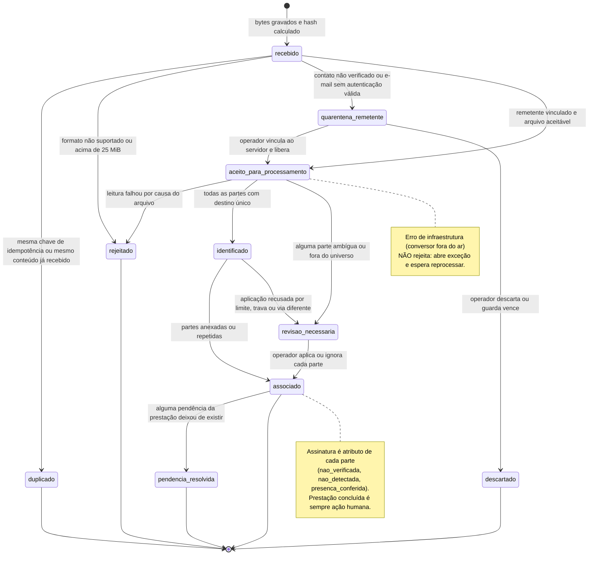
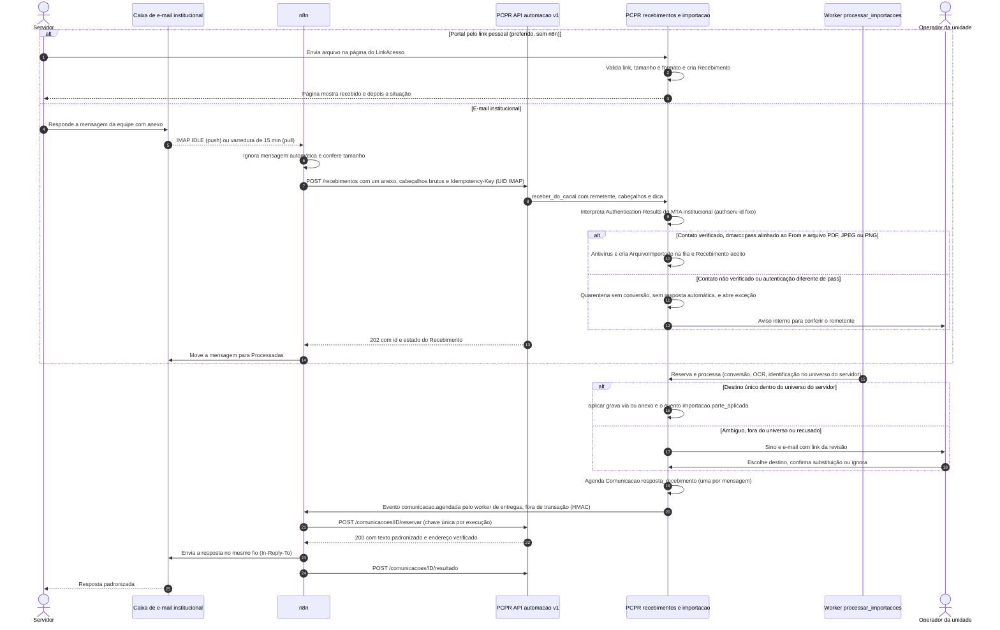

# 10.6 — Recebimento de documentos devolvidos pelo servidor

> **Escopo revisado em 18/10/2026:** [regra vigente do piloto](../../product/automacao-whatsapp-testes.md). Este site é um sistema
> de testes independente, não oficial da polícia e sem operação com policiais. WhatsApp Business
> Cloud API é o canal principal planejado; portal é apoio e e-mail opcional. As classificações e
> restrições policiais de 17/10 abaixo são histórico do cenário institucional, sem bloquear
> automaticamente o piloto. Não houve implementação ou ativação real nesta revisão.

Desenho técnico da Fase 2 (automação com n8n e IA), 17/10/2026. Base obrigatória:
[`../arquitetura.md`](../arquitetura.md), [`../contratos/evento-integracao.schema.json`](../contratos/evento-integracao.schema.json)
e [`../contratos/api-automacao.v1.yaml`](../contratos/api-automacao.v1.yaml).

Marcação: **[existe]** código executando hoje · **[parcial]** · **[novo]** a desenvolver.
Evidências `caminho:linha` foram conferidas no código em 17/10/2026. `ref/gv/…` e `ref/ev-implantado/…`
são as cópias somente leitura das referências implantadas usadas na auditoria (fora do repositório).

**Em uma frase:** o sistema já lê e direciona documentos (importação documental); este fluxo acrescenta
**uma porta de entrada para o próprio servidor** (portal por link e e-mail institucional; a plataforma
oficial do WhatsApp está bloqueada para a PCPR, maturidade 5, e o recebimento por ela fica pronto e
desligado na frente WA-3 do [plano](../plano-implantacao.md), ver [whatsapp-viabilidade.md](../whatsapp-viabilidade.md)), **o rastro de quem
mandou e em resposta a quê**, **um universo de destinos
restrito ao remetente** e **uma resposta padronizada** — sem criar leitura, classificação ou regra no n8n.

---

## 1. Objetivo e resultado para o usuário

**Problema hoje.** O servidor devolve RT assinado, comprovante, diário de bordo assinado ou termo por
e-mail, WhatsApp pessoal ou eProtocolo. O operador abre a mensagem, baixa os anexos, arrasta na
"fitinha" de importação, acompanha a revisão, abre o PDF para ver se está assinado e responde ao servidor
à mão — ou esquece de responder. Não há registro de quem mandou, quando, nem em resposta a quê.

**Resultado esperado.**

| Para quem | O que muda |
|---|---|
| **Servidor** | Devolve pelo **link pessoal da viagem** (portal, preferido) ou respondendo a mensagem institucional. Recebe uma resposta padronizada dizendo exatamente o que aconteceu ("recebido e anexado à prestação para conferência", "recebido, a equipe vai conferir", "não conseguimos usar este arquivo porque…; faça assim") e vê no portal a situação dos próprios envios. |
| **Operador de viagens** | Os documentos entram sozinhos na **mesma fila de importação** que já existe. Os inequívocos são anexados pelas regras atuais; os duvidosos aparecem numa fila **"Recebidos de servidores"** com o remetente, a mensagem a que ele respondeu e a sugestão de destino. Remetente não confirmado fica em **quarentena**. Nada é finalizado, assinado ou substituído sozinho. |
| **Gestão** | Vê tempo de entrada, taxa de anexação automática, revisões, rejeições e vínculos errados corrigidos. |

**Fora do escopo:** ler, classificar ou fazer OCR no n8n; validar assinatura ICP; assinar; finalizar
prestação; inferir pagamento; preencher valor/data do comprovante (melhoria separada, citada em §13);
IA decidindo destino. A IA **não tem papel na v1** deste fluxo (§5).

---

## 2. Estado atual com evidências

### 2.1 Sistema novo

| Capacidade | Estado | Evidência | Observação |
|---|---|---|---|
| Entrada pela fitinha (upload em sessão + CSRF) | IMPLEMENTADO | `gestao/viagens/views_importacao.py:32-56`; rotas `gestao/viagens/urls.py:24-30` | 1 a 50 arquivos por requisição; o cliente manda um por vez. Sem API de máquina. |
| Quem importa | IMPLEMENTADO | `gestao/viagens/importacao.py:31-35` | Exige `viagens.change_oficio` (`policies.edita_oficios`, `policies.py:65-67`). |
| Cada usuário vê só os próprios originais e revisa só as próprias partes | IMPLEMENTADO | `views_importacao.py:18-20`, `92-96`; `importacao.py:248-252` (`importacao__usuario=usuario`) | Partes de um arquivo de outro usuário (ex.: um usuário técnico) **não** podem ser revisadas por operadores hoje. |
| Original privado, SHA-256, deduplicação por (usuário, hash) | IMPLEMENTADO | `gestao/viagens/models.py:1856-1877`; `importacao.py:136-157` | Mesmo arquivo do mesmo usuário = mesmo registro; reenvio de um registro em `erro` volta à fila (`importacao.py:149-156`). |
| Limite de 25 MiB por arquivo | IMPLEMENTADO | `importacao.py:139-140`; `documentos/importador.py:22`; corpo de 26 MiB só na rota da fitinha `config/settings/base.py:180-187`; 413 em `gestao/plataforma/middleware.py:84-105` | Qualquer rota nova (API, portal) cai no teto geral de 16 MiB se não for registrada. |
| Fila persistente com lease | IMPLEMENTADO | `importacao.py:160-182` (lease 8 min, 3 tentativas, `skip_locked`); worker `management/commands/processar_importacoes.py:16-60`; `deploy/compose.yml:130-141` | O worker **consulta a fila a cada 1 s** (`processar_importacoes.py:47-52`); não usa LISTEN/NOTIFY. Rede só do banco, 2 GiB. |
| Conversão isolada e OCR local | IMPLEMENTADO | `documentos/importador.py:78-177` (formatos), `200-270` (OCR Tesseract por+eng, até 100 páginas), `273-312` (subprocesso 240 s), `315-321` (limites de memória/CPU) | Formatos: PDF; imagens png/jpg/jpeg/tif/tiff/webp/bmp/gif/avif; Office doc/docx/odt/xls/xlsx/ods/ppt/pptx/odp/rtf; txt/csv/eml/mht/mhtml/html/htm (`importador.py:24-25`, `100`). Zip, HEIC e áudio/vídeo não. |
| Separação por título e identificação | IMPLEMENTADO | `gestao/viagens/dominio/importacao.py:9-28` (8 tipos), `56-83` (separar), `125-194` (interseção de nº/ano, protocolo, CPF/nome; minuta vai à revisão), `197-224` (contexto do mesmo arquivo) | Texto é evidência, nunca instrução (`dominio/importacao.py:1`). |
| Universo de destinos | IMPLEMENTADO (por usuário) | `importacao.py:38-97` | Destinos de RT e comprovante **sem data do evento** (`importacao.py:55-67`) → comprovante sem nº/protocolo nunca casa sozinho (`dominio/importacao.py:173-181`). |
| Aplicação automática e revalidação | IMPLEMENTADO | `importacao.py:229-233` (aplica o destino único), `243-323` (`aplicar`: policies, travas, "repetido" por hash, substituição só com confirmação) | Idempotente: parte `anexado/repetido/ignorado` não reaplica (`importacao.py:253-254`); teste `gestao/viagens/tests/test_importacao.py:113`. |
| Estados | IMPLEMENTADO | `ArquivoImportado.estado`: fila → lendo → revisao / concluido / erro (`models.py:1864`, `importacao.py:185-189`); `ParteImportada.estado`: revisao → anexado / repetido / ignorado (`models.py:1895`, `views_importacao.py:105-110`) | Andamento por *polling* (`views_importacao.py:59-89`); **nenhum evento** ao concluir ou pedir revisão. |
| Revisão humana | IMPLEMENTADO | `views_importacao.py:99-129` | Escolher destino, confirmar substituição ou ignorar. |
| Destinos e limites | IMPLEMENTADO | Vias: ofício, justificativa, termo, OS — 15 MiB, só PDF (`assinados.py:33`, `76-83`); anexos da prestação: despacho, DB, RT, comprovante — 10 MiB, PDF/PNG/JPG (`anexos.py:26-52`) | Parte acima do limite do destino fica em revisão. |
| Conferência de assinatura | PARCIAL | `assinados.py:250-253` grava `ViaAssinada.conferencia` (`models.py:637`); `documentos/leitura.py:1-4`, `75-124` (campo /Sig e CN do certificado **sem validar a cadeia**; carimbos eProtocolo/ICP/gov.br) | Só ofício, justificativa, termo e OS. **Nada para RT, DB, despacho e comprovante** (`AnexoPrestacao` não tem campo, `models.py:1605-1660`). Ao separar partes, o PDF perde os campos /Sig (`importador.py:249-255`); parte única preserva os bytes (`importador.py:247-248`). |
| Comprovante importado sem valor/data/operação | LACUNA | `importacao.py:306-313`; `anexos.py:99-109` | A divergência "soma ≠ diária" fica cega para comprovantes importados. |
| Pendências da prestação | IMPLEMENTADO | `gestao/viagens/prestacao.py:127-156` | RT e DB **preenchidos** já satisfazem a pendência (`prestacao.py:144-147`): receber o assinado nem sempre "resolve" algo. |
| Aviso "Documentos assinados recebidos" | PARCIAL | `gestao/viagens/avisos.py:76-86` | Só conta anexos; não sabe se estão assinados. |
| Usuário ↔ servidor | INEXISTENTE | `gestao/identidade/models.py:25-31` (vínculo "opcional", não implementado); `gestao/cadastros/models.py:86-128` (`Servidor` sem e-mail, telefone único) | **Servidores viajantes não são usuários do sistema**: não há a quem atribuir um `ArquivoImportado` "em nome do servidor". |
| Entrada por e-mail, WhatsApp ou API | INEXISTENTE | — | ADR 0020 é proposta; `gestao/automacao` não existe. |
| Antivírus | INEXISTENTE | busca em `gestao/` e `deploy/` sem ClamAV | Isolamento de conversão existe; varredura de malware não. |
| Eventos de outbox | PARCIAL | só `viagens.documento.gerar`, `viagens.oficio.emitido` (`gestao/viagens/services.py:1067-1073`) e `plataforma.email.enviar` (`gestao/plataforma/notificacoes.py:57-60`) | Retentativa real 10 s → 640 s, `falhou` na 8ª tentativa (~21 min) (`outbox.py:34`, `72-73`, `108-111`). |

### 2.2 O que as referências em produção fazem

| Referência | Faz | Evidência |
|---|---|---|
| GV | **Envia** link de assinatura eletrônica de RT/DB por WhatsApp (assinatura desenhada carimbada no PDF). Não recebe arquivos devolvidos por canal. | `ref/gv/prestacoes_contas/assinatura_services.py:1-9` |
| GV | Antivírus ClamAV nos uploads privados, **obrigatório por padrão em produção**. | `ref/gv/core/uploads.py:60-61`, `73-78`; `ref/gv/config/settings/prod.py:8-11` |
| EV | Importa o **processo inteiro do eProtocolo** (25 MiB), com política central de upload e antivírus opcional. | `ref/ev-implantado/viagens_prestacoes/importacao/entrada.py:1-7`; `ref/ev-implantado/core/uploads.py:73-74` |
| EV | Deduplicação **global** por hash (o novo é por usuário) e **"desfazer"** uma importação que só criou anexos. | `entrada.py:78-87`, `136-150` |
| EV | Comprovante casado por CPF mascarado/nome + valor ≤ diária liberada + data na janela de saque, só entre prestações abertas. | `ref/ev-implantado/viagens_prestacoes/importacao/analise.py:333-341` |
| EV | Link sem login para o motorista preencher o diário no celular (o link é a credencial; token no caminho, limite de taxa). | `ref/ev-implantado/viagens_prestacoes/campo_views.py:1-13` |
| GV e EV | **Nenhuma** leitura de caixa postal nem webhook de entrada de documentos (busca por IMAP/caixa postal sem resultado). | — |

### 2.3 Lacunas que este fluxo fecha

1. Não existe porta de entrada para quem não é usuário (o servidor).
2. Não existe registro do remetente, do canal, da mensagem e da comunicação respondida.
3. O universo de destinos é o de um **usuário operador**; para o servidor ele precisa ser **o dos processos dele**.
4. A revisão é privada de quem enviou; partes recebidas precisam ser revisáveis pela equipe da unidade.
5. Nenhum evento sai da importação; ninguém é avisado nem o servidor recebe resposta.
6. Erro de infraestrutura (conversor indisponível) e erro de conteúdo usam a mesma exceção
   (`importador.py:58-62` e `175-177` levantam `LeituraInvalida`) — não dá para responder "reenvie" só quando
   a culpa é do arquivo.
7. Nada detecta "devolveu o PDF sem assinatura" nem "assinou a versão anterior".

---

## 3. Gatilho e definição do evento de conclusão

### 3.1 Gatilhos de entrada

| Canal | Gatilho | Quem chama o PCPR |
|---|---|---|
| **Portal** (preferido) | Servidor envia arquivo na página do link pessoal (`LinkAcesso` escopo `devolver_documentos`) | A própria view do PCPR chama o serviço — **sem n8n** |
| **E-mail institucional** | Nova mensagem na caixa dedicada (IMAP IDLE = *push*) ou varredura a cada 15 min (*pull*) | n8n → `POST /recebimentos` (um anexo por chamada) |
| **WhatsApp** | **Plataforma oficial BLOQUEADA (5)**: a política oficial da Meta proíbe autoridades policiais (23/09/2026; não depende de autorização interna). Ver [whatsapp-viabilidade.md](../whatsapp-viabilidade.md). O WhatsApp é **prioridade do usuário** (frentes WA-1 a WA-3 do [plano](../plano-implantacao.md)): os ramos de WhatsApp deste documento são o desenho do recebimento da **WA-3** — webhook com `X-Hub-Signature-256`, mídia por id, workflow exportado **desligado** e testado contra simulador —, ativável só depois do portão de ativação (autorização escrita da Meta pedida pela WA-2, maturidade 4). Até lá `canais_entrada.whatsapp = bloqueado` → 409 `canal_bloqueado`. A WA-1 (envio assistido) não recebe arquivo: a devolução segue pelo portal ou pelo e-mail | — (WA-3: n8n → `POST /recebimentos`, desligado) |

### 3.2 Escada de estados — cada degrau é um fato diferente

| Nível | Significa | Onde fica gravado | Quem decide | O que **não** significa |
|---|---|---|---|---|
| 1. **Arquivo recebido** | O PCPR tem os bytes, calculou SHA-256 e registrou remetente/canal/mensagem | `Recebimento.estado = recebido` [novo] | Sistema | Nada sobre conteúdo ou remetente |
| 2. **Aceito para processamento** | Remetente vinculado a um servidor por contato verificado (ou link pessoal), tamanho e formato aceitáveis, não duplicado | `Recebimento = aceito_para_processamento` + `ArquivoImportado(origem=recebimento, estado=fila)` | Sistema | Que o arquivo é legível ou é o documento certo |
| 3. **Documento identificado** | Uma parte tem tipo reconhecido e **destino único** no universo do remetente | `ParteImportada.tipo` ≠ "" e `ParteImportada.destino` ≠ "" | Regra pura `identificar_conjunto` | Que foi anexado (pode falhar por limite, trava ou via diferente) |
| 4. **Associado ao processo** | A parte virou `ViaAssinada` ou `AnexoPrestacao` (ou era idêntica a uma existente) | `ParteImportada.estado` anexado/repetido + `via`/`anexo` | Sistema (destino único) ou operador (revisão) | Que está assinado ou correto |
| 5. **Assinatura verificada** | Atributo por parte, não degrau do fluxo: `nao_verificada` (RT, DB, despacho, comprovante — nada é conferido hoje), `nao_detectada`, `presenca_conferida` (campo /Sig ou carimbo encontrado), `verificada_icp` (**inalcançável hoje**: a cadeia não é validada) | `ParteImportada.assinatura` [novo], derivado de `ViaAssinada.conferencia` | Leitura pypdf (ADR 0022) | Validade jurídica da assinatura |
| 6. **Pendência resolvida** | Um item de `prestacao.pendencias(ps)` que existia antes da aplicação deixou de existir depois | `ParteImportada.pendencias_resolvidas` [novo]; `Recebimento = pendencia_resolvida` | Sistema (comparação antes/depois na mesma transação) | Que a prestação está pronta |
| 7. **Prestação concluída** | `PrestacaoServidor.finalizada_em` preenchido | `prestacao.finalizar` (`prestacao.py:299`) | **Sempre uma pessoa** | — este fluxo nunca chega aqui |

### 3.3 Evento de conclusão deste fluxo

Um `Recebimento` está **concluído** quando (a) atingiu estado terminal — `duplicado`, `rejeitado`,
`descartado`, `associado` ou `pendencia_resolvida` — **e** (b) a resposta ao remetente foi resolvida:
mostrada na página (portal), comunicação `resposta_recebimento` em `enviada` ou `feita_a_mao` (entrega e
leitura são marcas de tempo, não estados), ou dispensada por regra (mensagem automática, remetente em
quarentena ou sem `dmarc=pass` alinhado: nunca há resposta automática nesses casos, D3). Grava `Recebimento.concluido_em`.

Uma `MensagemRecebida` está concluída quando todos os seus recebimentos estão concluídos. A conclusão do
**negócio** (pendência resolvida, prestação finalizada) é medida à parte e nunca é inferida pelo fluxo.

---

## 4. Diagramas

### 4.1 Estados de um `Recebimento` (um arquivo)



### 4.2 Sequência PCPR ↔ n8n ↔ canal ↔ pessoa



---

## 5. Responsabilidades

| Quem | Faz | NÃO faz |
|---|---|---|
| **Sistema PCPR** | Valida remetente (contato verificado, link e a autenticação do e-mail, interpretada pelo próprio PCPR a partir dos cabeçalhos brutos), antivírus, tamanho e formato (nas entradas externas, só PDF, JPEG e PNG); grava `MensagemRecebida`/`Recebimento`; cria o `ArquivoImportado`; converte, faz OCR, separa, identifica e aplica **pelas regras existentes**, restritas ao universo do servidor; detecta duplicados em todos os níveis; calcula pendências resolvidas; publica eventos; compõe o texto da resposta; abre exceções; mostra a fila "Recebidos de servidores" e o portal | Aplicar fora do universo do remetente; substituir via ou assinado vigente sem confirmação humana; afirmar que a assinatura é válida; finalizar prestação; responder a mensagem automática |
| **n8n** | Lê a caixa postal **dedicada à automação** (push e pull); descarta mensagens automáticas; confere tamanho declarado; calcula SHA-256 para conferência de transporte; chama a API com chave de idempotência; move a mensagem só depois de todos os 202; transporta a resposta pelo mecanismo comum de comunicações; abre exceção quando o PCPR está fora | Ler ou classificar PDF; OCR; escolher destino; decidir se o remetente é válido (só repassa o bloco bruto de cabeçalhos `Authentication-Results`, sem interpretar); descompactar zip; converter formatos; compor ou alterar o texto da resposta; guardar o arquivo além da execução; responder pelo campo Reply-To |
| **IA** | Nada na v1. Futuro possível (fase 2 da importação, nova ADR): sugerir tipo de parte sem título, com modelo **local** (ADR 0041 veda enviar documentos a terceiros), exibido só como sugestão na revisão | Decidir destino; ler o corpo da mensagem como instrução; preencher valor, data ou "atividade realizada"; dizer que algo está assinado |
| **Servidor** | Envia o arquivo pelo link ou pelo e-mail cadastrado; corrige e reenvia quando a resposta pedir | Escolher onde o documento é anexado; ver documentos de colegas |
| **Operador da unidade** | Revisa partes ambíguas; confirma substituições; libera ou descarta quarentena; reprocessa após falha de infraestrutura; responde manualmente quando quiser | — |
| **Gestor** | Liga/desliga as chaves do fluxo; acompanha exceções sem dono; decide quarentena sem unidade | — |

---

## 6. Contratos

### 6.1 Endpoints usados (de `api-automacao.v1.yaml`)

| Endpoint | Uso neste fluxo |
|---|---|
| `GET /estado` | n8n consulta antes de cada lote; com `recebimento-canais` desligado não chama `POST /recebimentos` |
| `POST /recebimentos` | Entrega de um anexo (multipart). Resposta 202 com `Recebimento` |
| `GET /recebimentos/{id}` | Só diagnóstico do n8n; o texto da resposta vai pela comunicação (§6.3 E6) |
| `POST /excecoes` | n8n abre exceção quando não consegue entregar (`canal_indisponivel`, `limite_tentativas`, `arquivo_nao_baixado` [novo]) |
| `GET /comunicacoes/devidas`, `POST /comunicacoes/{id}/reservar`, `/resultado`, `/entrega` | Transporte da resposta `resposta_recebimento` (tipo já previsto no contrato) pelo mecanismo comum |

### 6.2 Eventos usados (de `evento-integracao.schema.json`)

| Evento | Quem publica | Quando | Consumidor |
|---|---|---|---|
| `comunicacao.agendada` | PCPR | Resposta consolidada da mensagem pronta | n8n (envio) |
| `comunicacao.cancelada` | PCPR | Resposta dispensada (ex.: prazo de janela vencido) | n8n |
| `importacao.parte_aplicada` | PCPR | Parte passou a `anexado` ou `repetido` (qualquer origem) | Outros fluxos (ex.: cancelar lembrete de pendência), métricas |
| `importacao.revisao_necessaria` | PCPR | Arquivo entrou em `revisao` | Resumos/alertas opcionais no n8n; o aviso ao operador é interno |
| `prestacao.documento_recebido` | PCPR | Parte anexada a uma prestação (`AnexoPrestacao`) | Fluxos de pendência e de cobrança |
| `automacao.desligada` / `automacao.religada` | PCPR | Chave mudou | n8n para/retoma a leitura da caixa |

Todos saem pela outbox no tópico `integracao.evento` (desenho de `../arquitetura.md` §2), **na mesma
transação** da mudança — `aplicar` já é `@transaction.atomic` (`importacao.py:243`), o que torna o
evento tão idempotente quanto a aplicação.

### 6.3 Extensões necessárias [novo]

**E1 — `POST /recebimentos`: chave de idempotência e campos.**
O rascunho 2 dizia `Idempotency-Key = canal + id da mensagem`; isso **colide** quando uma mensagem tem
vários anexos. Regra adotada no rascunho 3 do contrato (e a propagar ao protótipo, que usa
`recebimento:<canal>:<id>`): `receb:<canal>:<mensagem_id_canal>:<anexo_indice>`.

**Proposta deste fluxo não incorporada ao rascunho 3** (o contrato descreve `mensagem_id_canal` como o
`Message-ID` e recebe `autenticacao_remetente` já interpretado em `{spf, dkim, dmarc}`): no e-mail,
`mensagem_id_canal` deveria ser o identificador **atribuído pelo servidor IMAP** (`<caixa>:<UIDVALIDITY>:<UID>`),
nunca o `Message-ID`, que é escolhido por quem envia: quem conhecesse o `Message-ID` de uma mensagem
legítima poderia mandar antes, de outro endereço, uma mensagem com o mesmo valor e fazer a verdadeira ser
descartada como "duplicada". O `Message-ID` segue num campo próprio, só para correlação. Pelo mesmo
motivo, a autenticação do remetente deveria chegar em bruto (`cabecalhos_autenticacao`, abaixo) e ser
interpretada pelo PCPR, não pelo n8n. Até a decisão, vale o contrato. Repetir a mesma chave devolve o
mesmo `Recebimento` (202, sem efeito, `Idempotency-Replayed: true`); mesma chave com SHA-256 diferente →
**409 `conflito_de_versao`** (exceção deliberada do contrato à regra geral do 422: o canal mudou o anexo,
e o PCPR abre exceção). Campos no multipart (os marcados "proposta" não estão no rascunho 3):

| Campo | Tipo | Regra |
|---|---|---|
| `anexo_indice` | inteiro ≥ 0 | Posição do anexo na mensagem; parte da chave |
| `total_anexos` | inteiro ≥ 1 | Permite consolidar uma única resposta por mensagem |
| `nome_arquivo` | texto ≤ 255 | Nome original (o `arquivo` multipart pode vir renomeado) |
| `em_resposta_a_mensagem_canal` | texto | `In-Reply-To`/`References` do e-mail ou `context.id` do WhatsApp; o PCPR resolve para a `Comunicacao` que enviou (guardou `provedor_mensagem_id` no `resultado`) |
| `cabecalhos_autenticacao` (proposta; o contrato tem `autenticacao_remetente`) | texto bruto (todos os `Authentication-Results`, na ordem) | O n8n **não interpreta**. O PCPR fixa por configuração o `authserv-id` do MTA institucional e considera só o cabeçalho mais acima com esse `authserv-id`; a TI precisa configurar o MTA para remover ou renomear, na entrada, cabeçalhos com o mesmo `authserv-id` (RFC 8601 §5). O remetente controla os cabeçalhos da própria mensagem e pode incluir um `Authentication-Results` forjado com `dmarc=pass`. Resultado interpretado (`{spf, dkim, dmarc, alinhado}`) fica em `MensagemRecebida.autenticacao`; a interpretação é testada no PCPR |
| `message_id` (proposta) | texto ≤ 998 | `Message-ID` declarado; só correlação. Mesmo (remetente, `Message-ID`) com SHA-256 da mensagem bruta diferente → exceção, nunca "duplicada" |
| `gerada_automaticamente` | booleano | `Auto-Submitted` ≠ `no`, `Precedence: bulk/list/junk`, `List-Id`, MAILER-DAEMON: n8n normalmente nem envia; se enviar, o PCPR não agenda resposta |
| `assunto` | texto ≤ 200 | Mostrado ao revisor; nunca usado na identificação |
| `texto_mensagem` | texto ≤ 2000, opcional (decisão D9) | Mostrado ao revisor como "mensagem do remetente"; dado, nunca instrução; não vai para IA |

O PCPR recalcula o SHA-256 e recusa com 422 `entrada_invalida` se divergir do informado. **Só fica fora da
quarentena** o e-mail com `dmarc=pass` alinhado ao domínio do `From`; `none`, `fail` ou ausente → quarentena,
sem conversão e sem resposta automática. `canal=portal`
**não** é aceito com token de serviço (o portal é interno). A rota precisa entrar em
`LIMITES_DO_CORPO_POR_CAMINHO` com 26 MiB (`config/settings/base.py:182-187`), senão o middleware devolve
413 a partir de 16 MiB.

**E2 — `POST /recebimentos/sem-arquivo` [novo].** Para o que não chega a ter bytes: anexo acima de
25 MiB (o n8n sabe o tamanho antes de baixar), mensagem sem anexo, anexo que o canal não deixou baixar.
Corpo JSON: `canal`, `mensagem_id_canal`, `anexo_indice`, `total_anexos`, `remetente`, `recebido_em`,
`nome_arquivo`, `tamanho`, `motivo` ∈ {`acima_do_limite`, `sem_anexo`, `nao_baixado`}. Mesma chave de
idempotência de E1. Efeito: `Recebimento` em `rejeitado` (ou exceção em `nao_baixado`) e resposta
orientando — sem gravar arquivo.

**E3 — Esquema `Recebimento` (resposta).** O contrato tem `assinatura` e `destino` **por arquivo**, mas um
arquivo vira várias partes (`dominio/importacao.py:56-83`). Acrescentar:

```yaml
Recebimento:
  properties:
    id: { type: integer }
    mensagem_id: { type: integer }
    estado: { enum: [recebido, duplicado, quarentena_remetente, aceito_para_processamento,
                     identificado, revisao_necessaria, associado, pendencia_resolvida,
                     rejeitado, descartado] }          # + descartado [novo]
    motivo_codigo: { enum: [formato_nao_suportado, acima_do_limite, protegido_por_senha,
                            paginas_excedidas, arquivo_danificado, sem_anexo,
                            remetente_nao_verificado, autenticacao_falhou, arquivo_malicioso,
                            duplicado_mesma_mensagem, duplicado_conteudo] }   # arquivo_malicioso: proposta (AUT-112), fora do rascunho 3
    importacao_id: { type: integer }
    partes:                                            # [novo]
      type: array
      items:
        properties:
          tipo: { type: string }                       # um dos 8 TIPOS ou vazio
          estado: { enum: [revisao, anexado, repetido, ignorado] }
          identificado: { type: boolean }
          destino: { type: string }                    # rótulo curto, sem CPF
          assinatura: { enum: [nao_verificada, nao_detectada, presenca_conferida, verificada_icp] }
          pendencias_resolvidas: { type: array, items: { type: string } }
```

`resposta_ao_remetente` fica marcado como **obsoleto** no rascunho 3 (`deprecated`): o texto passa a ser
conteúdo da comunicação `resposta_recebimento` (E6). O E3 foi incorporado ao contrato, salvo
`arquivo_malicioso`.

**E4 — `GET /estado`.** Fluxos novos: `recebimento-canais` (entrada por e-mail/WhatsApp),
`recebimento-portal`, `recebimento-aplicacao-automatica` (desligada = tudo vai para revisão). Campo
`canais_entrada: {email, whatsapp}` separado dos canais de saída (`whatsapp` = `bloqueado` em todos os
ambientes reais; whatsapp-viabilidade §5.2).

**E5 — Payload (`dados`) dos eventos.** Sem dados pessoais:

| Evento | `recurso` | `dados` | Chave de outbox (idempotência) |
|---|---|---|---|
| `importacao.parte_aplicada` | `{tipo: importacao, id: ArquivoImportado.pk, versao}` | `parte_id`, `tipo_documento`, `estado` (anexado/repetido), `alvo` (via/anexo), `oficio_id`, `prestacao_id`, `origem` (tela/recebimento), `recebimento_id` | `importacao.parte_aplicada:<parte_id>` (a parte só é aplicada uma vez) |
| `importacao.revisao_necessaria` | idem | `partes_em_revisao`, `motivos` (códigos), `recebimento_id`, `unidade_id` | `importacao.revisao_necessaria:<arquivo_id>:<versao>` |
| `prestacao.documento_recebido` | `{tipo: prestacao, id: PrestacaoContas.pk, versao}` | `anexo_id`, `tipo_documento` (nome do contrato), `prestacao_servidor_id`, `origem`, `recebimento_id`, `pendencias_resolvidas`, `pendencias_restantes` (número) | `prestacao.documento_recebido:<anexo_id>` |

`versao` exige `ArquivoImportado.versao` [novo] e a versão da prestação (campo comum aos fluxos de
prestação; enquanto não existir, contador monotônico em `PrestacaoContas`). `correlacao_id`:
`prestacao:<id>` quando houver destino; senão `recebimento:<id>`.

**E6 — Comunicação `resposta_recebimento`.** Uma por `MensagemRecebida`, chave
`resposta:<mensagem_recebida_id>:v1`; destinatário = **contato verificado** de onde veio a mensagem
(nunca `Reply-To`); `variaveis.em_resposta_a_canal` [novo] leva o `Message-ID`/`wamid` original para o
n8n responder no mesmo fio. Textos-modelo do PCPR (aprovação em D11):

| Situação | Texto-modelo (rascunho) |
|---|---|
| Anexado | "Recebemos N documento(s) em DD/MM às HH:MM. Relatório técnico — Ofício 12/2026: anexado à prestação para conferência da equipe." |
| Em conferência | "Recebemos 'arquivo.pdf'. A equipe de viagens vai conferir a qual processo ele pertence. Não é preciso reenviar." |
| Duplicado | "Este arquivo já tinha sido recebido em DD/MM. Não é preciso reenviar." |
| Não aceito | "Não conseguimos usar 'arquivo.zip': envie o documento em PDF ou a foto em JPEG ou PNG, sem compactar. Você pode enviar pelo seu link: …" |
| Sem anexo | "Não encontramos arquivo anexado na sua mensagem." |
| Remetente não confirmado ou sem `dmarc=pass` alinhado | **Nenhuma resposta automática** (D3): com `From` forjado, a caixa institucional responderia a terceiros escolhidos pelo atacante (*backscatter*). A equipe responde à mão, se quiser |

Nenhum texto diz "assinatura válida", "aprovado" ou "prestação concluída".

**E7 — `POST /excecoes`: motivos novos.** `arquivo_nao_baixado`, `fila_parada`,
`remetente_em_excesso`, `infraestrutura_leitura`.

**E8 — Erro de leitura com código [novo].** `LeituraInvalida` ganha `codigo` ∈ {`formato`, `senha`,
`paginas`, `danificado`, `tempo`, `conversor_indisponivel`, `interno`}. Só os quatro primeiros viram
`rejeitado` e resposta "reenvie"; `tempo`, `conversor_indisponivel` e `interno` mantêm o recebimento em
`aceito_para_processamento`, abrem exceção `infraestrutura_leitura` e esperam "reprocessar".

---

## 7. Modelo de dados [novo] e permissões

### 7.1 Entidades

Ficam em `gestao/viagens/` (contexto dono de `ArquivoImportado`); a fachada HTTP fica em
`gestao/automacao/` (ADR 0020) e só chama o serviço `gestao/viagens/recebimentos.py`.

**`MensagemRecebida`** — uma mensagem do canal (ou um envio pelo portal).

| Campo | Tipo | Observação |
|---|---|---|
| `canal` | texto: portal, email, whatsapp | |
| `mensagem_id_canal` | texto 255 | E-mail: identificador do servidor IMAP (`<caixa>:<UIDVALIDITY>:<UID>`); portal: UUID gerado no PCPR; **único com `canal`** (E1) |
| `message_id` | texto 998 | `Message-ID` declarado pelo remetente; só correlação e detecção de colisão (E1) |
| `remetente_endereco` | texto 320 | E-mail em minúsculas ou E.164; dado pessoal |
| `autenticacao` | JSON | `{spf, dkim, dmarc, alinhado, authserv_id}` interpretado pelo PCPR + o bloco bruto recebido |
| `gerada_automaticamente` | booleano | |
| `contato` | FK `ContatoVerificado`, nula | Dependência comum (`../arquitetura.md` §2) |
| `servidor` | FK `cadastros.Servidor`, nula | Resolvido pelo contato/link ou na liberação da quarentena |
| `link_acesso` | FK `LinkAcesso`, nula | Portal |
| `em_resposta_a` | FK `Comunicacao`, nula | Dica de contexto |
| `dica_ignorada` | texto 200 | Ex.: "comunicação de outro destinatário" |
| `assunto`, `texto` | texto 200 / 2000 | Só para o revisor (D9) |
| `recebida_em` | data-hora (UTC) | Do canal |
| `total_anexos` | inteiro, nulo | |
| `resposta` | FK `Comunicacao`, nula | `resposta_recebimento` |
| `criada_em`, `concluida_em` | data-hora | |

Índices: (`servidor`, `criada_em`), (`remetente_endereco`, `criada_em`) para limites de taxa.

**`Recebimento`** — um arquivo de uma mensagem.

| Campo | Tipo | Observação |
|---|---|---|
| `mensagem` | FK `MensagemRecebida` (PROTECT) | |
| `indice` | inteiro | **único com `mensagem`** |
| `nome_original`, `sha256`, `tamanho`, `tipo_detectado` | | Tipo pelo conteúdo (assinatura de bytes), não só pela extensão |
| `estado` | texto (§3.2/§4.1), indexado | |
| `motivo_codigo`, `motivo` | texto 40 / 500 | Código para máquina, texto para o operador |
| `arquivo_importado` | FK `ArquivoImportado`, nula (PROTECT) | Vários recebimentos podem apontar para o mesmo (duplicados) |
| `quarentena` | arquivo privado, opcional | Só enquanto em quarentena; liberado → vira o original do `ArquivoImportado`; descartado → apagado na purga |
| `contexto` | JSON | `{comunicacao_id, destinos_esperados: [...], versao_documento_enviado}` |
| `decidido_por`, `decidido_em` | FK usuário / data-hora | Liberação, descarte |
| `criado_em`, `concluido_em` | data-hora | |

**Alterações em modelos existentes**

| Modelo | Campo [novo] | Para quê |
|---|---|---|
| `ArquivoImportado` | `origem` (tela/recebimento, padrão tela); `versao` (inteiro, +1 a cada mudança de estado); `servidor_remetente` (FK `Servidor`, nula) | Escolher o universo de destinos; versão do evento; deduplicação dos recebidos por (servidor, SHA-256): a unicidade atual (`usuario`, `sha256`) (`models.py:1876-1877`) passa a valer só com `servidor_remetente` nulo, e um índice único parcial (`usuario`, `servidor_remetente`, `sha256`) cobre os recebidos |
| `ParteImportada` | `assinatura` (§3.2); `pendencias_resolvidas` (JSON); `sugerido` (chave de destino da dica, só exibição) | Degraus 5 e 6; revisão assistida |
| `AnexoPrestacao` | `conferencia` (JSON) | Estender a conferência ADR 0022 a RT/DB (dependência D, §13) |
| `Comunicacao` (comum) | `documentos_esperados` (lista de chaves de destino), `versao_documento` | Dica de contexto e detecção de "assinou a versão anterior" |
| `prestacao.pendencias` | devolver também **códigos** (`solicitacao`, `despacho`, `comprovante`, `diario`, `rt`, `carimbo`, `soma`) | Comparar antes/depois sem depender do texto |

**Usuário técnico.** `ArquivoImportado.usuario` é FK obrigatória para `Usuario` (`models.py:1859`) e o
servidor não é usuário. Proposta: um usuário `sistema.recebimentos` por ambiente, **senha inutilizável e
login recusado** e **sem papel de staff** (nem `ver_todas_unidades`, nem `change_oficio`). Com um papel
amplo, qualquer caminho que avaliasse policies para esse usuário (o `aplicar` reutilizado, a revisão, a
identificação no universo amplo do §7.2) autorizaria qualquer unidade, e a única barreira seria o
universo do servidor. Por isso as entradas externas passam por um `_aplicar_recebido(servidor, destino)`
cuja **única** autorização é `pode_devolver(servidor, destino)` (§7.4), sem consultar `has_perm` do
usuário técnico; o usuário técnico só dá autoria ao `ArquivoImportado`. Um teste prova que nenhum destino
fora do universo é aplicado mesmo quando a identificação devolve um único destino. O worker define o
contexto de auditoria `recebimento-<id>` como já faz com `importacao-<pk>`
(`processar_importacoes.py:24-25`). A mesma regra vale para o usuário técnico do portal do 10-5 (§7.3).

### 7.2 Serviço `gestao/viagens/recebimentos.py` [novo]

| Função | Faz |
|---|---|
| `receber_do_canal(token_ctx, canal, mensagem_id, indice, total, remetente, cabecalhos, recebido_em, nome, dados, em_resposta_a)` | Idempotência; limite de taxa; interpreta a autenticação (E1); resolve contato → servidor; formato por bytes **só PDF, JPEG ou PNG** (as listas de `importador.py:24-25` continuam valendo só para a fitinha, com operador autenticado); antivírus fail-closed; quarentena ou `importacao.receber(tecnico, …)` + `origem=recebimento` + `servidor_remetente`; registra dica |
| `receber_do_portal(link, nome, dados)` | O mesmo, sem n8n (inclusive formato restrito e antivírus); servidor vem do `LinkAcesso` |
| `_aplicar_recebido(servidor, destino, parte)` | Aplicação automática dos recebidos: autoriza **só** por `pode_devolver(servidor, destino)` e chama o corpo comum de `aplicar` |
| `registrar_sem_arquivo(…)` | E2 |
| `destinos_do_servidor(servidor)` | Consulta **a partir do servidor** (não do catálogo inteiro): `PrestacaoServidor` dele; diários em que é motorista (`DiarioBordo.motorista_servidor`, ou modo "oficio" com `Viajante.motorista`, `models.py:351-353`, `1517-1523`); termos ativos com documento `chave = str(servidor.pk)` (`termos.py:507-520`) |
| `liberar_quarentena(operador, recebimento, servidor)`, `descartar(operador, recebimento, motivo)` | Decisões humanas |
| `aplicar_parte_recebida(operador, parte_pk, destino, confirmar)` | Revisão pela equipe: confere `_destino_permitido(operador, destino)` (`importacao.py:100-133`) e reutiliza o corpo de `aplicar` refatorado num `_aplicar(parte, destino, autor, confirmar)` interno; `revisado_por = operador` |
| `reprocessar(operador, arquivo)` | Volta `erro` de infraestrutura para `fila` |
| `consolidar_resposta(mensagem)` | Agenda a `Comunicacao resposta_recebimento` (§8) |

Mudanças em `importacao.processar`: se `origem = recebimento`, (1) identifica no **universo do servidor**;
(2) se não decidir, identifica no universo amplo **só para preencher `candidatos`/`sugerido`** na revisão
(nunca aplica: a aplicação automática passa por `_aplicar_recebido`, que recusa destino fora do universo);
(3) antes de aplicar ofício/justificativa, recusa automaticamente arquivo cujo SHA-256 é igual ao de um
`Documento` gerado (`models.py:577`) — "parece o PDF sem assinatura"; (4) com `contexto.versao_documento_enviado`
menor que a versão atual, manda à revisão — "assinado sobre versão anterior"; (5) publica eventos e
calcula pendências resolvidas na transação de `aplicar`.

### 7.3 Regra proposta para o envio feito pelo próprio servidor

Hoje: "só quem pode editar documentos importa; cada usuário acompanha seus próprios originais"
(`docs/ops/importacao-documental.md:41-42`). Isso continua valendo para a fitinha. Para o servidor:

1. **O servidor entrega; o sistema decide.** Ele nunca escolhe o destino. No portal, escolher "a viagem
   do Ofício 12/2026" é **declaração** (dica), não vínculo.
2. **Identidade só por canal confirmado:** contato verificado do próprio servidor ou link pessoal entregue
   a esse contato. Nome exibido, assinatura de e-mail ou número citado na conversa não autorizam nada.
   Fora da quarentena só fica o e-mail com `dmarc=pass` alinhado ao domínio do `From`, interpretado pelo
   PCPR com o `authserv-id` fixo (E1); `fail`, `none` ou sem resultado → quarentena, sem conversão e sem
   resposta automática.
3. **Universo de aplicação automática** = documentos de que ele é titular, em processos de que participa,
   ainda abertos: comprovante e RT assinado da **própria** `PrestacaoServidor` (não removida, não
   finalizada); DB assinado se for o **motorista** daquele diário (equipe não finalizada); termo
   **individual** dele (termo ativo).
4. **Fora do universo** (ofício, justificativa, despacho, OS, termo genérico ou de viatura, documento de
   colega, processo de que não participa, processo finalizado ou cancelado): nunca aplica sozinho; vai à
   revisão com o remetente e o motivo. Aceitar ou não esses tipos vindos do servidor é a decisão D1.
5. **Substituição nunca automática.** Via ou RT/DB assinado vigente e diferente → revisão (regra atual,
   `importacao.py:278-281`, `301-304`). Comprovante quando já existe comprovante ativo da mesma pessoa →
   revisão (D7), porque foto e PDF do mesmo comprovante têm hashes diferentes e somariam duas vezes.
6. **Autoria registrada sem fingir:** o arquivo é do usuário técnico; o remetente, o canal e a mensagem
   ficam no `Recebimento`; quem decide na revisão fica em `revisado_por`.
7. **O servidor acompanha só os próprios envios** (pelo link): nome do arquivo, data, estado em linguagem
   simples e o processo ("Relatório técnico — Ofício 12/2026"). Não vê CPF, documentos de colegas nem baixa
   o que outros mandaram.
8. **A equipe revisa pela unidade do processo**, com as policies existentes (`oficios_visiveis`,
   `pode_editar_equipe_prestacao`, `policies.py:44-52`, `624-626`), e não por "dono do original".
9. **Limites anti-abuso** (valores em D10): 25 MiB por arquivo, 20 anexos por mensagem, 60 arquivos por
   servidor por dia; quarentena com teto por remetente e global por dia — o excesso não é gravado, só
   registrado, e abre uma exceção `remetente_em_excesso` por dia.

### 7.4 Policies [novo] (`gestao/viagens/policies.py`)

| Policy | Regra |
|---|---|
| `pode_devolver(servidor, chave_destino)` | Item 3 de §7.3 (pura sobre os dados; testável sem usuário) |
| `pode_ver_recebimentos(usuario)` | `change_oficio` ou `change_prestacaoservidor`; lista filtrada pela unidade dos ofícios do servidor remetente |
| `pode_revisar_parte_recebida(usuario, parte)` | Algum candidato/sugerido dentro de `oficios_visiveis(usuario)`; a aplicação revalida com `_destino_permitido` |
| `pode_liberar_quarentena(usuario)` | Permissão nova `viagens.liberar_recebimento` (D4); vincular remetente a servidor também exige `cadastros.change_servidor` se marcar o contato como verificado |
| `pode_baixar_original_recebido(usuario, recebimento)` | Mesma régua da revisão |
| Escopos do token do n8n | `recebimentos:criar`, `recebimentos:ler` — sem listar, sem baixar arquivo, sem `canal=portal` |

### 7.5 Privacidade, guarda e isolamento da conversão

Originais no mesmo armazenamento privado da importação; quarentena em pasta separada e **sem
conversão/OCR** até a liberação. Eventos e logs sem nome, CPF, endereço ou conteúdo. n8n com dados
binários em disco e **sem retenção de execuções** no workflow de recebimento (nem sucesso nem erro;
[n8n/README.md](../n8n/README.md), "Retenção de execuções"), para não reter documentos nem remetentes.
**Achado do protótipo (T13, em tratamento):** no n8n 2.43.7, execuções disparadas por webhook do W4
(recebimento) ficaram no banco do n8n com status `running` e o número do remetente, mesmo com
`saveData*` = `none`. Por isso o recebimento com dado pessoal deve preferir a entrada direta no PCPR
(portal) ou prever a limpeza dessas execuções; a escolha sai do resultado do protótipo da WA-3 (em
andamento). O e-mail lido por IMAP passa pelo mesmo W4 e entra na mesma decisão.
Assunto/texto da mensagem apagados junto com a mensagem conforme a guarda decidida (D5).

**Arquivos de quem não tem conta não podem alimentar o conversor atual como está.** Hoje só operadores
autenticados enviam arquivos à importação. O conversor (LibreOffice, Tesseract, pypdf) roda no contêiner
`importador`, que tem o ambiente da aplicação e a rede do banco (`deploy/compose.yml:130-141`); o
subprocesso limpa as variáveis de ambiente (`importador.py:287-297`), mas roda com o mesmo UID, que
consegue ler o ambiente do processo pai. Uma falha explorável num conversor viraria acesso ao banco. A
quarentena só adia o risco, porque a liberação leva o mesmo arquivo ao mesmo conversor. Requisitos para
ligar `recebimento-portal` e `recebimento-canais`:

1. **Formatos:** nas entradas externas (portal, e-mail, API) só PDF, JPEG e PNG, verificados pelos bytes.
   Os destinos já só aceitam PDF/PNG/JPG (`anexos.py:26-52`; vias só PDF), então nada se perde. Office,
   HTML, EML, MHT, TIFF, BMP, GIF, WEBP, AVIF, HEIC e zip: recusados com orientação.
2. **Conversor isolado:** os arquivos recebidos são lidos num contêiner conversor separado, sem rede
   (`network_mode: none`), sem `env_file` e sem segredos, com UID distinto, sistema de arquivos somente
   leitura, `no-new-privileges` e limites de memória e CPU, trocando bytes com o importador por uma pasta
   de spool.
3. **Antivírus fail-closed** em todas as entradas externas, **inclusive o portal** (AUT-112 sobe para antes
   do AUT-03): antivírus fora do ar → o arquivo espera, nunca segue sem varredura.
4. **Derivado sanitizado:** o operador vê por padrão um PDF re-renderizado; o original só por download,
   com `Content-Disposition: attachment`, `X-Content-Type-Options: nosniff` e `Content-Security-Policy:
   sandbox`.

---

## 8. Regras de tempo (America/Sao_Paulo)

Datas gravadas em UTC; textos e prazos calculados no fuso do sistema (`config/settings/base.py:167-169`).
Dias úteis com `dominio/prestacao.somar_dias_uteis` (`gestao/viagens/dominio/prestacao.py:68`).

| Regra | Valor proposto | Observação |
|---|---|---|
| Leitura da caixa postal | IMAP IDLE contínuo + varredura a cada 15 min de mensagens com mais de 10 min na entrada | Push dá latência; pull recupera o que o push perdeu |
| Retentativa n8n → PCPR | Retentativa nativa do n8n, de segundos (no máximo 5 s entre tentativas; o protótipo usou 3 × 1 s); em queda longa a mensagem fica na entrada para a varredura de 15 min | Uma exceção `canal_indisponivel` por hora, no máximo |
| Lease do importador | 8 min, 3 tentativas | Existente (`importacao.py:160-182`) |
| Consolidação da resposta | Quando todos os anexos da mensagem chegarem a estado terminal **ou** 15 min após o último anexo; espera mínima de 2 min entre anexos | Uma resposta por mensagem |
| Hora da resposta | Imediata, a qualquer hora | É eco de uma ação da própria pessoa; lembretes de outros fluxos é que têm horário |
| WhatsApp (WA-3, pronta e desligada; vale só depois do portão de ativação) | Resposta cancelada se passar de 23 h desde a mensagem do servidor | Fora da janela de 24 h só modelo aprovado |
| Fila parada | `fila` > 30 min ou `lendo` > 16 min → exceção `fila_parada` e aviso ao gestor | Um aviso por hora |
| Guarda da quarentena | 30 dias corridos; purga diária às 03:00 | D5 |
| Prazo de revisão | 2 dias úteis → lembrete interno ao operador da unidade | D8 |
| Validade do link do portal | Até a prestação do servidor ser finalizada, no máximo 30 dias após o fim da viagem, às 23:59:59 | D6 |
| Limites diários | Contados por data local | §7.3 item 9 |

---

## 9. Falhas e recuperação

| Cenário | Detecção | Efeito | Recuperação |
|---|---|---|---|
| **Evento/entrega duplicada** (n8n repete o POST, IMAP relê a mensagem) | Mesma `Idempotency-Key` (`canal`+UID IMAP+`indice`) | Devolve o mesmo `Recebimento`; nada novo | Automática |
| **Arquivo duplicado** (mesmo conteúdo em outra mensagem **do mesmo servidor**) | (`servidor_remetente`, `sha256`) já existe (§7.1) | `Recebimento` novo em `duplicado`, ligado ao `ArquivoImportado` existente; resposta "já recebido em DD/MM"; se o anterior estava em `erro`, volta à fila (`importacao.py:149-156`) | Automática. O mesmo arquivo vindo de **outro** servidor é um recebimento novo, processado no universo dele: a resposta nunca revela envio alheio |
| **Mesmo conteúdo já anexado** (operador subiu pela fitinha antes) | Hash da parte igual ao vigente (`importacao.py:276-277`, `298-300`) | Parte `repetido` | Automática |
| **Documento duplicado mas diferente** (nova via para destino com via vigente; segundo comprovante) | `vigente` diferente (`importacao.py:278-281`, `301-304`); comprovante ativo existente (D7) | Revisão "confirme a substituição" | Operador confirma ou ignora |
| **Documento incorreto: PDF sem assinatura** | SHA-256 igual ao `Documento` gerado (`models.py:577`); para RT/DB, conferência estendida sem assinatura detectada | Revisão; resposta "parece o documento sem assinatura" | Servidor reenvia assinado |
| **Documento de outra viagem** | Referências apontam para processo fora do universo do servidor | Revisão "processo do qual o remetente não participa"; candidatos do universo amplo como sugestão | Operador decide |
| **Vários processos em aberto do mesmo servidor** | `identificar` devolve mais de um candidato ou nenhum (comprovante sem nº) | Revisão com candidatos; a dica pré-seleciona, não aplica | Operador escolhe; v2 opcional em D2 |
| **Arquivo ilegível, protegido, danificado, >100 páginas** | `LeituraInvalida` com código de conteúdo (E8) | `rejeitado` + resposta com a orientação já existente no importador (`importador.py:98-99`, `210-213`, `175-177`) | Servidor reenvia |
| **Arquivo incompleto** (só a página de assinatura; fotos de páginas em mensagens separadas) | Parte sem título → tipo vazio → revisão (`dominio/importacao.py:126-127`) | Revisão; resposta "em conferência" | Operador ignora/aplica; portal orienta enviar um PDF único |
| **Remetente sem vínculo confirmado** | Endereço sem `ContatoVerificado` ou sem `dmarc=pass` alinhado | Quarentena: arquivo guardado, sem conversão e sem resposta automática; exceção `contato_nao_verificado`; aviso ao gestor | Operador vincula e libera, ou descarta; nunca o remetente se autoverifica pela própria mensagem |
| **Tamanho acima de 25 MiB** | n8n vê o tamanho antes de baixar; PCPR devolve 413 se receber | `POST /recebimentos/sem-arquivo` → `rejeitado` + resposta "divida ou reduza; limite 25 MB" | Servidor reenvia; parte acima de 15/10 MiB depois da separação fica em revisão "reduza o PDF" |
| **Formato não suportado** (tudo o que não for PDF, JPEG ou PNG: Office, HTML, EML, outras imagens, zip, rar, HEIC, áudio) | Tipo por bytes na recepção (antes da fila) | `rejeitado` `formato_nao_suportado` + resposta "envie PDF, JPEG ou PNG" (só para remetente confirmado) | Servidor reenvia |
| **Arquivo malicioso ou antivírus fora do ar** | Varredura fail-closed antes da fila | Detectado: `rejeitado` `arquivo_malicioso` e exceção ao gestor, sem resposta com detalhe. Antivírus fora: o arquivo espera, nada segue sem varredura | Gestor confere; o arquivo nunca chega ao conversor |
| **Serviço indisponível — PCPR fora** | n8n recebe erro de conexão/5xx | Mensagem fica na entrada; exceção por hora | Varredura reenvia; idempotência evita duplicar |
| **Serviço indisponível — worker/conversor fora** | Arquivo parado em `fila`; `LeituraInvalida` `conversor_indisponivel` | **Não** rejeita nem responde "reenvie"; resposta consolidada após 15 min diz "recebido, em processamento"; exceção `infraestrutura_leitura` | Gestor corrige; operador usa "reprocessar"; lease retoma sozinho (`importacao.py:160-182`) |
| **Retentativa após sucesso parcial** (n8n cai depois de 2 de 3 anexos; worker cai depois de aplicar 1 de 3 partes) | Chaves já vistas; partes já criadas (`importacao.py:197-203`); partes aplicadas retornam cedo (`importacao.py:253-254`) | Só o que faltou é feito; uma resposta por mensagem (chave `resposta:<mensagem>:v1`) | Automática |
| **Reinício do n8n** | Mensagens não movidas continuam na entrada; comunicações agendadas continuam em `devidas` | Nada se perde; o PCPR guarda o que é devido | Pull de 15 min (caixa) e `GET /comunicacoes/devidas` (respostas) |
| **Link expirado** (portal) | `LinkAcesso` vencido ou revogado | Página explica e oferece "enviar novo link para o contato cadastrado" (nunca pede ou aceita outro endereço) | Novo link vai ao contato verificado; limite de 3 pedidos por dia |
| **Link de mídia expirado** (WhatsApp; WA-3, pronta e desligada) | Download falha | n8n pede nova URL pelo *media id*; se falhar, `sem-arquivo` com `nao_baixado` + exceção `arquivo_nao_baixado` | Resposta pede reenvio pelo portal |
| **Viagem reagendada** | Ofício retificado/reaberto revoga vias (`assinados.py:300-307`); versão da comunicação respondida menor que a atual | Via de versão anterior → revisão "assinado sobre versão anterior"; termo/OS com `impressao_dos_dados` diferente → revisão | Servidor assina a versão nova (fluxo de envio para assinatura) |
| **Correção de dados após envio para assinatura** | `contexto.versao_documento_enviado` < versão atual; para termo/OS, impressão do envio ≠ impressão atual | Revisão; resposta "o documento foi corrigido depois do envio; assine a versão de DD/MM" | Operador decide; nada é anexado à versão nova sem conferência |
| **Destinatário sem autorização / sem contato verificado** (para a resposta) | Contato não verificado ou revogado na hora da reserva | Reserva devolve 409; resposta não sai | Portal mostra a situação; operador responde por outro meio (§10.4) |
| **Cancelamento da viagem/ofício** | Destinos excluem ofício cancelado (`importacao.py:41`, `117`) | Revisão "processo cancelado"; nada é anexado | Operador ignora |
| **Prestação finalizada** | Trava em `anexos._conferir_dono` (`anexos.py:119-123`) | Revisão "prestação finalizada — reabra para anexar" | Operador decide reabrir ou ignorar |
| **KM parcial** | — | Não se aplica a este fluxo (fluxo de quilometragem) | — |
| **Mensagem automática / laço de respostas** | `gerada_automaticamente`; mais de uma resposta por mensagem é impossível pela chave | Nenhuma resposta | — |

---

## 10. Deduplicação, cancelamento, desligamento e continuação manual

### 10.1 Deduplicação em camadas

1. **Mensagem/anexo** — `Idempotency-Key` `receb:<canal>:<mensagem_id_canal>:<anexo_indice>` (contrato; no
   e-mail, este fluxo propõe o UID dado pelo servidor IMAP, E1) e unicidade (`canal`, `mensagem_id_canal`) + (`mensagem`, `indice`).
2. **Arquivo** — (`servidor_remetente`, `sha256`) do `ArquivoImportado`; recebimento marcado `duplicado`
   só quando o anterior é do mesmo servidor.
3. **Conteúdo no destino** — parte `repetido` quando o hash é igual ao vigente.
4. **Efeito** — `aplicar` não reaplica parte terminal; eventos com chave de outbox por parte/anexo.
5. **Resposta** — uma `Comunicacao` por mensagem; reserva com lease e chave única por tentativa (inclui o
   id da execução; [arquitetura §3.3](../arquitetura.md)).

### 10.2 Cancelamento

- **Pelo servidor:** no portal, "enviei por engano" enquanto o recebimento não está associado → marca e
  abre item para o operador; depois de associado, só o operador remove (`anexos.remover`,
  `assinados.revogar`, com as versões anteriores de 30 dias).
- **Da viagem/ofício:** destinos cancelados somem do universo; o que chegar vai à revisão.
- **Da resposta:** `comunicacao.cancelada` se a janela do canal vencer ou a mensagem for automática.

### 10.3 Desligamento

| Chave (`/estado`) | Desligada significa |
|---|---|
| Geral da automação | API devolve 423; n8n deixa as mensagens na entrada |
| `recebimento-canais` | Só a entrada por e-mail para; portal continua |
| `recebimento-portal` | Página mostra "envio temporariamente indisponível; procure a equipe" |
| `recebimento-aplicacao-automatica` | Tudo é recebido, mas **toda parte vai para revisão** (modo seguro para os primeiros dias e para incidentes) |

O n8n pode ser parado a qualquer momento: a caixa postal guarda as mensagens e o PCPR guarda as
respostas devidas.

### 10.4 Continuação manual

- Operador abre a caixa institucional e usa a fitinha, como hoje — o fluxo atual não é removido.
- Na fila "Recebidos de servidores": aplicar, ignorar, liberar ou descartar quarentena, reprocessar,
  **copiar o texto da resposta** e "marcar como respondida por outro meio".
- Toda exceção tem dono (operadores da unidade do processo; gestor quando não há unidade) e ação.

---

## 11. Métricas

| Métrica | Definição | Fonte | Meta inicial |
|---|---|---|---|
| **Tempo humano economizado (estimado)** | (arquivos entrados por canal) × (T_baixar_e_subir + T_responder) − tempo de revisões **novas** (as que antes não existiriam). T_* medidos por cronometragem de 20 casos manuais antes da implantação. **Hipótese a validar:** 2–4 min por arquivo | `Recebimento` + amostra cronometrada | Divulgar só o valor medido |
| Anexação automática | Partes de recebimento aplicadas sem `revisado_por` ÷ total de partes | `ParteImportada` | Medir no corpus antes de prometer |
| **Vínculo errado** (prioritária, ADR 0041) | Partes aplicadas automaticamente e depois removidas/substituídas/revogadas pelo operador em até 30 dias | `AnexoPrestacao.removido_*`, `ViaAssinada.revogada_*` | 0 no corpus sintético; investigar cada caso real |
| Latência de entrada | `Recebimento.criado_em − MensagemRecebida.recebida_em` | Banco | p95 ≤ 2 min (push), ≤ 15 min (pull) |
| Latência de processamento | `ArquivoImportado.concluido_em − criado_em`; `duracao_ms` já existe | Banco | p95 ≤ 5 min |
| Latência até a resposta | Resultado da comunicação − `recebida_em` | `Comunicacao` | p95 ≤ 20 min |
| Taxa de revisão / quarentena / rejeição | Por motivo (`motivo_codigo`) | `Recebimento` | Acompanhar tendência |
| Duplicidades | Por camada (§10.1); **respostas duplicadas por mensagem** | Banco | Respostas duplicadas = 0 |
| Falhas | Execuções com erro no n8n; 413/422/423/5xx da API; exceções abertas, idade e tempo de resolução | n8n + `ExcecaoAutomacao` | Nenhuma exceção sem dono > 2 dias úteis |
| Tempo de revisão | `aplicado_em − criado_em` das partes revisadas | `ParteImportada` | Comparar com o tempo antes |

---

## 12. Critérios de aceite

1. **Portal, caminho feliz.** Dado um servidor com link válido para a prestação do Ofício 12/2026, quando
   ele envia o RT assinado que cita "Ofício nº 12/2026", então é criado um `ArquivoImportado` de origem
   `recebimento` do usuário técnico, a parte vira `rt_assinado` da `PrestacaoServidor` **dele**, o
   recebimento fica `associado`, `importacao.parte_aplicada` e `prestacao.documento_recebido` são
   publicados uma única vez e a página mostra "anexado à prestação para conferência".
2. **Entrega duplicada.** Dado um `POST /recebimentos` já aceito com a chave K, quando o n8n repete com K,
   então a resposta traz o mesmo `Recebimento.id` e não há `ArquivoImportado`, parte, evento ou resposta
   nova.
3. **Arquivo duplicado em nova mensagem.** Dado um arquivo já recebido, quando o servidor o manda de novo
   em outra mensagem, então surge um `Recebimento` `duplicado` ligado ao mesmo `ArquivoImportado` e a
   resposta diz "já recebido em DD/MM".
4. **Remetente não verificado.** Dado um e-mail de endereço sem contato verificado, quando chega com
   anexo, então o arquivo fica em quarentena, **não** é convertido nem lido, nenhum `ArquivoImportado` é
   criado, abre-se a exceção `contato_nao_verificado` e nenhuma resposta automática é enviada.
5. **Autenticação falhou.** Dado um e-mail com o endereço de um contato verificado mas `dmarc=fail`,
   quando chega, então vai para quarentena como no critério 4.
6. **Documento de outra viagem.** Dado o servidor X, quando envia o RT do Ofício 15/2026, do qual não
   participa, então a parte fica em revisão com o motivo "processo do qual o remetente não participa" e
   nada é anexado.
7. **Vários processos abertos.** Dado X com duas prestações abertas, quando responde à comunicação da
   prestação A com um comprovante sem número nem protocolo, então a parte fica em revisão com os dois
   candidatos, A pré-selecionado como sugestão, e nada é aplicado sozinho.
8. **Acima do limite.** Dado um anexo de 30 MiB, quando o n8n o encontra, então chama
   `/recebimentos/sem-arquivo`, o recebimento fica `rejeitado` `acima_do_limite` e a resposta orienta
   dividir ou reduzir; se o n8n enviar o arquivo mesmo assim, a API devolve 413 e nada é gravado.
9. **Formato não suportado.** Dado um `.zip`, quando chega, então é `rejeitado` `formato_nao_suportado`
   **antes** de entrar na fila de importação.
10. **Protegido por senha.** Dado um PDF com senha, quando o worker o processa, então o recebimento fica
    `rejeitado` `protegido_por_senha` e a resposta pede uma cópia desbloqueada.
11. **Falha de infraestrutura.** Dado o conversor indisponível, quando o worker tenta ler, então o
    recebimento **continua** `aceito_para_processamento`, abre-se `infraestrutura_leitura`, nenhuma
    resposta pede reenvio, e depois de "reprocessar" o arquivo segue normalmente.
12. **Sucesso parcial do n8n.** Dada uma mensagem com 3 anexos em que o n8n caiu após entregar 2, quando
    a varredura a reprocessa, então os 2 primeiros são reconhecidos pela chave, o 3º é criado e sai
    **uma** resposta consolidada.
13. **Via diferente vigente.** Dado um RT assinado já anexado, quando chega outro diferente, então a parte
    fica em revisão "confirme a substituição" e o vigente não muda.
14. **Prestação finalizada.** Dada a prestação do servidor finalizada, quando chega o comprovante, então a
    parte fica em revisão "prestação finalizada" e nada é anexado.
15. **Versão anterior.** Dado um ofício reaberto e reemitido depois da comunicação de assinatura, quando
    chega a via assinada em resposta à comunicação antiga, então a parte fica em revisão "assinado sobre
    versão anterior" e nenhuma via é anexada.
16. **PDF sem assinatura.** Dado um arquivo idêntico (SHA-256) ao PDF gerado do ofício, quando chega,
    então não vira via assinada, fica em revisão e a resposta diz "parece o documento sem assinatura".
17. **Mensagem automática.** Dada uma resposta automática de férias com anexo, quando chega, então nenhuma
    resposta é agendada.
18. **Pendência resolvida sem concluir.** Dada a pendência "Anexe o comprovante…", quando o comprovante é
    aplicado, então o recebimento fica `pendencia_resolvida` com `["comprovante"]` e a prestação **não** é
    finalizada.
19. **Desligamento.** Com `recebimento-aplicacao-automatica` desligada, quando chega um RT identificável,
    então ele é recebido e fica em revisão; com a chave geral desligada, a API devolve 423 e a mensagem
    permanece na caixa.
20. **Privacidade dos eventos.** Para todo evento deste fluxo, o `dados` não contém nome, CPF, endereço,
    assunto, texto nem conteúdo de documento (teste de contrato contra o esquema).
21. **Cabeçalho de autenticação forjado.** Dado um e-mail com o `From` de um contato verificado e um
    `Authentication-Results: …; dmarc=pass` incluído pelo remetente, com `authserv-id` diferente do
    configurado (ou abaixo do cabeçalho do MTA, que diz `fail`), quando chega, então vai para quarentena,
    sem conversão e sem resposta.
22. **Arquivo idêntico de outro servidor.** Dado que A já enviou um PDF, quando B envia o mesmo arquivo,
    então B **não** recebe "já recebido", o recebimento dele é processado no universo de B, e nada
    revela a B o envio de A.
23. **Fora do universo com destino único.** Dado que a identificação no universo amplo devolve um único
    destino de outro servidor, quando o recebimento é processado, então nada é aplicado
    (`_aplicar_recebido` recusa) e a parte vai à revisão.
24. **Formato fora da lista.** Dado um `.docx` ou `.html` enviado pelo portal ou por e-mail, quando chega,
    então é `rejeitado` `formato_nao_suportado` e **nunca** chega ao conversor.
25. **Message-ID repetido.** Dado que um terceiro mandou antes uma mensagem com o mesmo `Message-ID` de
    uma devolução legítima, quando a legítima chega, então ela é recebida normalmente (a chave é o UID
    IMAP) e a colisão de `Message-ID` com conteúdo diferente abre exceção.

---

## 13. Dependências, maturidade e esforço

| Componente | Depende de | Maturidade |
|---|---|---|
| Núcleo: `MensagemRecebida`/`Recebimento`, usuário técnico, universo do servidor, eventos, revisão pela equipe, códigos de erro | Desenvolvimento no PCPR; base comum (API v1 + token, `/estado`, `ExcecaoAutomacao`, relay de eventos) | **2** |
| Portal (upload pelo link) | `LinkAcesso` e `ContatoVerificado` (comuns); nova tela com UI Lab, estados vazio/erro, axe e dados em `demonstracao.py` (CLAUDE.md) | **2** |
| Resposta padronizada | `Comunicacao` (comum) | **2** |
| E-mail institucional | Caixa **dedicada à automação** (a caixa da equipe nunca é conectada ao n8n), credencial IMAP/OAuth restrita a ela, `Authentication-Results` com `authserv-id` fixo e remoção, na entrada, de cabeçalhos forjados com o mesmo `authserv-id` — tudo concedido pela TI institucional | **4** |
| Antivírus (ClamAV), fail-closed em todas as entradas externas (AUT-112) | Contêiner `clamd`; cerca de 1 GiB de RAM na VPS (estimativa; medir). **Pré-requisito** para ligar `recebimento-portal` e `recebimento-canais` | **3** |
| Conversor isolado para arquivos recebidos e derivado sanitizado (§7.5) | Contêiner sem rede, sem segredos, UID distinto; desenvolvimento e infraestrutura no PCPR. **Pré-requisito** junto com o antivírus | **2** |
| Conferência estendida a RT/DB e leitura de /Sig antes de separar | Desenvolvimento (achados DOC-VIA-ASSINADA-CONFERENCIA) | **2** (recomendado, não bloqueia) |
| Comprovante com valor/data/operação e casamento pela janela de saque | Desenvolvimento + dados de liberação preenchidos | **2** (melhora a taxa automática; não bloqueia) |
| WhatsApp (recebimento oficial, WA-3) | Portão de ativação da WA-3: autorização escrita da Meta (consulta WA-2, **4**), conta verificada, decisão formal e LGPD; decisão sobre o achado T13 | **5** para ativar — plataforma oficial BLOQUEADA pela política (autoridades policiais proibidas no Platform, 23/09/2026); não depende de autorização interna. Construir e testar desligado é desenvolvimento (2); ver [whatsapp-viabilidade.md](../whatsapp-viabilidade.md) |

**Maturidade do fluxo: 3** — o portal é desenvolvimento no sistema (2), mas só pode ser ligado com o
antivírus fail-closed (3, recurso na VPS) e o conversor isolado (§7.5); e-mail depende da TI (4);
recebimento pela plataforma oficial do WhatsApp bloqueado (5), mas pronto e desligado pela frente WA-3,
prioridade do usuário.

**Esforço: M** sobre a base comum pronta; **G** se este for o primeiro fluxo a construí-la. Justificativa:
a leitura, a identificação e a aplicação já existem e são reaproveitadas; o trabalho novo é (a) dois
modelos e migrações, (b) o serviço de recebimento e o universo do servidor, (c) refatorar `aplicar` para
aceitar a revisão pela equipe sem quebrar a fitinha, (d) eventos e códigos de erro, (e) duas telas (fila
de recebidos e página do portal) com os requisitos de interface do projeto, (f) dois workflows de n8n
(push e pull da caixa), (g) o conversor isolado com antivírus fail-closed para os arquivos recebidos
(§7.5) e (h) testes de domínio, integração e navegador cobrindo os 25 critérios.

---

## 14. Decisões a confirmar com o usuário

| # | Decisão | Recomendação do desenho |
|---|---|---|
| D1 | Quais tipos o **servidor** pode devolver com aplicação automática? Ofício, justificativa, despacho e OS vindos dele: aceitar só para revisão ou recusar? | Automático: comprovante, RT assinado, DB assinado (se motorista), termo individual. Demais: só revisão |
| D2 | A comunicação respondida ou a viagem escolhida no portal pode servir de discriminador para comprovante/RT **sem** número ou protocolo? | v1: só sugestão. v2 sob chave: só se tipo esperado + CPF/nome do remetente + nenhuma referência conflitante + um único destino esperado do tipo |
| D3 | Responder a remetente **não** confirmado? | **Não** responder automaticamente a mensagem em quarentena nem a e-mail sem `dmarc=pass` alinhado (evita *backscatter* com `From` forjado; mesma regra de 10-1 §9); a equipe responde à mão, se quiser |
| D4 | Quem libera a quarentena e quem é dono da fila de recebidos por unidade? | Operador da unidade do processo; quarentena sem unidade: gestor |
| D5 | Guarda: quarentena não liberada, rejeitados, assunto/texto da mensagem (LGPD) | 30 dias para quarentena e texto; original aceito segue a regra da importação (sem exclusão automática hoje) |
| D6 | Validade do link do portal | Até finalizar a prestação, no máximo 30 dias após o fim da viagem |
| D7 | Segundo comprovante da mesma pessoa: somar ou revisar? | Revisar |
| D8 | Prazo para revisar recebidos e quem é lembrado | 2 dias úteis, operadores da unidade |
| D9 | Guardar o corpo do e-mail (até 2000 caracteres) para o revisor? | Sim, só exibição, com guarda curta |
| D10 | Limites anti-abuso (por mensagem, por servidor/dia, quarentena por remetente/dia e global) | 20 / 60 / 10 por remetente e 200 MB por dia |
| D11 | Textos oficiais das respostas (ASCOM) | Partir dos rascunhos de E6 |
| D12 | Antivírus obrigatório na entrada externa? | Sim, **fail-closed em todas as entradas externas, inclusive o portal** (AUT-112, etapa 4), como pré-requisito para ligar `recebimento-portal` e `recebimento-canais` |
| D13 | Qual assinatura vale para RT e DB (gov.br, assinatura avançada do eProtocolo, ICP, física digitalizada)? Define o que "assinatura verificada" pode significar | Até decidir, só "presença conferida" e nunca afirmar validade |
| D14 | Aceitar HEIC (fotos de iPhone) e zip? | Não nas entradas externas (só PDF, JPEG e PNG, §7.5); a resposta e o portal orientam a enviar JPEG ou PDF |
| D15 | Um servidor pode devolver documento **de colega** (ex.: o motorista envia os RTs da equipe)? | Não automático; revisão |
| D16 | E-mail pessoal (não institucional) pode ser contato verificado para devolver documentos? | Sim, se verificado por código; decisão institucional |

**O que o usuário precisa informar:** o endereço da caixa institucional dedicada à automação e o
procedimento da TI para conceder acesso IMAP/OAuth restrito a ela; se o servidor de e-mail grava
`Authentication-Results`, com qual `authserv-id`, e se remove na entrada os cabeçalhos forjados com esse
identificador; por qual canal os documentos assinados voltam hoje e em que proporção (eProtocolo, e-mail,
WhatsApp pessoal, papel); quem assina o termo de autorização e o DB; os textos oficiais das respostas; e os
prazos de guarda.

---

## Anexo A — Conferências feitas no código (correções a achados e contratos)

1. **Retentativa da outbox:** é 10 s → 640 s, com `falhou` na 8ª tentativa (~21 min), não 5 s → 1 h
   (`outbox.py:34`, `72-73`, `108-111`). Já corrigido em `../arquitetura.md` §2.
2. **LISTEN/NOTIFY** existe só na outbox (`outbox.py:67-69`); o worker de importação consulta a fila a
   cada 1 s (`processar_importacoes.py:47-52`).
3. **Contrato `POST /recebimentos`:** a chave "canal + id da mensagem" colide com vários anexos (E1);
   `assinatura`/`destino` por arquivo não representam um arquivo com várias partes (E3).
4. **"Em nome do servidor vinculado"** não é possível sem mudança: `ArquivoImportado.usuario` é FK
   obrigatória (`models.py:1859`), a importação exige `change_oficio` (`importacao.py:31-35`) e não há
   vínculo usuário↔servidor (`identidade/models.py:25-31`). Daí o usuário técnico + universo do servidor.
5. **Revisão privada:** partes só são revisáveis por quem enviou (`views_importacao.py:92-96`;
   `importacao.py:248-252`); recebidos exigem revisão pela unidade.
6. **Estados da parte** incluem `ignorado` (`views_importacao.py:105-110`), ausente na leitura VIA-VIAS-ASSINADAS.
7. **Erros de infraestrutura e de conteúdo** usam a mesma `LeituraInvalida` (`importador.py:58-62`,
   `72-75` × `175-177`) e ambos levam o arquivo a `erro` (`importacao.py:235-236`).
8. **Rotas novas** herdam o teto de 16 MiB (`config/settings/base.py:180-187`; `middleware.py:99-104`).
9. **Antivírus no GV** não é só "usado": é obrigatório por padrão em produção (`ref/gv/config/settings/prod.py:8-11`).
10. **Deduplicação:** no novo é por usuário (`models.py:1876-1877`); na EV é global
    (`entrada.py:78-87`). Com usuário técnico único, os recebimentos ganhariam dedup global entre
    servidores, o que revelaria a B a existência e a data de um envio de A e ligaria o recebimento de B
    ao arquivo de A. Por isso a deduplicação dos recebidos é por (servidor, SHA-256) (§7.1).
