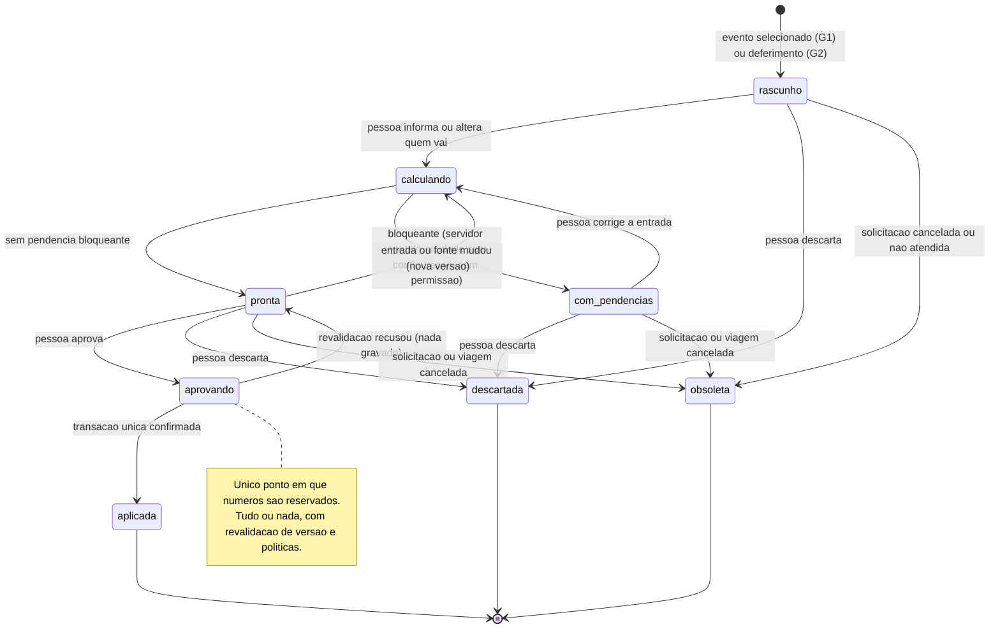
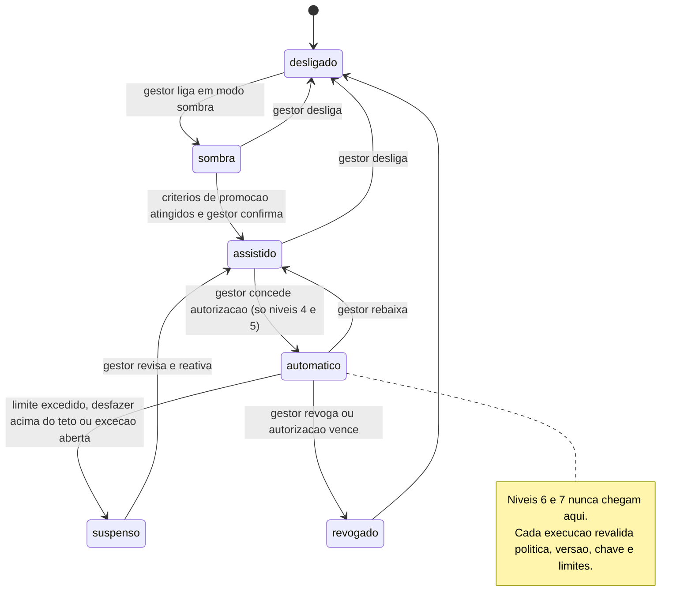

# 11.3 — Autonomia progressiva: selecionar o evento, informar quem vai e conferir

Fase 2 · desenho técnico · 17/10/2026 · **Status: desenho.** Nada deste fluxo existe no sistema novo
além das peças marcadas **[existe]**. Base obrigatória: [arquitetura](../arquitetura.md),
[evento de integração](../contratos/evento-integracao.schema.json),
[API de automação](../contratos/api-automacao.v1.yaml), ADR 0020 (proposto) e
[plano de implantação](../plano-implantacao.md) (etapa 5). Fluxos relacionados, **referenciados e não
repetidos aqui**: [11-1 rotas e roteiros](11-1-rotas-e-roteiros.md) (a parte "roteiro" da proposta),
[10-2 envio de documentos](10-2-envio-de-documentos.md), [10-3 prestação e saque](10-3-prestacao-e-mensagem-de-saque.md),
[10-4 link de KM](10-4-link-de-km-na-vespera.md), [10-5 DB e RT para assinatura](10-5-db-e-rt-para-assinatura.md),
[10-6 recebimento](10-6-recebimento-de-documentos.md). Marcação: **[existe]** código executando hoje ·
**[parcial]** · **[novo]** a desenvolver. Evidências em `caminho:linha` conferidas no código em 17/10/2026.

> Em uma frase: **o sistema prepara tudo em prévia, a pessoa confere uma vez, aprovar grava tudo numa
> transação — e emitir, assinar e protocolar continuam sendo atos humanos.** A autonomia cresce por fluxo
> e por nível de risco, com autorização registrada, limites e revogação; nunca por "confiança" de um modelo.

---

## 1. Objetivo e resultado para o usuário

**Hoje** (caminho atual, levantado no código — não é medição de uso): a DG defere a solicitação; alguém
abre a folha deferida e clica "Gerar viagem" escolhendo a unidade; a viagem nasce com título, período,
um destino, motivo e tipo, **sem equipe, viatura, roteiro, serviços, anexos nem meta**; o operador cria o
roteiro (que nasce vazio) e digita os trechos; abre "Gerar documentos" e monta, cartão a cartão, equipe,
quem dirige e viatura; o lote cria ofícios **já numerados**, termos, OS e plano em rascunho; depois o
operador abre cada documento para completar protocolo, justificativa, funções da OS, atividades e
coordenadores do plano; confere o quadro de prontidão; emite cada ofício; baixa o pacote e leva ao
eProtocolo. Para uma viagem com dois ofícios são cerca de nove telas diferentes antes da primeira emissão,
e conflitos de agenda, cadastros incompletos e diárias só aparecem **depois** que os documentos já
existem e consumiram números.

**Resultado desejado — três passos**

1. **Selecionar o evento**: uma lista "Eventos deferidos sem viagem preparada" (solicitações deferidas
   da unidade) ou uma viagem existente em rascunho/preparação.
2. **Informar quem vai**: um cartão por ofício com servidores, quem dirige e viatura (ou outro meio de
   transporte). O sistema mostra a meta pedida na solicitação (efetivo × informado) e **sugestões
   determinísticas explicáveis** (motorista indicado na solicitação, motoristas habituais da viatura,
   quem costuma ir àquele destino) — nunca escolhe ninguém.
3. **Conferir uma proposta consolidada**, em **modo prévia**: nada gravado, **nenhum número reservado**.
   Numa só tela: viagem, roteiro (proposta do fluxo 11-1), ofícios previstos com diárias por ofício,
   termos, OS (quem, onde, cronograma, função), plano (atividades vindas dos serviços pedidos, efetivo,
   coordenadores padrão), **a origem de cada dado**, os avisos (conflitos, cadastros incompletos, prazo
   e justificativa, km estimado) e **o que ainda falta** depois de aprovar (protocolo, justificativa,
   assinaturas). Um clique **"Aprovar e criar"** aplica tudo **numa transação**: cria ou atualiza a viagem,
   grava o roteiro, cria os rascunhos (aqui, e só aqui, os números são reservados), vincula tudo e publica
   os eventos. Emitir continua sendo a ação da folha de cada ofício, com a mesma conferência de hoje.

**Autonomia progressiva** é a regra que decide **o que pode acontecer sem pedir** (seção 5): cada operação
tem um nível (1 a 7); só os níveis 1–5 podem rodar sozinhos, e os níveis 4–5 só com **autorização por
fluxo** registrada, com limites e revogável. Isso elimina interrupções repetitivas (avisos, recálculos,
vínculos, marcações de obsolescência, lembretes) sem afrouxar o portão dos atos oficiais.

**Fora do escopo:** IA ou automação escolher equipe, motorista ou viatura; emitir, retificar, cancelar,
assinar ou protocolar sem pessoa; substituir a tramitação oficial no eProtocolo (Decreto estadual PR
7.304/2021, art. 1º, §2º, veda sistemas paralelos de controle e tramitação —
[fonte](https://www.administracao.pr.gov.br/sites/default/arquivos_restritos/files/documento/2021-04/decreto_7304_-_2021_-_eprotocolo_-_com_anexos_0.pdf),
consultada em 17/10/2026; **ponto a confirmar**: a proposta e a aprovação no PCPR são preparação e
controle interno, e complementam o eProtocolo, não o substituem). **WhatsApp não participa**: a política
oficial do WhatsApp Business Platform (whatsappbusiness.com/policy, seção de uso governamental, atualizada
em 23/09/2026, consultada em 17/10/2026) lista autoridades policiais entre os usuários proibidos, sem
processo de aprovação; ativação da plataforma oficial para a PCPR = **bloqueada** (5). As frentes WA-1 a
WA-3 do [plano](../plano-implantacao.md), prioridade do usuário, cobrem avisos a servidores, não este fluxo
interno ([whatsapp-viabilidade.md](../whatsapp-viabilidade.md)). Os avisos deste fluxo são o sino e, se
ligado, o e-mail institucional pela outbox **[existe]**.

---

## 2. Estado atual com evidências

### 2.1 Sistema novo

| Capacidade | Estado | Evidência | Observação |
|---|---|---|---|
| Gerar a viagem da solicitação deferida (botão) | IMPLEMENTADO | `gestao/viagens/de_eventos.py:120-154`; decisão "botão, não automática" em `:10-14`; `docs/migration/decisoes.md:270` (agente — confirmar) | Pré-condições `:79-88` (deferida, município, data, sem viagem ativa) sob `select_for_update` (`:124`) |
| O que a viagem gerada traz | PARCIAL | `gestao/viagens/de_eventos.py:136-146` | Título, motivo "(Solicitação #N)", descrição, período, **um** destino, tipos casados pelo nome do tipo de evento |
| O que a viagem gerada **não** traz | INEXISTENTE | `gestao/eventos/models_solicitacao.py:51-68, 106-158` × `de_eventos.py:136-146` | Serviços (mesmo catálogo `AtividadePlano`, `:109`), unidade móvel, motorista (`:66-68`), total e equipes (`:61`, `:131-135`), CIN (`:64`), protocolo (`:59`), local/endereço, anexos (`:148-158`) |
| Unidade sugerida | IMPLEMENTADO | `gestao/viagens/de_eventos.py:65-71` | Equipe com o mesmo nome/sigla da unidade, senão lotação de quem gera |
| Uma viagem ativa por solicitação | IMPLEMENTADO (por trava, não por restrição) | `de_eventos.py:86-87, 124`; `models_solicitacao.py:221-222` | A restrição única é `(solicitacao, viagem)`; "uma ativa" depende da verificação sob trava |
| Aviso "viagem gerada" | PARCIAL | `de_eventos.py:149-152` (`transaction.on_commit`) | Fora da outbox: se o processo cair entre o commit e o aviso, ele se perde |
| Encerrar a viagem quando a solicitação não acontece | IMPLEMENTADO | `de_eventos.py:157-178`; `gestao/eventos/solicitacoes.py:272-273, 296-306` | Sem documento: cancela sozinho; com documento: só avisa. Já é uma **ação automática de nível 4** (seção 5) |
| Novo documento vinculado e semeado | IMPLEMENTADO | `gestao/viagens/viagem.py:288-325` | Roteiro nasce vazio, só observações (`:298-299`); termo usa o título da viagem (`:308`); OS com `tipo_sugerido` (`:313-314`); plano com unidade móvel (`:315-319`) e atividades padrão, não as pedidas (`gestao/viagens/planos.py:462-465`) |
| Gerar documentos em lote ("informar quem vai") | IMPLEMENTADO | `gestao/viagens/viagem_lote.py:76-134`; tela `views_viagem.py:371-433`; formulário `forms.py:1640-1694` | Um ofício por equipe a partir do último roteiro ativo (`:92`); sem roteiro, ofícios sem trechos e sem diárias (`:94-96`); termos, OS e plano só se inexistentes (`:111-130`); viagem → GERADOS (`:131-133`) |
| Validação do lote | PARCIAL | `viagem_lote.py:44-73` | Só duplicidade interna (servidor em dois ofícios, já na viagem, viatura repetida). **Não** verifica conflitos com outras viagens nem cadastro incompleto antes de gerar |
| Termos do lote | PARCIAL (provável erro) | `viagem_lote.py:114` sem `evento`; padrão `gestao/viagens/models.py:819` | Saem "PCPR na Comunidade" em vez do título da viagem (o "Novo termo" usa o título, `viagem.py:308`) |
| **Numeração reservada no rascunho** | IMPLEMENTADO | Ofício `gestao/viagens/services.py:90-99, 153-174` (`:167`); OS `gestao/viagens/ordens.py:77-88, 217`; plano `gestao/viagens/planos.py:99-111, 456` | Lacuna só nasce da exclusão ou da troca manual (`services.py:1264-1276, 279-283`). Lote, repetir e duplicar **consomem números na hora** → a proposta **não pode** criar rascunhos para "mostrar" |
| Consultar o próximo número sem reservar | IMPLEMENTADO | `services.py:112-132`; `ordens.py:91-95`; `planos.py:114-117` | Leitura pura — a prévia mostra "nº atribuído na aprovação", não um número |
| Prévias que já não gravam | IMPLEMENTADO | `services.py:429-438` (`calcular_informados`); `views_roteiros.py:266-313`; `services.py:989-1000` ("nunca grava durante leitura"); minuta do ofício `pacotes.py:8-9`; `ordens.py:460`, `planos.py:748` (`fixar=False`) | São as peças da prévia consolidada: mesmas funções do salvamento, nada persiste |
| Pendências e avisos do ofício | IMPLEMENTADO | `services.py:473-542` (bloqueantes × avisos); conflitos `:597-601`; cadastro `:545-558`; protocolo obrigatório `:517-519` | Hoje só existem **depois** do rascunho criado |
| Prazo e justificativa | IMPLEMENTADO | `gestao/viagens/dominio/prazos.py:1-8, 55-67`; `services.py:465-469`; padrão 10 dias `gestao/cadastros/models.py:400-403` | Antecedência = 1ª saída − data do ofício; ≤ N dias exige justificativa |
| Emissão | IMPLEMENTADO | `services.py:1034-1078` | Revalida versão, política `pode_emitir` (`policies.py:88-89`) e prontidão; publica `viagens.documento.gerar` e `viagens.oficio.emitido`; abre a prestação |
| Quadro de prontidão e coerência da viagem | IMPLEMENTADO | `gestao/viagens/viagem_conferencia.py:81-208, 246-315` | "Meta da DG" pendente (`:5-6`; `viagem_lote.py:4`); solicitação anexada dispensa OS/plano (`:148-153`) |
| "Aplicar em todos" (coerência) | PARCIAL | `viagem_conferencia.py:324-386` | Grava OS, termo e plano por `QuerySet.update` e `delete/bulk_create`, **fora dos services e sem versão** — precisa ser corrigido antes de qualquer automação usá-lo |
| Conflitos de agenda | IMPLEMENTADO | `gestao/plataforma/conflitos.py:153-172` | Aviso, nunca bloqueio; servidores, viaturas, unidades móveis; não há dado de férias/afastamento |
| Sugestão de equipe/viatura | PARCIAL | `gestao/cadastros/models.py:209-214` (`Viatura.motoristas`) | Motoristas habituais existem; ranking "quem costuma ir" não existe |
| Versão da viagem | PARCIAL | `viagem.py:49-50, 193-200` | Concorrência por `atualizado_em` em texto; o ofício tem `versao` inteiro (`services.py:219-229`) |
| Importação documental aplica sozinha quando a identificação é única | IMPLEMENTADO | `gestao/viagens/importacao.py:229-233` | Em nome de quem enviou o arquivo; ambíguo vai para revisão — exemplo real de nível 4 |
| Avisos internos por rotina | IMPLEMENTADO | `gestao/viagens/apps.py:17-18`; `gestao/eventos/apps.py:18`; `gestao/plataforma/notificacoes.py:38-61` | Sino; e-mail só com `NOTIFICACOES_POR_EMAIL` (padrão desligado, `config/settings/base.py:268`) |
| Pacote para o eProtocolo | PARCIAL | `gestao/viagens/pacotes.py:334-382` | ZIP numerado com LEIA-ME "para subir e assinar no eProtocolo" (`:369-370`); envio fora do sistema |
| eProtocolo | PARCIAL | `gestao/integracoes/eprotocolo/config.py:51-52`; `servico.py:25` | Trava de somente leitura ligada por padrão; abrir protocolo exige destravar |
| Outbox | PARCIAL | [arquitetura §2](../arquitetura.md) | Um assinante por tópico; o worker segura a transação durante o assinante; retentativa efetiva ~21 min; sem tela de falhas |
| Registro de ferramentas, `PedidoAprovacao`, token de serviço | INEXISTENTE | `docs/adr/0020-automacao-ferramentas-e-aprovacao.md` (proposto); `docs/ai/README.md:41-46` | Classes de risco descritas, nada implementado |
| Autorização por fluxo, painel "o que a automação fez" | INEXISTENTE | — | Proposta deste documento |
| Proposta consolidada em prévia | **INEXISTENTE** | — | Lacunas `VIA-EVENTO-SEMENTE-LOTE`, `VIA-LOTE-QUEM-VAI`, `EVT-GERAR-VIAGEM` |
| IA / LLM | INEXISTENTE | (nenhum cliente LLM no código) | — |

### 2.2 O que a referência em produção já faz (somente leitura)

- **EV implantado gera a viagem sozinho no deferimento.** Depois do commit do despacho "atender", cria a
  viagem em rascunho, uma por ambiente/equipe designada, com sede, percurso, datas, motivo, equipes e meta,
  unidade móvel, motorista designado e anexos; junta eventos vizinhos na mesma cidade; uma falha não
  derruba o despacho e uma rotina diária refaz o que faltou (`EVI/solicitacoes/services.py:368-418`;
  `EVI/solicitacoes/integracao_viagens.py:1-23, 252-330`; `EVI/viagens_viagem/multieventos.py:1-25`).
- **EV "Gerar documentos"**: o operador escolhe a equipe de cada ofício; o sistema cria tudo em rascunho
  com horários aprendidos do histórico, sugestões ordenadas de quem costuma ir e da viatura, motivo,
  custeio e justificativa "Preenchido pelo histórico", plano semeado da solicitação, quadro de prontidão,
  contador da meta e conflitos como aviso (`EVI/viagens_viagem/views.py:445-497`;
  `EVI/viagens_viagem/planejamento.py:1-20` — a escolha da equipe é sempre humana, `:10-13`;
  `EVI/viagens_planos/semente_solicitacao.py:1-13`; `EVI/viagens_viagem/meta_equipe.py:1-12`).
  **Não tem prévia**: cria os rascunhos direto e o operador corrige depois.
- **EV assistente (removido antes da versão implantada)**: o LLM só escolhia a ferramenta e os
  parâmetros; `AcaoPendente` (pendente → confirmada/cancelada) impedia gravar sem confirmação
  (`EVG@5f939ba assistente/llm/base.py:1-13`; removido em `EVG@f62c2cb`). Lição aproveitada:
  **confirmação antes de gravar**; não se copia código.
- **EV leitura de pedidos**: sugere valor por campo com confiança e **trecho de origem**, sem gravar na
  leitura (`EVI/core/preencher_por_email.py:1-24`) — é o modelo para "a origem de cada dado".
- **EV triagem**: só abre a tela do módulo quando a confiança passa de 0,55; "nada é decidido sozinho"
  (`EVI/core/triagem_email.py:35-36`; `EVI/core/leitura/triagem.py:1-6`).
- **Anti-exemplo do EV**: com eProtocolo simulado e `AUTO_PROTOCOLO_OFICIO=1` por padrão, todo ofício
  salvo sem protocolo recebe número SIMULADO, só com aviso (`EVI/config/settings.py:319-332`;
  `EVI/viagens_oficios/form_context.py:225-227`). Autonomia que produz dado com aparência oficial é o que
  o nível 7 deste desenho proíbe.
- **GV implantado**: ofício em assistente por etapas; o número é sugerido por área/ano e "finalizar"
  valida pendências (`gv/oficios/services.py:728-815, 1016-1050`); a **assinatura digital do ofício é
  feita no eProtocolo** (decisão registrada, `gv/documentos/migrations/0004_drop_assinaturas_tables.py:1-4`);
  RT e DB têm assinatura eletrônica simples **pelo próprio signatário** por link público (token cifrado +
  hash, CPF, expiração; link padrão de 7 dias), enviado pelo operador por click-to-chat
  (`gv/prestacoes_contas/assinatura_services.py:1-10, 93-149`).

**Consequência para o desenho:** as referências automatizam mais (gravam direto), mas sem prévia e, no
caso do EV, à custa de dados com aparência oficial. O sistema novo tem numeração mais íntegra e por isso
**precisa** da prévia: a conferência consolidada é o que permite chegar ao "selecionar, informar,
conferir" sem consumir números nem criar papéis para desfazer.

### 2.3 O que o sistema já deduz × o que a pessoa precisa informar

A ponte Eventos→Viagens hoje cria **viagem vazia**. A tabela diz, campo a campo, de onde a proposta tira
cada dado e quem decide.

| Dado | Hoje na viagem gerada | Na proposta (origem exibida) | Quem decide |
|---|---|---|---|
| Unidade responsável | escolhida no botão, com sugestão (`de_eventos.py:65-71`) | mesma sugestão; ambígua → pendência para a DG | **pessoa confirma** (DG ou quem gera) |
| Título, período, destino, motivo, descrição, tipo | sim (`de_eventos.py:136-146`) | "da Solicitação #N" | sistema [existe] |
| Serviços pedidos → atividades do plano | não | "da Solicitação #N" (mesmo catálogo, ADR 0044) | sistema [novo, determinístico] |
| Meta de efetivo (total e por equipe) e CIN | não | quadro "pedido × informado" | sistema mostra [novo]; não bloqueia |
| **Quem vai (nomes, por ofício)** | não | cartões; sugestões com o motivo de cada uma | **pessoa informa — sempre** |
| Quantos ofícios / divisão em equipes | não | padrão: um ofício por viatura | **pessoa** |
| Quem dirige | não | sugestão: motorista indicado na solicitação (`models_solicitacao.py:66-68`) | **pessoa confirma** |
| Viatura | não | sugestão: viaturas cujos motoristas habituais estão na equipe (`cadastros/models.py:209-214`); unidade móvel da solicitação só tem nome (`gestao/eventos/models.py:69-73`) | **pessoa escolhe** (vínculo unidade móvel ↔ viatura é decisão D-9) |
| Meio de transporte sem viatura | não | — | **pessoa informa** |
| Roteiro (trechos, horários, km) | não (roteiro nasce vazio) | proposta do [fluxo 11-1](11-1-rotas-e-roteiros.md), com fonte do km e origem do horário | sistema propõe; **pessoa confere os horários** quando não há regra nem histórico |
| Diárias por ofício | só depois do rascunho | `calcular_informados` com os trechos e o número de servidores do ofício | sistema [existe a função] |
| Motivo do ofício | lote copia o da viagem (`viagem_lote.py:100`) | "da viagem" | sistema [existe] |
| Custeio | padrão "unidade" (`models.py:200-201`) | "padrão" | pessoa altera se outra instituição custeia (e diz qual) |
| Protocolo do eProtocolo | não | "falta depois de aprovar" (obrigatório para emitir, `services.py:517-519`) | **pessoa informa**; abertura pela integração é nível 4 de maturidade |
| Justificativa | não | se exigida pelo prazo: aviso com a data-limite; rascunho opcional por modelo de texto ou IA, marcado | **pessoa escreve ou aceita** |
| Data do ofício | hoje, no rascunho | "data da emissão" (`services.py:989-1000`) | sistema |
| Termos | lote: servidores de fora da unidade emissora (`viagem_lote.py:112-116`) | mesma regra; evento = título da viagem (D-4) | sistema |
| OS: tipo, equipe, destinos, período | `tipo_sugerido` (`ordens.py:144-159`) | "do tipo da viagem" / "unidade móvel" | sistema |
| OS: função de cada servidor | não | sugestão "motorista" para quem dirige (D-16); demais em branco | **pessoa** |
| Plano: efetivo, destinos, período | `planos.dados_dos_oficios` | "dos ofícios previstos" | sistema |
| Plano: coordenador administrativo | padrão da unidade (`cadastros/models.py:421-423`) | "padrão da unidade" | sistema; pessoa troca |
| Plano: coordenador operacional | não | — | **pessoa** |
| Anexos da solicitação | não copiados (`de_eventos.py:13-14`) | vínculo proposto (D-10) | decisão |
| Horário/programação do evento | não existe na solicitação | leitura opcional pela IA no fluxo 11-1 | pessoa confere |
| Conflitos e cadastros incompletos | só depois do rascunho | avisos na prévia | **pessoa decide** seguir ou trocar |

---

## 3. Gatilho e definição precisa do evento de conclusão

**Gatilhos**

| Id | Quando | Quem dispara | Chave que desliga |
|---|---|---|---|
| G1 | Botão **"Preparar viagem"** na folha da solicitação deferida, na lista "Eventos deferidos sem viagem preparada" ou na folha da viagem (substitui a entrada do lote) | Pessoa com `pode_propor_viagem` | nenhuma: função do sistema, funciona sem n8n e sem IA |
| G2 | Commit do despacho "atender" (`solicitacoes.despachar`, `:244-274`) → tópico interno da outbox `eventos.solicitacao.deferida` [novo] (para o n8n, o mesmo fato sai como o evento de integração `solicitacao.despachada` com `situacao: deferida`) | Sistema, pela outbox | fluxo `proposta-viagem-auto` em `/estado` e autorização por fluxo de nível 2 |
| G3 | Mudança na solicitação ou na viagem com proposta aberta (período, destino, cancelamento) | Sistema, na mesma transação da mudança | nenhuma (é integridade, não automação) |

G2 **não cria a viagem**: prepara uma proposta sem equipe (roteiro, plano previsto, meta) e avisa a
equipe de viagens da unidade "Evento deferido: informe quem vai". Criar a viagem sozinho no deferimento,
como o EV, é a decisão D-1.

**Evento de conclusão da preparação (sucesso técnico):** `PropostaViagem` em `pronta` ou `com_pendencias`
cuja `assinatura_entrada` corresponde às versões atuais das fontes (solicitação, viagem, cadastros
usados, tabela de diárias vigente), gravada com a publicação de `proposta_viagem.pronta` [novo].

**Evento de conclusão do fluxo (resultado para o usuário):** `proposta_viagem.aprovada` [novo] — commit
da **transação única** que, por uma pessoa com `pode_aprovar_proposta`, criou ou atualizou a viagem,
gravou o roteiro, criou os rascunhos numerados (ofícios, termos, OS, plano), vinculou tudo e registrou em
`PropostaViagem.aplicacao` os ids criados. Encerram também, sem efeito de negócio: `descartada` (pessoa)
e `obsoleta` (sistema).

**Não são conclusão:** a prévia mostrada; o rascunho de texto da IA; o fim de uma execução do n8n; a
emissão dos ofícios (é a continuação, por documento, com o portão de hoje); o envio aos servidores
(fluxo 10-2).

---

## 4. Diagramas

### 4.1 Estados da proposta consolidada



### 4.2 Modos de autonomia de um fluxo (autorização por fluxo)



- **sombra**: o sistema calcula o que faria e registra, sem efeito e sem aviso — mede acerto.
- **assistido**: prepara e pede **um clique** (ou mostra como sugestão na tela).
- **automático**: executa sem clique, dentro dos limites, registrando em "O que a automação fez" com
  **desfazer** (nível 4) ou cancelamento antes do envio (nível 5).

### 4.3 Sequência PCPR ↔ n8n ↔ IA ↔ pessoas

```mermaid
sequenceDiagram
    autonumber
    actor DG as DG
    actor Op as Operador de viagens
    participant PCPR as PCPR (telas e services)
    participant W as Worker da outbox
    participant F as Fila de IA (worker com lease)
    participant IA as Provedor de LLM
    participant N as n8n
    actor Ch as Chefia no eProtocolo

    DG->>PCPR: despacha Atender (solicitacoes.despachar)
    PCPR->>PCPR: commit e outbox eventos.solicitacao.deferida [novo]
    opt fluxo proposta-viagem-auto autorizado (G2)
        W->>PCPR: monta proposta sem equipe (roteiro 11-1, plano, meta)
        PCPR-->>Op: sino Evento deferido, informe quem vai
    end
    Op->>PCPR: seleciona o evento e informa quem vai
    PCPR->>PCPR: propor (somente leitura, sem numero)
    PCPR-->>Op: proposta com origem de cada dado, avisos e o que falta
    opt Justificativa exigida e fluxo de IA ligado
        Op->>PCPR: pedir rascunho de justificativa
        PCPR->>PCPR: grava pedido de texto (unico por campo, versao e prompt)
        F->>PCPR: reserva o pedido (skip locked, lease), confere chave e politica
        F->>IA: porta de IA - dados estruturados como dado e esquema estrito, fora de transacao
        IA-->>F: texto
        F->>PCPR: registra a sugestao (transacao curta), validador recusa fato fora do contexto
        PCPR-->>Op: sugestao marcada, nao gravada no oficio
    end
    Note over N,F: n8n so na alternativa D6 do fluxo 11-2; aqui ele so alerta se a fila de IA parar
    Op->>PCPR: Aprovar e criar
    PCPR->>PCPR: revalida assinatura de entrada, versoes e politicas
    PCPR->>PCPR: transacao unica com viagem, roteiro, oficios numerados, termos, OS e plano
    PCPR->>W: outbox proposta_viagem.aprovada
    PCPR-->>Op: rascunhos criados e lista do que falta
    Op->>PCPR: informa protocolo e emite cada oficio (pode_emitir)
    Op->>Ch: leva o pacote ao eProtocolo para assinar e tramitar
    Note over PCPR,N: Envio aos servidores segue o fluxo 10-2 com liberacao humana
```

---

## 5. Responsabilidades

| Ator | Faz | NÃO faz |
|---|---|---|
| **Sistema PCPR** | Monta a proposta com as **mesmas funções** do salvamento (sem persistir); mostra a origem de cada dado; calcula diárias, prazo, conflitos e pendências; aplica tudo numa transação na aprovação; reserva números só aí; mantém autorizações por fluxo, limites, revogação e o painel "o que a automação fez"; executa níveis 1–4 autorizados; marca propostas obsoletas | Escolher quem vai; emitir, assinar ou protocolar; reservar número em prévia; depender do n8n ou da IA para a proposta |
| **Worker da outbox** [existe] | Calcula a proposta de G2 e as rotas sem cache fora da requisição; publica eventos pós-aprovação | Regra de negócio fora dos services; HTTP externo dentro da transação |
| **Fila de IA** [novo] (worker com *lease*, a mesma do [11-2 §6.4](11-2-textos-de-plano-de-trabalho.md)) | Reserva o pedido de texto, revalida chave e política, chama a porta única de IA (AUT-96) **fora de transação**, registra a sugestão numa transação curta, até 3 tentativas | Regra de negócio fora dos services; gravar texto, prompt ou resposta em log |
| **n8n** | Resumo diário "eventos deferidos sem proposta aprovada" por e-mail institucional; alerta de falhas e de fila de IA parada (só metadados). Chamar o LLM só se a decisão D6 do 11-2 escolher a alternativa pelo n8n, com as mesmas regras de lá | Montar ou aprovar proposta; gravar no banco; escolher equipe; emitir; guardar o texto pedido (no caminho adotado não o recebe, nem a chave de IA; na alternativa D6, o workflow não salva execução nenhuma) |
| **IA (LLM)** | Rascunho de **texto** (justificativa, motivo, contextualização do plano) a partir de dados estruturados, marcado "preparado pela IA"; explicar em linguagem simples o que falta (leitura); leitura de programação (fluxo 11-1) | Escolher equipe, viatura, datas, horários ou quantidades; afirmar número ou fato ausente do contexto; aprovar, emitir, assinar; seguir instruções contidas em anexos |
| **Operador de viagens** | Seleciona o evento; informa quem vai; confere a proposta; aprova; completa protocolo e justificativa; emite | — |
| **DG** | Defere; confirma a unidade quando ambígua | — |
| **Gestor de viagens** | Concede, rebaixa e revoga autorizações por fluxo da sua unidade; define parâmetros (11-1) | Conceder autorização para nível 6 ou 7 (o sistema recusa) |
| **Chefia / signatários** | Assinam no eProtocolo (ofício) ou pelo link do fluxo 10-5 (RT/DB) | — |

### 5.1 Os sete níveis de operação, com exemplos reais

Correspondência com as classes de risco do ADR 0020 (`docs/ai/README.md:41-46`): níveis 1 e 3 =
`leitura`; 2 = `preparacao`; 4 = `reversivel`; 5 = `reversivel` (aviso interno) ou `irreversivel`
pré-autorizado (envio externo); 6 = `irreversivel` com portão; 7 = sem ferramenta.

| Nível | O que é | Pode rodar sem clique? | Exemplos **existentes** (código) | Exemplos **planejados** |
|---|---|---|---|---|
| **1. Consultas e orientações** | Lê e explica, sem efeito | Sim, com a política do usuário efetivo (sessão, token pessoal ou delegação emitida pelo PCPR) e escopo da unidade | Quadro de prontidão (`viagem_conferencia.py:81-208`); `verificar_prontidao` (`services.py:501-507`); conflitos (`plataforma/conflitos.py:153-172`); próximo número sem reservar (`services.py:112-132`); itens do pacote (`pacotes.py:278-327`) | Ferramentas `viagens.prontidao`, `viagens.proposta_obter`; assistente que explica o que falta |
| **2. Preparação de rascunhos** | Produz proposta ou texto **descartável**, sem registro de negócio nem número | Sim (é o que a pessoa vai conferir) | Prévia de diárias (`services.py:429-438`; `views_roteiros.py:290-313`); prévia de trechos (`views_roteiros.py:266-287`); minuta com marca d'água (`pacotes.py:8-9`); documento com `fixar=False` (`ordens.py:460`; `planos.py:748`) | `PropostaViagem`; proposta de roteiro (11-1); rascunho de justificativa/motivo por IA |
| **3. Verificações automáticas** | Confere e transforma em aviso, pendência ou exceção, sem mudar dado | Sim | Coerência viagem × documentos (`viagem_conferencia.py:246-315`); leitura da via assinada (ADR 0022, aviso); prazo (`dominio/prazos.py:55-67`); cadastro incompleto (`services.py:545-558`) | Revalidar propostas abertas quando cadastros mudam; ofícios em rascunho com saída próxima; tabela de diárias sem vigência |
| **4. Atualizações de baixo risco** | Altera dado de trabalho, **reversível**, sem número, sem envio externo, sem tocar documento emitido ou via assinada | Só com **autorização por fluxo** + política + desfazer | Importação aplica parte com destino único (`importacao.py:229-233`); cancelar viagem **sem documento** quando a solicitação cai (`de_eventos.py:167-173`); recalcular diárias (`services.py:461-462`); situação da viagem (`viagem.py:236-245`); autosave sem histórico (`services.py:239-253`) | Marcar proposta obsoleta; vincular anexos da solicitação à viagem; criar a viagem (sem número) no deferimento se D-1 aprovar; descartar propostas abandonadas |
| **5. Envios previamente autorizados por fluxo** | Comunicação com modelo fixo, destinatário por regra, canal e janela definidos | Só com autorização por fluxo; cada envio é revalidado na reserva ([arquitetura §3](../arquitetura.md)) | Sino e e-mail de notificação (`notificacoes.py:38-61`); rotinas de avisos da prestação e de chegadas (`viagens/apps.py:17-18`); lembretes das solicitações (`eventos/apps.py:18`) | Resumo diário de eventos sem proposta; fluxos 10-3 (saque), 10-4 (link de KM), 10-5 (DB/RT para assinatura). O 10-2 (documentos) mantém **liberação humana por envio** |
| **6. Decisões e emissões que exigem conferência** | Efeito oficial ou numeração; decisão de gestão | **Não.** Clique na tela de quem tem a permissão; por automação, só `PedidoAprovacao` (202) | Escolher quem vai (lote, `viagem_lote.py:76-134`); criar rascunho numerado (`services.py:153-174`); emitir (`services.py:1034-1078`); reabrir, retificar, cancelar, excluir (`services.py:1081-1276`); cancelar viagem em cascata (`viagem.py:332-366`); piso da numeração (`services.py:135-149`) | **Aprovar a proposta consolidada**; "Emitir os N prontos" se D-5 aprovar |
| **7. Assinaturas e atos reservados a humanos** | Ato pessoal ou institucional | **Nunca**; não existe ferramenta | Despacho da DG (`solicitacoes.py:244-274`); assinatura do ofício no eProtocolo (decisão do GV); abrir/tramitar protocolo oficial (trava `eprotocolo/config.py:51-52`) | RT/DB assinados pelo próprio servidor (10-5); validação ICP-Brasil fora do sistema (ADR 0022) |

**Divergência a resolver (D-7):** `docs/ai/README.md:44` classifica "criar **rascunho** de ofício" como
preparação automática. Neste sistema o rascunho **reserva número oficial** (`services.py:167`), então aqui
ele é nível 6. Da mesma forma, "adicionar viajante" (`docs/ai/README.md:45`, reversível) só é nível 4
quando **executa o que a pessoa informou**; escolher o viajante é nível 6 e nunca é da IA.

### 5.2 Regra de portão (ADR 0020 estendido)

Avaliada no PCPR para toda execução, venha da tela, do worker, do n8n ou da IA:

```
portao(operacao, chamador, usuario_efetivo, objeto):
    # usuario_efetivo = sessao da tela, dono do token pessoal ou usuario da Delegacao
    # (X-PCPR-Delegacao) emitida pelo PCPR na acao humana; nunca declarado pelo chamador
    se chave geral ou fluxo desligado e a operacao escreve      -> 423, nada feito
    se nao politica_do_servico(usuario_efetivo, objeto)        -> 403 (a mesma policies.py da tela)
    nivel 1-3                                                  -> executa (sem efeito oficial)
    nivel 4  se AutorizacaoFluxo ativa cobre (operacao, unidade)
             e dentro dos limites                              -> executa, registra, oferece desfazer
             senao                                             -> vira sugestao na tela (1 clique)
    nivel 5  so pelo fluxo de comunicacao (reserva + revalidacao);
             fora da autorizacao                               -> PedidoAprovacao
    nivel 6                                                    -> 202 PedidoAprovacao; executa so quando
                                                                  pessoa com a permissao aprova na tela
    nivel 7                                                    -> nao ha ferramenta; a tela diz o que fazer
```

Regras fixas: (1) a autorização por fluxo **não pode** cobrir nível 6 ou 7 — o sistema recusa a
concessão; (2) a aprovação da proposta consolidada é **uma** decisão de nível 6 que cobre um conjunto
**listado item a item** na tela (N ofícios, termos, OS, plano) — não um "carimbo" genérico; (3) o que é
aprovado é exatamente o que foi mostrado: se a assinatura de entrada mudou, a aprovação é recusada e a
diferença é exibida.

### 5.3 Autorização por fluxo — sem interrupções repetitivas, com limites e revogação

| Elemento | Regra |
|---|---|
| Escopo | Um fluxo (`proposta-viagem-auto`, `vinculos-da-solicitacao`, `resumo-eventos-sem-proposta`…), uma unidade, um nível máximo (2, 4 ou 5) e a lista fechada de operações cobertas |
| Quem concede | Nova permissão `automacao.autorizar_fluxo` (gestor de viagens da unidade); quem decide quem tem é D-6 |
| Limites | Por execução (ex.: até N itens), por dia, janela horária local, volume por destinatário; ultrapassar **suspende** o fluxo e abre exceção |
| Validade | `vence_em` obrigatório; renovar é ato explícito. Prazo padrão: **estimativa** a decidir (D-13) |
| Versão da regra | `versao_regra` = hash dos modelos de texto, regras de destinatário e operações; mudou a regra, a autorização volta a `assistido` |
| Revogação | Imediata; vale na próxima reserva/execução (revalidar antes de agir). A chave geral continua sendo o desligamento de emergência |
| Suspensão automática | Limite excedido; taxa de "desfazer" acima do teto; exceção aberta sem dono; falha repetida |
| Promoção | Sombra → assistido → automático só com critérios medidos (D-13): por exemplo, N execuções em sombra e taxa de concordância mínima — **números a decidir, não fatos** |
| Transparência | Painel "O que a automação fez" por unidade: quando, o quê, sob qual autorização, desfazer (nível 4) |

O que **deixa de interromper** a pessoa: avisos internos, recálculos, vínculos de anexos, marcação de
propostas obsoletas, descarte de propostas abandonadas, resumo diário. O que **continua pedindo**:
aprovar a proposta (uma vez por viagem), informar protocolo, emitir, assinar.

### 5.4 Como a pessoa vê e confere a proposta consolidada

Componente novo, primeiro no UI Lab (`/ui-lab/`) com os estados rascunho, calculando, pronta, com
pendências, obsoleta, aplicada e erro; depois na folha da solicitação e da viagem. Dados de demonstração
em `gestao/viagens/demonstracao.py` para avaliação no PREVIEW; 360–1440 px sem rolagem horizontal, axe
sem violações.

1. **Cabeçalho:** evento, unidade, período, "calculada às HH:MM", e o selo **"Prévia: nada foi gravado e
   nenhum número foi reservado."**
2. **Quem vai:** cartões por ofício (servidores, quem dirige, viatura ou meio); meta "pedido × informado";
   sugestões com o motivo ("indicado na Solicitação #N", "dirige esta viatura", "foi a Maringá 3 vezes em
   12 meses"); botão "ignorar sugestões".
3. **Roteiro:** a proposta do fluxo 11-1 (alternativa escolhida), com fonte do km e origem do horário.
4. **Documentos que serão criados:** "Ofício (nº atribuído na aprovação) — 3 servidores, viatura X,
   diárias R$ …"; termos para quem é de fora; OS (tipo, equipe, destinos, período, funções); plano
   (atividades, efetivo, coordenadores). Cada valor com o **selo de origem**: *da Solicitação #N* ·
   *da viagem* · *calculado* · *regra da unidade* · *histórico* · *padrão da unidade* · *informado por
   você* · *sugerido pela IA — confira*.
5. **Avisos:** conflitos de agenda, cadastros incompletos, km estimado, chegada após o início do
   atendimento, prazo ("emitindo até DD/MM, a justificativa é dispensada").
6. **O que falta depois de aprovar:** por ofício — protocolo, justificativa (se exigida), funções da OS,
   coordenador operacional —, com quem resolve e onde.
7. **Ações:** *Aprovar e criar* (desabilitada com pendência bloqueante), *Salvar e continuar depois*,
   *Abrir no lote* (preenche o formulário atual, nada gravado), *Descartar*.

### 5.5 Classificação das oportunidades deste fluxo

| Oportunidade | Classificação | Maturidade |
|---|---|---|
| Proposta consolidada em prévia, aprovação em transação única | melhor execução pelo próprio sistema (dependente de desenvolvimento) | 2 |
| Semente da solicitação (serviços → atividades, motorista, meta, anexos) | automação determinística suficiente | 2 |
| Sugestões explicáveis de equipe, motorista e viatura | automação determinística suficiente | 2 |
| Autorização por fluxo, painel e desfazer | dependente de desenvolvimento | 2 |
| G2: proposta preparada no deferimento | melhor execução pelo próprio sistema (assinante da outbox, não n8n) | 2 |
| Resumo diário de eventos deferidos sem proposta aprovada | automação indicada com n8n (alternativa: rotina do sistema no sino) | 2 |
| Rascunho de justificativa, motivo e contextualização | assistência por IA indicada | 3 |
| Explicar o que falta em linguagem simples | assistência por IA indicada | 3 |
| Abrir o protocolo do ofício no eProtocolo | dependente de integração externa | 4 |
| IA escolher equipe ou viatura; emitir, assinar ou protocolar sem pessoa | inadequada ou inviável atualmente — decisão de gestão e ato oficial; responsabilização | 5 |
| Avisos por WhatsApp (plataforma oficial) | inadequada ou inviável atualmente — política da plataforma proíbe autoridades policiais; as frentes WA do plano (prioridade do usuário) tratam de avisos a servidores, não deste fluxo | 5 |

---

## 6. Contratos

### 6.1 Usados dos contratos atuais

| Contrato | Item | Uso |
|---|---|---|
| Evento | `viagem.cancelada`, `viagem.reagendada`, `viagem.participantes_alterados` | Métricas. O PCPR já marcou a proposta como obsoleta e cancelou os pedidos de texto ligados na mesma transação |
| Evento | `automacao.desligada` / `automacao.religada` | n8n para e religa o resumo diário |
| API | `GET /estado` | n8n confere chave geral e fluxo antes de agir; a fila de IA consulta as mesmas chaves internamente |
| API | `POST /excecoes` | Resumo diário que não saiu. A falha esgotada de rascunho de texto fica no próprio pedido e na fila de exceções interna [novo, comum], como no 11-2 |
| API | `GET /ferramentas`, `POST /ferramentas/{nome}/executar` | Ferramentas abaixo; token de serviço **sempre** com `X-PCPR-Delegacao` (o `X-PCPR-Usuario-Representado` do rascunho 2 foi retirado); token pessoal age como o dono; nível 6 devolve 202 |

### 6.2 Extensões de evento [novo]

Incorporadas ao contrato no rascunho 3 (`tipo` e `recurso.tipo`: `solicitacao`, `proposta_viagem`,
`autorizacao_fluxo`, `sugestao_texto`), com duas unificações: `solicitacao.deferida` virou
`solicitacao.despachada` com `situacao: deferida` (o mesmo evento cobre `devolvida` e `nao_atendida`), e
`texto.rascunho_solicitado` passou a ter o recurso `sugestao_texto` e o alvo em `dados.alvo`, na família
`texto.rascunho_*` comum com o 11-2. Idempotência comum aos fluxos: `id` = UUIDv5 de `(tipo, recurso.tipo, recurso.id, recurso.versao)`.
`viagem.gerada` já é proposto no [fluxo 11-1](11-1-rotas-e-roteiros.md) (§6.2) e é reutilizado.

| Tipo [novo] | Recurso | `dados` (sem dados pessoais) | Quem consome |
|---|---|---|---|
| `solicitacao.despachada` | solicitacao | `{situacao: "deferida", inicio_evento, unidade_sugerida_id \| null}` | métricas; n8n (resumo diário) só para `situacao: deferida` |
| `proposta_viagem.pronta` | proposta_viagem | `{origem: "solicitacao"\|"viagem", pendencias_bloqueantes, oficios_previstos}` | métricas |
| `proposta_viagem.aprovada` | proposta_viagem | `{viagem_id, oficios: n, termos: n, ordem: bool, plano: bool}` | métricas; nenhum envio externo |
| `proposta_viagem.obsoleta` | proposta_viagem | `{motivo}` | métricas; o PCPR já cancelou o pedido de texto ligado na transação |
| `texto.rascunho_solicitado` (e `_pronto`, `_aceito`) | sugestao_texto | `{alvo: {tipo: "proposta_viagem", id}, campos: ["justificativa"\|"motivo"\|"contextualizacao"], prompt_versao}` | métricas; quem atende é a fila de IA do PCPR (worker com *lease*). O n8n só o consome na alternativa D6 do 11-2 |
| `automacao.autorizacao_concedida` / `_revogada` / `_suspensa` | autorizacao_fluxo | `{fluxo, unidade_id, modo, vence_em}` | n8n atualiza o que pode agendar |

Pré-requisito comum: `Viagem.versao` inteiro (hoje `atualizado_em` em texto, `viagem.py:49-50`).

### 6.3 Ferramentas [novo] (registro do ADR 0020)

| Ferramenta | Nível / risco | Política (do usuário efetivo: delegação ou token pessoal) | Entrada → saída | `Idempotency-Key` |
|---|---|---|---|---|
| `viagens.eventos_sem_proposta` | 1 / leitura | `pode_ver` da solicitação; escopo da unidade | `{unidade_id?, dias?}` → solicitações deferidas sem proposta aprovada, com início | — |
| `viagens.prontidao` | 1 / leitura | `pode_ver_viagem` | `{viagem_id}` → `Quadro` serializado | — |
| `viagens.propor` | 2 / preparação | `pode_propor_viagem` | `{solicitacao_id \| viagem_id, equipes?, alternativa_roteiro?}` → `PropostaViagem` | `proposta:<origem>:<assinatura_entrada>` |
| `viagens.proposta_obter` | 1 / leitura | ver a origem | `{proposta_id}` → `PropostaViagem` | — |
| `viagens.proposta_aprovar` | 6 / irreversível | `pode_aprovar_proposta` | `{proposta_id, versao}` → **202** `aprovacao_pendente` — nunca executa por máquina | `aprovar:<proposta_id>:<versao>` |
| `textos.contexto` (só na alternativa D6) | 1 / leitura | `pode_ver_viagem` | `{proposta_id, campo}` → dados estruturados (tipo, serviços, município, período, efetivo, prazo) **sem CPF, RG, telefone** | — |
| `textos.registrar_sugestao` (só na alternativa D6) | 2 / preparação | `pode_propor_viagem` | `{proposta_id, versao, campo, texto, modelo, prompt_versao}` → aceita só se todo número, data e município do texto existir no contexto | `texto:<proposta_id>:<versao>:<campo>:<prompt_versao>` |

No caminho adotado, a fila de IA usa os **serviços internos** equivalentes a `textos.contexto` e
`textos.registrar_sugestao`, com a mesma política, a mesma validação e a mesma chave de deduplicação; as
duas ferramentas só são criadas se a decisão D6 do 11-2 escolher o n8n como executor.

**Não existem** ferramentas para escolher equipe, emitir, assinar, abrir protocolo ou conceder
autorização. Escrever na `PropostaViagem` a equipe é ação da tela, não da automação.

Extensão de `EstadoAutomacao` [novo], compatível com o v1: manter `fluxos` (booleano) e acrescentar
`autorizacoes: {fluxo: {modo, nivel_max, limites, vence_em}}` para o n8n saber o que pode agendar.

### 6.4 Tópicos internos da outbox [novo]

| Tópico | Payload | Chave | Assinante |
|---|---|---|---|
| `eventos.solicitacao.deferida` (tópico interno, não é evento de integração) | `{solicitacao_id}` | `deferida:<solicitacao_id>:<decidido_em>` | **um só** assinante (a outbox aceita um por tópico) que despacha: G2 (proposta), e a geração da viagem se D-1 aprovar |
| `viagens.proposta.calcular` | `{proposta_id, versao}` | `proposta-calc:<proposta_id>:<versao>` | calcula a proposta fora da requisição quando há rotas sem cache |
| `viagens.aviso.viagem_gerada` | `{viagem_id}` | `aviso-viagem:<viagem_id>` | substitui o `on_commit` de `de_eventos.py:149-152` (aviso não se perde) |

### 6.5 Esquema `PropostaViagem` (gerada pelo sistema) — valores ilustrativos

```json
{
  "versao_esquema": 1,
  "motor": "proposta_viagem@1",
  "origem": {"tipo": "solicitacao", "id": 77},
  "assinatura_entrada": "sha256:…",
  "fontes": {"solicitacao_atualizada_em": "2026-10-15T14:02:11-03:00", "viagem_versao": null,
             "tabela_diarias_id": 3, "configuracao_unidade_atualizada_em": "…"},
  "viagem": {
    "id": null,
    "unidade": {"id": 4, "origem": "sugerida: equipe com o nome da unidade"},
    "titulo": {"valor": "Maringá/PR — 12/11/2026", "origem": "solicitacao:77"},
    "periodo": {"inicio": "2026-11-12", "fim": "2026-11-12", "origem": "solicitacao:77"},
    "meta": {"servidores": 6, "informados": 5, "origem": "solicitacao:77"}
  },
  "roteiro": {"proposta_roteiro_id": 31, "alternativa": "A"},
  "oficios": [
    {"ordem": 1, "numero": null, "numero_na_aprovacao": true,
     "servidores": [{"id": 15, "origem": "informado"}, {"id": 22, "origem": "informado"}],
     "motorista": {"id": 22, "origem": "solicitacao:77 (motorista indicado)"},
     "viatura": {"id": 9, "origem": "informado"},
     "motivo": {"origem": "viagem"},
     "diarias": {"total": "<motor de diárias>", "origem": "calculado"},
     "prazo": {"situacao": "no_prazo", "emitir_ate_sem_justificativa": "2026-11-01"},
     "avisos": ["Cadastro de <servidor> sem RG: o documento sai sem esse dado."],
     "falta_depois": ["protocolo"]}
  ],
  "termos": [{"oficio": 1, "servidores": [22], "evento": {"valor": "<título da viagem>", "origem": "viagem"}}],
  "ordem": {"criar": true, "tipo": {"chave": "unidade_movel", "origem": "tipo da viagem"},
            "funcoes": {"22": {"valor": "motorista", "origem": "sugerido: quem dirige"}}},
  "plano": {"criar": true, "atividades": {"ids": [5, 8, 13], "origem": "solicitacao:77 (serviços)"},
            "coordenador_adm": {"origem": "padrão da unidade"}, "falta_depois": ["coordenador operacional"]},
  "pendencias_bloqueantes": [],
  "avisos": ["Conflito: viatura 9 em outro ofício de 12/11 08:00 a 18:00."],
  "textos": [{"campo": "justificativa", "estado": "nao_exigida"}]
}
```

---

## 7. Modelo de dados [novo] e permissões

### 7.1 Entidades

| Entidade [novo] | Campos mínimos | Restrições |
|---|---|---|
| `PropostaViagem` (`gestao/viagens`) | `solicitacao` FK null; `viagem` FK null; `unidade` FK; `estado` (rascunho, calculando, pronta, com_pendencias, aprovando, aplicada, descartada, obsoleta); `versao` int; `entrada` JSON (equipes, alternativa de roteiro, opções termos/OS/plano, textos aceitos); `assinatura_entrada`; `fontes` JSON; `resultado` JSON (§6.5); `aplicacao` JSON (ids criados); `origem_gatilho` (botao, deferimento, ferramenta); `criada_por`; `aprovada_por/em`; `descartada_por/em`, `motivo`; `correlacao_id`; `erro` | Uma ativa por solicitação e uma por viagem (índice parcial nos estados ativos); `CHECK` solicitação ou viagem preenchida; **não** referencia número; tabela auditada por trigger |
| `AutorizacaoFluxo` (`gestao/automacao`) | `fluxo`; `unidade` FK; `modo` (desligado, sombra, assistido, automatico, suspenso, revogado); `nivel_max` (2, 4 ou 5 — `CHECK`); `operacoes` (lista fechada); `limites` JSON; `janela` (hora inicial/final locais); `versao_regra`; `concedida_por/em`; `vence_em`; `revogada_por/em`, `motivo`; `suspensa_em`, `motivo_suspensao` | Uma vigente por `(fluxo, unidade)`; `CHECK nivel_max <= 5`; revogar/suspender não apaga histórico |
| `PedidoAprovacao`, `ExecucaoFerramenta` (ADR 0020) | + `nivel`, `autorizacao` FK null, `desfeita_em/por` | `ExecucaoFerramenta` de nível 4 guarda o necessário para desfazer |
| `Viagem.versao` | inteiro, concorrência e eventos | comum a outros fluxos |

Nenhuma tabela nova de "semente": a meta e os serviços são lidos da solicitação pelo vínculo
`ViagemGerada` quando necessários (evita cópia que diverge). Módulos: domínio puro
`gestao/viagens/dominio/proposta_viagem.py` (montagem a partir de dados já carregados — verificado pelo
import-linter); serviço `gestao/viagens/propostas.py` (prévia e aplicação). O ponto técnico central:
`viagem_lote.gerar` é dividido em **planejar** (puro, devolve a lista do que seria criado) e **executar**
(as mesmas chamadas de hoje a `services`, `termos`, `ordens`, `planos`); a prévia usa só o planejar,
a aprovação usa os dois — **uma função de montagem**, para que prévia e gravação não possam divergir.

### 7.2 Permissões (`policies.py`) [novo]

| Política | Regra |
|---|---|
| `pode_propor_viagem(u, origem)` | Solicitação: `de_eventos.pode_gerar(u)` e `eventos.policies.pode_ver(u, s)`; viagem: `pode_editar_viagem(u, v)` |
| `pode_ver_proposta(u, p)` | quem vê a origem |
| `pode_aprovar_proposta(u, p)` | `pode_propor_viagem` **e** `pode_criar` (ofício, `policies.py:74-75`) **e** as políticas de criação de termo, OS e plano quando pedidos; na transação, cada service reconfere a sua (como o lote faz hoje) |
| `pode_autorizar_fluxo(u, unidade)` | permissão `automacao.autorizar_fluxo` e lotação na unidade (ou `ve_todas_unidades`) |
| `pode_revogar_autorizacao(u, a)` | quem pode autorizar; administrador sempre (além da chave geral) |
| `pode_desfazer_execucao(u, e)` | quem tem a política do serviço original sobre o objeto |
| Token de serviço de IA (contrato rascunho 3) | escopo `ferramentas:executar` restrito, no cadastro do token (`x-ferramentas-permitidas`), a `viagens.prontidao`, `viagens.propor` e `viagens.proposta_obter` (mais `textos.contexto` e `textos.registrar_sugestao` só na alternativa D6 do 11-2), e **sempre** com `X-PCPR-Delegacao` emitida pelo PCPR quando a pessoa age (G1: quem pediu; validade ≤ 15 min, uso único). G2 roda dentro do PCPR (assinante interno da outbox), sem token: a autorização por fluxo concedida pelo gestor **não** vira delegação para a API. Delegação de usuário administrativo ou com visão de todas as unidades é recusada |

Avisos de "proposta pronta" e "evento deferido" vão ao grupo de viagens da unidade
(`de_eventos.py:109-111`), nunca a terceiros. Servidores viajantes **não são usuários** do sistema
(`Servidor` sem e-mail, telefone único, `cadastros/models.py:94-103`): não recebem nada deste fluxo.

---

## 8. Regras de tempo (America/Sao_Paulo)

- Datas e horas locais; eventos com deslocamento explícito (`-03:00`). Horários de roteiro: regras do
  [fluxo 11-1 §8](11-1-rotas-e-roteiros.md).
- **Data do ofício = data da emissão** (`services.py:989-1000`). A prévia avalia o prazo com "hoje" e
  mostra a **data-limite para emitir sem justificativa = 1ª saída − (N + 1) dias** (N =
  `prazo_justificativa_dias`, padrão 10, `cadastros/models.py:400-403`; regra em `dominio/prazos.py:60-66`).
  A emissão revalida (`services.py:1040-1043`).
- **Frescor da prévia:** recalculada ao abrir se passou de 15 min (parâmetro, **estimativa**) ou se a
  assinatura das fontes mudou; a aprovação sempre revalida. Diferença cosmética (ordem de exibição) não
  exige nova conferência; diferença em equipe, datas, diárias, documentos ou números previstos exige.
- **G2:** logo após o commit do deferimento (outbox). Resumo diário dos eventos sem proposta aprovada às
  08:00 locais (horário a decidir), só em dia útil (a confirmar).
- **Abandono:** proposta sem uso por 30 dias ou com o evento já iniciado → `descartada` (nível 4,
  autorizável). Prazos são **estimativas** a confirmar.
- **Autorizações:** `vence_em` obrigatório; janela horária de envios de nível 5 definida por fluxo.

---

## 9. Falhas e recuperação

| Cenário | Detecção | Efeito | Recuperação |
|---|---|---|---|
| Evento duplicado (`eventos.solicitacao.deferida` reentregue; G2 duas vezes) | Chave da outbox; uma proposta ativa por solicitação | Nenhuma proposta nova | Automática |
| Duplo clique ou reentrega em "Aprovar" | `select_for_update` na proposta; estado `aplicada`; `Idempotency-Key` | Um único conjunto criado | Segunda resposta: "já aplicada", com os links |
| Fonte mudou entre a prévia e a aprovação (período, destino, servidor inativado, tabela de diárias) | `assinatura_entrada` ≠ fontes atuais | Aprovação recusada; nada gravado | Tela recalcula e destaca a diferença; pessoa confere de novo |
| Falha no meio da transação (ex.: unidade sem configuração ao criar o plano) | Exceção de domínio | **Rollback total**: nenhum documento, nenhum número, nenhuma lacuna | Proposta volta a `pronta` com o erro; a prévia passa a checar `configuracao_da_unidade` antes (`services.py:78-86`) |
| Usuário sem permissão para um dos tipos (ex.: não cria OS) | Política na prévia e no service | Pendência bloqueante na prévia | Desmarcar o documento ou pedir a quem pode |
| Servidor em dois ofícios ou já na viagem | `viagem_lote.validar` (mesma função) | Bloqueante, mesmas mensagens de hoje | Corrigir os cartões |
| Conflito de agenda ou cadastro incompleto | `plataforma.conflitos`; `avisos_de_cadastro` | Aviso (como hoje; bloquear é D-3) | Pessoa troca ou segue |
| Solicitação cancelada ou não atendida | `despachar`/`cancelar` (`solicitacoes.py:272-273, 296-306`) | Proposta → `obsoleta` na mesma transação; viagem sem documento cancelada (existe) | Nada a fazer; reativar não ressuscita a proposta |
| Provedor de rotas indisponível | fluxo 11-1 | km estimado com selo | Recalcular depois; não bloqueia aprovar |
| IA indisponível ou texto inválido | Fila de IA do PCPR esgota 3 tentativas; validador recusa | Sem sugestão; nada bloqueia | Exceção interna; pessoa usa texto pronto (`services.py:961-966`) ou escreve |
| Reinício do worker da fila de IA (ou do servidor) | *Lease* vencido; pedido de texto parado > 10 min | Nenhum efeito duplicado (chave por campo + prompt) | A varredura devolve o pedido à fila, com no máximo 3 reservas; > 30 min → exceção. O n8n parado não afeta os rascunhos |
| Destinatário sem autorização | Política no aviso | Aviso só ao grupo da unidade | Exceção se ninguém na unidade puder aprovar |
| Link expirado | Não há link sem login neste fluxo | — | — |
| KM parcial | Município sem coordenadas (11-1) | Pendência não bloqueante "km ausente" | Corrigir cadastro ou km manual |
| Documento duplicado ou incorreto | Anexo da solicitação repetido (sha256 quando houver, D-10) | Vínculo único | Pessoa remove |
| Retentativa após sucesso parcial | Transação única; eventos pós-commit pela outbox | Sem meio-termo | Outbox reentrega só os eventos |
| Correção depois da emissão ou do envio para assinatura | Ofício ≠ rascunho | A proposta não toca documento emitido nem via assinada | Ação humana existente (reabrir/retificar); a coerência aponta o que divergiu |
| Ação de nível 4 errada (ex.: anexo vinculado à viagem errada) | Pessoa clica "desfazer" ou a taxa de desfazer passa do teto | Desfeita pela operação inversa, registrada | Teto excedido → autorização `suspensa` e exceção |
| Autorização revogada ou vencida no meio de uma execução | Revalidação antes de agir | Execução não ocorre (423/negado) | Vira sugestão de 1 clique |
| Limite diário excedido | Contador da autorização | Fluxo `suspenso`; exceção para o gestor | Gestor revisa e reativa |
| Concessão de autorização para nível 6/7 | `CHECK nivel_max <= 5` e lista fechada de operações | Recusada | — |
| Numeração concorrente (duas aprovações ao mesmo tempo) | Trava por ano em `reservar_numero` (`services.py:93-94`) | Serializa; sem número repetido | Automática |

---

## 10. Deduplicação, cancelamento, desligamento e continuação manual

- **Deduplicação:** uma proposta ativa por solicitação e por viagem; mesma entrada = mesma proposta
  (`assinatura_entrada`); aprovar é idempotente (estado + chave); viagem por solicitação continua
  protegida por `motivo_que_impede` sob trava (`de_eventos.py:79-88, 124`) — e a criação da viagem passa a
  acontecer **dentro** da transação de aprovação; eventos com `id` estável.
- **Cancelamento:** descartar é da pessoa; obsolescência é do sistema, na transação da mudança;
  depois de aprovada, a viagem segue o cancelamento em cascata existente (`viagem.py:332-366`), humano.
- **Desligamento:** chaves `proposta-viagem-auto` (G2), `ia-textos-proposta` e `resumo-eventos-sem-proposta`
  em `/estado`; revogar a autorização desliga o modo automático daquela unidade. Desligado tudo, o botão
  "Preparar viagem" (determinístico) **continua**: não depende de n8n nem de IA.
- **Continuação manual:** o caminho atual não é removido — "Gerar viagem", "Novo documento", "Gerar
  documentos" (lote) e a edição de cada documento seguem funcionando; "Abrir no lote" leva a entrada da
  proposta para o formulário atual sem gravar; depois de aprovada, tudo é rascunho comum, editável.

---

## 11. Métricas

| Métrica | Como medir | Meta inicial |
|---|---|---|
| **Tempo do deferimento aos rascunhos (antes)** | `Movimento` DECISAO (`models_solicitacao.py:177`) → criação do último rascunho da viagem (auditoria por trigger), 4 semanas antes da entrega | Linha de base (hoje não medida) |
| **Mesmo tempo (depois)** | DECISAO → `proposta_viagem.aprovada` | Publicar após 4 semanas |
| Telas e gravações por viagem até os rascunhos | Contagem de gravações auditadas em viagem, roteiro, ofícios, OS, plano e termos no período | Hipótese: de ~9 telas para 1 + protocolo/justificativa — **a validar** |
| Campos redigitados da solicitação | Campos da viagem/plano/OS gravados manualmente com valor igual ao da solicitação | Queda após E2 |
| Aceitação | % de propostas aprovadas; % aprovadas sem alteração de equipe/roteiro em 24 h; tamanho dos ajustes | > 60 % aprovadas (meta inicial a revisar) |
| Equivalência prévia × gravado | Comparar `resultado` com o que a aplicação criou (trechos, diárias, servidores, documentos) | **0 divergências** |
| Integridade da numeração | Lacunas criadas por exclusão de rascunhos gerados por proposta em 30 dias | Abaixo da linha de base do lote |
| Pendências restantes | Itens "falta depois" por viagem; tempo até a emissão | Acompanhar |
| Autonomia | Por fluxo e unidade: execuções automáticas, % desfeitas, suspensões, exceções, tempo em cada modo | Desfeitas < teto definido em D-13 |
| IA | % rascunhos aceitos sem edição / editados / descartados; recusas do validador (fato fora do contexto); custo por rascunho | Fato não suportado aceito = 0 |
| Latência | Abrir proposta (p50/p95) com e sem cache de rotas; aprovação | p95 < 3 s com cache (estimativa) |

---

## 12. Critérios de aceite

1. **Dado** uma solicitação deferida com 3 serviços, motorista indicado e meta de 6 servidores, **quando**
   o operador abre "Preparar viagem" e informa dois ofícios, **então** a proposta mostra viagem, roteiro,
   dois ofícios com diárias, termos, OS e plano com as 3 atividades, cada valor com o selo de origem, e
   as contagens de `Viagem`, `Roteiro`, `Oficio`, `TermoAutorizacao`, `OrdemServico`, `PlanoTrabalho`,
   `Historico`, `NumeracaoAnual`/`LacunaNumeracao` (e as de OS e plano) são **iguais antes e depois**.
2. **Dado** a mesma proposta, **quando** o operador aprova, **então** o sistema cria exatamente os
   documentos, servidores, motoristas, viaturas, trechos e diárias exibidos (teste de equivalência
   planejar × executar) e os números só passam a existir nesse commit.
3. **Dado** uma falha simulada ao criar o plano, **quando** a aprovação roda, **então** nada é gravado,
   nenhum número é consumido nem vira lacuna, e a proposta volta a `pronta` com a mensagem do erro.
4. **Dado** uma proposta aprovada, **quando** o mesmo pedido de aprovação chega de novo (duplo clique ou
   reentrega), **então** existe um único conjunto de documentos e a resposta é "já aplicada" com os links.
5. **Dado** uma proposta pronta, **quando** alguém altera o período da solicitação ou inativa um servidor
   escolhido, **então** a aprovação é recusada, a tela mostra a diferença e nada é gravado.
6. **Dado** uma proposta aberta, **quando** a DG registra "não atender", **então** na mesma transação a
   proposta passa a `obsoleta` e "Aprovar" fica indisponível.
7. **Dado** um servidor em dois cartões, **quando** a proposta é calculada, **então** fica `com_pendencias`
   com a mesma mensagem de `viagem_lote.validar` e "Aprovar" desabilitado.
8. **Dado** um servidor com conflito de agenda em outra viagem, **quando** a proposta é calculada, **então**
   o conflito aparece como aviso e não impede aprovar (até a decisão D-3).
9. **Dado** a 1ª saída em 8 dias e prazo de 10, **quando** a proposta é calculada, **então** mostra
   "justificativa obrigatória" em "o que falta"; com 20 dias, mostra a data-limite para emitir sem
   justificativa (1ª saída − 11 dias).
10. **Dado** o n8n chamando `viagens.proposta_aprovar`, **quando** a ferramenta executa, **então** a
    resposta é 202 com o id do `PedidoAprovacao` e nada é criado até uma pessoa com
    `pode_aprovar_proposta` aprovar na tela.
11. **Dado** qualquer chamador de automação, **quando** procura ferramenta para emitir, assinar, abrir
    protocolo, escolher equipe ou conceder autorização, **então** ela não existe no registro e a chamada é
    negada, sem efeito.
12. **Dado** um gestor tentando conceder autorização por fluxo de nível 6 ("emitir"), **quando** salva,
    **então** o sistema recusa com a explicação.
13. **Dado** o fluxo `vinculos-da-solicitacao` em modo automático, **quando** uma viagem é aprovada,
    **então** os anexos são vinculados sem pedir, a ação aparece em "O que a automação fez" com
    "desfazer", e desfazer remove o vínculo e fica registrado.
14. **Dado** essa autorização revogada, **quando** a próxima aprovação acontece, **então** nada é
    vinculado sozinho e a tela mostra a sugestão de 1 clique.
15. **Dado** uma autorização com limite de 20 execuções por dia, **quando** ocorre a 21ª, **então** o fluxo
    fica `suspenso`, abre uma exceção para o gestor e a execução não acontece.
16. **Dado** a chave geral desligada, **quando** o operador usa "Preparar viagem", **então** a proposta
    determinística funciona; G2, resumo diário e rascunhos de IA não rodam (a fila de IA não chama o
    provedor; 423 nas escritas da API).
17. **Dado** um rascunho de justificativa da IA que cita um número inexistente no contexto, **quando** a
    fila de IA registra a sugestão, **então** ela é recusada e conta na métrica de fato não suportado.
18. **Dado** uma viagem que já tem OS, **quando** a proposta é aprovada com "OS" marcada, **então** a OS
    existente não é alterada e o aviso é o mesmo do lote ("já tinha a OS…").
19. **Dado** a decisão D-4 aprovada, **quando** a proposta cria termos, **então** o evento do termo é o
    título da viagem, não "PCPR na Comunidade".
20. **Dado** a proposta aprovada, **quando** o operador tenta emitir um ofício sem protocolo, **então** a
    emissão é recusada como hoje (`services.py:517-519`) — a proposta não afrouxa nenhum portão.

---

## 13. Dependências, maturidade, esforço e sequência de evolução

### 13.1 Peças

| Peça | Depende de | Maturidade | Esforço |
|---|---|---|---|
| Correções de base: termo com título (D-4), "Aplicar em todos" via services e com versão, aviso de viagem gerada pela outbox, `Viagem.versao` | Decisão D-4 | 2 | P |
| Lote dividido em planejar/executar + prévia sem gravar + teste de equivalência | — | 2 | M |
| Semente da solicitação (serviços → atividades, motorista, meta, anexos) | D-9, D-10 | 2 | P |
| `PropostaViagem` + tela única (UI Lab, demo, axe, 360–1440 px) + aprovação em transação | 11-1 E1 para o roteiro | 2 | M |
| Sugestões determinísticas de equipe, motorista e viatura | Histórico de ofícios emitidos | 2 | P |
| Fundação `gestao/automacao` (ferramentas, `PedidoAprovacao`, `ExecucaoFerramenta`, token) | ADR 0020, comum a todos os fluxos | 2 | G (compartilhado) |
| `AutorizacaoFluxo`, painel "o que a automação fez", desfazer, suspensão | Fundação; D-6, D-13 | 2 | M |
| G2 (proposta no deferimento) e resumo diário | Tópico `eventos.solicitacao.deferida`; n8n só para o e-mail | 2 | P |
| Rascunhos de texto por IA (fila de IA do PCPR e porta única, as mesmas do 11-2) | Provedor de LLM, credencial, custo, decisão LGPD (D-15) | 3 | M |
| Protocolo aberto pela integração com aprovação | Credencial e autorização do eProtocolo | 4 | M |
| IA escolhendo equipe; emissão, assinatura ou protocolo automáticos; WhatsApp | — | 5 (não recomendado / bloqueado) | — |

**Maturidade do fluxo: 2** — o núcleo (prévia, aprovação única, sugestões, autorização por fluxo) é só
desenvolvimento no sistema, sem custo externo, sem n8n e sem IA. A camada de IA é 3; o protocolo
automático é 4; WhatsApp e atos reservados são 5.

**Ajuste à ordem do [plano de implantação](../plano-implantacao.md):** lá a proposta consolidada é a
etapa 5, depois das etapas 1–4. As entregas E0–E4 abaixo **não dependem** da fundação de automação, do
n8n nem da IA e podem começar antes; E5, E6 e E8 esperam a fundação (etapa 1), e E7 espera só a decisão
de provedor (a fila de IA roda no PCPR e não usa a API de automação, como no 11-2).

**Esforço total: G.** Justificativa: refatoração do lote com garantia de equivalência; entidade e tela
novas com muitos estados e origens de dado; integração com a proposta de roteiro (11-1); fundação de
ferramentas e autorização por fluxo que ainda não existem; testes de "nada gravado" sobre seis tabelas e
três numerações.

### 13.2 Sequência de evolução, do que existe à proposta consolidada

| Entrega | O que muda | Nível máximo de autonomia | Aceite |
|---|---|---|---|
| **E0 — Base** | Termos com título da viagem; "Aplicar em todos" pelos services com versão; aviso de viagem gerada pela outbox; `Viagem.versao` | inalterado | Critérios 19; teste de que `aplicar` usa `ordens.salvar`/`termos.salvar` e recusa versão velha |
| **E1 — Prévia do lote** | `viagem_lote` dividido em planejar/executar; botão "Conferir antes de gerar" na tela atual, com diárias por ofício, conflitos e cadastros | 2 (prévia) | Critérios 1, 2, 3, 7, 8, 18 aplicados ao lote |
| **E2 — Semente da solicitação** | Serviços → atividades do plano; motorista sugerido; meta pedido × informado no quadro; anexos vinculados (D-10) | 2 | Solicitação com 3 serviços gera plano com as 3 atividades; selo "da Solicitação #N" |
| **E3 — Proposta consolidada** | `PropostaViagem` a partir da solicitação (cria a viagem na aprovação) e da viagem; roteiro do 11-1; tela única; "salvar e continuar depois" | 2 + aprovação humana (6) | Critérios 1–9, 20 no PREVIEW com DEMO |
| **E4 — Sugestões** | "Quem costuma ir", motoristas habituais, viatura compatível, cada uma com o porquê | 2 | Nunca sugere inativo ou com conflito; precisão medida contra equipes reais anonimizadas |
| **E5 — Fundação de automação** | Ferramentas, `PedidoAprovacao`, token; `AutorizacaoFluxo` em modo sombra; painel | 1–2 por máquina; 6 só com 202 | Critérios 10, 11, 12, 16 |
| **E6 — Autonomia de baixo risco** | G2; vínculos automáticos; descarte de abandonadas; resumo diário pelo n8n; promoção sombra → assistido → automático | 4–5 com autorização | Critérios 13, 14, 15; métricas de 4 semanas em sombra antes de promover |
| **E7 — IA para texto** | Rascunhos de justificativa, motivo e contextualização, validados | 2 | Critério 17; corpus de 30 casos anonimizados com gabarito; fato não suportado aceito = 0 |
| **E8 — Institucional** | Protocolo pela integração com aprovação; "Emitir os N prontos" se D-5 aprovar | 6 (sempre humano) | Trava de mutação por ambiente; nenhuma mutação sem aprovação |

---

## 14. Decisões a confirmar e o que o usuário precisa informar

O código não responde estas perguntas; até a resposta, vale o comportamento mais conservador (indicado).

1. **D-1 Viagem no deferimento:** criar a viagem sozinha no deferimento, como o EV, ou só preparar a
   proposta e avisar (recomendado; responde `docs/migration/decisoes.md:270`)? *Até decidir: só proposta.*
2. **D-2 Unidade ambígua:** quando a equipe designada não casa com uma unidade, quem escolhe — a DG no
   despacho ou a equipe de viagens? *Até decidir: pendência para a DG.*
3. **D-3 Bloquear ou avisar** conflito de agenda e cadastro incompleto na aprovação? *Hoje: aviso.*
4. **D-4 Termos do lote** com o título da viagem como "evento"? *Recomendado: sim.*
5. **D-5 Emissão em lote:** uma confirmação para emitir vários ofícios prontos, listados um a um, ou
   sempre um por vez? *Até decidir: um por vez.*
6. **D-6 Autorização por fluxo** como extensão do ADR 0020 (aprovação antecipada, com limites e
   revogação): quem concede (gestor de viagens? DG?), quais fluxos podem chegar a "automático", e se envio
   externo de nível 5 pode ser pré-autorizado ou exige liberação por envio (como o 10-2 faz).
7. **D-7 Rascunho numerado é nível 6:** confirmar e atualizar `docs/ai/README.md:44-45`.
8. **D-8 Protocolo:** o protocolo da solicitação (`Solicitacao.protocolo`) serve para o ofício, ou cada
   ofício tem o seu? Quem abre e em que momento?
9. **D-9 Unidade móvel ↔ viatura e motorista da solicitação:** ligar o catálogo de unidades móveis a uma
   viatura? O motorista indicado vira "quem dirige" sugerido do primeiro ofício?
10. **D-10 Anexos:** vincular os anexos da solicitação à viagem? Isso dispensa OS/plano no quadro
    (`viagem_conferencia.py:148-153`) — é o efeito desejado?
11. **D-11 Multieventos:** juntar eventos vizinhos na mesma cidade numa viagem, como o EV?
12. **D-12 Equipes (Alfa/Bravo…):** têm membros habituais que possam virar sugestão?
13. **D-13 Critérios de promoção e limites:** quantas execuções em sombra, qual concordância mínima, qual
    teto de "desfazer", qual validade padrão da autorização, quem aprova a promoção.
14. **D-14 Decreto 7.304/2021:** confirmar que proposta e aprovação no PCPR são preparação e controle
    interno e que assinatura e tramitação continuam no eProtocolo.
15. **D-15 IA e dados:** é permitido enviar dados estruturados da viagem (sem CPF, RG, telefone) a um
    provedor externo de LLM? Qual provedor e contrato? Ver custos no documento de custos. O executor
    segue a recomendação do [11-2](11-2-textos-de-plano-de-trabalho.md) (§6.4 e decisão D6): o PCPR
    chama o modelo, e o n8n só entra se a D6 escolher a alternativa.
16. **D-16 Funções da OS:** pré-atribuir "motorista" a quem dirige? Há outras funções deduzíveis?

**O que o usuário (operador) informa em cada viagem, na conferência única:**

1. qual evento (solicitação deferida) ou qual viagem;
2. a unidade, só se a sugestão estiver ausente ou ambígua;
3. **quem vai**, por ofício (nomes);
4. quem dirige e a viatura de cada ofício, ou o meio de transporte;
5. os horários de ida e volta, só quando não há regra da unidade nem histórico (fluxo 11-1);
6. o custeio, só se não for a unidade (e qual instituição);
7. quais documentos gerar (termos, OS, plano — padrão: todos os que faltam);
8. funções da OS e coordenador operacional do plano, se não houver padrão.

**Depois de aprovar (continua humano):** protocolo de cada ofício; justificativa quando o prazo exigir;
emissão; assinatura no eProtocolo; envio aos servidores pelo fluxo 10-2.

**O sistema deduz sozinho:** título, período, destino, motivo, descrição e tipo; unidade sugerida;
atividades do plano a partir dos serviços; meta pedida; motorista sugerido; roteiro proposto com km e
tempos (11-1); diárias por ofício; termos para quem é de fora; tipo, equipe, destinos e período da OS;
efetivo, destinos e coordenador administrativo padrão do plano; prazo e data-limite da justificativa;
conflitos, cadastros incompletos e pendências.

**Uma vez, pela instituição:** respostas a D-1…D-16; parâmetros da unidade do fluxo 11-1; coordenador
administrativo padrão e assinantes nos dados da unidade; quem recebe a permissão de autorizar fluxos; um
conjunto de 30 solicitações reais anonimizadas com a equipe e os documentos efetivamente emitidos, para
medir aceitação e equivalência antes de promover qualquer fluxo a "automático".
