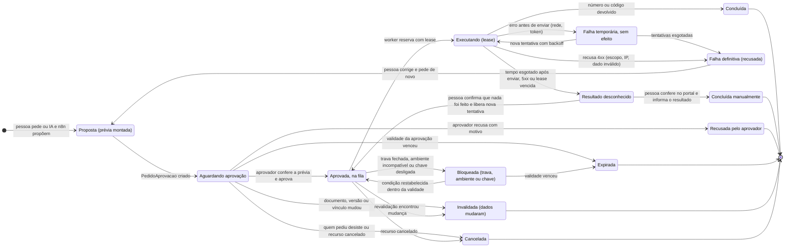
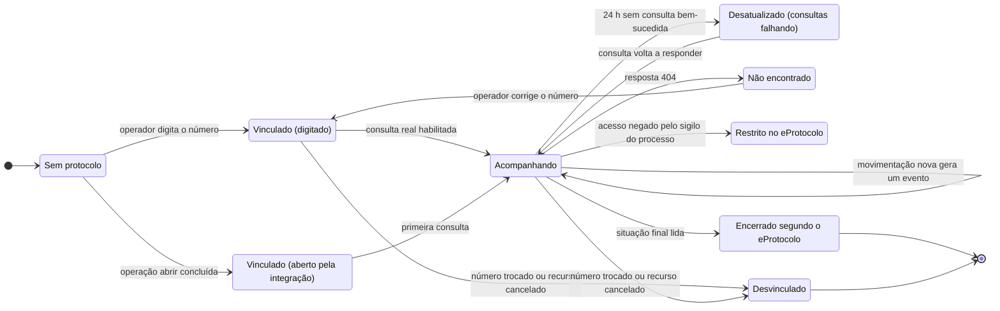
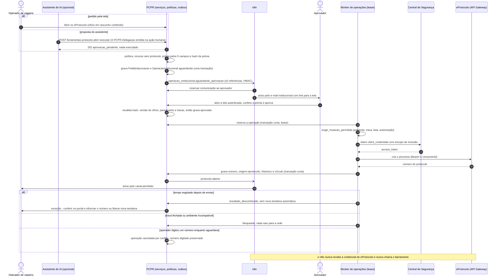
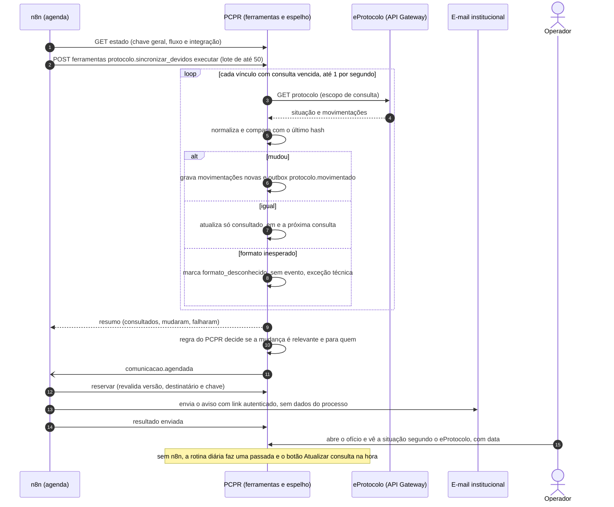
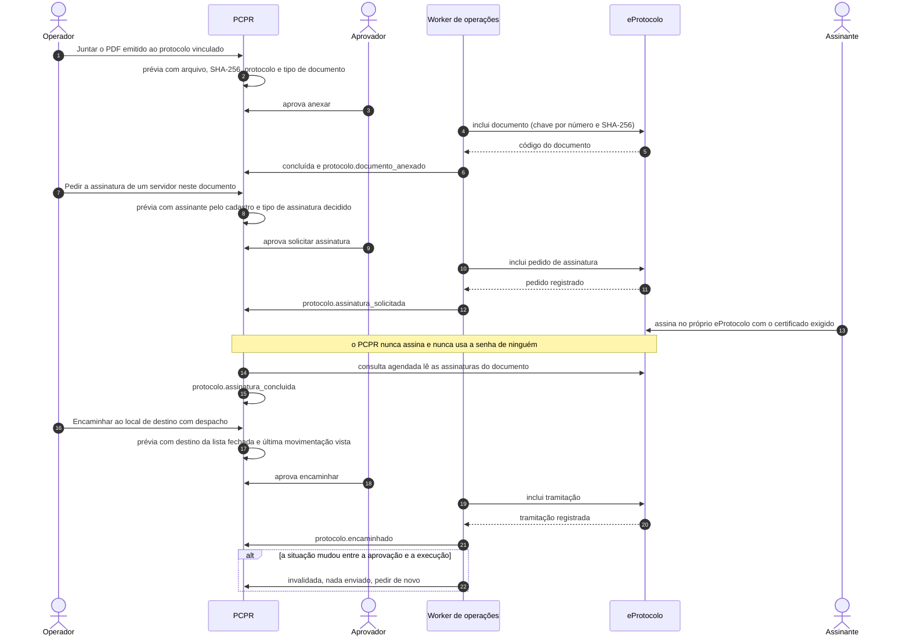
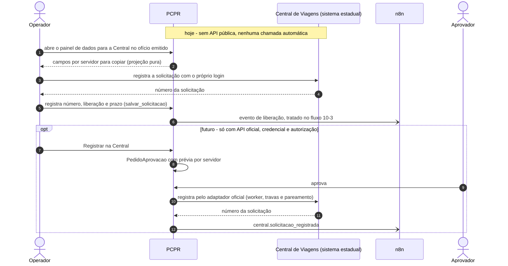

# 13 — Integrações institucionais: e-Protocolo e Central de Viagens

Desenho técnico da Fase 2 (17/10/2026). Base obrigatória: [arquitetura](../arquitetura.md),
[evento de integração](../contratos/evento-integracao.schema.json),
[API de automação](../contratos/api-automacao.v1.yaml), ADR 0019 (integrações atrás de portas) e
ADR 0020 (ferramentas com política e aprovação). Estudos de origem:
[`docs/integrations/eprotocolo.md`](../../integrations/eprotocolo.md) e
[`docs/integrations/central-de-viagens.md`](../../integrations/central-de-viagens.md).

Marcação de desenho: **[existe]** código executando hoje no sistema novo · **[parcial]** · **[novo]** a
desenvolver. Marcação de capacidade, usada nas tabelas de estado:

- **EXISTENTE**: o código executa (em tela, comando ou teste).
- **VERIFICADA PARCIALMENTE**: o código executa, mas só contra simulação, transporte falso ou mock. Nunca
  contra o barramento real.
- **PLANEJADA**: só existe em documento.

Evidências `caminho:linha` são relativas à raiz do repositório (`gestao/…`, `config/…`) ou às referências
somente leitura em produção (`ref/gv/…`, GV commit `ded9b648`; `ref/ev-implantado/…`). Este fluxo
**referencia, sem repetir**, os fluxos [10-2](10-2-envio-de-documentos.md) (envio de documentos),
[10-3](10-3-prestacao-e-mensagem-de-saque.md) (liberação de diárias),
[10-5](10-5-db-e-rt-para-assinatura.md) (DB/RT para assinatura) e
[10-6](10-6-recebimento-de-documentos.md) (recebimento e importação de processos).

---

## 1. Objetivo e resultado para o usuário

**Objetivo.** O fluxo quer reduzir a redigitação e o acompanhamento manual entre o PCPR e dois sistemas
estaduais. O **e-Protocolo** é o sistema oficial de gestão de documentos e processos. A **Central de
Viagens** é o sistema estadual de viagens e diárias. Há três limites:

1. Não se cria um sistema paralelo de tramitação.
2. Não se usa automação de navegador nem a sessão pessoal de nenhum servidor.
3. Toda mutação num sistema estadual passa por **aprovação humana na tela** e por **travas por ambiente**.

**Limite normativo (ponto a confirmar).** O Decreto estadual nº 7.304/2021
([PDF oficial](https://www.administracao.pr.gov.br/sites/default/arquivos_restritos/files/documento/2021-04/decreto_7304_-_2021_-_eprotocolo_-_com_anexos_0.pdf),
consultado em 17/10/2026; vigência e alterações posteriores **não verificadas**) estabelece:

| Dispositivo | Conteúdo (resumido) | Consequência para o desenho |
|---|---|---|
| art. 1º, *caput* | o eProtocolo é o sistema oficial de gestão dos documentos emitidos e recebidos pelo Executivo estadual | número, situação e tramitação **oficiais** são os do eProtocolo; o PCPR só **espelha** o que leu, sempre com a data da leitura |
| art. 1º, §2º | veda a adoção de sistemas paralelos de controle e tramitação de documentos e processos | o PCPR controla a **preparação** (ofício, prestação) e mostra o andamento lido. Nunca registra "tramitou" por conta própria nem mantém um estado de tramitação editável. O GV tem esse estado (`status_local`), e o novo **não** o copia |
| art. 3º | o servidor acessa o eProtocolo com chave e senha pessoais e intransferíveis, pela Central de Segurança | nenhuma automação usa a credencial de uma pessoa. A integração usa um **usuário de sistema** credenciado (`client_credentials`) |
| art. 16 | documentos que tramitam entre órgãos são protocolados só em formato digital, no eProtocolo | abrir, anexar e encaminhar acontecem **no** eProtocolo, pela API oficial, ou continuam manuais |
| art. 20 | quem cadastra escolhe assunto e palavras-chave com a máxima precisão | a IA pode **sugerir**; quem escolhe é uma pessoa, na prévia |
| art. 38, §1º | atos que autorizam ou efetivam despesa devem ser assinados com certificação digital ICP-Brasil | o PCPR **nunca assina**. Pedir assinatura só aciona o eProtocolo, e o assinante assina lá com o certificado exigido |
| art. 11, §2º; art. 12, parágrafo único | a Celepar afere e publica a indisponibilidade; em indisponibilidade prolongada admite-se o ato fora do meio eletrônico | a continuação manual é sempre possível. O relatório de indisponibilidade serve para conciliar falhas |

**Resultado para cada pessoa.**

| Quem | Hoje | Com o fluxo |
|---|---|---|
| Operador de viagens | Copia os cinco campos do painel "dados para o eProtocolo", abre o processo no portal, digita o número de 9 dígitos no ofício (`gestao/viagens/eprotocolo.py:123-167`, `gestao/viagens/services.py:274-276`). Depois volta ao portal para ver se andou | Pede "abrir no eProtocolo" sobre uma prévia conferida. Vê no ofício e na prestação a situação **lida** do eProtocolo, com data. Recebe aviso quando algo relevante muda |
| Aprovador (papel a definir, §14) | — | Confere a prévia exata do que vai sair (campos, arquivo e hash, destino) e aprova ou recusa. Nada sai sem esse ato |
| Assinante | É avisado por fora | Assina **no eProtocolo**, como hoje. O PCPR só detecta, na consulta, que a assinatura foi feita |
| Operador (Central de Viagens) | Digita a solicitação na Central e copia o número de volta, servidor a servidor (`gestao/viagens/prestacao.py:267-284`) | Copia de um painel por servidor (sem API). Se um dia houver API oficial, faz o mesmo pedido com aprovação |

**O fluxo não faz:** assinar; decidir abertura, despacho ou destino de tramitação; abrir, anexar ou
encaminhar sem aprovação; usar robô de navegador ou "raspagem" no eProtocolo ou na Central; guardar ou usar
senha de servidor; tratar número **simulado** ou **de treinamento** como oficial; deixar o n8n ou a IA
chamarem o eProtocolo diretamente; enviar comunicação pela plataforma oficial do WhatsApp. Ela está
bloqueada (maturidade 5): a política oficial (whatsappbusiness.com/policy, consultada em 17/10/2026) proíbe
autoridades policiais no WhatsApp Business Platform, como registrado em
[`../whatsapp-viabilidade.md`](../whatsapp-viabilidade.md). O WhatsApp é prioridade do usuário nas frentes
WA-1 a WA-3 do [plano](../plano-implantacao.md), voltadas a avisos a servidores; os avisos deste fluxo são
internos (sino e e-mail).

**Casos de uso cobertos:**

| # | Caso de uso | Sistema |
|---|---|---|
| U1 | Criar (abrir) protocolo a partir de um documento do PCPR | e-Protocolo |
| U2 | Acompanhar protocolos: situação, local atual, pendências | e-Protocolo |
| U3 | Anexar documentos ao processo | e-Protocolo |
| U4 | Solicitar assinaturas, sem assinar | e-Protocolo |
| U5 | Encaminhar (tramitar) processos | e-Protocolo |
| U6 | Consultar tramitação e movimentações | e-Protocolo |
| U7 | Registrar solicitações de diárias | Central de Viagens |
| U8 | Acompanhar as situações que a Central disponibilizar | Central de Viagens |
| U9 | Acionar comunicações a partir de eventos **confirmados** de U1–U8 | PCPR + n8n |

> **Estas NÃO são as únicas pendências da automação.** Mesmo com credenciais e autorização
> institucionais, o plano ainda depende de: formulário de KM ([10-4](10-4-link-de-km-na-vespera.md));
> contatos verificados (`ContatoVerificado`); identidade do servidor (servidores viajantes não são
> usuários, `Servidor` não tem e-mail e o vínculo usuário↔servidor está pendente); dados do RT
> ([10-5](10-5-db-e-rt-para-assinatura.md)); API de automação `/api/automacao/v1`; worker de entregas com
> lease; os requisitos de infraestrutura da etapa 0 do [plano](../plano-implantacao.md) (n8n isolado,
> backup com cópia fora do servidor, poda, alertas); elegibilidade de canais (plataforma oficial do WhatsApp bloqueada,
> com as frentes WA-1 a WA-3 do plano em andamento; e-mail institucional não confirmado). Detalhes na §13.3.

---

## 2. Estado atual com evidências

### 2.1 Sistema novo — e-Protocolo

| Capacidade | Estado | Nível | Evidência | Observação |
|---|---|---|---|---|
| Porta tipada `PortaEprotocolo` (`autenticar`, `consultar`, `abrir`) e tipos `Origem`, `Situacao`, `Movimentacao`, `PedidoDeAbertura` (com `chave` de idempotência), `ProtocoloAberto` | IMPLEMENTADO | EXISTENTE | `gestao/integracoes/eprotocolo/porta.py:16-65` | O formato real das respostas está marcado "a conferir no treinamento" (`porta.py:3-5`) |
| Configuração única: ambientes `simulado`, `desenvolvimento`, `homologacao`, `treinamento`, `producao`; URLs oficiais por ambiente; `real` só com credenciais; `oficial` só em produção | IMPLEMENTADO | EXISTENTE | `gestao/integracoes/eprotocolo/config.py:15-32`, `:42-75`; `config/settings/base.py:288-306` | Sem credencial, cai no modo simulado e diz isso na tela (`config.py:81-92`) |
| Trava de somente leitura **ligada por padrão**: variável vazia não desliga | IMPLEMENTADO | EXISTENTE | `config/settings/base.py:299-301`; `config.py:51-52`, `:73-75` | Só `false/0/no/nao/não` desliga |
| Códigos institucionais exigidos para abrir (órgão, local de origem, assunto "viagem", espécie "ofício") | IMPLEMENTADO (só checagem) | EXISTENTE | `config.py:36-38`, `:70-71` | Os valores vêm do gestor do eProtocolo (§14) |
| Adaptador simulado: a consulta devolve "Simulado — sem consulta real"; `abrir` gera número determinístico pela chave, marcado `SIMULADO` | IMPLEMENTADO | EXISTENTE | `gestao/integracoes/eprotocolo/adaptadores.py:45-65` | O simulado **não recusa** abrir: devolve um número fictício marcado. Hoje é inofensivo porque ninguém chama. A §6.3 bloqueia isso em produção |
| Adaptador HTTP: token `client_credentials` com `Basic` + `scope`; `Bearer` + `consumerId`; cache do token renovado 30 s antes; `GET /v3/protocolos/{n}`; só HTTPS, sem redirecionamento, resposta até 2 MB; erros tipados com mensagem que diz o que fazer | IMPLEMENTADO | **VERIFICADA PARCIALMENTE** (transporte falso nos testes; nunca contra o gateway) | `adaptadores.py:69-96`, `:105-175`; `gestao/integracoes/eprotocolo/erros.py:6-31` | Nome do cabeçalho `consumerId` "a confirmar na documentação restrita" (`adaptadores.py:36`); mapeamento tolerante da resposta (`adaptadores.py:207-218`) |
| `AdaptadorHttp.abrir` | **sempre recusa** | EXISTENTE (como recusa) | `adaptadores.py:177-187` | `EscritaBloqueada` com a trava ligada (padrão). Com a trava aberta: `ConfiguracaoIncompleta` se faltam códigos e, mesmo com tudo configurado, `ConfiguracaoIncompleta` "ainda não confirmada… (fase E4)" |
| Serviço: `adaptador()`, `consultar()`, `abrir()`, `origem_vale_como_oficial()`, `diagnostico()` | IMPLEMENTADO | EXISTENTE | `gestao/integracoes/eprotocolo/servico.py:14-52` | — |
| Diagnóstico `manage.py eprotocolo_check [--ping]` (nunca grava; segredos mascarados) | IMPLEMENTADO | EXISTENTE | `gestao/integracoes/management/commands/eprotocolo_check.py:1-39`; `config.py:120-127` | `--ping` autentica e consulta **só leitura** |
| Testes sem rede (13): token conforme a doc oficial, reaproveitamento do token, só HTTPS, `abrir` exige trava aberta e códigos, diagnóstico não toca a rede | IMPLEMENTADO | EXISTENTE | `gestao/integracoes/tests/test_eprotocolo.py:72`, `:86`, `:102`, `:141`, `:148`, `:157` | São testes de contrato contra respostas **inventadas**, não gravadas do barramento |
| **Nenhum contexto de negócio chama** `servico.consultar` ou `servico.abrir` | — | — | busca por `integracoes.eprotocolo` fora de `gestao/integracoes/`: nenhum resultado | Só o comando de diagnóstico usa o serviço |
| Fronteiras por import-linter: integrações não dependem de contextos; o domínio não conhece integrações | IMPLEMENTADO | EXISTENTE | `pyproject.toml:109-121` | Orienta onde moram os novos modelos (§7) |
| Ofício: `protocolo` (9 dígitos) e `protocolo_origem` (`manual`, `eprotocolo`, `treinamento`, `simulado`); quem digita assume `manual` | IMPLEMENTADO | EXISTENTE | `gestao/viagens/models.py:175-190`; `gestao/viagens/services.py:274-276`; migração `0010_origem_do_protocolo` | Só `manual` e `eprotocolo` valem como oficiais (`servico.py:29-30`) |
| Protocolo obrigatório para emitir (decisão D1) | IMPLEMENTADO | EXISTENTE | `gestao/viagens/services.py:516-518` | Exige o campo preenchido, **não** a origem oficial (§7.2) |
| Painel "dados para o eProtocolo": 5 campos copiáveis do rascunho ou do instantâneo emitido, sem CPF/RG, com aviso de origem | IMPLEMENTADO | EXISTENTE | `gestao/viagens/eprotocolo.py:87-100`, `:123-167`; `gestao/viagens/dominio/eprotocolo.py:47`; `docs/product/oficios-eprotocolo.md` | É o caminho manual e a base da prévia de abertura (§6.5) |
| Ponto de extensão `viagens.oficio.emitido` | PARCIAL | EXISTENTE (só log) | `gestao/viagens/assinantes.py:46-49` | Documentado como gancho de "notificações e eProtocolo" |
| Tópico `integracoes.eprotocolo.abrir` descrito no estudo | INEXISTENTE | PLANEJADA | `docs/integrations/eprotocolo.md` (seção "Arquitetura no sistema novo") | Não existe no código |
| Consulta de andamento para prestação, eventos, palestras ou coffee | INEXISTENTE | PLANEJADA | `gestao/eventos/models_solicitacao.py:59`; `gestao/palestras/models.py:111`; `gestao/coffee/models.py:167-177` | Nesses módulos o protocolo é digitado; o coffee só gera textos para copiar |
| Efeito colateral a respeitar: baixar o pacote do protocolo de pagamento do coffee **registra o atesto** | IMPLEMENTADO | EXISTENTE | `gestao/coffee/protocolo.py:137-160` | Nenhuma automação pode tratar esse download como leitura |

### 2.2 Sistema novo — Central de Viagens

| Capacidade | Estado | Nível | Evidência |
|---|---|---|---|
| Nº da solicitação, data de liberação e prazo limite de saque **por servidor**, digitados; regra prazo ≥ liberação; aviso ao registrar a liberação | IMPLEMENTADO (manual) | EXISTENTE | `gestao/viagens/models.py:1450-1452`; `gestao/viagens/prestacao.py:267-284` (ver [10-3](10-3-prestacao-e-mensagem-de-saque.md)) |
| Coluna "Nº solicitação (Central de Viagens)" no PDF do ofício, **sempre vazia** | IMPLEMENTADO (vazia) | EXISTENTE | `gestao/viagens/templates/viagens/documentos/oficio.html:88`, `:92` |
| Pacote `gestao/integracoes/central_viagens/` (porta + adaptador nulo) | INEXISTENTE | PLANEJADA | `docs/integrations/central-de-viagens.md` (seção "Conclusão") |
| Painel "dados para a Central de Viagens" com copiar | INEXISTENTE | PLANEJADA | idem |
| API pública da Central | **não existe** publicamente | — | estudo de 03/10/2026: a Central autentica pela Central de Segurança (`authorization_code`), os manuais estão "em construção" e **nenhuma API** é documentada ([página do DETO](https://www.administracao.pr.gov.br/DETO/Central_de_Viagens)) |

### 2.3 Fundação de automação que este fluxo usa (sistema novo)

| Peça | Estado | Evidência |
|---|---|---|
| `gestao/automacao/` (`PedidoAprovacao`, `ExecucaoFerramenta`, registro de ferramentas) | INEXISTENTE (ADR 0020 "proposto") | `docs/adr/0020-automacao-ferramentas-e-aprovacao.md`; não há pacote `gestao/automacao` |
| `/api/automacao/v1` | INEXISTENTE (contrato rascunho) | [`api-automacao.v1.yaml`](../contratos/api-automacao.v1.yaml) |
| Outbox | EXISTENTE, com limites: **um assinante por tópico** (`gestao/plataforma/outbox.py:41-45`); o worker **segura a transação** durante o assinante (`outbox.py:80-116`); 8 tentativas, ~21 min até `falhou` (`outbox.py:34`); sem tela de falhas | — |
| Padrão de lease para trabalho fora de transação | EXISTENTE na importação documental | `gestao/viagens/importacao.py:161-183`: retoma automaticamente depois de 8 min. **Serve para leitura, não para mutação externa** (§9) |
| Protótipo local (`docs/automacao/prototipo/`) | **não exercita** este fluxo | busca por "protocolo" ou "central" nos scripts: nenhum resultado |

### 2.4 O que a referência em produção faz — GV (implantado)

| Capacidade | Nível | Evidência |
|---|---|---|
| "Central de Protocolos" local: modelo `Protocolo` com `status_local` (`rascunho`, `criado`, `documentos_enviados`, `aguardando_assinatura`, `em_tramitacao`, `com_pendencia`, `concluido`, `erro`, `cancelado`), mais documentos, assinaturas, pendências, tramitações, movimentações e logs | EXISTENTE | `ref/gv/protocolos/models.py:31-109` |
| Cliente OAuth2 `client_credentials` + `consumerId`; segredos e CPF mascarados nos logs | VERIFICADA PARCIALMENTE (sem evidência de chamada real) | `ref/gv/integracoes/eprotocolo/client.py:1-70`, `:42-65` |
| Caminhos v3 centralizados (criar, consultar, concluir, documentos, volumes, pendências, tramitações, movimentações, assinaturas de documento, tabelas auxiliares), marcados "confirmar … antes do go-live" | PLANEJADA (não confirmada) | `ref/gv/integracoes/eprotocolo/schemas.py:1-44` |
| Lista de escopos "esperados" (consultar, incluir, concluir, documentos, tramitações, pendências, assinaturas, tabelas) para pedir à Celepar/SEAP. **Não é catálogo oficial** | PLANEJADA | `schemas.py:46-68` |
| Modos `mock` (padrão), `treinamento`, `homologacao`, `producao`, `real_controlado`; operações de leitura (`consultar`, `importar`) separadas das de mutação (`anexar_documento`, `criar_pendencia`, `tramitar`, `criar_protocolo`, `concluir`) | EXISTENTE | `ref/gv/integracoes/eprotocolo/settings.py:14-36`; `ref/gv/config/settings/base.py:395-417` (`REAL_READONLY=true`, `REAL_MUTATIONS_ENABLED=false` por padrão) |
| Trava de mutação: ambiente `real_controlado`, um protocolo por vez, `REAL_READONLY=False`, `REAL_MUTATIONS_ENABLED=True`, flag `--real`, protocolo explícito e confirmação manual | EXISTENTE | `ref/gv/integracoes/eprotocolo/settings.py:171-209` |
| …mas a trava **só é aplicada quando o ambiente é `real_controlado`**: a checagem está dentro de `if cfg.is_real_controlado()` | EXISTENTE | `ref/gv/protocolos/services.py:368-377` (chamada em `:548`, `:641`, `:684`, `:704`, `:760`). **Lição:** no novo, a trava vale para **qualquer** ambiente real (§6.3) |
| Em `mock`, abrir a lista da Central de Protocolos **grava protocolos de demonstração** no banco (`modo_mock=True`, `_demo`) | EXISTENTE | `ref/gv/protocolos/views.py:64-66`; `ref/gv/protocolos/services.py:172-217`. **Lição:** dado fictício nunca entra no banco de produção; demonstração só no PREVIEW, por `semear_demo` |
| Sincronização só por comando manual (`sync_eprotocolo --ativos`), sem agendamento | EXISTENTE | `ref/gv/protocolos/management/commands/sync_eprotocolo.py:1-40`; `ref/gv/protocolos/services.py:806-865` |
| Comandos `eprotocolo_*_real` (consultar, criar, anexar, pendência, tramitar, importar, ping, check) atrás da trava | EXISTENTE | `ref/gv/protocolos/management/commands/` |
| Guia de treinamento (validar token, consulta, criação de teste, envio de PDF, conclusão) | PLANEJADA | `ref/gv/docs/eprotocolo_treinamento.md:1-25` |
| A fase seguinte **"pausa totalmente a integração real"** e usa a Central em modo mock | — | `ref/gv/docs/eprotocolo_treinamento_demo.md:1-5` |
| Decisão registrada: a assinatura digital de documentos é feita no eProtocolo; no GV ficou só a assinatura eletrônica simples de RT/DB por link (ver [10-5](10-5-db-e-rt-para-assinatura.md)) | EXISTENTE | `ref/gv/documentos/migrations/0004_drop_assinaturas_tables.py:1-4` |
| Central de Viagens estadual | INEXISTENTE ("Central de Viagens 3" é o nome do próprio GV) | `ref/gv/core/views.py:119` |

### 2.5 O que a referência em produção faz — EV (implantado)

| Capacidade | Nível | Evidência |
|---|---|---|
| Cliente OAuth2, caminhos v3 "confirme na documentação oficial", mock determinístico | VERIFICADA PARCIALMENTE | `ref/ev-implantado/integracoes/eprotocolo/schemas.py:13-44`; `mocks.py:22-54` |
| Padrão `AMBIENTE=mock` **e** `AUTO_PROTOCOLO_OFICIO=1`: todo ofício gravado sem protocolo recebe número `SIMULADO`, com aviso na tela, **sem bloquear** a geração do documento | EXISTENTE | `ref/ev-implantado/config/settings.py:319-342`; `viagens_oficios/protocolo_services.py:74-151`; `viagens_oficios/form_context.py:207-227` |
| Consulta diária do andamento da prestação na rotina ("Processo em [setor]") e aviso quando chega ao setor do despacho | EXISTENTE no código; **contra mock** se não houver credencial | `ref/ev-implantado/core/rotinas.py:96`; `viagens_prestacoes/protocolo_services.py:64-148` |
| Importação do PDF do processo baixado à mão; números `SIMULADO`/`TREINAMENTO` têm peso menor na identificação | EXISTENTE | `ref/ev-implantado/viagens_prestacoes/importacao/analise.py:247` (ver [10-6](10-6-recebimento-de-documentos.md)) |

### 2.6 Síntese pelas cinco categorias pedidas

| Categoria | O que está nela |
|---|---|
| **Implementado** | **Novo:** porta, adaptadores simulado e HTTP de consulta, serviço, travas de configuração, diagnóstico, testes sem rede, campo e origem do protocolo no ofício, painel copiável, campos manuais da Central na prestação. **GV:** Central de Protocolos local com mock, cliente, travas em `real_controlado` e comandos. **EV:** abertura automática com número simulado por padrão, consulta diária, importação do processo |
| **Testado em treinamento** | **Nada. Não há evidência** de chamada real bem-sucedida ao barramento de treinamento em nenhum dos três sistemas: nenhuma resposta gravada, nenhum registro de homologação. O GV registra a pausa da integração real (`eprotocolo_treinamento_demo.md:1-5`), e os três marcam os caminhos como "a confirmar". O ambiente configurado na produção do GV/EV não se confirma pelo código (o padrão é mock) |
| **Dependente de credenciais** (o código existe e falta só a credencial) | Consulta de situação no sistema novo (fase E3): `client_id`, `secret`, `consumerId`, escopo `spiserv.protocolos.consultar`, IP de saída autorizado, códigos institucionais. Tudo fica em variáveis de ambiente, nunca no repositório |
| **Dependente de API e autorização institucional** | Abrir (caminho e corpo da abertura **não são públicos**, `adaptadores.py:185-187`); anexar; solicitar assinatura; encaminhar; movimentações e documentos do processo; escopos de inclusão aprovados; usuário de sistema com CPF vinculado a local/setor; tipos de documento e locais de destino. **Toda a Central de Viagens:** não há API pública documentada |
| **A desenvolver** (não depende de terceiros) | Pareamento de ambientes e trava generalizada; `gestao/automacao` (aprovação, execuções, `OperacaoInstitucional`, worker com lease); espelho `ProtocoloVinculado`; ferramentas e telas de aprovação; eventos novos; painel "dados para a Central"; regras de comunicação |

### 2.7 Oportunidades classificadas

| Oportunidade | Classificação | Por quê |
|---|---|---|
| Painel "dados para a Central de Viagens" com copiar | automação determinística suficiente | projeção pura, no mesmo padrão do painel do eProtocolo |
| Prévia de abertura montada dos dados do ofício (os 5 campos existentes) | automação determinística suficiente | `dados_eprotocolo` já produz assunto e detalhamento |
| Abrir, anexar, solicitar assinatura e encaminhar com aprovação | dependente de integração externa | caminhos, escopos e autorização vêm do credenciamento |
| Portão de aprovação, travas e worker de operações | dependente de desenvolvimento | ADR 0020 ainda não implementado |
| Espelho da situação, deduplicação de movimentações, regra "o que é relevante" | melhor execução pelo próprio sistema | é estado e regra de negócio. A credencial e o IP autorizado ficam só no PCPR |
| Agendar a consulta periódica e entregar os avisos de movimentação | automação indicada com n8n | agenda e transporte nas bordas, com o PCPR como dono do estado (arquitetura §1) |
| Resumir em linguagem simples as movimentações e despachos lidos; sugerir assunto e palavras-chave na prévia | assistência por IA indicada | texto livre vindo do eProtocolo; a saída é sugestão, e uma pessoa escolhe (art. 20) |
| Registrar e consultar solicitações na Central por API | dependente de integração externa | não há API pública (§2.2) |
| Baixar o PDF do processo pela API e mandar para a fila de importação | dependente de integração externa | escopo de documentos; a importação existe ([10-6](10-6-recebimento-de-documentos.md)) |
| Robô de navegador ou sessão de usuário no eProtocolo ou na Central | **inadequada ou inviável atualmente**: viola o acesso protegido e a pessoalidade da credencial (Decreto 7.304/2021, art. 3º), é frágil e não é auditável | — |
| IA decidindo abrir, encaminhar ou despachar | **inadequada ou inviável atualmente**: é ato administrativo com efeito externo e irreversível (ADR 0020, item 3) | — |
| Comunicação dos eventos por WhatsApp | **inadequada ou inviável atualmente**: a política da Meta proíbe autoridades policiais no Business Platform, e nenhum BSP contorna isso | — |

---

## 3. Gatilho e definição precisa do evento de conclusão

### 3.1 O que **não** conclui nada

- **Aprovação concedida.** Só libera a execução.
- **Resposta 2xx sem número ou código.** Vira `resultado_desconhecido` (§9).
- **Número de origem `simulado` ou `treinamento` num PCPR de produção.** Isso não pode existir (§6.3).
  Em PREVIEW ou STAGING esse número conclui só o teste.
- **Situação produzida pelo mapeamento tolerante sem os campos esperados** (`"Sem situação"`,
  `adaptadores.py:215-216`). Não gera evento de mudança.
- **Afirmação da IA ou texto colado** por alguém. O único evento confirmado é a leitura da API oficial,
  gravada e deduplicada pelo PCPR.

### 3.2 Definição por caso de uso

| # | Gatilho | Pré-condições revalidadas na execução | Evento de conclusão |
|---|---|---|---|
| U1 | Pessoa com permissão pede "Abrir no eProtocolo" num ofício em rascunho conferido; ou a IA ou o n8n **propõem** por ferramenta e o pedido vira `PedidoAprovacao` | recurso sem protocolo; prévia com hash igual ao aprovado; versão do ofício igual; códigos institucionais presentes; ambientes pareados; trava aberta; `abrir` na lista de permitidas; aprovação válida | `OperacaoInstitucional(abrir)` concluída com o número devolvido pelo adaptador real. O número é gravado em `Oficio.protocolo` com origem `eprotocolo` pelo serviço (com `Historico`), o `ProtocoloVinculado` é criado e o PCPR publica `protocolo.aberto` |
| U2/U6 | Agenda (n8n) chama `protocolo.sincronizar_devidos`; sem n8n, a rotina diária do PCPR faz uma passada; ou o botão "Atualizar" na tela | vínculo ativo; consulta habilitada; janela e limite de taxa | `ConsultaProtocolo` gravada (`consultado_em`). Se o hash normalizado mudou, grava `MovimentacaoProtocolo` (só acrescenta) e publica **um** `protocolo.movimentado` |
| U3 | Pessoa pede "Juntar ao processo" um PDF **emitido** (ofício, justificativa, pacote da prestação) | vínculo ativo; PDF imutável com SHA-256; tamanho e tipo aceitos; aprovação | código do documento no eProtocolo devolvido e gravado com o hash enviado; publica `protocolo.documento_anexado` |
| U4 | Pessoa pede "Solicitar assinatura de X" num documento já anexado | documento anexado; assinante resolvido pelo cadastro; tipo de assinatura decidido pela instituição (art. 38); aprovação | pedido registrado no eProtocolo (código); publica `protocolo.assinatura_solicitada`. A **assinatura** só conclui quando a consulta a lê (`protocolo.assinatura_concluida`) |
| U5 | Pessoa pede "Encaminhar ao local Y" com despacho | destino numa lista fechada configurada; a última movimentação vista é a mesma da prévia; aprovação | tramitação registrada (código), confirmada na consulta seguinte pelo novo local atual; publica `protocolo.encaminhado` |
| U7 | **Hoje:** ofício emitido, e o operador abre o painel "dados para a Central". **Futuro (só com API):** pedido com aprovação | — / API oficial disponível | **Hoje:** o operador registra o nº da solicitação (`salvar_solicitacao`). **Futuro:** número devolvido pela API, origem `central_api` |
| U8 | **Hoje:** a pessoa registra a liberação, que já dispara o aviso do [10-3](10-3-prestacao-e-mensagem-de-saque.md). **Futuro:** consulta agendada | API oficial | **Futuro:** `central.situacao_alterada` lido da API. **Nunca** inferir liberação |
| U9 | Evento confirmado de U1–U8 classificado como relevante por regra **do PCPR** (§6.4) | chave do fluxo ligada; destinatário autorizado; contato verificado; canal permitido | `Comunicacao` criada e entregue pelo mecanismo comum (reservar → enviar → resultado, [arquitetura §3](../arquitetura.md)) |

---

## 4. Diagramas

### 4.1 Estados de uma operação institucional (U1, U3, U4, U5 e, no futuro, U7)



A operação **nunca** volta sozinha de `Executando` para `Aprovada`. Isso é diferente do lease da importação
documental, que retoma depois de 8 min: lá a repetição é inofensiva, aqui poderia abrir dois processos.

### 4.2 Estados do espelho de um protocolo vinculado (U2, U6)



Nenhum desses estados é tramitação. Todos descrevem **a leitura** que o PCPR fez. A tela sempre mostra
"segundo o eProtocolo em dd/mm hh:mm".

### 4.3 Sequência — abrir protocolo com aprovação humana (U1)



### 4.4 Sequência — acompanhar e comunicar (U2, U6, U9)



### 4.5 Sequência — anexar, solicitar assinatura e encaminhar (U3, U4, U5)



### 4.6 Sequência — Central de Viagens (U7, U8)



---

## 5. Responsabilidades

| Componente | Faz | Não faz |
|---|---|---|
| **Sistema PCPR** | Dono das credenciais institucionais (só em variáveis de ambiente) e da saída de rede autorizada; monta prévias; política de quem pede e quem aprova; travas e pareamento de ambientes; worker de operações com lease; espelho e deduplicação; regra de relevância; `Comunicacao`; exceções; chave geral e do fluxo; métricas; continuação manual | Tramitar por conta própria; manter estado de tramitação editável; assinar; aceitar número simulado ou de treinamento em produção; repetir mutação sem saber o resultado |
| **Worker de operações institucionais** [novo] | Executar mutações aprovadas fora de transação, uma por vez por protocolo, com lease e revalidação imediatamente antes do HTTP | Retomar sozinho uma mutação interrompida; executar sem `AutorizacaoDeMutacao` válida |
| **Outbox + worker de entregas** [existe + novo] | Registrar eventos depois do commit e entregá-los ao n8n com HMAC (arquitetura §2) | Fazer HTTP ao eProtocolo dentro do assinante (seguraria a transação, `outbox.py:80-116`) |
| **n8n** | Agendar `protocolo.sincronizar_devidos` em horário comercial; transportar avisos (aprovação pendente, movimentação relevante, assinatura concluída, falhas) pelo canal permitido; alertar exceções | Ter credencial do eProtocolo ou da Central; chamar o barramento; decidir relevância ou destinatário; aprovar; gravar no banco |
| **IA** (opcional) | Resumir movimentações e despachos lidos, com citação de cada trecho; sugerir assunto e palavras-chave na prévia; propor uma operação (que vira pedido de aprovação) | Aprovar; escolher destino de tramitação ou assinante; afirmar situação que não veio da API; ler processos fora da permissão do usuário da delegação (ou do dono do token pessoal) |
| **Operador de viagens** | Pede operações, confere prévias, resolve exceções (`resultado_desconhecido`, `nao_encontrado`), usa o caminho manual quando preciso | — |
| **Aprovador** (papel a definir) | Aprova ou recusa cada mutação na tela | Aprovar por e-mail, API ou mensagem |
| **Assinante** | Assina no eProtocolo com o meio exigido | — |
| **Instituição** (gestor de acesso do órgão, SEAP, Celepar, DETO) | Credenciamento, usuário de sistema, escopos, IP autorizado, códigos institucionais, decisão sobre a Central | — |

---

## 6. Contratos

### 6.1 Existentes [existe]

- `PortaEprotocolo.autenticar() / consultar(numero) -> Situacao / abrir(PedidoDeAbertura) -> ProtocoloAberto`
  (`porta.py:60-65`).
- Erros `ConfiguracaoIncompleta`, `EscritaBloqueada`, `Indisponivel`, `Recusado(status)`, `NaoEncontrado`
  (`erros.py:6-31`). Todos trazem mensagem pronta para a tela.
- `servico.origem_vale_como_oficial(origem)` (`servico.py:29-30`) e `servico.diagnostico()`
  (`servico.py:33-52`).
- Da API de automação (rascunho, ainda inexistente): `GET /estado`, `POST /ferramentas/{nome}/executar`
  (`irreversivel` devolve 202 `aprovacao_pendente`), `POST /excecoes` e o ciclo de `comunicacoes`.
- Nenhum tipo do `evento-integracao.schema.json` cobre protocolos. Os tipos novos estão na §6.4.

### 6.2 Porta estendida do e-Protocolo [novo]

A porta atual vira **duas portas**: leitura e mutação. Assim a trava fica na própria estrutura do código:
quem só tem a porta de leitura não consegue mutar. A assinatura de `abrir` muda para exigir a
autorização, o que não quebra nada, porque nenhum contexto chama `abrir` hoje.

```python
# gestao/integracoes/eprotocolo/porta.py — extensão proposta [novo]
class Operacao(StrEnum):
    ABRIR = "abrir"
    ANEXAR = "anexar"
    SOLICITAR_ASSINATURA = "solicitar_assinatura"
    ENCAMINHAR = "encaminhar"


@dataclass(frozen=True)
class AutorizacaoDeMutacao:
    """Prova de aprovação humana. Só gestao.automacao a constrói, a partir de um
    PedidoAprovacao aprovado na tela. O adaptador real recusa mutação sem ela."""
    pedido_aprovacao_id: int
    operacao: Operacao
    alvo: str                 # número do protocolo; em ABRIR, a chave do recurso
    chave: str                # idempotência, única por operação
    ambiente_pcpr: str        # APP_ENV no momento da aprovação
    ambiente_eprotocolo: str  # producao | treinamento | homologacao
    hash_previa: str          # SHA-256 do que o aprovador viu
    aprovado_por: int
    aprovado_em: datetime
    expira_em: datetime


@dataclass(frozen=True)
class PedidoDeAnexo:
    numero: str               # 9 dígitos
    nome_arquivo: str
    sha256: str
    tamanho: int
    tipo_documento: str       # código institucional (DESCONHECIDO até a doc restrita)
    chave: str                # f"anexar:{numero}:{sha256}"


@dataclass(frozen=True)
class PedidoDeAssinatura:
    numero: str
    codigo_documento: str
    assinante_ref: int        # servidor no cadastro; o CPF é resolvido só na execução
    tipo_assinatura: str      # decidido pela instituição (Decreto 7.304/2021, art. 38)
    chave: str                # f"assinatura:{numero}:{codigo_documento}:{assinante_ref}"


@dataclass(frozen=True)
class PedidoDeTramitacao:
    numero: str
    local_destino: str        # código de uma lista fechada configurada
    despacho: str
    base_movimentacao: str    # hash da última movimentação vista na prévia
    chave: str                # f"encaminhar:{numero}:{local_destino}:{base_movimentacao}"


class LeituraEprotocolo(Protocol):
    def autenticar(self) -> None: ...
    def consultar(self, numero: str) -> Situacao: ...                         # [existe]
    def movimentacoes(self, numero: str) -> tuple[Movimentacao, ...]: ...     # [novo]
    def documentos(self, numero: str) -> tuple[DocumentoNoProcesso, ...]: ... # [novo]
    def assinaturas(self, numero: str, codigo_documento: str
                    ) -> tuple[SituacaoAssinatura, ...]: ...                  # [novo]
    def tabela(self, nome: Literal["orgaos", "locais", "assuntos", "especies"]
               ) -> tuple[ItemTabela, ...]: ...                               # [novo]


class MutacaoEprotocolo(Protocol):
    def abrir(self, pedido: PedidoDeAbertura,
              autorizacao: AutorizacaoDeMutacao) -> ProtocoloAberto: ...
    def anexar(self, pedido: PedidoDeAnexo, conteudo: Callable[[], bytes],
               autorizacao: AutorizacaoDeMutacao) -> DocumentoAnexado: ...
    def solicitar_assinatura(self, pedido: PedidoDeAssinatura,
                             autorizacao: AutorizacaoDeMutacao) -> AssinaturaSolicitada: ...
    def encaminhar(self, pedido: PedidoDeTramitacao,
                   autorizacao: AutorizacaoDeMutacao) -> TramitacaoRegistrada: ...
```

Os resultados (`DocumentoAnexado`, `AssinaturaSolicitada`, `TramitacaoRegistrada`) trazem só número,
código devolvido pelo órgão e hash enviado. Caminhos, corpos, nomes de campo e escopos de cada operação
ficam **"DESCONHECIDO"** até a documentação restrita do credenciamento. O GV (`schemas.py:19-68`) serve só
como lista de perguntas, não como contrato.

Adaptadores: `Simulado` (desenvolvimento e testes), `Gravado` [novo] (respostas reais do **treinamento**,
anonimizadas, para testes de contrato) e `Http`. Em produção, `Simulado` é proibido para mutação (§6.3).

### 6.3 Travas e pareamento de ambientes [novo]

```python
# gestao/integracoes/eprotocolo/travas.py [novo] — chamada pelo adaptador real em toda mutação
PAREAMENTO = {                       # APP_ENV -> ambientes do eProtocolo aceitos
    "production": {"producao", "desligado"},
    "staging": {"treinamento", "homologacao", "simulado"},
    "preview": {"treinamento", "simulado"},
    "dev": {"simulado", "treinamento"}, "lab": {"simulado"}, "test": {"simulado"},
}

def exigir_pareamento(app_env: str, eprotocolo_ambiente: str) -> None:
    """No startup (como exigir_demo_somente_no_preview): par inválido -> ImproperlyConfigured."""

def exigir_mutacao_permitida(config, autorizacao, agora) -> None:
    """Qualquer falha -> EscritaBloqueada, e nada sai para a rede.
    1. config.real (credenciais completas) e par válido com APP_ENV;
    2. trava de somente leitura desligada explicitamente (EPROTOCOLO_SOMENTE_LEITURA=false);
    3. operação em EPROTOCOLO_MUTACOES (lista explícita, vazia por padrão);
    4. autorização da mesma operação e do mesmo alvo, gravada no mesmo par de ambientes, não expirada;
    5. uma operação por protocolo de cada vez (lock por número);
    6. chave geral e chave do fluxo 'integracoes-institucionais' ligadas (/estado)."""
```

**Treinamento × produção:**

| Aspecto | Produção | Treinamento, homologação e PREVIEW |
|---|---|---|
| Par de ambientes | `APP_ENV=production` só com `EPROTOCOLO_AMBIENTE=producao` ou `desligado`. Sem credencial, **desligado**, não simulado: sem número fictício e sem "consulta simulada" | `staging`/`preview` nunca com `producao`: o startup falha |
| Credenciais | `client_id`, `secret`, `consumerId` próprios de produção; token emitido pela Central de Segurança de produção (`config.py:30-31`) | credenciais próprias; token pela Central de Segurança de homologação (`config.py:26-29`) |
| Token da API de automação (n8n → PCPR) | token de serviço de produção, inválido nos outros ambientes (contrato v1) | idem, próprio do ambiente |
| Instância e workflows do n8n | credenciais e webhooks de produção; recusa evento com `ambiente` ≠ `producao` | separados; recusa evento de produção |
| Trava de mutação | fechada por padrão; abrir exige variável de ambiente + lista explícita + chave na tela | idem, para os números de teste nunca "vazarem" |
| Origem gravada | `eprotocolo` ou `manual` | `treinamento` ou `simulado`, com o aviso "não vale" (`gestao/viagens/eprotocolo.py:87-100`) |
| Emissão | exige origem oficial (§7.2) | aceita `treinamento`/`simulado` para fins de teste |

### 6.4 Eventos [novo] (extensão do enum de `evento-integracao.schema.json`)

`recurso.tipo` ganha `protocolo` e `operacao_institucional`. `dados` continua sem nomes, CPF,
despachos ou conteúdo de documentos: o consumidor busca pela API, com autorização.

| `tipo` | `recurso` | `dados` mínimos | Consumidor |
|---|---|---|---|
| `operacao_institucional.aguardando_aprovacao` | operacao_institucional | `sistema`, `operacao`, `pedido_aprovacao_id`, `expira_em` | n8n → aviso ao aprovador |
| `operacao_institucional.concluida` | operacao_institucional | `sistema`, `operacao`, `protocolo_id` | n8n → aviso a quem pediu |
| `operacao_institucional.falhou` | operacao_institucional | `codigo_erro` (`recusado`, `esgotada`, `invalidada`, `expirada`) | n8n → alerta |
| `operacao_institucional.resultado_desconhecido` | operacao_institucional | `operacao` | n8n → alerta **imediato** |
| `protocolo.aberto` | protocolo | `origem`, `recurso_vinculado` (ex.: `oficio:812`) | n8n → aviso |
| `protocolo.movimentado` | protocolo | `mudancas` (`situacao`, `local`, `pendencia`), `relevancia` (regra do PCPR: `chegou_ao_setor_do_despacho`, `pendencia_aberta`, `devolvido`, `encerrado`, `outra`) | n8n → comunicação, se a regra a criar |
| `protocolo.documento_anexado` | protocolo | `documento_ref` (tipo e id no PCPR) | auditoria e aviso |
| `protocolo.assinatura_solicitada` | protocolo | `documento_ref`, `assinante_ref` | aviso opcional ao assinante pelo canal permitido |
| `protocolo.assinatura_concluida` | protocolo | `documento_ref` | aviso; alimenta a conferência de vias assinadas e a [10-6](10-6-recebimento-de-documentos.md) |
| `protocolo.encaminhado` | protocolo | `local_destino_codigo` | aviso |
| `protocolo.consulta_falhando` | protocolo | `falhas_consecutivas`, `desde` | alerta operacional |
| `central.solicitacao_registrada` | prestacao | `servidor_ref` | **futuro**, só com API |
| `central.situacao_alterada` | prestacao | `servidor_ref`, `situacao_codigo` | **futuro**, só com API |

"Evento confirmado" (U9) só existe para tipos gerados de leitura **real** e gravada, no ambiente do
consumidor. Na produção, um evento de origem `treinamento` ou `simulado` é recusado.

### 6.5 Ferramentas (ADR 0020) [novo]

| Nome | Risco | Entrada | Saída | Política | Idempotência |
|---|---|---|---|---|---|
| `protocolo.consultar` | leitura | `numero` ou `vinculo_id` | `Situacao`, `consultado_em`, `origem`, aviso | ver o recurso vinculado | — |
| `protocolo.sincronizar_devidos` | leitura (efeito só no espelho local) | `limite` ≤ 50 | `{consultados, mudaram, falharam}` | conta técnica com papel `automacao_leitura` [novo] | por vínculo e janela |
| `protocolo.preparar_abertura` | preparação | `recurso`, `versao` | prévia: campos, origem de cada campo, hash | pedir operação no recurso | por versão |
| `protocolo.abrir` | **irreversível** | `recurso`, `versao`, `hash_previa` | 202 com `pedido_aprovacao_id` | pedir: operador. Aprovar: papel aprovador | `eprotocolo:abrir:{recurso}:{versao}` |
| `protocolo.vincular_manual` | reversível | `recurso`, `numero` | vínculo com origem `manual` | editar o recurso | por (recurso, número) |
| `protocolo.anexar_documento` | **irreversível** | `numero`, `documento_id` (emitido) | 202 | idem | `anexar:{numero}:{sha256}` |
| `protocolo.solicitar_assinatura` | **irreversível** | `numero`, `codigo_documento`, `servidor_id` | 202 | idem | `assinatura:{numero}:{codigo}:{servidor}` |
| `protocolo.encaminhar` | **irreversível** | `numero`, `local_destino`, `despacho`, `base_movimentacao` | 202 | idem | `encaminhar:{numero}:{destino}:{base}` |
| `protocolo.resumir_movimentacoes` | leitura (IA) | `vinculo_id` | resumo curto com citação de cada movimentação usada | ver o recurso | — |
| `central.dados_para_copiar` | leitura | `oficio_id` | campos por servidor | ver o ofício | — |
| `central.registrar_solicitacao` | **irreversível** | `prestacao_servidor_id` | hoje **503** `integracao_inexistente` | — | `central:{prestacao_servidor}` |
| `central.consultar_solicitacao` | leitura | `numero` | hoje **503** `integracao_inexistente` | — | — |

**Não existe rota de aprovação na API de automação**, de propósito. Aprovar só se faz na tela, com
sessão de pessoa. Um token de serviço (n8n) ou um assistente de IA não tem como aprovar.

### 6.6 API de automação — extensões [novo]

- `GET /estado`: acrescenta `integracoes.eprotocolo` (`ambiente`, `consulta`, `mutacoes_permitidas`,
  `ultima_consulta_ok_em`) e `integracoes.central_viagens` (`disponivel: false`). O n8n não agenda nada
  com a consulta desligada.
- `Erro.codigo`: acrescenta `trava_fechada`, `ambiente_incompativel`, `resultado_desconhecido`,
  `integracao_inexistente`.
- Nenhum endpoint devolve credencial, token do barramento ou corpo bruto do eProtocolo.

### 6.7 Central de Viagens [novo]

```python
# gestao/integracoes/central_viagens/porta.py [novo]
class PortaCentralViagens(Protocol):
    def disponivel(self) -> bool: ...
    def consultar_solicitacao(self, numero: str) -> SituacaoSolicitacao: ...
    def registrar_solicitacao(self, pedido: PedidoDeSolicitacao,
                              autorizacao: AutorizacaoDeMutacao) -> SolicitacaoRegistrada: ...
# Adaptador padrão e único hoje: Nulo -> disponivel() == False; os demais levantam IntegracaoInexistente.

# gestao/viagens/dominio/central.py [novo] — Python puro, como dominio/eprotocolo.py
def dados_para_central(*, servidor: str, cargo: str, periodo: str, destinos: Sequence[str],
                       motivo: str, oficio: str) -> tuple[CampoCopiavel, ...]: ...
```

A lista de campos depende da resposta do DETO (pergunta 4 do estudo). O painel do eProtocolo **omite
CPF/RG por regra**. Se a Central exigir CPF, a decisão fica na §14 (D12).

---

## 7. Modelo de dados [novo] e permissões

### 7.1 Entidades novas

| Entidade | Onde | Campos principais | Regras |
|---|---|---|---|
| `PedidoAprovacao` (compartilhada, ADR 0020) | `gestao/automacao/` | `ferramenta`, `entrada` (mascarada), `resumo_legivel`, `hash_previa`, `pedido_por` (pessoa, IA ou serviço + usuário da `Delegacao` usada), `estado` (`pendente`, `aprovado`, `recusado`, `expirado`, `cancelado`, `invalidado`), `decidido_por`, `decidido_em`, `motivo`, `expira_em` | Só a tela muda o estado para `aprovado`. A aprovação guarda o hash do que foi mostrado |
| `ExecucaoFerramenta` (compartilhada) | `gestao/automacao/` | ferramenta, chamador (credencial), usuário da delegação e id da `Delegacao`, entrada mascarada, saída resumida, duração, resultado, aprovação vinculada | Trilha de quem pediu o quê. A auditoria imutável continua sendo o trigger do banco |
| `OperacaoInstitucional` | `gestao/automacao/` | `sistema` (`eprotocolo`, `central_viagens`), `operacao`, `alvo_tipo` e `alvo_id` (genéricos), `protocolo_numero`, `entrada` (referências, sem CPF), `entrada_sha256`, `pedido_aprovacao`, `estado` (§4.1), `ambiente_pcpr`, `ambiente_externo`, `chave` (**única**), `lease_ate`, `tentativas`, `resultado_ref` (número ou código), `http_status`, `erro`, `duracao_ms`, `concluida_manual_por`, `versao` | Um registro por efeito pretendido. A chave única impede duplicata por duplo clique ou reentrega |
| `ProtocoloVinculado` | `gestao/protocolos/` [novo contexto neutro] | `numero`, `origem`, `ambiente`, `recurso_tipo` e `recurso_id` (ex.: `viagens.oficio:812`), `papel` (`oficio`, `envio_prestacao`, `pagamento`…), `ativo`, `situacao_lida`, `local_atual_lido`, `ultima_movimentacao_em`, `consultado_em`, `proxima_consulta_em`, `falhas_consecutivas`, `hash_ultima_resposta`, `estado_espelho` (§4.2) | Único por (`recurso`, `papel`, `ativo`). Nada é editável à mão além de vincular e desvincular. Os campos lidos são só leitura (art. 1º, §2º) |
| `MovimentacaoProtocolo` | `gestao/protocolos/` | `vinculo`, `ocorrida_em`, `descricao`, `local`, `chave` (hash de número, data, descrição e local), `lida_em` | Só acrescenta; a chave deduplica |

**Por que um contexto `gestao/protocolos/`.** `gestao/integracoes` não pode depender de contextos
(`pyproject.toml:109-115`) e serve vários módulos (viagens, prestação, eventos, palestras, coffee). O novo
contexto referencia recursos por tipo e id. Os contextos registram quais campos de protocolo expõem, no
mesmo padrão de `registrar_rotina` (`gestao/plataforma/rotinas.py:25`). Novo contrato do import-linter:
`gestao.protocolos` não importa contextos de negócio.

### 7.2 Alterações em modelos e regras existentes

- `Oficio.protocolo` continua sendo a fonte do número **no documento**. O serviço mantém o
  `ProtocoloVinculado` em sincronia quando o campo muda (digitado → `manual`; aberto → `eprotocolo`).
- **Pendência de emissão** [novo]: em produção, emitir exige `protocolo_origem ∈ {manual, eprotocolo}`.
  Hoje só se exige o campo preenchido (`services.py:516-518`). Com o pareamento da §6.3 isso já não deveria
  acontecer; é defesa em profundidade.
- `PrestacaoServidor.numero_solicitacao` ganha `origem_numero_solicitacao` (`manual` | `central_api`) só
  quando houver API.
- Nada muda no efeito colateral do coffee (`coffee/protocolo.py:137-160`). Ele fica **fora** de qualquer
  ferramenta de leitura.

### 7.3 Permissões (`policies.py` do contexto) [novo]

| Ação | Quem | Observação |
|---|---|---|
| Ver o espelho do protocolo | quem vê o recurso (mesmo recorte de unidade) | Processo restrito ou sigiloso no eProtocolo (art. 39, §1º) → só "acesso restrito", sem conteúdo |
| Pedir operação (abrir, anexar, solicitar assinatura, encaminhar) | quem edita o recurso **e** tem o papel `opera_eprotocolo` | IA e n8n pedem só com uma `Delegacao` emitida pelo PCPR na ação de uma pessoa com essa política (`X-PCPR-Delegacao`; ninguém declara quem representa) |
| Aprovar operação | papel `aprova_eprotocolo` na unidade | Se quem pediu pode aprovar o próprio pedido (duas pessoas ou uma) fica na §14 (D2). IA e tokens de serviço **nunca** aprovam |
| Desligar o fluxo (chave na tela) | administrador | Ligar a mutação também exige variável de ambiente, ou seja, ato de infraestrutura |
| Consulta agendada | conta técnica `automacao_leitura` | Só ferramentas de leitura |

**Dados pessoais.** O CPF do assinante e do usuário de sistema é resolvido só na execução e nunca vai
para evento, log ou `entrada`. Logs registram só método, caminho, status e duração (`adaptadores.py:157-158`).
Corpo bruto da resposta não é guardado; se for preciso diagnosticar, a versão mascarada fica 30 dias
(estimativa, §14 D16).

---

## 8. Regras de tempo (America/Sao_Paulo)

| Regra | Valor | Fonte |
|---|---|---|
| Timeout HTTP de consulta | 15 s | [existe] `config.py:50` |
| Timeout HTTP de anexo | 60 s | **estimativa** (upload de PDF) |
| Renovação do token | 30 s antes de vencer | [existe] `adaptadores.py:140-142` |
| Validade da aprovação | 24 h; invalidada antes se o recurso mudar | **estimativa**, a decidir (D2) |
| Lease do worker de operações | 2 min; ao vencer numa mutação, `resultado_desconhecido` (sem retomar) | **estimativa** |
| Falha temporária **antes de enviar** (rede, DNS, token) | novas tentativas em 1, 5, 15 e 60 min, depois a cada 3 h até 24 h → `falha_definitiva` com exceção | **estimativa**; a outbox atual esgota em ~21 min (`outbox.py:34`), curto demais |
| Janela de consulta agendada | dias úteis, 07:00–20:00 | **estimativa**, a decidir (D10) |
| Frequência por estado do espelho | recém-aberto ou aguardando assinatura: a cada 2 h; em tramitação: 2×/dia; sem movimento há 30 dias: 1×/semana; encerrado: para | **estimativa** (a cadência de 2 h vem da leitura do GV) |
| Taxa máxima | ≤ 1 requisição/s, lote ≤ 50 | **estimativa**. O gateway aplica limitação de taxa por `consumerId` (doc oficial pública), mas os **números não são públicos** |
| "Desatualizado" | 24 h sem consulta bem-sucedida | **estimativa** |
| Fallback sem n8n | uma passada na rotina diária [existe] dentro da janela | arquitetura §3, item 8 |
| Relatório de indisponibilidade do eProtocolo | divulgado pela Celepar até 12 h do dia útil seguinte | Decreto 7.304/2021, art. 11, §2º |

Prazos administrativos (quando abrir, quando encaminhar) **não são inventados aqui**. A ordem
institucional entre abrir, emitir, assinar e enviar é dúvida aberta (§14, D7).

---

## 9. Falhas e recuperação

| Falha | Detecção | Efeito | Recuperação |
|---|---|---|---|
| Credencial ausente ou incompleta | `config.faltantes()`; `eprotocolo_check` | Em produção, integração **desligada**: só painel copiável e digitação | Configurar as variáveis; `eprotocolo_check --ping` |
| Par de ambientes inválido (ex.: preview com produção) | `exigir_pareamento` no startup | O processo não sobe | Corrigir a configuração |
| Token recusado (401/403 na Central de Segurança) | `Recusado` | Nenhuma chamada segue; exceção de configuração; **sem laço** de tentativas | Conferir id, secret e escopos com o gestor |
| Escopo ou IP não autorizado (403 no gateway) | `Recusado` com status | Operação `falha_definitiva`; consultas param | Pedir o escopo ou a autorização do IP; repetir pela tela |
| Gateway fora do ar em **leitura** | `Indisponivel` | Espelho mantém o último valor, com data | Backoff; depois de 24 h, `desatualizado` e `protocolo.consulta_falhando`; conferir o relatório da Celepar |
| Erro de rede **antes** de enviar uma mutação | `Indisponivel` sem bytes enviados | `falha_temporaria` | Backoff da §8 com a mesma chave |
| Tempo esgotado ou 5xx **depois** de enviar uma mutação | tipo de exceção e fase da chamada | `resultado_desconhecido`; **sem** nova tentativa automática | Pessoa confere no portal: informa o número ou código (`concluida_manual`) ou confirma que nada foi feito (volta para `aprovada`) |
| Processo morre entre o HTTP e a gravação | lease vencida com `estado=executando` | idem | idem |
| Trava fechada entre a aprovação e a execução | `exigir_mutacao_permitida` | `bloqueada`; nada saiu | Reabrir dentro da validade ou cancelar |
| Documento, versão ou prévia mudaram após a aprovação | hash ou versão diferentes na revalidação | `invalidada` | Novo pedido |
| Número digitado enquanto a abertura aguardava | conflito de versão no recurso | Abertura `cancelada`; o número digitado é preservado (como na referência) | — |
| Pedido duplicado (duplo clique, reentrega, IA repetindo) | chave única em `OperacaoInstitucional` | O mesmo pedido é devolvido | — |
| Evento duplicado ou fora de ordem no n8n | `id` e `recurso.versao` | Descartado | — |
| Resposta em formato inesperado | normalização sem campos obrigatórios | `formato_desconhecido`; **nenhum** evento de mudança | Atualizar o adaptador com nova resposta gravada |
| Protocolo inexistente (404) | `NaoEncontrado` | `nao_encontrado`; exceção para o operador | Corrigir o número; o vínculo não é apagado |
| Processo restrito ou sigiloso | 403 específico (a confirmar) | `restrito`; nada é copiado | — |
| n8n parado | ausência de chamadas | Sem perda: o PCPR guarda o que é devido | Rotina diária e botão "Atualizar" |
| Worker de operações parado | fila `aprovada` envelhecendo | Nada executa | Tela de saúde e alerta; reiniciar |
| Mudança de versão da API (ex.: v3 → nova) | `--ping` diário em produção falha; testes do adaptador gravado | Consultas falham, mutações bloqueadas | Atualizar o adaptador em treinamento antes |
| IA propõe operação com dado sem origem | prévia mostra a origem de cada campo, e campos sem origem no PCPR bloqueiam | Pedido não pode ser aprovado | Corrigir os dados no PCPR |
| Central: número de solicitação digitado errado | sem validação de formato (formato desconhecido) | Aviso de liberação com número errado ([10-3](10-3-prestacao-e-mensagem-de-saque.md)) | Correção com histórico; validação quando o formato for conhecido |

---

## 10. Deduplicação, cancelamento, desligamento e continuação manual

**Deduplicação.**

- Uma `OperacaoInstitucional` por chave (§6.5). A chave de `abrir` inclui a versão do recurso. Antes de
  abrir, o serviço confere se o recurso já tem protocolo (digitado ou aberto) e recusa.
- Um vínculo ativo por (recurso, papel).
- Movimentações deduplicadas por hash; `protocolo.movimentado` só sai quando o hash normalizado da
  situação muda.
- Comunicação deduplicada pela chave da `Comunicacao` (mecanismo comum da arquitetura).
- **Limite honesto:** não se sabe se o barramento aceita chave de idempotência. Por isso a proteção contra
  efeito duplicado é do PCPR (chave única + nenhuma nova tentativa depois de enviar) e, no caso
  desconhecido, da conferência humana.

**Cancelamento.**

- Pedido pendente ou aprovado e não executado: quem pediu ou o aprovador cancela, com motivo.
- Recurso cancelado (ofício cancelado): todas as operações pendentes do recurso são canceladas na mesma
  transação.
- O que **já aconteceu** no eProtocolo não se desfaz pelo PCPR. Cancelar ou arquivar processo é ato
  humano no portal. O espelho mostra o resultado na consulta seguinte.

**Desligamento** (do mais rápido ao mais amplo):

1. Chave do fluxo `integracoes-institucionais` na tela. Escritas da API devolvem 423, e o worker não
   reserva novas operações.
2. Retirar a operação de `EPROTOCOLO_MUTACOES`.
3. `EPROTOCOLO_SOMENTE_LEITURA=true` (padrão).
4. `EPROTOCOLO_AMBIENTE=desligado` (produção) ou `simulado` (fora de produção): nenhuma chamada real.
5. Parar o n8n: nada se perde.

**Continuação manual** (sempre disponível, independente de credencial):

- Painel de campos copiáveis [existe] e digitação do número [existe].
- Para cada operação, "Fiz no portal": registra a operação como `concluida_manual`, com o número ou código
  e quem conferiu.
- Link para o portal do eProtocolo; a situação exibida traz a data da última leitura.
- Central de Viagens: painel de cópia e digitação do número na prestação [existe].

---

## 11. Métricas

| Métrica | Para quê | Alvo ou alerta |
|---|---|---|
| Mutações executadas **sem** pedido aprovado | invariante de segurança | **0**; qualquer valor > 0 é incidente |
| Operações em `resultado_desconhecido` | risco de duplicata | alerta a partir de 1 |
| Ofícios com protocolo aberto pela integração × digitado | adoção | — |
| Tempo entre pedido e decisão de aprovação (p50, p95) | gargalo humano | — |
| Taxa de recusa e de invalidação de pedidos | qualidade das prévias | — |
| Latência por operação (p95) e erros por código HTTP | saúde do barramento | — |
| Consultas por dia e por protocolo | respeito ao limite de taxa | dentro do limite combinado (D10) |
| Idade da última consulta bem-sucedida | espelho confiável | alerta > 24 h |
| Movimentações detectadas e comunicações disparadas por elas | valor entregue | — |
| Divergência entre número digitado e número aberto no mesmo recurso | erro de processo | 0 |
| Central: % de servidores com nº da solicitação registrado antes do retorno da viagem | retrabalho (se D12 confirmar o momento) | — |

---

## 12. Critérios de aceite

1. **Dado** a trava de somente leitura no padrão, **quando** um pedido `abrir` é aprovado, **então** o
   transporte gravado registra zero chamadas, a operação fica `bloqueada` e a tela diz o que falta.
2. **Dado** um pedido `abrir` sem aprovação, **quando** o worker roda, **então** nada é reservado e o
   transporte registra zero chamadas.
3. **Dado** `APP_ENV=preview` e `EPROTOCOLO_AMBIENTE=producao`, **quando** o processo inicia, **então** o
   startup falha com `ImproperlyConfigured`. O mesmo vale para `APP_ENV=production` com `treinamento`.
4. **Dado** um PCPR de produção sem credenciais, **quando** alguém tenta abrir ou consultar, **então** a
   integração aparece "desligada", nenhum número simulado é gerado, e o painel copiável e a digitação
   continuam funcionando.
5. **Dado** dois pedidos `abrir` com a mesma chave (duplo clique ou reentrega), **quando** executados,
   **então** existe uma única `OperacaoInstitucional` e no máximo uma chamada de criação.
6. **Dado** uma abertura aprovada e ainda não executada, **quando** o operador digita um número no ofício,
   **então** a abertura é cancelada por conflito e o número digitado permanece com origem `manual`.
7. **Dado** um tempo esgotado depois do envio da criação, **quando** o worker trata o erro, **então** a
   operação fica `resultado_desconhecido`, não há nova tentativa automática e abre-se uma exceção com as
   ações "informar número" e "nada foi feito".
8. **Dado** um vínculo cuja situação mudou no eProtocolo, **quando** duas sincronizações seguidas rodam,
   **então** é gravado exatamente um `protocolo.movimentado`. A segunda só atualiza `consultado_em`.
9. **Dado** uma resposta sem os campos esperados, **quando** normalizada, **então** nenhum evento de
   mudança é publicado e uma exceção técnica é aberta.
10. **Dado** o n8n desligado, **quando** passa um dia útil, **então** a rotina diária consulta os vínculos
    devidos dentro da janela e a tela mostra a data da leitura.
11. **Dado** um assistente de IA com token de serviço, **quando** chama `protocolo.abrir`, **então** recebe
    202 `aprovacao_pendente`, e nenhuma rota da API permite aprovar.
12. **Dado** um pedido aprovado, **quando** o PDF ou a versão do ofício mudam antes da execução, **então**
    a operação fica `invalidada` e nada é enviado.
13. **Dado** qualquer chamada ao barramento, **quando** os logs são inspecionados, **então** não contêm
    token, secret, `consumerId` completo nem CPF completo.
14. **Dado** um pedido `encaminhar` com `base_movimentacao` X, **quando** a última movimentação lida passa
    a ser Y, **então** a operação é invalidada.
15. **Dado** um evento `protocolo.movimentado` com `ambiente=treinamento`, **quando** chega ao workflow de
    produção, **então** é recusado e nenhuma comunicação é criada.
16. **Dado** um ofício cancelado com operações pendentes, **quando** o cancelamento é gravado, **então**
    todas as operações pendentes ficam `cancelada` na mesma transação.
17. **Dado** um ofício em produção com protocolo de origem `treinamento` ou `simulado`, **quando** se
    tenta emitir, **então** a emissão é bloqueada com a pendência "protocolo não oficial".
18. **Dado** a Central sem API, **quando** o operador abre o ofício emitido, **então** vê os campos por
    servidor para copiar, `central.registrar_solicitacao` devolve 503 `integracao_inexistente` e nenhum
    acesso automático à Central acontece.
19. **Dado** credenciais de treinamento (fase E3), **quando** `eprotocolo_check --ping` roda, **então** a
    consulta real responde, o mapeamento é conferido campo a campo e as respostas anonimizadas viram o
    adaptador gravado dos testes. Este é o critério que transforma "VERIFICADA PARCIALMENTE" em
    "testado em treinamento".

---

## 13. Dependências, maturidade e esforço

### 13.1 Por parte

| Parte | Classificação | Depende de | Maturidade | Esforço |
|---|---|---|---|---|
| **A.** Painel "dados para a Central de Viagens" (domínio puro + tela) | automação determinística suficiente | lista de campos exigidos (D12) | **2** | **P** |
| **B.** Pareamento de ambientes, `desligado` em produção, trava generalizada, pendência "protocolo não oficial" | dependente de desenvolvimento | — | **2** | **P** |
| **C.** Fundação ADR 0020: `PedidoAprovacao`, `ExecucaoFerramenta`, `OperacaoInstitucional`, worker com lease, tela de aprovação, chave do fluxo | dependente de desenvolvimento | API de automação (etapa 1 do plano) | **2** | **G** (compartilhada com toda a automação) |
| **D.** Fase E3: consulta real em treinamento e adaptador gravado | dependente de integração externa | credenciais de treinamento, `consumerId`, escopo de consulta, IP de saída autorizado | **3** | **P** sobre o código existente |
| **E.** Espelho `ProtocoloVinculado` + sincronização + `protocolo.movimentado` | melhor execução pelo próprio sistema (agenda: automação indicada com n8n) | B, C, D | **3** | **M** |
| **F.** Comunicações a partir de eventos confirmados | automação indicada com n8n | E + `Comunicacao`, `ContatoVerificado`, worker de entregas, e-mail institucional | **3** | **P** sobre a fundação comum |
| **G.** Abrir protocolo com aprovação | dependente de integração externa | C, D, caminho e corpo da abertura (doc restrita), escopo de inclusão, códigos institucionais, decisão D7 | **4** | **M** |
| **H.** Anexar documento | dependente de integração externa | G + escopo de documentos + tipos de documento | **4** | **M** |
| **I.** Solicitar assinatura | dependente de integração externa | H + decisão sobre o tipo de assinatura por documento (art. 38) | **4** | **M** |
| **J.** Encaminhar | dependente de integração externa | G + lista fechada de destinos + autorização do órgão | **4** | **M** |
| **K.** Baixar o PDF do processo pela API e mandar para a importação | dependente de integração externa | escopo de documentos; [10-6](10-6-recebimento-de-documentos.md) | **4** | **M** |
| **L.** IA: resumo de movimentações; sugestão de assunto e palavras-chave | assistência por IA indicada | E; provedor e orçamento (D8 do plano, provedor de IA, modelo, orçamento e política de dados) | **3** | **P–M** |
| **M.** Central: registrar e consultar por API | dependente de integração externa | existência de API oficial, credenciamento, ambiente de teste | **4** (passa a **5** se DETO/Celepar confirmarem que não há API) | **G** |
| **N.** Robô de navegador no eProtocolo ou na Central | inadequada ou inviável atualmente (art. 3º; acesso protegido; não auditável) | — | **5** | — |
| **O.** IA decidindo abertura ou tramitação | inadequada ou inviável atualmente (ato administrativo irreversível) | — | **5** | — |
| **P.** Comunicação por WhatsApp (plataforma oficial) | inadequada ou inviável atualmente (política oficial da Meta proíbe autoridades policiais); as frentes WA do plano tratam de avisos a servidores, não deste fluxo | — | **5** | — |

**Maturidade do fluxo como um todo: 4.** O que tem valor imediato (A, B) é 2. O acompanhamento (D, E, F)
é 3 assim que houver credencial de consulta. Todas as mutações (G–J) são 4. **Esforço total: G**, porque
inclui a fundação C. Sem ela: **M**.

**Ordem sugerida:** B → A → C → D → E → F → (L) → G → H → I → J → K. M fica para quando houver resposta
institucional.

### 13.2 Bloqueios institucionais (não dependem de código)

Credenciamento no PDS Mantis (projeto "e-Protocolo – Integrações"); usuário de sistema com CPF vinculado a
local/setor, com permissões dadas pelo gestor de acesso do órgão (Decreto 7.304/2021, art. 5º);
`consumerId`; IPs de saída autorizados por ambiente; escopos aprovados; documentação restrita dos endpoints;
para a Central, contato com DETO/SEAP e Celepar ([estudo](../../integrations/central-de-viagens.md),
"Perguntas ao canal institucional").

### 13.3 Outras pendências da automação (independentes do e-Protocolo e da Central)

| Pendência | Onde está tratada |
|---|---|
| Formulário de KM na véspera (PWA, fila offline, link) | [10-4](10-4-link-de-km-na-vespera.md) |
| Contatos verificados dos servidores (`ContatoVerificado`) | [arquitetura §2](../arquitetura.md) |
| Identidade do servidor: servidores viajantes não são usuários, `Servidor` não tem e-mail, vínculo usuário↔servidor pendente | arquitetura §2; [10-2](10-2-envio-de-documentos.md) |
| Dados do RT e decisão sobre a assinatura de DB/RT | [10-5](10-5-db-e-rt-para-assinatura.md) |
| API de automação `/api/automacao/v1` e token de serviço | [`contratos/api-automacao.v1.yaml`](../contratos/api-automacao.v1.yaml) |
| Worker de entregas com lease (a outbox segura a transação no assinante e esgota em ~21 min) | arquitetura §2 e §3 |
| Requisitos de infraestrutura: n8n isolado, backup com cópia fora do servidor, poda, alertas | etapa 0 do [plano](../plano-implantacao.md); [`../../ops/mudanca-hospedagem/hospedagem-n8n.md`](../../ops/mudanca-hospedagem/hospedagem-n8n.md) |
| Elegibilidade de canais: plataforma oficial do WhatsApp bloqueada, com as frentes WA-1 a WA-3 (prioridade do usuário); e-mail institucional (domínio, relay SMTP) não confirmado | [`../whatsapp-viabilidade.md`](../whatsapp-viabilidade.md); D4 e D4a do plano |

---

## 14. Decisões a confirmar e o que o usuário precisa informar

| # | Pergunta (o código não responde) | Por que importa | Proposta do desenho |
|---|---|---|---|
| D1 | A leitura do Decreto 7.304/2021 está vigente? O espelho de leitura e o acompanhamento no PCPR são aceitos como **complemento** (não sistema paralelo)? Isso vale também para os estados internos da prestação (enviada, aprovada, devolvida)? | Art. 1º, §2º | Confirmar com SEAP e a assessoria jurídica antes da parte E |
| D2 | Quem pode **pedir** e quem pode **aprovar** cada operação? Quem pediu pode aprovar o próprio pedido? Qual a validade da aprovação? | Portão humano | Papéis `opera_eprotocolo` e `aprova_eprotocolo` por unidade. Duas pessoas para `abrir` e `encaminhar`; uma basta para `anexar`. Validade de 24 h |
| D3 | De quem é o **usuário de sistema** (CPF) da integração, a que local/setor fica vinculado e quem é o gestor de acesso? | Toda ação roda sob um CPF (estudo, credenciamento) | Usuário de sistema dedicado, nunca o CPF de um operador |
| D4 | Valores dos **códigos institucionais**: órgão, local de origem, assunto "viagem", espécie "ofício", palavra-chave, tipos de documento, locais de destino | Exigidos para abrir, anexar e encaminhar | Fornecidos pelo gestor do eProtocolo; ficam em variável de ambiente (não são segredo, mas variam por ambiente) |
| D5 | Já existe pedido de credenciamento, `consumerId` ou credencial de **treinamento**? Quais escopos foram pedidos? | Desbloqueia D e G–K | Começar só com o escopo de consulta |
| D6 | O servidor de produção terá **IP de saída fixo** e autorizado? | Exigência do gateway em produção | Informar o IP fora do repositório (canal institucional) |
| D7 | Qual a **ordem institucional** entre abrir protocolo, emitir, assinar e enviar o ofício? Hoje o código exige protocolo **antes** de emitir (`services.py:516-518`) | Define quando `abrir` é oferecido e o que se anexa | Abrir sobre o rascunho conferido → emitir → anexar o PDF emitido → solicitar assinatura |
| D8 | Que **assinatura** cada documento exige (ICP-Brasil, avançada do eProtocolo, simples) e quem assina? | Art. 38, §1º (despesa → ICP-Brasil); U4 | Decisão jurídica. O PCPR só solicita |
| D9 | Para onde se pode **encaminhar** (lista fechada) e com que despacho padrão? | U5 | Lista curta, configurada pelo administrador |
| D10 | **Frequência e janela** das consultas e o limite de taxa combinado com a Celepar | §8 | Valores da §8 até haver número oficial |
| D11 | Que mudanças viram **comunicação** e para quem (operador, chefia, servidor)? | U9 | Só ao operador e a quem pediu: chegada ao setor do despacho, pendência aberta, devolução, assinatura concluída |
| D12 | "Central de Viagens" é o sistema estadual (`/ncv/`) ou o nome do próprio GV ("Central de Viagens 3")? Quem obtém o nº da solicitação e **quando**? Que campos a Central exige (CPF incluído)? Houve contato com DETO/SEAP/Celepar? | U7, U8, painel A | Painel de cópia já; API só com resposta oficial |
| D13 | Protocolos de **eventos, palestras e coffee** entram no acompanhamento? | Escopo de E | Começar por ofício e prestação |
| D14 | O efeito "baixar o pacote do protocolo de pagamento registra o atesto" (coffee) continua? | Automação não pode tratar como leitura | Manter, fora de qualquer ferramenta |
| D15 | O **pacote da prestação** vai para qual processo (o do ofício ou um novo de envio ao financeiro)? | U3 para a prestação; [10-3](10-3-prestacao-e-mensagem-de-saque.md) D3 | A definir com o financeiro |
| D16 | Retenção do espelho, das movimentações e de respostas mascaradas (LGPD; art. 39) | Dados pessoais em despachos | Espelho enquanto o recurso existir; resposta mascarada por 30 dias |
| D17 | Usar IA para resumir despachos e sugerir palavras-chave? Com qual provedor? | Parte L, custo | Só depois de E, com avaliação em conjunto sintético |

**O que o usuário precisa informar:**

1. Situação do credenciamento no eProtocolo (D5): se há credencial de treinamento, `consumerId` e escopos.
   Os valores ficam só em variáveis de ambiente, **nunca** no repositório.
2. O usuário de sistema e o gestor de acesso (D3), e os códigos institucionais (D4).
3. Se o servidor de produção terá IP fixo autorizado (D6), informado por canal institucional.
4. A ordem institucional do ofício e o tipo de assinatura de cada documento (D7, D8).
5. Quem pede e quem aprova (D2), destinos permitidos (D9) e quem recebe cada aviso (D11).
6. O que é a "Central de Viagens" no vocabulário da equipe, o momento do nº da solicitação e o resultado
   de qualquer contato com DETO/SEAP/Celepar (D12).
7. Confirmação jurídica da leitura do Decreto 7.304/2021 (D1).

---

## Apêndice — correções ao levantamento e aos documentos

- **"`abrir` sempre recusa" vale para o adaptador HTTP** (`adaptadores.py:177-187`). Ele levanta
  `EscritaBloqueada` com a trava ligada e `ConfiguracaoIncompleta` nos demais casos. O **adaptador
  simulado não recusa**: devolve número determinístico marcado `SIMULADO` (`adaptadores.py:62-65`). Como
  `servico.adaptador()` cai no simulado sem credencial (`servico.py:14-18`), um futuro chamador em
  produção receberia número fictício. A §6.3 fecha isso com `desligado` em produção.
- `docs/integrations/eprotocolo.md` lista a fase **E2** (campo `protocolo_origem` + avisos) como pendente,
  mas ela está implementada (`gestao/viagens/models.py:180-190`, migração `0010_origem_do_protocolo`,
  `gestao/viagens/eprotocolo.py:87-100`). O mesmo documento descreve o tópico `integracoes.eprotocolo.abrir`,
  que não existe. Este fluxo substitui o tópico por `OperacaoInstitucional` + worker com lease, porque o
  assinante da outbox seguraria a transação durante o HTTP.
- A lista de escopos e caminhos do GV (`ref/gv/integracoes/eprotocolo/schemas.py:19-68`) **não é
  documentação oficial**: o próprio código pede conferência antes do go-live.
- **"Testado em treinamento"** não tem evidência em nenhum sistema (§2.6). O guia de treinamento do GV
  descreve objetivos, e o documento seguinte registra a pausa da integração real.

## Fontes externas

| Fonte | Data de consulta | Uso |
|---|---|---|
| Decreto PR 7.304/2021 (PDF oficial, link na §1) | 17/10/2026 | arts. 1º, 2º, 3º, 5º, 11, 12, 16, 20, 38, 39. Vigência e alterações não verificadas |
| Documentação pública do `spi-servicos` (<https://treinamento.api.eprotocolo.pr.gov.br/spi-servicos/inicial.html>) | 03/10/2026 (via `docs/integrations/eprotocolo.md`) | ambientes, autenticação, `consumerId`, credenciamento, IP autorizado |
| Página da Central de Viagens no DETO (<https://www.administracao.pr.gov.br/DETO/Central_de_Viagens>) | 03/10/2026 (via `docs/integrations/central-de-viagens.md`) | ausência de API pública; Decreto 2.428/2019 |
| Política do WhatsApp Business (<https://whatsappbusiness.com/policy/>) | 17/10/2026 | bloqueio do canal para autoridades policiais |
