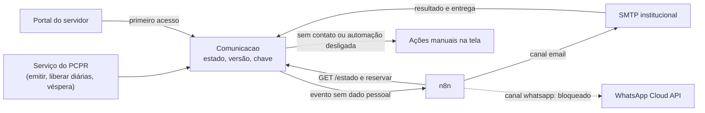

# WhatsApp Business: canal principal do sistema de testes

## Conclusão vigente — 18/10/2026

O usuário esclareceu: **o site não é oficial da polícia, não vai operar com policiais e é um
sistema de testes independente**. A premissa institucional policial da análise de 17/10 fica
substituída para este piloto. A integração pela **WhatsApp Business Platform / Cloud API oficial**
é o canal principal planejado, sem exigir uma autorização da PCPR ou uma exceção policial.

A elegibilidade da conta real não foi verificada e não é presumida. Usar a identidade verdadeira
do responsável pelo projeto e identificar as mensagens como teste. A política oficial continua
exigindo opt-in, modelos quando aplicáveis e respeito à janela de atendimento; consulta em
[18/10/2026](https://whatsappbusiness.com/policy/). O onboarding deve conferir os recursos de teste
atualmente disponíveis na conta. A documentação técnica de início da Meta retornou HTTP 429 nesta
revisão; não se afirma um número fixo de destinatários nem dispensa de verificação comercial.

## Escopo e sequência do piloto

1. Simulador local para desenvolvimento e regressões (já existente).
2. Fundação de comunicações no PCPR e adaptador oficial (a desenvolver).
3. LAB dedicado com recursos de teste da Meta, contatos verificados, opt-in e lista de
   destinatários permitidos, acesso autenticado e dados administrativos fictícios.
4. Ensaio completo: aviso → status → resposta/documento sintético → associação → confirmação.
5. Extensão a KM, documentos, DB/RT e dúvidas sobre a situação fictícia com link ao portal.

WhatsApp é o canal principal; portal e notificações internas são apoio; e-mail é opcional.
Envio manual é contingência. PREVIEW/DEMO público continua simulado e não recebe credenciais.
O estado inicial é `desligado`, não um bloqueio policial automático. A integração real ainda
não foi implementada nem ativada; os resultados do protótipo são exclusivamente simulados.

## Frentes revisadas

| Frente | Papel no piloto | Dependências |
|---|---|---|
| WA-3 / AUT-174 | Integração principal Cloud API: envio, recebimento, mídia e status | desenvolvimento, credenciais/recursos Meta e aceite em LAB; maturidade 3 |
| WA-1 / AUT-172 | Contingência manual registrada | desenvolvimento no PCPR; maturidade 2 |
| WA-2 / AUT-173 | Onboarding normal da conta independente | acesso ao painel e recursos de teste; maturidade 3; consulta policial histórica não exigida |
| AUT-10 | Canal oficial WhatsApp no piloto, coberto pela WA-3 | maturidade 3; classificação externa, sem somar nova oportunidade |

Critérios detalhados e regra de ambiente:
[produto](../product/automacao-whatsapp-testes.md) · [plano](plano-implantacao.md) ·
[ADR 0046](../adr/0046-whatsapp-principal-no-sistema-de-testes.md).

## Histórico de 17/10/2026 — cenário institucional policial

**As seções abaixo são preservadas como pesquisa do cenário anterior.** As referências a
PCPR, consulta excepcional, maturidade 5 e canal bloqueado valem para aquele cenário, não
para o piloto independente acima. Não representam uma autorização nem uma ativação feita.

## 1. A regra encontrada na política vigente

| Item | Valor |
|---|---|
| Documento | WhatsApp Business Policy (política para os serviços "WhatsApp for Business") |
| URL | <https://whatsappbusiness.com/policy/> (versão em português: <https://whatsappbusiness.com/pt-br/policy/>) |
| Seção | "Policy on Government and Political Use" (em português, "Política sobre Uso Político e Governamental") |
| Última atualização indicada na página | **23/09/2026** |
| Data da consulta | **17/10/2026** |
| Confiança | Alta (fonte oficial) |

**O que a seção diz (paráfrase):**

1. Entidades governamentais podem usar o WhatsApp Business Platform, mas apenas por meio de um
   Provedor de Soluções (Solution Provider, antigo BSP).
2. A mesma seção lista usuários **proibidos** no Platform. Estão entre eles as autoridades
   policiais ("Law Enforcement Agencies"), os serviços militares e os órgãos de segurança nacional
   e de inteligência. Também ficam proibidas as empresas que atendem exclusivamente a governos e
   os serviços ligados a política partidária ou a votação.
3. Não há exceção, programa especial, aprovação prévia nem ressalva para uso administrativo
   interno, para comunicação com os próprios servidores ou para um setor específico do órgão. A
   política não define o termo "autoridades policiais".

**Abrangência e sanções.** A visão geral diz que a política rege os serviços "WhatsApp for
Business", o que inclui o **aplicativo WhatsApp Business** e o **Platform**. A seção de governo
cita só o Platform. A seção de aplicação (Enforcement, seção 7) permite limitar ou remover o
acesso e impedir o uso futuro depois de um encerramento por violação. A política também tem uma
parte sobre suspensão, encerramento e recurso.

**Provedores (BSP).** A documentação da 360dialog, consultada em 17/10/2026, informa que o
provedor não aceita autoridades policiais, militares nem de segurança nacional, e cita "the
police" entre os serviços de emergência excluídos. Fonte:
<https://docs.360dialog.com/docs/resources/government-agencies>. É fonte de provedor, não da
Meta; confiança média. Para governos em geral, o mesmo documento descreve uma aprovação adicional
da Meta, com verificação da empresa em até 14 dias e sem garantia de aprovação. Esse processo
aparece só na documentação do provedor, e não na página da Meta.

**Canais WhatsApp de outros órgãos do Paraná.** Há páginas oficiais da Celepar e um comunicado da
SEAP que citam números de WhatsApp para suporte, além de uma página da PCPR de 2023 sobre
acionamentos do Instituto de Identificação. Não foi verificado se usam o app ou o Platform, nem se
continuam vigentes (confiança baixa). Uso por órgão não policial **não cria precedente** para a
PCPR.

**Interpretação desta análise.** A regra recai sobre a **entidade**, então um setor da PCPR, como
a ASCOM, não fica fora dela por fazer comunicação administrativa. A confirmação por escrito é a
pergunta P1 da seção 3. Até lá, nada deve presumir o contrário.

---

## 2. Classificação

| Possibilidade | Classificação | Maturidade | Justificativa |
|---|---|---|---|
| A PCPR ativar o WhatsApp Business Platform (Cloud API), inclusive pelo setor de comunicação | inadequada ou inviável atualmente | **5** | A política vigente (23/09/2026) proíbe autoridades policiais, sem exceção nem processo de aprovação |
| Ativar por meio de um provedor de soluções (BSP) | inadequada ou inviável atualmente | **5** | A política da Meta vale para todos os provedores; ao menos um (360dialog) declara que recusa polícia. Contratar BSP não resolve |
| Uso "só interno": avisos administrativos aos próprios servidores | inadequada ou inviável atualmente | **5** | A política não traz ressalva para uso interno |
| Conta de outro órgão estadual enviando avisos da PCPR | inadequada ou inviável atualmente (não recomendada) | **5** | Ocultaria a identidade institucional de quem comunica e contornaria a política; ver seção 4 |
| Bibliotecas ou serviços não oficiais que automatizam o WhatsApp Web ou o app | inadequada ou inviável atualmente (vedada em definitivo neste plano) | **5** | Viola os termos, arrisca o banimento do número, expõe a sessão do aparelho e não deixa trilha confiável |
| Aplicativo WhatsApp Business (sem API) operado à mão por número institucional | inadequada ou inviável atualmente até resposta da Meta | **5** | A visão geral da política inclui o app; a seção de governo não o menciona; ver P3 |
| Link `wa.me` aberto pelo operador no próprio aparelho (prática atual) | decisão institucional; fora da automação | não se aplica | Ver seção 7 |
| Envio assistido com registro: mensagem mínima + `wa.me` no aparelho institucional + registro no PCPR (frente WA-1, prioridade do usuário) | melhor execução pelo próprio sistema | **2** | Só desenvolvimento no sistema (AUT-172). O uso depende da decisão D4a do plano (aparelho e número institucionais) e da resposta à P3 ou P4: se o aparelho usar o app WhatsApp Business, vale a linha "Aplicativo WhatsApp Business" acima até a resposta da Meta |
| Integração oficial construída e testada **desligada** (frente WA-3) | dependente de integração externa | **5 para ativar** | Construir contra simulador, sem conta nem credencial da Meta, é desenvolvimento (2); ligar exige o portão de ativação (AUT-174) |

**Uma autorização formal da PCPR não muda o quadro.** A pesquisa terminou: o bloqueio vem da
política da Meta, e uma decisão interna não o remove. Os fluxos que antes tratavam o WhatsApp como
"em análise" ou "só com autorização formal" (10-3, 10-4 e 10-5) foram corrigidos em 17/10/2026, e
todos os fluxos usam hoje maturidade 5 / BLOQUEADO para a plataforma oficial; os que avisam servidores
registram também as frentes WA-1 (2), WA-2 (4) e WA-3 (5 para ativar), prioridade do usuário. O que pode
mudar a classificação da plataforma oficial é:

1. uma nova versão da política que deixe de proibir autoridades policiais; ou
2. uma resposta escrita da Meta, guardada com uma ADR, que declare a PCPR elegível para um uso
   definido.

Revisão sugerida: conferir a data de "última atualização" da seção a cada trimestre. Uma pessoa
faz isso, sem automação. Se a data mudar, ler o texto e registrar o resultado.

### 2.1 Reclassificação das oportunidades das leituras que dependiam de WhatsApp

As leituras do código propuseram várias automações "via WhatsApp Business API". A parte WhatsApp
de cada uma passa a **inadequada ou inviável atualmente (5)**. O objetivo continua viável por
outro canal, conforme a tabela.

| Processo (leituras) | Oportunidade proposta | Como estava classificada | Alternativa sem WhatsApp | Classificação e maturidade da alternativa (fonte) |
|---|---|---|---|---|
| PREST-MENSAGEM-SAQUE · GV-PREST-AVISO-DIARIAS · EV-MENSAGEM-LIBERACAO | Envio automático do aviso de liberação de diárias e lembretes de prazo de saque | automação indicada com n8n | Texto como função de domínio testada + envio por e-mail institucional + situação no portal | Texto: automação determinística suficiente, **2**. Envio pelo n8n: automação indicada com n8n, **3** (SMTP e e-mail verificado). Fonte: 10-3, seção 13 |
| PLAT-NOTIF-SINO · NOTIFICACOES-ROTINAS · GV-NOTIFICACOES | Espelhar avisos em canal externo; central de notificações com n8n como entregador | automação indicada com n8n / dependente de integração externa | E-mail individual por destinatário; resumo diário por e-mail | E-mail individual: automação determinística suficiente, **2**. Espelhamento e resumo: automação indicada com n8n, **3** |
| GV-PREST-ASSINATURA · PREST-DOCS-ENVIO-ASSINATURA | Envio automático do link de DB/RT para assinatura e lembrete antes de expirar | automação indicada com n8n | Portal com `LinkAcesso` + aviso por e-mail | Portal: dependente de desenvolvimento, **2**. E-mail pelo n8n: **3**. Fonte: 10-5, seção 13 |
| EV-DIARIO-LINK-KM · VIA-VESPERA-SAIDA | Envio automático do link de KM na véspera | automação indicada com n8n | Sino ao operador + e-mail ao motorista com e-mail verificado; entrega manual registrada | E-mail: **3** (como AUT-41 na matriz). A base manual (link mostrado e entrega registrada pela tela) é **2**. Fonte: 10-4, maturidade |
| ENTRADA-DEMANDAS-CANAIS · PAL-PEDIDO-REGISTRO | WhatsApp Business como canal de entrada de pedidos e documentos | dependente de integração externa | Caixa postal institucional lida pelo n8n; portal; formulário público | Portal: **2**. Caixa institucional: **4** em 10-6 (credencial IMAP concedida pela TI) |
| PAL-ANDAMENTO-RESPOSTA · EV-RESPOSTA-PADRAO | Envio real da resposta ao solicitante com status | automação indicada com n8n | E-mail institucional depois de confirmação humana | automação indicada com n8n, **3** |
| EV-WHATSAPP-CANAL | Canal oficial (Cloud API) via n8n "só com autorização formal" | dependente de integração externa | — | A autorização interna não basta: **5**. Prioridade do usuário: integração pronta e desligada (WA-3, AUT-174) e consulta formal (WA-2, AUT-173) |
| GV-ASSISTENTE-DUVIDAS · EV-IA-ASSISTENTE | Assistente de dúvidas dos servidores (o canal não estava definido) | assistência por IA indicada | Assistente dentro do portal do servidor, só com ferramentas de leitura e a política do usuário | Assistência por IA indicada: **3** (como AUT-88 na matriz). A base sem IA (central de ajuda e "Minha situação", AUT-97) é **2**. Pelo WhatsApp: **5** |
| EV-LEITURA-PEDIDO | Preencher formulário a partir de conversa exportada ou print colado pelo operador | automação determinística suficiente | Não muda: não usa a plataforma do WhatsApp, só lê um texto que o operador já tem | Automação determinística suficiente (existe na referência; LGPD na guarda do arquivo) |

---

## 3. Perguntas objetivas a esclarecer com a Meta ou com um provedor autorizado

**Nenhum contato foi feito nesta missão.** As perguntas ficam prontas para a instituição enviar
por canal oficial, por escrito: ASCOM com a TI e a assessoria jurídica da PCPR. O canal de contato
adequado na Meta (suporte de empresas, gerente de parceiro ou provedor autorizado) não foi
pesquisado. Toda resposta deve vir por escrito e ser anexada a uma ADR antes de qualquer mudança.

**Elegibilidade (Meta):**

- **P1.** O termo "Law Enforcement Agencies" da Policy on Government and Political Use alcança
  uma polícia civil estadual inteira, inclusive unidades administrativas e de comunicação social
  que não exercem atividade policial? Há definição ou lista publicada do termo?
- **P2.** Existe algum processo, programa ou exceção, atual ou previsto, para autoridade policial
  usar o Platform só em comunicação administrativa com os próprios servidores, sem contato com o
  público?
- **P3.** A vedação alcança o **aplicativo WhatsApp Business** (sem API), operado à mão num número
  institucional da PCPR? A visão geral da política inclui o app; a seção de governo cita só o
  Platform.
- **P4.** E o **WhatsApp comum (pessoal)**, quando um servidor da PCPR o usa para avisos de
  trabalho a colegas? Qual documento rege esse caso: a Business Policy ou os termos do serviço
  pessoal?
- **P5.** Um link click-to-chat (`wa.me`) gerado por um sistema da PCPR e aberto pelo operador
  no próprio aparelho conta como uso dos serviços "WhatsApp for Business" pela PCPR?
- **P6.** Um órgão estadual **não policial** e já elegível pode enviar **comunicações próprias
  dele** a servidores estaduais que sejam policiais? A pergunta não é sobre enviar em nome da PCPR.
  Isso contornaria a política e fica fora deste plano (seção 4).
- **P7.** Se a PCPR já tiver números no app WhatsApp Business (atendimento, suporte), qual é o
  caminho de regularização e quais as consequências previstas na seção de aplicação?
- **P8.** Como a Meta comunica mudanças na política? Há registro de alterações ou aviso aos
  provedores?

**Provedores (BSP):**

- **P9.** O provedor confirma por escrito que recusa autoridade policial, mesmo para uso interno?
  Ele encaminharia uma consulta formal à Meta em nome do órgão?
- **P10.** Se um contrato fosse assinado e a Meta depois aplicasse a vedação, o que aconteceria
  com o número, o histórico e os dados (portabilidade, exclusão, prazo)?

**Perguntas internas** (não vão à Meta, mas decidem os canais alternativos) estão na seção 8.

---

## 4. O que NÃO fazer

| Não fazer | Por quê |
|---|---|
| Usar **integração não oficial**: bibliotecas que automatizam o WhatsApp Web ou o app, nós comunitários não oficiais do n8n, "APIs" de terceiros que emulam um aparelho | Viola os termos, arrisca o banimento do número, expõe a sessão do aparelho e não deixa trilha confiável. A revisão de dependências (pip, npm, nós do n8n) deve recusar esses pacotes |
| **Ocultar a identidade institucional**: conta em nome de pessoa física, de fornecedor, de outro órgão ou de empresa intermediária; mensagem sem dizer que vem da PCPR | Contorna a política e impede o destinatário de saber quem fala com ele. A arquitetura exige remetente institucional explícito (10-2, seção 6.4) |
| Usar **número pessoal** de servidor como canal do sistema, como remetente cadastrado ou como "número do setor" num chip pessoal | O histórico e os dados ficam no aparelho de uma pessoa, fora da guarda institucional, e saem com ela |
| **Automatizar o app comum** (WhatsApp ou WhatsApp Business): scripts, RPA, cliques automáticos, envio em massa a partir de lista, "disparadores" | Mesmo problema da integração não oficial; o link `wa.me` só é aceitável como ação manual de uma pessoa, registrada no PCPR (WA-1, seção 7.3, opção B) |
| Criar **conta, WABA ou número de teste da PCPR** na Meta "só para experimentar" | Mesmo o ambiente de teste é uso da plataforma em nome de autoridade policial |
| **Contratar BSP** como solução | Nenhum provedor pode liberar o que a política proíbe |
| Configurar os **nós WhatsApp do n8n** (Business Cloud ou Trigger) com credenciais de qualquer conta | Não há conta elegível; a credencial seria de outra entidade |
| Presumir permissão porque **outros órgãos estaduais** têm WhatsApp | A vedação é específica para autoridades policiais |
| Deixar `canais.whatsapp` como `ligado` em ambiente real (produção, treinamento, preview) | O contrato já prevê o valor `bloqueado` (`api-automacao.v1.yaml`, `EstadoAutomacao`) |
| Reaproveitar o desenho de canal WhatsApp removido do EV (set/2026) | Foi removido da referência; não há código implantado. A limpeza de resíduos de configuração na referência é tarefa operacional à parte, sem relação com o sistema novo |

---

## 5. Desenho independente de canal

### 5.1 Canais disponíveis hoje e o que falta

| Canal | Alcança | Situação | Depende de | Maturidade | Classificação |
|---|---|---|---|---|---|
| **Notificações internas (sino e central)** | Só usuários do sistema (operadores e gestores) | **EXISTENTE**: `gestao/plataforma/notificacoes.py:33-67` | — | **1** | melhor execução pelo próprio sistema |
| **E-mail de notificação pela outbox** | Usuários com e-mail | **VERIFICADA PARCIALMENTE**: o código existe (`plataforma.email.enviar`), mas o envio fica desligado ou no console por padrão e sai num único e-mail com todos no "Para" (`notificacoes.py:79-80`) | E-mail individual por destinatário (desenvolvimento); SMTP institucional | **2–3** | automação determinística suficiente |
| **E-mail institucional (Google Workspace do Estado via Celepar)** | Servidores com e-mail institucional verificado | **PLANEJADA**. Notícia da AEN de 01/12/2025: mais de 60 mil contas Workspace em 26 órgãos da administração direta, sem os órgãos nomeados. **Falta confirmar se a PCPR está incluída**, o domínio e se a TI libera remetente para sistemas | Confirmação com a TI da PCPR e a Celepar; SMTP relay ou conta de serviço; `ContatoVerificado` | **3** no envio; **4** na leitura da caixa (10-6) | automação indicada com n8n |
| **Portal do servidor** (link autenticado "Meus documentos"; `LinkAcesso` com escopo e validade) | Servidores e motoristas com acesso concedido | **PLANEJADA** (10-2, X11; 10-5; 10-6). O padrão de token com hash é **EXISTENTE** (`gestao/plataforma/assinatura.py`, feed ICS) | Vínculo usuário↔servidor ou link por contato verificado; telas novas (UI Lab, axe, `demonstracao.py`) | **2** | dependente de desenvolvimento |
| **Ações manuais registradas** ("copiar mensagem", "mostrar link", "marcar enviado por outro meio") | Qualquer pessoa, pelo meio que o operador usar | **PLANEJADA** (10-3, seção 10; 10-4) | `Comunicacao` | **2** | melhor execução pelo próprio sistema |
| **SouParaná** (app oficial dos servidores estaduais, com notificações do governo) | Servidores estaduais | Não foi encontrada API pública de integração (pesquisa de 17/10/2026; Celepar, notícia de 28/10/2024) | Acordo com Celepar e SEAP | **4** | dependente de integração externa |
| **SMS** | Quem tem celular | **Não pesquisado** nesta missão (provedor, custo e regras não levantados) | Pesquisa e contratação | **3** (estimativa) | dependente de integração externa |
| **eProtocolo** | Tramitação oficial entre órgãos | Não é canal de aviso. O Decreto estadual 7.304/2021 o define como sistema oficial de gestão de documentos e veda sistemas paralelos de controle e tramitação (**a confirmar**: vigência e alterações não verificadas) | Integração institucional (etapa 6 do plano) | **4** | dependente de integração externa |
| **WhatsApp assistido com registro (WA-1)** | Servidores com telefone no cadastro, pelo operador | **PLANEJADA** (prioridade do usuário; hoje `wa.me` sem registro, seção 7.1) | `Comunicacao`; texto como função de domínio; decisão D4a do plano; P3/P4 | **2** | melhor execução pelo próprio sistema |
| **WhatsApp oficial (Platform)** | — | **BLOQUEADA**; integração pronta e desligada na WA-3 | Política da Meta; portão de ativação | **5** | inadequada ou inviável atualmente (AUT-10); preparação: AUT-174 |

**Ponto de atenção do Decreto 7.304/2021.** Os avisos e o portal **complementam** a tramitação
oficial; não a substituem. Um ofício ou documento devolvido que constitua tramitação oficial
continua sendo registrado no eProtocolo, e o PCPR guarda o número do protocolo junto do item.
Fonte:
<https://www.administracao.pr.gov.br/sites/default/arquivos_restritos/files/documento/2021-04/decreto_7304_-_2021_-_eprotocolo_-_com_anexos_0.pdf>,
consultada em 17/10/2026.

**Limites do e-mail institucional, se a PCPR estiver no Workspace.** Fonte:
<https://knowledge.workspace.google.com/admin/gmail/advanced/route-outgoing-smtp-relay-messages-through-google>,
consultada em 17/10/2026.

- O SMTP relay (`smtp-relay.gmail.com`) aceita autenticação por lista de IPs e/ou SMTP AUTH, com
  TLS na porta 587. **Neste plano, só SMTP AUTH**, com credenciais distintas para o PCPR e para o
  n8n; nunca autorização por lista de IPs, porque a VPS é compartilhada com o PREVIEW (DEMO, entrada
  sem senha), e um processo de outro contêiner enviaria em nome da PCPR. Fora de produção o canal é
  simulado ([arquitetura.md](arquitetura.md), seção 4).
- Limites: 10.000 mensagens e 10.000 destinatários únicos por usuário em 24 h, e 100
  destinatários por transação.
- Para o envio comum de uma conta Workspace, a página de limites de envio do Gmail fala em 2.000
  mensagens por dia por usuário.

A pesquisa avaliou que esses limites comportam o volume esperado do setor (**estimativa**: o
volume real não foi medido). As credenciais ficam só em variável de ambiente, nunca no Git (ADR 0010).

### 5.2 Como o mesmo fluxo troca de canal sem mudar de estado

O canal é um **atributo** da comunicação. A máquina de estados é a mesma para todos os canais e
pertence ao PCPR.

1. **Estado no PCPR.** A `Comunicacao` (10-2, seção 4.2) passa pelos estados `agendada → enviando
   → enviada`, com os desvios `falhou`, `desconhecido`, `sem_contato`, `cancelada` e
   `feita_a_mao`. Nenhum desses estados cita um canal. Entrega e leitura são **marcas de tempo**
   (`entregue_em`, `lida_em`, 10-3, seção 7) registradas por `POST /comunicacoes/{id}/entrega`.
   Elas nunca regridem e não são estados. Assim, um canal que não confirma leitura (e-mail) e um
   que confirma (o WhatsApp oficial, depois da ativação da WA-3) usam a mesma máquina.
2. **Escolha do canal na reserva, não no evento.** O evento leva só ids. O canal e o endereço
   vêm do `ContatoVerificado` (canal `email`, ou `whatsapp` no futuro) no momento de
   `POST /comunicacoes/{id}/reservar`, que revalida tudo (arquitetura, seção 3, item 5).
3. **Conteúdo neutro com renderizadores.** A função de domínio devolve
   `Mensagem(assunto, blocos, variaveis)`. Os renderizadores `para_email`, `para_copiar` e
   `para_whatsapp` formatam o mesmo conteúdo (10-3, seção 3.3); o `para_whatsapp` já serve ao `wa.me` da
   WA-1 e, depois da ativação da WA-3, ao modelo aprovado. Num canal que
   exige modelo aprovado, o nome e a versão do modelo seguem em `mensagem.modelo`, que o contrato
   já prevê.
4. **Transporte isolado no n8n.** O fluxo do n8n recebe o evento, consulta `/estado`, reserva,
   **desvia pelo canal**, envia e devolve `resultado`. Trocar de canal muda só o nó de envio e o
   tratamento do status.
5. **Entrada pelo mesmo caminho.** `POST /recebimentos` aceita `canal` em `email` ou `whatsapp`
   (este responde 409 `canal_bloqueado`), com `Idempotency-Key` `receb:<canal>:<mensagem_id_canal>:<anexo_indice>`
   (contrato rascunho 3).
   O portal entra pelo próprio PCPR, sem token de serviço. Tudo cai na importação documental
   existente (10-6).
6. **Trocar o canal de uma pessoa.** A comunicação pendente no canal antigo é cancelada e uma nova
   é agendada no canal novo, com a mesma chave de negócio. Há unicidade de uma comunicação vigente
   por alvo (10-3, seção 7). A máquina de estados não muda.
7. **Chave de canal.** O `/estado.canais` traz `portal` e `email` (`ligado`/`desligado`) e
   `whatsapp` (`ligado`/`desligado`/`bloqueado`). Regra **incorporada ao contrato** no rascunho 3 de
   `api-automacao.v1.yaml` (PLANEJADA, ainda sem código):
   - `bloqueado` é diferente de `desligado`. `desligado` volta a ser `ligado` por um administrador
     na tela. `bloqueado` só muda por configuração versionada acompanhada de ADR que registre a
     elegibilidade.
   - Com `bloqueado`, nenhum `ContatoVerificado` de canal `whatsapp` pode ser verificado, e a
     reserva de uma comunicação ou o recebimento de um arquivo nesse canal são recusados com 409
     `canal_bloqueado` (`canais_entrada.whatsapp` vale para a entrada).
   - Valor em todos os ambientes reais: `bloqueado`.

Como cada canal se encaixa no mesmo contrato:

| Marco | E-mail institucional | Portal | WhatsApp oficial (WA-3, pronto e desligado; vale após a ativação) |
|---|---|---|---|
| Aceito pelo canal → `resultado: enviada` | Resposta 250 do SMTP, com `Message-ID` estável | Não se aplica: o item fica disponível; o aviso sai por outro canal | A API de envio só confirma que aceitou a requisição |
| `entregue_em` | Em geral não há confirmação confiável | — | Status `delivered` (pode não vir quando a leitura é simultânea) |
| `lida_em` | Não confiável | **Primeiro acesso ao item** (`primeiro_acesso_em`, 10-2 X11): a confirmação auditável | Status `read`. Não foi confirmado se some quando o usuário desliga as confirmações de leitura |
| Falha depois do envio | Devolução (bounce) lida na caixa → `falhou` | — | Status `failed` → `falhou` |
| Resposta com anexo | Resposta ao e-mail → `/recebimentos` | Upload pelo link → `/recebimentos` | Mensagem com mídia → baixar em até 7 dias → `/recebimentos` |

### 5.3 A lacuna real: contato dos servidores

O WhatsApp não é o gargalo principal. O gargalo é que **servidores viajantes não são usuários do
sistema**:

- `Servidor` tem telefone (único, 11 dígitos) e nenhum e-mail (`gestao/cadastros/models.py:94-103`).
- O vínculo usuário↔servidor está pendente.
- O motorista "pessoa não cadastrada" não tem contato algum.

Enquanto a plataforma oficial estiver bloqueada, o caminho é este:

1. Obter e verificar o e-mail institucional de cada servidor. A origem é a decisão D8 de 10-3; a
   verificação é por código enviado ao próprio e-mail.
2. Dar acesso ao portal por link com escopo.
3. Para quem não tiver e-mail, usar a entrega manual registrada (10-4: "mostrar link", "marcar
   enviado por outro meio"), inclusive o WhatsApp assistido com registro (WA-1).

O telefone continua no cadastro como dado de contato, não como canal automático; na WA-1 ele só monta o
`wa.me` que o operador abre.

---

## 6. Requisitos técnicos da integração oficial (frente WA-3: construir desligada, não ativar)

Esta seção é a base da frente WA-3 do plano: porta, opt-in, modelos, webhook e workflows são construídos e
testados **desligados**, contra um simulador da Graph API, sem conta, app, número ou credencial reais. A
**ativação** só vale **depois** de uma resposta escrita da Meta que declare a PCPR elegível, de uma ADR e
do portão de ativação (seção "Prioridade definida pelo usuário"). Nada aqui autoriza criar conta, app,
número ou credencial. Os fatos vêm da documentação
oficial da Meta e do n8n, consultada em 17/10/2026; as URLs estão na seção 9.

### 6.1 Ativos e credenciais

| Ativo | Requisito |
|---|---|
| Business portfolio da Meta | Verificação da empresa. Novos portfolios ficam limitados a 2 números, ampliados para 20 depois da verificação ou ao atingir o limite de 2.000 |
| WhatsApp Business Account (WABA) | Para governo, só por Provedor de Soluções (política). Desde 01/07/2026, clientes com faturamento no Brasil (Sold-To Brasil) podem ter WABA em BRL faturada pela Facebook Brasil; a migração é obrigatória até 30/06/2027 |
| Número de telefone | Do titular (institucional), capaz de receber SMS ou voz. **Um número registrado no Cloud API não pode ser usado ao mesmo tempo no WhatsApp comum.** Exige PIN de verificação em duas etapas e nome de exibição |
| Residência de dados | `data_localization_region` no registro do número; o Brasil (`BR`) é suportado. Não remove o bloqueio; serve à avaliação de LGPD |
| App da Meta com o produto WhatsApp | Em modo Live, com URLs de política de privacidade e de termos. O lançamento completo depende do App Review do guia de Tech Provider (documentação do n8n) |
| Token de acesso | O token temporário expira rápido. Para uso contínuo, token permanente de **usuário de sistema** |
| App Secret | Chave do HMAC dos webhooks (6.7) |
| Credenciais no n8n | Nó de envio: Access Token e Business Account ID. Trigger: OAuth2 com App ID e App Secret. Ficam só no cofre de credenciais do n8n (`N8N_ENCRYPTION_KEY` guardada fora da VPS, conforme o plano), nunca no Git |

### 6.2 Provedor e condições

- Governo usa o Platform só por Provedor de Soluções. Empresas que atendem **exclusivamente**
  governos são proibidas.
- A aprovação adicional da Meta para governos e a verificação em até 14 dias aparecem só na
  documentação de um provedor (360dialog), sem garantia de aprovação.
- No contrato: residência dos dados, exportação e exclusão ao fim, responsabilidade por incidente
  e saída sem perda do número (P10).

### 6.3 Opt-in e consentimento

- Antes de enviar, a empresa precisa ter o número e o **opt-in** do destinatário.
  - O opt-in pode ser genérico, não específico do WhatsApp, se cumprir a lei local.
  - Deve deixar claro que a pessoa aceita receber comunicações e dizer o nome da empresa.
  - Métodos aceitos: SMS, site, URA, em pessoa ou em papel.
  - Pedidos de opt-out precisam ser atendidos.
- No PCPR, isso já tem lugar em `ContatoVerificado`: `consentimento_em`, `revogado_em`, `metodo`
  e `origem`. O número continua valendo só depois de verificado por código enviado ao próprio
  canal (arquitetura, seção 4).

### 6.4 Modelos (templates) e categorias

- Fora da janela de atendimento só saem modelos com status `APPROVED`. As categorias são
  marketing, utility e authentication, e a revisão leva até 24 h.
- Utility exige conteúdo não promocional e específico ao usuário ou essencial. Conteúdo misto ou
  vago é classificado como marketing.
- Os tipos do contrato seriam utility: `documentos_disponiveis`, `mensagem_saque`, `link_km`,
  `documentos_para_assinatura`, `lembrete_pendencia`, `aviso_cancelamento` e
  `aviso_reagendamento`.
- O texto continua versionado no domínio do PCPR (teste de *snapshot*). O modelo aprovado na Meta
  é a cópia, com o mapeamento `tipo → modelo@versão` guardado no PCPR. Variáveis sem CPF, RG,
  telefone, dados bancários nem conteúdo do documento (10-2, seção 6.4).

### 6.5 Janela de 24 horas

Uma mensagem ou ligação do usuário abre uma janela de 24 h, renovada a cada nova mensagem dele.
Dentro da janela vale mensagem livre (service), inclusive documento; fora dela, só modelo
aprovado. Consequência: o aviso proativo sai como modelo com **link para o portal**, não como
PDF anexo. Responder com documento exige que o servidor tenha escrito antes. O fluxo 10-6 já
cancela uma resposta automática passadas 23 h da mensagem do servidor.

### 6.6 Mídia

| Regra | Valor |
|---|---|
| Documento (PDF e outros) | Até **100 MB** |
| Mídia enviada por upload | Persiste 30 dias |
| ID de mídia recebido por webhook | Expira em **7 dias**: baixar e guardar no PCPR antes disso |
| URL obtida em `GET /MEDIA_ID` | Expira em **5 minutos**. O download exige `Authorization: Bearer`; em 404, pedir nova URL |
| Mensagem de documento | `id` (upload, recomendado) ou `link` (URL pública, não recomendado); legenda até 1.024 caracteres; `filename` com extensão |
| Documento recebido | O webhook traz `caption`, `filename`, `mime_type`, `sha256` e `id`. A partir de 12/11/2025 (liberação gradual, "over several weeks") pode trazer também a `url`. O `sha256` serve para conferir o transporte |

No PCPR, preferir o link autenticado do portal. Se o canal exigir arquivo, usar URL assinada e
curta (contrato, `anexos`). Arquivos recebidos passam por antivírus antes da importação (10-6, D12).

### 6.7 Webhooks

- Os POSTs chegam assinados em **`X-Hub-Signature-256`**: `sha256=` seguido do HMAC-SHA256 do
  corpo, com o App Secret como chave. Validar em tempo constante e recusar o que não tiver
  assinatura válida.
- A verificação do endpoint é por `GET` com `hub.mode`, `hub.verify_token` e `hub.challenge`.
- O certificado TLS precisa ser válido (autoassinado não serve); há suporte a mTLS. O payload
  chega a 3 MB.
- **Falhas são reentregues por até 7 dias**, o que pode gerar **duplicatas**. A deduplicação é
  pelo id da mensagem do WhatsApp, que é a `Idempotency-Key` de `/recebimentos` e de `/entrega`.
  Um status repetido não regride.
- O nó Webhook genérico do n8n **não verifica HMAC nativamente**. A validação fica num nó de
  código ou criptografia ou no PCPR
  ([hospedagem-n8n.md](../ops/mudanca-hospedagem/hospedagem-n8n.md)). A documentação consultada
  não diz se o WhatsApp Trigger valida a assinatura: **verificar antes de usar**.
- Hoje o n8n não tem rota pública ([hospedagem-n8n.md](../ops/mudanca-hospedagem/hospedagem-n8n.md)). Se um dia
  houver webhook de provedor, libera-se no nginx só o caminho exato, com verificação da assinatura
  e limite de taxa; o resto responde 404.

### 6.8 Status de entrega

O webhook de status informa `sent`, `delivered`, `read` e `failed` (`played` para áudio). `read`
implica `delivered`, e o `delivered` pode não vir quando os dois são simultâneos. A resposta da
API de envio só confirma que a requisição foi aceita. Mapeamento no PCPR:

| Status do WhatsApp | Registro no PCPR |
|---|---|
| Requisição aceita | `resultado: enviada` |
| `delivered` | `entregue` |
| `read` | `lida` |
| `failed` | `falhou` + exceção |

A prova de leitura que vale para a instituição continua sendo o acesso ao portal.

### 6.9 Limites e faixas (tiers)

- O limite conta **destinatários únicos fora da janela em 24 h móveis**, no nível do business
  portfolio. Começa em **250**.
- Sobe para **2.000** por um caminho de escala: verificação da empresa, ou 2.000 envios de
  qualidade em 30 dias.
- Depois sobe automaticamente para 10.000, 100.000 e ilimitado.
- Vazão padrão de 80 mensagens por segundo por número.
- Comparar com o volume medido antes de qualquer decisão. O volume do setor não foi medido.

### 6.10 Custos no Brasil

A cobrança é **por mensagem entregue**, por categoria e país do destinatário, desde 01/07/2025.

- Tabela vigente desde **01/07/2026**. O calendário de preços só muda em 1º de janeiro, abril,
  julho e outubro.
- Valores da calculadora oficial (<https://whatsappbusiness.com/pt-br/products/platform-pricing/>,
  pelo endpoint da própria calculadora), consultada em **17/10/2026**, para destinatário no Brasil:

| Categoria | USD por mensagem entregue | BRL por mensagem entregue |
|---|---|---|
| Marketing | 0,0625 (sem faixas) | 0,3217 |
| Utility | 0,0068 (até 250 mil/mês); 0,0065; 0,0061; 0,0058; 0,0054; 0,0051 (acima de 70 mi) | 0,0350 (até 250 mil/mês); 0,0333; 0,0315; 0,0298; 0,0280; 0,0263 |
| Authentication | 0,0068 (até 500 mil/mês); 0,0065; 0,0061; 0,0058; 0,0054; 0,0051 (acima de 20 mi) | 0,0350 (até 500 mil/mês); 0,0333; 0,0315; 0,0298; 0,0280; 0,0263 |
| Service (mensagem livre na janela) | 0,0068 | 0,0350 |

**Conflito na documentação oficial (desde 01/10/2026).** A página de mensagens não-template diz
que, a partir de 01/10/2026, a Meta cobra mensagens service e utility **dentro** da janela de
24 h, por mensagem, com tarifa igual à de utility e authentication. A página principal de preços
ainda descreve as duas como gratuitas, e a calculadora já devolve tarifa para "Service". Para
estimar custo, **presumir que toda mensagem entregue é cobrada**.

Conta de referência, só aritmética: cada 1.000 mensagens utility entregues no Brasil, na
primeira faixa, custam USD 6,80 ou R$ 35,00.

Não confirmado: um resultado de busca atribuiu à Meta uma isenção para governos e ONGs até
31/12/2027 e um corte de entrega para quem não tivesse forma de pagamento até 30/09/2026. Nada
disso foi achado nas páginas oficiais, e não se aplicaria a órgão policial.

### 6.11 Atendimento humano

- Mensagens recebidas viram `Recebimento` ou item da fila de exceções no PCPR, com dono e prazo.
- Dentro da janela, só uma pessoa da equipe responde, pela tela do PCPR. Fora dela, só modelo
  aprovado.
- O n8n não conversa. No máximo envia a confirmação padronizada de recebimento, a comunicação
  `resposta_recebimento` (10-6 E6; o campo `resposta_ao_remetente` está obsoleto no contrato rascunho 3).
- A IA pode sugerir classificação, mas nunca responde nem decide sozinha (arquitetura, seção 1).
- O nó "Send and Wait for Response" do n8n não substitui a aprovação na tela do PCPR (ADR 0020).

### 6.12 Separação entre teste e produção

- Ao começar no Cloud API, a Meta cria automaticamente um WABA e um **número de teste**, com
  limites relaxados e sem exigir forma de pagamento para modelos.
- O WhatsApp aceita **um webhook por app**. No n8n, as URLs de teste e de produção do Trigger se
  **sobrescrevem**: "ouvir evento de teste" desvia o tráfego de produção. Portanto:
  - um app da Meta para teste, com número de teste, e outro para produção;
  - fluxos de teste numa instância ou num ambiente separado do n8n;
  - nunca "ouvir evento de teste" no app de produção.
- O `/estado.ambiente` do PCPR (`producao`, `treinamento`, `preview`, `teste`) impede canal real
  fora de produção. Em teste, só números sintéticos, como o protótipo já faz com DDD 00.
- O PREVIEW (DEMO) nunca tem canal WhatsApp.

### 6.13 Nós oficiais do n8n

| Nó | O que faz | Observações |
|---|---|---|
| WhatsApp Business Cloud | Message: Send, Send and Wait for Response, Send Template. Media: Upload, Download, Delete. Para o que não é coberto, o nó HTTP Request com a mesma credencial | A documentação não trata da janela de 24 h, da aprovação de modelos nem de modelos com cabeçalho de documento |
| WhatsApp Trigger | Eventos Messages, Message Template Status Update, Account Update e Security | Um webhook por app; URLs de teste e produção se sobrescrevem (6.12) |

### 6.14 O que mudaria no PCPR (checklist, na ordem)

Os itens 3 a 6 são construídos já pela frente WA-3, desligados e testados contra simulador; os itens 1, 2
e 7 só depois do portão de ativação.

1. ADR com a evidência de elegibilidade (resposta escrita da Meta e política vigente na data),
   base legal (LGPD) e relatório de impacto.
2. `canais.whatsapp`: `bloqueado → desligado` por configuração versionada; depois `ligado` **por
   fluxo**.
3. `ContatoVerificado` de canal `whatsapp` com opt-in registrado e verificação por código.
4. Renderizador `para_whatsapp` e mapeamento `tipo → modelo@versão`, com teste de *snapshot*.
5. Fluxo do n8n com desvio por canal, validação do HMAC, deduplicação por id da mensagem e
   download de mídia em até 7 dias.
6. Nenhuma execução salva nos workflows de mensagem do n8n (arquitetura, seção 4) e solução para o achado
   T13 do protótipo (execuções de webhook retidas como `running` com o número do remetente;
   [desempenho-e-custos §14.7](desempenho-e-custos.md)).
7. Painel de entregas e falhas no PCPR; teste ponta a ponta com o número de teste.

---

## 7. Situação atual: o link `wa.me` manual (base da frente WA-1)

### 7.1 O que existe

Nenhum dos três sistemas envia mensagem: todos montam um link click-to-chat que o **operador abre
no próprio aparelho** e envia à mão. Não há integração WhatsApp ativa em produção. No EV
implantado, a rota do webhook é só um comentário (`ref/ev-implantado/config/urls.py:46-48`), e o
desenho de canal oficial foi removido do repositório em set/2026.

| Sistema | Uso | Situação | Evidência |
|---|---|---|---|
| Sistema novo | Aviso de liberação de diárias: menu "Avisar por WhatsApp" no cartão do servidor. Texto simplificado; sem as validações do GV; não confere os 11 dígitos; sem registro de envio; sem teste do texto | **EXISTENTE** | `gestao/viagens/views_prestacao.py:176-191`, `:225`; `gestao/viagens/templates/viagens/prestacao/_cartao.html:97` |
| Sistema novo | Resposta padrão ao solicitante de palestra ("Abrir no WhatsApp"). O histórico "Resposta registrada" é gravado antes de qualquer envio e não prova que a mensagem saiu | **EXISTENTE** | `gestao/palestras/dominio.py:163-167`; `gestao/palestras/templates/palestras/folha.html:154`; `gestao/palestras/views.py:337-353` |
| GV (produção) | Aviso de liberação de diárias com texto institucional ("PRAZO IMPRORROGÁVEL"). Validação no navegador (nº da solicitação, liberação até hoje, prazo, telefone com 11 dígitos). Opções WhatsApp, WhatsApp Business ou copiar. Sem registro | **VERIFICADA PARCIALMENTE** (leitura de código) | `gv/static/js/pages/prestacoes-diaria-wa.js:34-97`, `:127-145` |
| GV (produção) | Link de assinatura eletrônica de RT/DB enviado pelo WhatsApp do operador. O controle de quem assina fica no sistema: token, CPF, expiração | **VERIFICADA PARCIALMENTE** | `gv/prestacoes_contas/signature_views.py:35-44` |
| EV (implantado) | Aviso de liberação, link de KM ao motorista e resposta de palestra, todos por `wa.me` | **VERIFICADA PARCIALMENTE** | `viagens_prestacoes/cartoes.py:60-79`; `viagens_prestacoes/campo_services.py:186-189`; `demandas_eventos/services.py:218-222` |

### 7.2 Implicações

1. **Quem envia é a conta do operador.** A identidade institucional depende do número usado, que
   o sistema não conhece. Se o número é pessoal, a conversa e os dados do servidor ficam num
   aparelho pessoal, fora da guarda e da retenção institucionais, e saem com a pessoa quando ela
   muda de setor.
2. **Não há trilha.** O sistema não sabe se, quando nem o que foi enviado. Hoje não há como provar
   que o servidor foi avisado do prazo improrrogável de saque, nem quem o avisou. Em Palestras, o
   registro feito antes do envio pode sugerir um envio que não houve.
3. **Dados pessoais na URL.** O texto vai na query string do `wa.me`: nome, número do ofício,
   valor da diária e datas, além do telefone no caminho. A URL passa pelo redirecionador da Meta
   e fica no histórico do navegador. Pesa na avaliação de LGPD e pede texto mínimo.
4. **Incerteza na política.** A visão geral da política inclui o app WhatsApp Business. Se o
   operador escolhe a opção "WhatsApp Business" (GV), ou se o número é uma conta Business da
   instituição, cabe a pergunta P3. Se é o WhatsApp pessoal, cabe a P4. A seção de aplicação
   prevê suspensão de acesso para quem viola a política.
5. **Não pode ser automatizado.** Esse caminho só existe como gesto manual. Qualquer automação dele
   cai na seção 4.
6. **Sem revogação.** Uma mensagem pode ser encaminhada e não pode ser recolhida. Retificar exige
   outra mensagem manual, sem garantia de que a primeira seja desconsiderada.
7. **Custo humano.** Cada aviso leva vários passos manuais por servidor. A linha de base de tempo
   está proposta em 10-3 (seção 11).

### 7.3 A decisão é institucional

Manter, mudar ou retirar o `wa.me` é decisão da PCPR, não deste plano técnico. Ela corresponde a
D16 em [10-3](fluxos/10-3-prestacao-e-mensagem-de-saque.md) e a D4/D4a no
[plano de implantação](plano-implantacao.md). **Escolha do usuário (17/10/2026):** opção B, como frente
WA-1 do plano, com aparelho e número institucionais (falta a decisão D4a e a resposta à P3 ou P4). Opções
e efeito técnico de cada uma:

| Opção | O que o sistema faz | Observação |
|---|---|---|
| A. Manter como está | Link `wa.me` com o texto atual | Mantém as implicações 1 a 6 |
| **B. Manter com texto mínimo e registro (adotada: frente WA-1)** | O texto vem da função de domínio (sem valor nem dados além do necessário). Ao abrir, o sistema pede "marcar enviado por outro meio: WhatsApp manual" e registra quem e quando | Ganha trilha e paridade com o GV; depende do aparelho institucional (D4a) e da resposta à P3 ou P4 |
| C. Só "copiar mensagem" + "marcar enviado por outro meio" | Sem link para o WhatsApp; o operador escolhe o meio e o sistema registra | É a proposta técnica em 10-3, D16, até a decisão |
| D. Retirar toda menção a WhatsApp | Só portal, e-mail e entrega pessoal registrada | Depende de os servidores terem e-mail verificado (seção 5.3) |

Em todas as opções, o registro usa `Comunicacao` com `origem = outro_meio` e o meio informado. A
automação nunca envia por esse caminho.

---

## 8. Decisões a confirmar e pendências

| # | Pergunta ou pendência | Quem responde | Efeito |
|---|---|---|---|
| W1 | ~~Atualizar as opções de D4 no plano de implantação~~ **Resolvido:** a D4 diz que o WhatsApp é prioridade (frentes WA-1 a WA-3), com a plataforma oficial só com autorização formal; em paralelo, portal + notificações internas + e-mail institucional. A D4a pede o aparelho/número institucional e o responsável pela consulta | — | — |
| W2 | ~~Trocar "em análise" por "bloqueado (5)" nos fluxos~~ **Resolvido em 17/10/2026:** corrigido em todos os fluxos (10-1 a 13 usam 5/BLOQUEADO para a plataforma oficial, sem condição de autorização interna); os que avisam servidores registram as frentes WA-1 a WA-3 | — | — |
| W3 | Destino do `wa.me` manual (seção 7.3: A, B, C ou D). **Respondido em parte:** opção B, frente WA-1; falta o aparelho/número institucional (D4a do plano) | PCPR (ASCOM, chefia de viagens, jurídico) | Tela do cartão do servidor e de Palestras |
| W4 | Enviar as perguntas P1 a P10 à Meta ou a um provedor. **Decidido pelo usuário:** sim, frente WA-2; falta designar o canal e o responsável (D4a do plano) | PCPR | Única forma de rever o bloqueio |
| W5 | A PCPR está no Google Workspace do Estado? Qual o domínio? A Celepar ou a TI liberam SMTP relay ou conta de serviço para sistemas? Há caixa dedicada para receber devoluções (IMAP)? | TI da PCPR / Celepar | Maturidade do e-mail (3 ou 4) |
| W6 | Origem do e-mail dos servidores e dos motoristas (diretório institucional ou cadastro) e método de verificação | Usuário (10-3, D8) | Sem isso, toda comunicação automática cai em `sem_contato` |
| W7 | Confirmar a vigência do Decreto 7.304/2021 e como ele se aplica a avisos e recebimentos do PCPR | Jurídico ou SEAP | Garante que o portal complementa o eProtocolo sem virar sistema paralelo |
| W8 | Confirmar se algum app ou conta da Meta foi criado durante o desenho de canal removido do EV (set/2026) e, se existir, desativá-lo | Responsável pela referência | O uso é vedado pela política |
| W9 | O protótipo local (`prototipo/simulador_pcpr.py`) usa um canal "whatsapp" fictício, `ligado` por padrão e com números sintéticos, para exercitar o mecanismo independente de canal. Na configuração real o valor é `bloqueado`. Vale avaliar se o simulador deve usar `email` como canal padrão | Dono do protótipo (esta tarefa não edita a pasta) | Evita que o exemplo pareça recomendação |
| W10 | Avaliar SMS como canal alternativo para quem não tem e-mail (provedor, custo, regras) | Pesquisa futura | Hoje "não pesquisado" |

---

## 9. Fontes (consultadas em 17/10/2026)

| Fonte | URL | Oficial |
|---|---|---|
| WhatsApp Business Policy (seção de uso governamental, atualizada em 23/09/2026) | <https://whatsappbusiness.com/policy/> · <https://whatsappbusiness.com/pt-br/policy/> | Sim |
| 360dialog: agências governamentais | <https://docs.360dialog.com/docs/resources/government-agencies> | Não (provedor) |
| Meta: opt-in | <https://developers.facebook.com/documentation/business-messaging/whatsapp/getting-opt-in> | Sim |
| Meta: categorias de modelos | <https://developers.facebook.com/documentation/business-messaging/whatsapp/templates/template-categorization> | Sim |
| Meta: envio de mensagens e janela de 24 h | <https://developers.facebook.com/documentation/business-messaging/whatsapp/messages/send-messages> | Sim |
| Meta: mídia | <https://developers.facebook.com/documentation/business-messaging/whatsapp/business-phone-numbers/media> | Sim |
| Meta: mensagem de documento | <https://developers.facebook.com/documentation/business-messaging/whatsapp/messages/document-messages> | Sim |
| Meta: webhook de documento recebido | <https://developers.facebook.com/documentation/business-messaging/whatsapp/webhooks/reference/messages/document> | Sim |
| Meta: criar endpoint de webhook | <https://developers.facebook.com/documentation/business-messaging/whatsapp/webhooks/create-webhook-endpoint> | Sim |
| Meta: status de mensagens | <https://developers.facebook.com/documentation/business-messaging/whatsapp/webhooks/reference/messages/status> | Sim |
| Meta: limites de envio | <https://developers.facebook.com/documentation/business-messaging/whatsapp/messaging-limits> | Sim |
| Meta: números de telefone | <https://developers.facebook.com/documentation/business-messaging/whatsapp/business-phone-numbers/phone-numbers> | Sim |
| Meta: visão geral da plataforma (ambiente de teste, tokens) | <https://developers.facebook.com/documentation/business-messaging/whatsapp/about-the-platform> | Sim |
| Meta: registro e residência de dados | <https://developers.facebook.com/documentation/business-messaging/whatsapp/business-phone-numbers/registration> | Sim |
| Meta: preços | <https://developers.facebook.com/documentation/business-messaging/whatsapp/pricing> | Sim |
| Meta: preços de mensagens não-template | <https://developers.facebook.com/documentation/business-messaging/whatsapp/pricing/non-template-messages> | Sim |
| Calculadora oficial de preços | <https://whatsappbusiness.com/pt-br/products/platform-pricing/> | Sim |
| n8n: nó WhatsApp Business Cloud | <https://docs.n8n.io/integrations/builtin/app-nodes/n8n-nodes-base.whatsapp/> | Sim |
| n8n: WhatsApp Trigger | <https://docs.n8n.io/integrations/builtin/trigger-nodes/n8n-nodes-base.whatsapptrigger/> | Sim |
| n8n: credenciais do WhatsApp | <https://docs.n8n.io/integrations/builtin/credentials/whatsapp/> | Sim |
| Decreto PR 7.304/2021 (eProtocolo) | <https://www.administracao.pr.gov.br/sites/default/arquivos_restritos/files/documento/2021-04/decreto_7304_-_2021_-_eprotocolo_-_com_anexos_0.pdf> | Sim |
| AEN: Google Workspace no Governo do PR (01/12/2025) | <https://www.parana.pr.gov.br/aen/Noticia/Governo-do-Estado-amplia-uso-do-Google-Workspace-e-ativa-60-mil-contas-corporativas> | Sim |
| Google: SMTP relay do Workspace | <https://knowledge.workspace.google.com/admin/gmail/advanced/route-outgoing-smtp-relay-messages-through-google> | Sim |
| Google: limites de envio do Workspace | <https://knowledge.workspace.google.com/admin/gmail/gmail-sending-limits-in-google-workspace?hl=en> | Sim |
| Celepar: app SouParaná (28/10/2024) | <https://www.celepar.pr.gov.br/Noticia/Celepar-e-Governo-lancam-aplicativo-para-facilitar-o-acesso-dos-servidores-estaduais> | Sim |
| Celepar: Central de Atendimento (WhatsApp de suporte) | <https://www.celepar.pr.gov.br/Pagina/Central-de-Atendimento-da-Celepar> | Sim |
