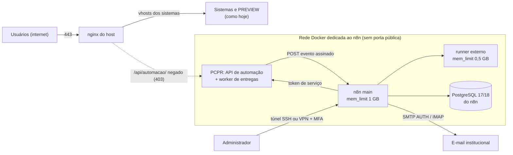

# Hospedagem do n8n — alternativas, comparação e recomendação

Situação medida em 17/10/2026 ([capacidade-vps.md](capacidade-vps.md)): VPS KVM 2 (2 vCPU, 7,8 GiB,
52 GB livres) com os dois sistemas reais (Gerenciador de Viagens e Eventos Sociais, serviços nativos do
Ubuntu) e o PREVIEW do sistema novo **já em Docker** (Docker e Compose instalados). Preços e
comportamento dos produtos da Hostinger: ver a seção "Fontes" (consultadas em 17/10/2026). Detalhes do
host de produção (mapa de portas e serviços, versões, estado do firewall e da cópia externa) ficam no
inventário privado do pacote de backup, não neste repositório público.

## As operações possíveis são diferentes — avaliar separadamente

| Operação | O que acontece com os dados | Reversível? |
|---|---|---|
| **A. Instalar n8n no Ubuntu atual** (Docker já existe) | nada muda nos sistemas; novo projeto Compose isolado | sim (remover o projeto) |
| **B. Reinstalar a VPS por template "n8n/Docker"** | o disco é **apagado**; os dois sistemas precisam ser restaurados do backup | não |
| **C. Mudar a capacidade do plano** (upgrade KVM 2 → KVM 4) | nada muda no disco (redimensionamento) | parcialmente (downgrade tem regras) |
| **D. Contratar n8n gerenciado / outro produto** | os sistemas ficam onde estão; n8n fora da VPS | sim |
| **E. Contratar uma segunda VPS pequena só para o n8n** (KVM 1, com ou sem o template n8n) | a VPS atual não é tocada; o n8n roda em outra máquina | sim (cancelar a segunda VPS) |

## Comparação

| Critério | A. n8n no Ubuntu atual | B. Reinstalar por template e restaurar |
|---|---|---|
| Preservação dos dados | Total (nada é tocado) | Depende do backup e da restauração no dia; risco de perda do que foi gravado depois do corte |
| Compatibilidade | Docker e Compose já instalados e em uso pelo PREVIEW; n8n entra como mais um projeto Compose em 127.0.0.1, atrás do nginx existente | Template entrega Docker + n8n prontos, mas GV e EV (serviços nativos: aplicações, banco, filas, antivírus e conversores de documentos) precisam ser reinstalados à mão sobre ele |
| Indisponibilidade | Zero para os sistemas (só um `nginx -t && reload` se houver vhost novo; a recomendação não publica o n8n) | **Horas** [estimativa]: parada e cópia final medidas em 10–15 min + download e reenvio do pacote de ~1,6 GB (~5 min cada a 50 Mbit/s) + reinstalar a pilha nativa (não medido; algumas horas de trabalho técnico) + restaurar bancos e mídia (≈ 3 min no teste) + DNS, certificados e conferência |
| Recuperação | Remover o projeto devolve o estado anterior | Sem volta depois de formatar; só o backup. **A restauração em sistema operacional novo não foi testada**: o teste usou o mesmo host e o mesmo Ubuntu, com o código e o venv extraídos do pacote rodando sobre as bibliotecas do sistema atual; num SO limpo o venv pode não funcionar e Python, bibliotecas de sistema, PostgreSQL, Redis, filas, antivírus, conversores, nginx e certbot teriam de ser reinstalados antes ([backup-e-recuperacao.md](backup-e-recuperacao.md)) |
| Manutenção | Um Docker para PREVIEW + n8n; sistemas reais seguem como estão até a migração para o sistema novo | Mesmo resultado final, com um caminho bem mais arriscado |
| Recursos | Precisa de swap e limites de memória (3,8 GB livres no pior momento) | Mesma máquina, mesmos recursos |
| Desempenho | Idêntico ao atual; n8n em modo normal | Idêntico |
| Custo | R$ 0 adicional (mesmo plano) | R$ 0 adicional, mas alto custo de trabalho e risco |

**O template não traz nada que a VPS atual não tenha**: o que ele oferece (Docker + n8n configurado) é
obtido em minutos com um `compose.n8n.yml` no servidor existente, sem formatar.

**Operação E — segunda VPS só para o n8n.** É a forma de usar o template n8n **sem** a Operação B, e tira
o n8n da memória da VPS de produção, que é o gargalo medido.

| Critério | E. Segunda VPS (KVM 1: 1 vCPU, 4 GB, 50 GB NVMe) |
|---|---|
| Custo | R$ 29,99/mês promocional (24 meses, pago adiantado) → R$ 59,99 na renovação, sem impostos |
| Rede | O PCPR e o n8n deixam de estar no mesmo host: a API de automação e o webhook de eventos precisam atravessar a internet (TLS + lista de IPs + token) ou um túnel/VPN entre as duas VPS, e o n8n passa a ter rota pública para receber eventos — o contrário da recomendação de segurança abaixo |
| Manutenção | Mais um servidor para atualizar, monitorar, pôr firewall e fazer backup (dump + chave do n8n), com o mesmo cuidado da VPS principal |
| Latência | + um salto de rede por chamada (dezenas de ms) — irrelevante no volume da PCPR |
| Memória | Libera ~1,5 GB na VPS atual; o KVM 1 sobra para o n8n em modo normal (pico de 884 MiB no protótipo) |

**Conclusão:** A continua preferível enquanto a VPS atual tiver memória (3,8 GB disponíveis no pior
momento medido, contra o orçamento de 1,5 GB do n8n): custo zero, nenhuma rota pública e nenhuma máquina a
mais para proteger. E passa a ser a melhor saída **se** a medição depois da instalação mostrar falta de
memória antes do upgrade C, ou se a instituição exigir isolamento físico entre o n8n e os sistemas reais.

## Recomendação

**Alternativa A**, em etapas, sem reinstalar:

1. **Antes de tudo** (requisitos, não descrição do estado atual): cópia externa do backup conferida
   (bloqueio da Fase 1); swap de 2–4 GB; firewall do host restrito ao mínimo necessário e acesso
   administrativo restrito; portas internas só em localhost; limites de memória por contêiner.
2. **n8n em contêineres próprios**, modo normal (um processo `main`, sem queue mode):
   - **runner de código externo** (imagem `n8nio/runners`, que substitui o runner `internal` obsoleto —
     achado do protótipo) em contêiner próprio;
   - **banco PostgreSQL 17 ou 18 em contêiner próprio** na rede do n8n, sem porta publicada, com dump
     próprio no backup. Motivos para não usar o PostgreSQL 16 do cluster existente: a n8n aceita o 16 só
     "por compatibilidade" e a faixa suportada muda todo novembro (o PostgreSQL 19 tem lançamento previsto
     para 19/11/2026); um contêiner numa rede Docker própria não alcança o `127.0.0.1` do host sem abrir o
     cluster de produção à bridge do Docker (`listen_addresses`, `pg_hba`), o que aumenta a superfície do
     banco real; e o `pg_basebackup` e o `max_connections` do cluster de produção ficam fora do n8n;
   - dados binários em disco; **`mem_limit` de 1 GB no principal, 0,5 GB no runner** [estimativa] e um
     limite pequeno no banco — orçamento de ~1,5 GB, a revisar depois de medir na VPS
     ([desempenho-e-custos.md](../../automacao/desempenho-e-custos.md) §9.2);
     `N8N_CONCURRENCY_PRODUCTION_LIMIT` definido explicitamente (≤ 5; vem desligado por padrão);
   - **nenhuma rota pública para o n8n.** O worker de entregas do PCPR posta em `http://n8n:5678/webhook/…`
     numa rede Docker dedicada, e o e-mail entra por IMAP (o n8n busca). O editor fica acessível só por
     túnel SSH ou VPN, com MFA. Se um dia houver provedor com webhook, libera-se no nginx só o caminho
     exato, com verificação da assinatura do provedor e `limit_req`; o resto do vhost responde 404.
     Expor o vhost inteiro abriria `/webhook-test/`, `/form/`, `/rest/` e a tela de login, e permitiria
     que qualquer cliente da internet disparasse execuções antes da checagem do HMAC (que é feita dentro
     do fluxo);
   - a **API de automação** do PCPR (`/api/automacao/`) é negada no nginx público e aceita só a partir
     da rede do n8n (defesa em profundidade contra token vazado);
   - **instâncias separadas por ambiente**: a do PREVIEW não tem credencial real de SMTP nem de IMAP, e a
     saída SMTP (25/465/587) dos contêineres do PREVIEW é bloqueada no host — o PREVIEW é público, com
     entrada DEMO sem senha, e não pode enviar e-mail em nome da PCPR. Em produção, SMTP com credencial
     própria do n8n (SMTP AUTH), nunca autorização por lista de IPs;
   - workflows de mensagem e de arquivo sem salvar execuções (o corpo da reserva traz destino e link);
   - prazo de atualização para avisos de segurança críticos do n8n (a versão é fixada; proposta: até 7
     dias para "crítico").
3. **Backup do n8n** junto com o resto: dump do banco do n8n + `N8N_ENCRYPTION_KEY` guardada fora da VPS
   (sem ela as credenciais salvas no n8n não podem ser lidas), poda de execuções ligada.
4. **Upgrade para KVM 4 (Operação C) só quando a medição mostrar falta de memória** (por exemplo, com o
   sistema novo em produção ao lado dos antigos, ou IA local). Não é necessário para o n8n sozinho; a
   Operação E é a alternativa a comparar nesse momento.
5. **Não usar a Operação B.** Se um dia for preciso reinstalar (troca de sistema operacional, por
   exemplo), fazer com `30-atualizacao-final.sh`, cópia externa conferida, janela de manutenção e um
   ensaio prévio da restauração num SO limpo.

Queue mode (Redis + workers) foi avaliado e descartado neste porte: não diminui a latência de fluxos que
esperam por APIs externas, consome memória e exige Redis/PostgreSQL compartilhados; reavaliar só com
centenas de execuções simultâneas medidas.

### Topologia recomendada (genérica)

## Conflitos a evitar na instalação

| Recurso | Cuidado |
|---|---|
| Portas | 80/443 são do nginx nativo; não instalar Traefik/Caddy de template disputando essas portas. O n8n não publica porta; se precisar de uma no loopback para o túnel do editor, escolher uma livre (conferir antes) e só em `127.0.0.1` |
| Proxy | Nenhum vhost público para o n8n. Se um dia for preciso, um arquivo novo em `sites-available/`, `nginx -t` antes do reload, sem tocar nos arquivos dos sistemas |
| Banco | Contêiner PostgreSQL próprio do n8n; o n8n nunca recebe credencial dos bancos dos sistemas e o cluster de produção não é aberto à rede Docker |
| Rede Docker | Rede própria do n8n, compartilhada só com o componente do PCPR que posta eventos e recebe a API; não ligar à rede do PREVIEW |
| Volumes | pasta de dados própria do n8n, separada das pastas das aplicações e do PREVIEW |
| Atualizações | Imagem com versão fixa (n8n e runner na mesma versão). Atualizar: (1) dump do banco do n8n e cópia da `N8N_ENCRYPTION_KEY`; (2) ler as notas de versão e as mudanças incompatíveis; (3) trocar a tag; (4) conferir que os workflows e as credenciais abrem. **Voltar:** as migrações do banco do n8n não são reversíveis — restaurar o dump e a chave e usar a tag anterior; não basta trocar a imagem |
| Disco | Poda de execuções e dados binários com retenção; monitorar a pasta de dados do n8n |
| Memória | Somar o principal, o runner e o banco do n8n no orçamento (~1,5 GB); swap e limites antes de subir |

## O que os produtos da Hostinger fazem (fontes oficiais, consultadas em 17/10/2026)

| Fato | Fonte |
|---|---|
| Trocar ou reinstalar o sistema operacional — **o que inclui aplicar um template** — apaga permanentemente todos os dados da VPS, inclusive o snapshot; restaurar um backup de outro SO volta ao SO antigo | [Change the OS of your VPS](https://www.hostinger.com/support/4965922-how-to-change-the-operating-system-of-your-vps-at-hostinger/) |
| O template "Ubuntu 24.04 with n8n" instala o n8n em Docker Compose (`/docker/n8n`); a variante "queue mode" usa Redis e 3 workers. Não informa se usa SQLite ou PostgreSQL. O Traefik aparece só na legenda de uma imagem ("Docker compose config with Traefik labels"); que ele **ocuparia 80/443**, hoje do nginx, é inferência deste documento a partir desses rótulos | [n8n VPS template](https://www.hostinger.com/support/10473267-how-to-use-the-n8n-vps-template-at-hostinger/) |
| O suporte da Hostinger "abrange apenas o ambiente VPS, incluindo a instalação e o funcionamento da aplicação n8n", sem suporte a fluxos, configurações ou códigos personalizados | [n8n hosting (FAQ)](https://www.hostinger.com/br/vps/n8n-hosting) |
| Upgrade de plano mantém arquivos e configurações, leva até 10 min; não se aumenta só RAM ou disco | [Upgrade a VPS](https://www.hostinger.com/support/1583229-how-to-upgrade-a-vps-server) |
| Backup semanal gratuito; diário pago (preço não público); até 4 backups retidos; 1 snapshot manual por vez, apagado após 1 dia ou ao trocar o SO | [Back up or restore a VPS](https://www.hostinger.com/support/1583232-how-to-back-up-or-restore-a-vps-at-hostinger/) |
| Existe "Managed n8n" dentro do plano "AI Automation apps" (servidor gerenciado pela Hostinger: configuração, atualizações, backups e segurança). A página do plano lista só quatro aplicações — Hermes Agent, OpenClaw, n8n e Paperclip — e não menciona hospedar aplicação própria, SSH, CPU ou RAM. Que ele **não hospeda** os sistemas Django/PostgreSQL não foi verificado; não há nenhuma indicação de que aceite | [Managed n8n](https://www.hostinger.com/support/hostinger-managed-n8n-overview-and-setup/) · [AI Automation apps](https://www.hostinger.com/br/ai-automation-apps) |

Preços de vitrine (BRL/mês, promocional → renovação): KVM 1 R$ 29,99 → 59,99 (1 vCPU, 4 GB, 50 GB NVMe) ·
**KVM 2 R$ 43,99 → 77,99** · KVM 4 R$ 59,99 → 149,99 · KVM 8 R$ 119,99 → 259,99
([servidor VPS](https://www.hostinger.com/br/servidor-vps)); a página "n8n hosting" cobra o mesmo por plano.
"AI Automation apps" (n8n gerenciado): R$ 29,99 (24 meses) a R$ 54,99 (mensal), renovação R$ 59,99
([AI automation apps](https://www.hostinger.com/br/ai-automation-apps)). O prazo exato das promoções não
está claro nas páginas.

**Consequência:** o template n8n é a mesma VPS com outro sistema instalado — escolhê-lo para a máquina
atual é a Operação B (formatar); numa VPS nova, é a Operação E. O "Managed n8n" seria uma assinatura a
mais, sem acesso equivalente; só faria sentido para tirar o n8n da VPS, o que não é necessário pela
medição.

Sobre o n8n (docs.n8n.io, versão estável 2.43.7 de 16/10/2026): edição Community sob Sustainable Use License
(uso interno permitido; S3 para binários, SSO, ambientes e log streaming são pagos); PostgreSQL 17 e 18
suportados ("as of July 2026") e 16 só por compatibilidade — e "n8n's supported version range shifts each
year", acompanhando a troca anual de versões do PostgreSQL em novembro
([bancos do n8n](https://docs.n8n.io/deploy/host-n8n/configure-n8n/choose-n8ns-database.md);
[PostgreSQL 19 RC 1](https://www.postgresql.org/about/news/postgresql-19-rc-1-released-3409/), lançamento
previsto para 19/11/2026); conferir a página antes de instalar e não fixar o 16 no plano. Na 2.x os
binários vão para disco no modo normal e para o banco no queue mode (disco não é suportado em queue mode);
poda ligada por padrão (14 dias / 10 mil execuções); controle de concorrência desligado por padrão
([concorrência](https://docs.n8n.io/hosting/scaling/concurrency-control/)); backup precisa do banco **e**
da chave em `~/.n8n/config` ou `N8N_ENCRYPTION_KEY`; o nó Webhook não verifica HMAC nativamente
(verificação no fluxo ou autenticação por cabeçalho/JWT). Detalhes e custos:
[`../../automacao/desempenho-e-custos.md`](../../automacao/desempenho-e-custos.md).
