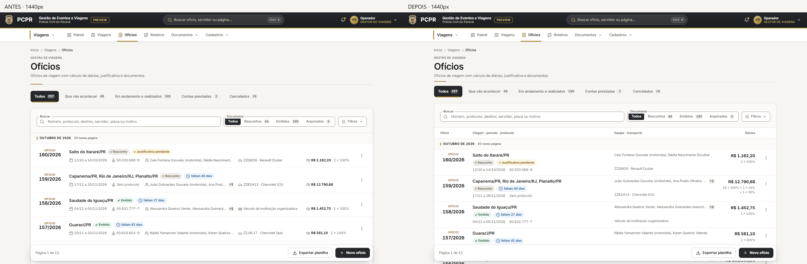
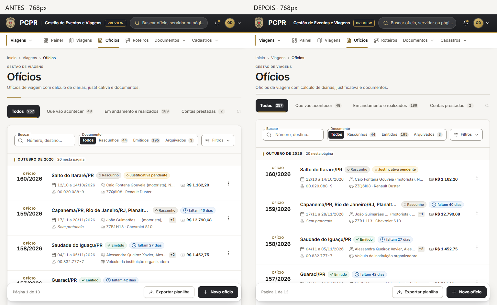
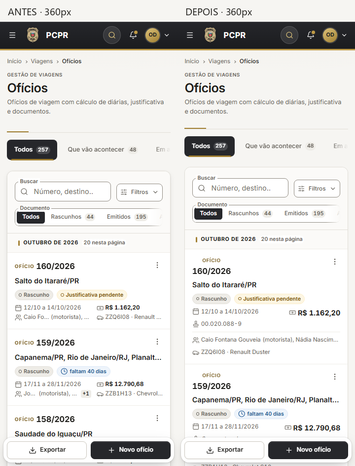
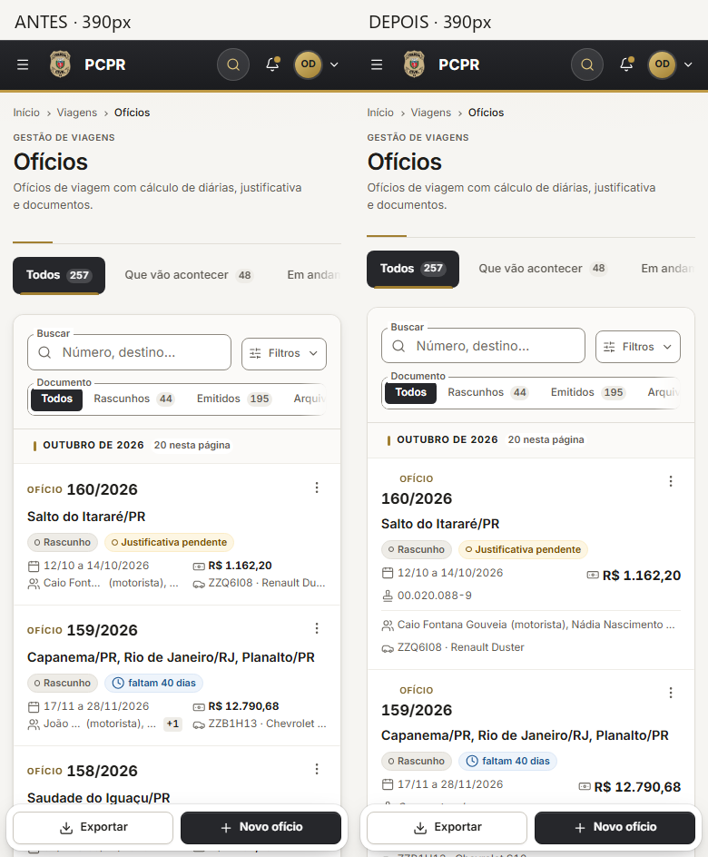
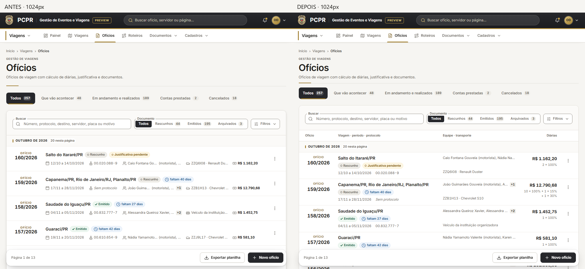
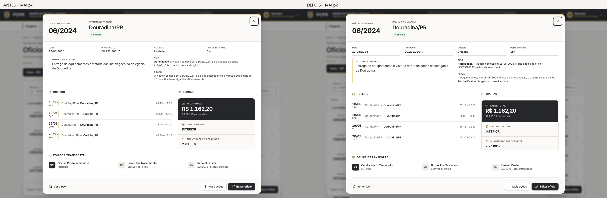
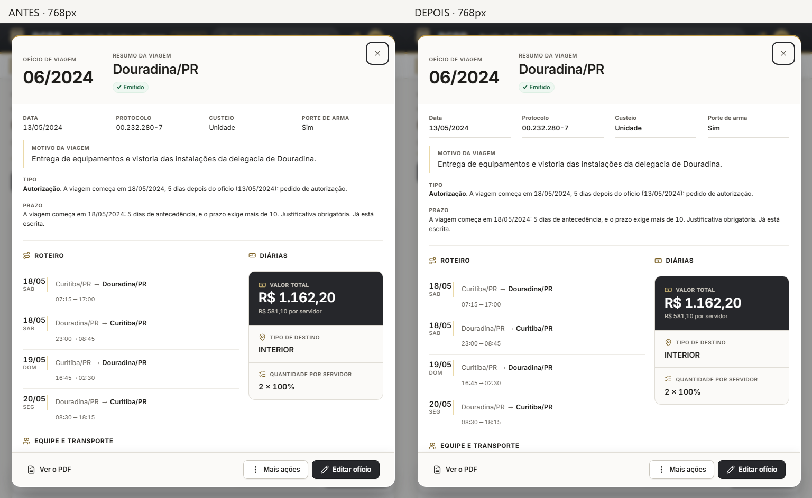
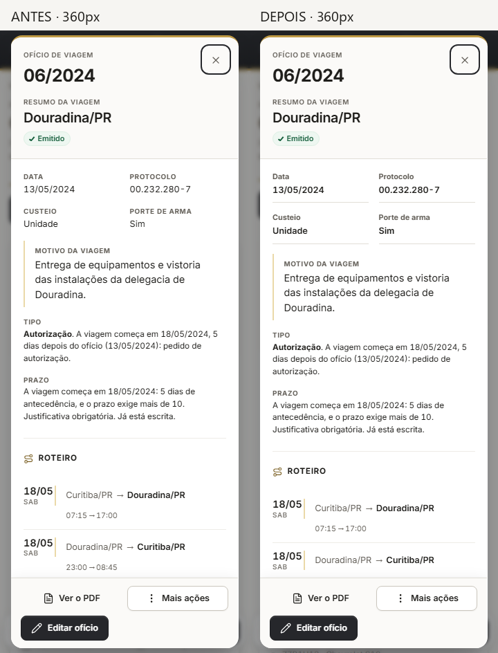
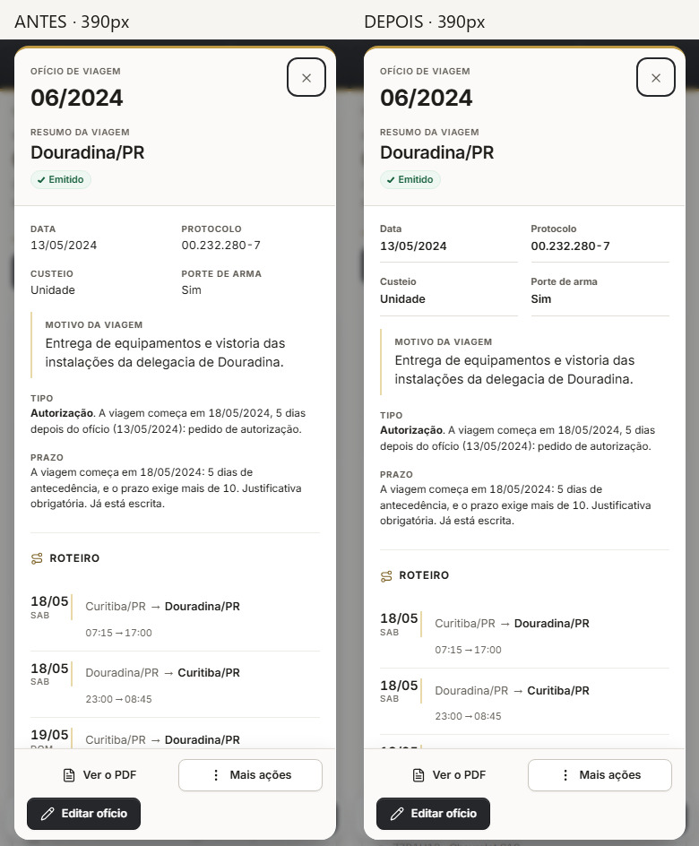
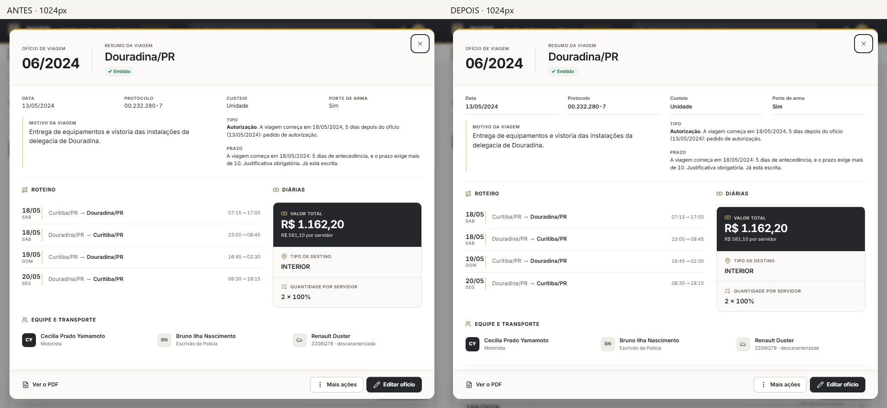

# Ofícios — evidências da leitura operacional

Base: `0213d75`. Resultado: branch `codex/oficios-leitura-operacional`.
Renderização real da aplicação, mesmo dataset sintético PREVIEW/LAB.
Cada comparação apresenta **antes à esquerda, depois à direita**.
Capturas de viewport com 900 px de altura; os painéis documentais são
capturados após a navegação até a seção e a conclusão do carregamento.

## Lista — tela-piloto

### 1440 px

### 768 px

### 360 px

### 390 px

### 1024 px

## Resumo — segunda tela

### 1440 px

### 768 px

### 360 px

### 390 px

### 1024 px

## Áreas protegidas observadas

Folha e Documentos não receberam novo desenho nesta rodada. As capturas
abaixo registram a verificação de compatibilidade dos componentes compartilhados.

### Folha

- [360 px — antes/depois](../evidencias/oficios-leitura-operacional/comparacoes/folha-360.png)
- [390 px — antes/depois](../evidencias/oficios-leitura-operacional/comparacoes/folha-390.png)
- [768 px — antes/depois](../evidencias/oficios-leitura-operacional/comparacoes/folha-768.png)
- [1024 px — antes/depois](../evidencias/oficios-leitura-operacional/comparacoes/folha-1024.png)
- [1440 px — antes/depois](../evidencias/oficios-leitura-operacional/comparacoes/folha-1440.png)

### Documentos na Folha

- [360 px — antes/depois](../evidencias/oficios-leitura-operacional/comparacoes/documentos-360.png)
- [390 px — antes/depois](../evidencias/oficios-leitura-operacional/comparacoes/documentos-390.png)
- [768 px — antes/depois](../evidencias/oficios-leitura-operacional/comparacoes/documentos-768.png)
- [1024 px — antes/depois](../evidencias/oficios-leitura-operacional/comparacoes/documentos-1024.png)
- [1440 px — antes/depois](../evidencias/oficios-leitura-operacional/comparacoes/documentos-1440.png)

### Documentos no Resumo

- [360 px — antes/depois](../evidencias/oficios-leitura-operacional/comparacoes/documentos-6-360.png)
- [390 px — antes/depois](../evidencias/oficios-leitura-operacional/comparacoes/documentos-6-390.png)
- [768 px — antes/depois](../evidencias/oficios-leitura-operacional/comparacoes/documentos-6-768.png)
- [1024 px — antes/depois](../evidencias/oficios-leitura-operacional/comparacoes/documentos-6-1024.png)
- [1440 px — antes/depois](../evidencias/oficios-leitura-operacional/comparacoes/documentos-6-1440.png)

## Arquivos individuais e medições

- [Capturas antes](../evidencias/oficios-leitura-operacional/antes/)
- [Capturas depois](../evidencias/oficios-leitura-operacional/depois/)
- [Console antes](../evidencias/oficios-leitura-operacional/antes-console.json)
- [Console depois](../evidencias/oficios-leitura-operacional/depois-console.json)
- [Medições de responsividade](../evidencias/oficios-leitura-operacional/depois-medidas.json)
- [Comparação de performance](../evidencias/oficios-leitura-operacional/performance-comparacao.json)
- [Relatório de fechamento](oficios-leitura-operacional-2026-10-08.md)
