# Comparações reais — Ofícios, 08/10/2026

Esquerda: produto anterior à missão. Direita: candidato visual. Mesmo dataset
sintético, mesma largura e altura. Somente cabeçalhos “ANTES/DEPOIS” foram
acrescentados ao composto. Imagens individuais estão nas pastas `antes/` e
`depois/` correspondentes; nenhuma imagem foi gerada por IA.

## Lista

360 px:

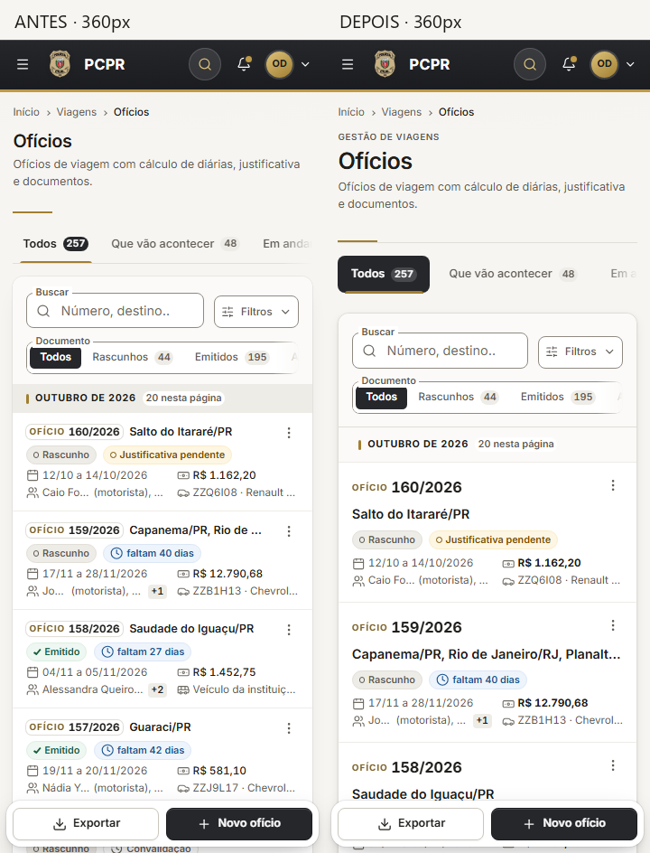

768 px:

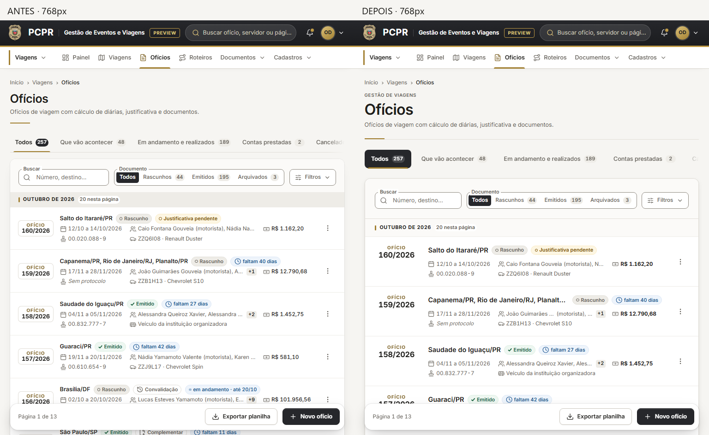

1440 px:

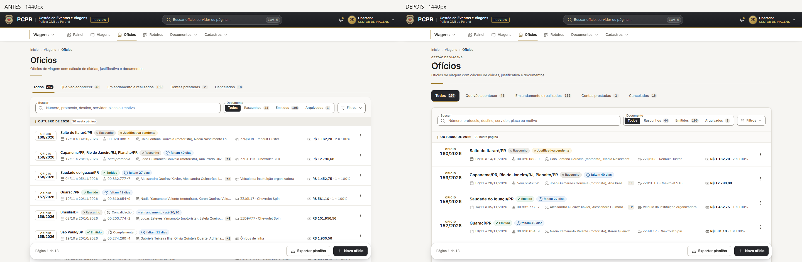

[390 px](../evidencias/oficios-premium/comparacoes/lista-390.png) ·
[1024 px](../evidencias/oficios-premium/comparacoes/lista-1024.png).

## Resumo

360 px:

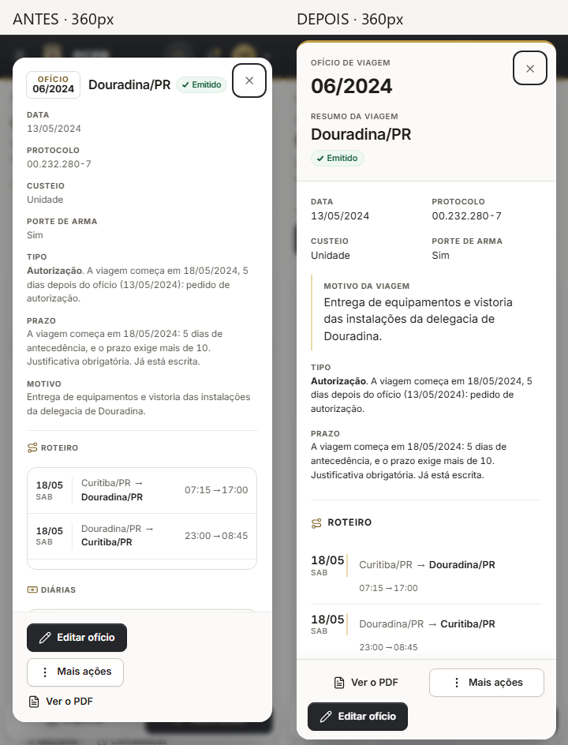

768 px:

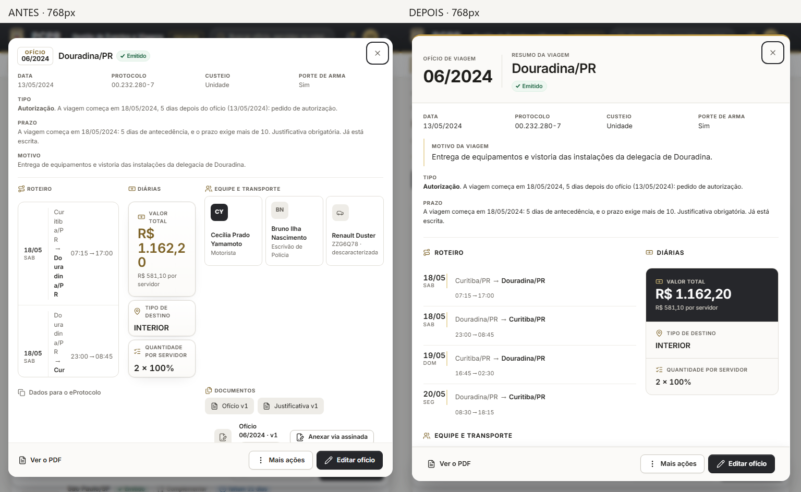

1440 px:

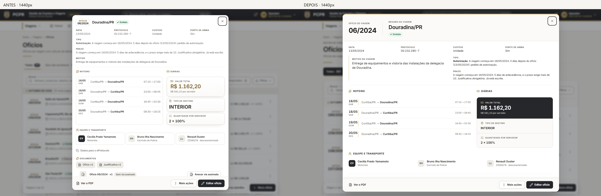

[390 px](../evidencias/piloto-resumo/comparacoes/viagens-oficios-resumo-6-390.png) ·
[1024 px](../evidencias/piloto-resumo/comparacoes/viagens-oficios-resumo-6-1024.png).

Documentos inferiores do mesmo Resumo:
[360](../evidencias/piloto-resumo/comparacoes/documentos-6-360.png) ·
[768](../evidencias/piloto-resumo/comparacoes/documentos-6-768.png) ·
[1440](../evidencias/piloto-resumo/comparacoes/documentos-6-1440.png).

## Cadastro/Edição/Folha

360 px:

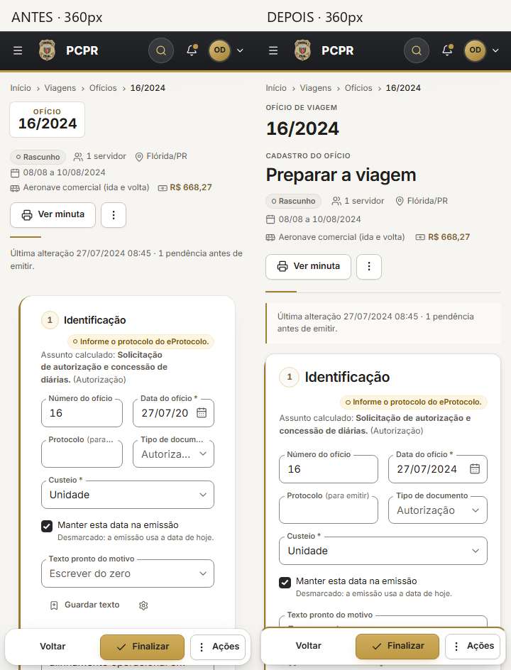

768 px:

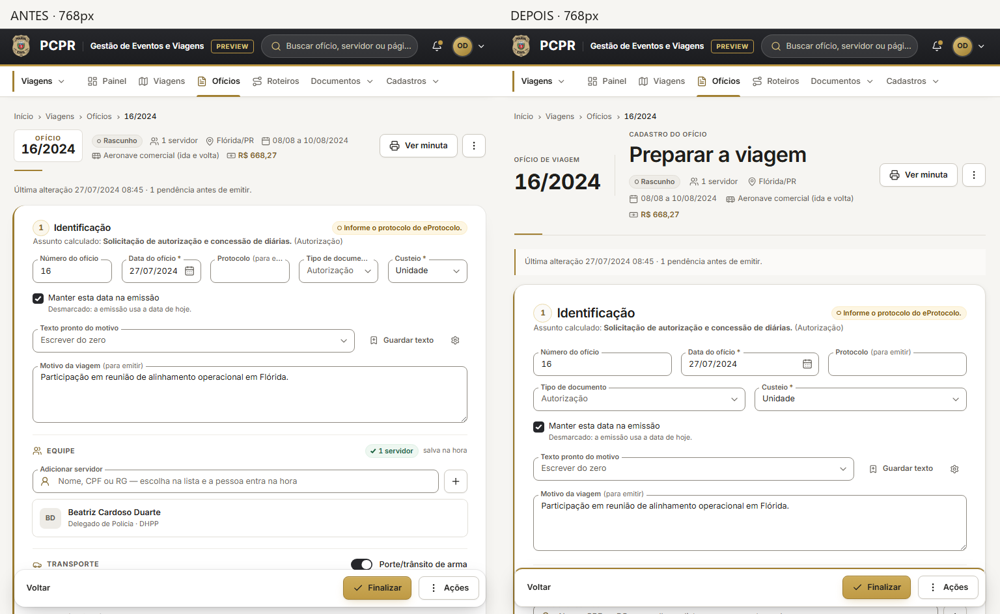

1440 px:

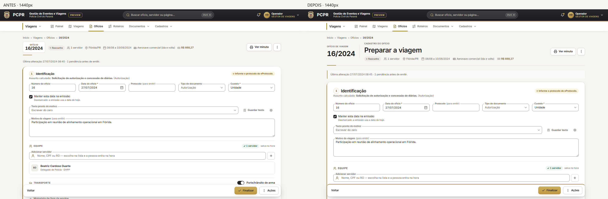

[390 px](../evidencias/oficios-premium/comparacoes/folha-390.png) ·
[1024 px](../evidencias/oficios-premium/comparacoes/folha-1024.png).

## Painel Documentos

360 px:

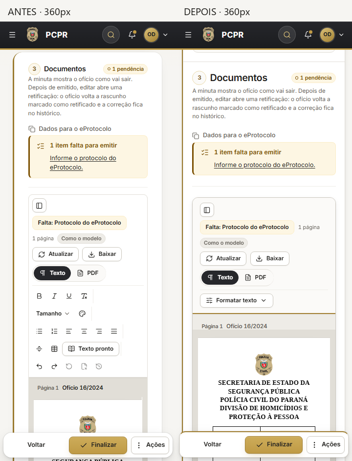

768 px:

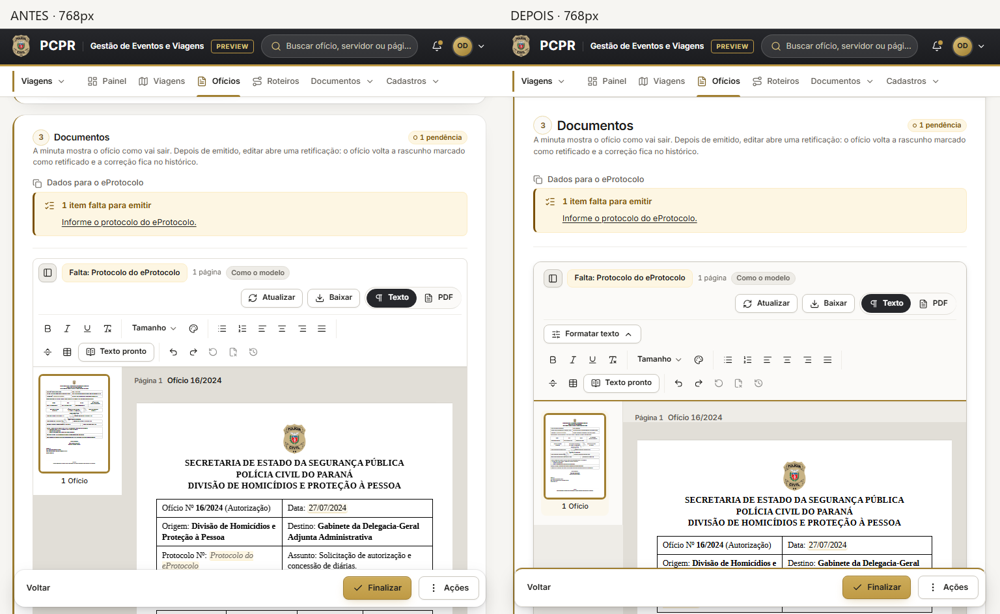

1440 px:

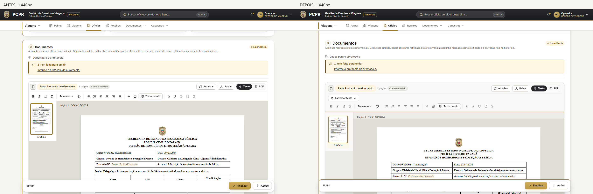

[390 px](../evidencias/oficios-premium/comparacoes/documentos-390.png) ·
[1024 px](../evidencias/oficios-premium/comparacoes/documentos-1024.png).

O painel faz parte da Folha; não foi criada uma página nova. A minuta renderiza
o mesmo documento oficial. Os testes cobrem Texto/PDF, histórico, edição,
Baixar, atualização, índice e carregamento adiado.

Relatório, testes, classificação e decisão: [QA do bloco](oficios-premium-2026-10-08.md).
