# Resumo do Ofício — evidências da reconstrução

08/10/2026. Piloto único na branch `codex/oficios-resumo-reconstrucao`, base `c027493`.
Aplicação real, Chromium, PREVIEW sintético. Mesmo Ofício 06/2024, mesmos dados,
arquivos e altura de 900 px. Sem imagem gerada. A reprovação anterior permanece registrada.

## Três direções antes da implementação final

Renderizações sintéticas do UI Lab, sem operações: A documento vivo, B mesa operacional,
C ficha editorial. Conceitos, vantagens e riscos em
[diagnóstico e direção](../visual/oficios-resumo-reconstrucao.md).
As três alternativas usam a mesma amostra ilustrativa entre si; os antes/depois do piloto
usam o registro real do PREVIEW, sem substituir seus dados pela amostra dos conceitos.

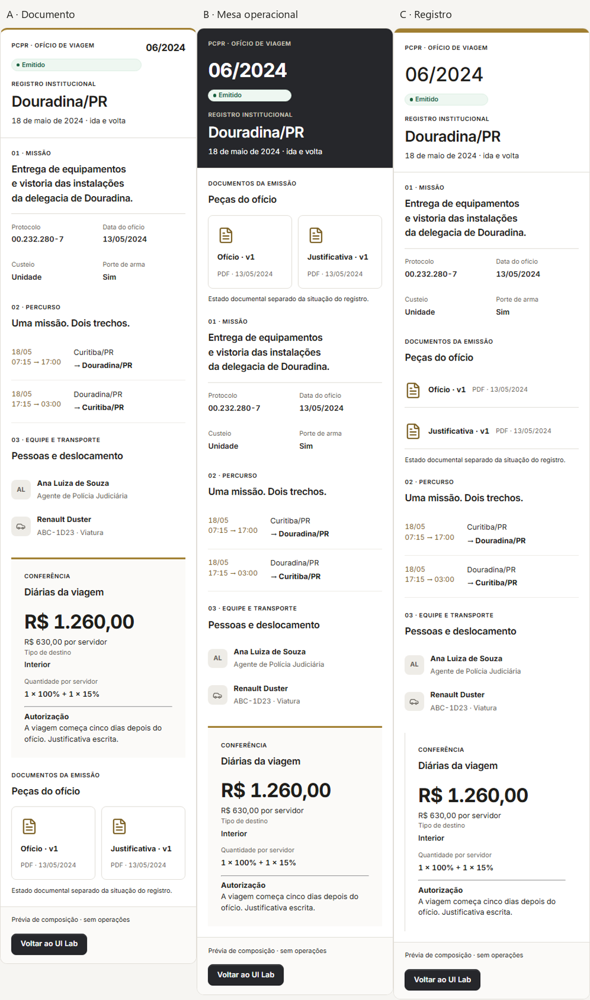

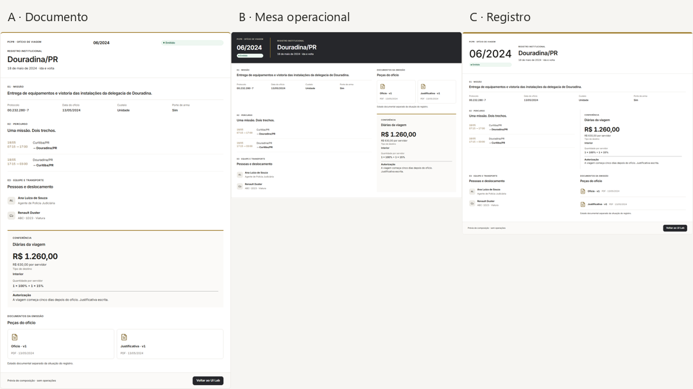

## Transformação em miniatura

Antes acima, depois abaixo. Identidade, documentos, percurso, conferência e distribuição
do espaço mudam de composição. A evidência não substitui o julgamento estético do usuário.

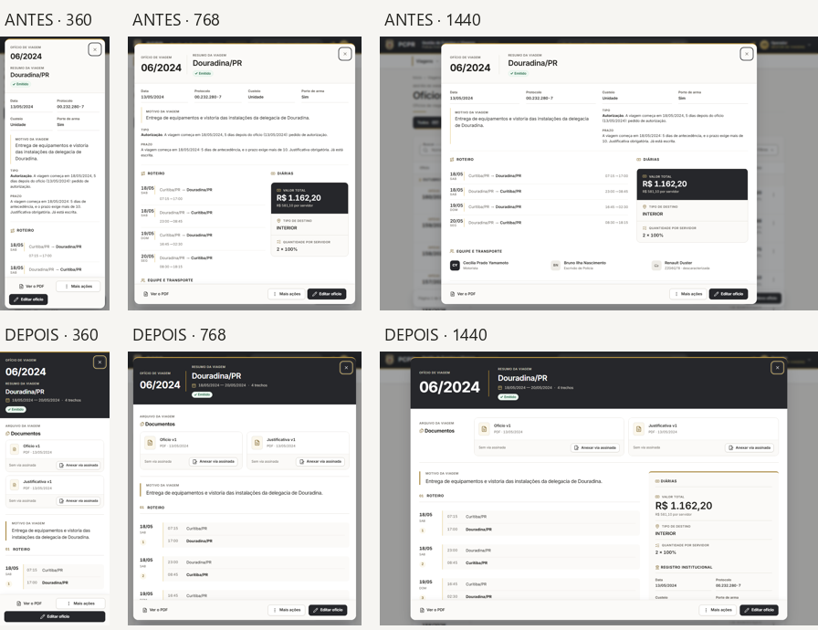

## Celular — 360 px

Antes:

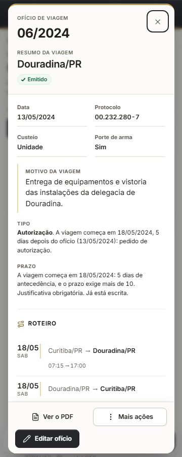

Depois:

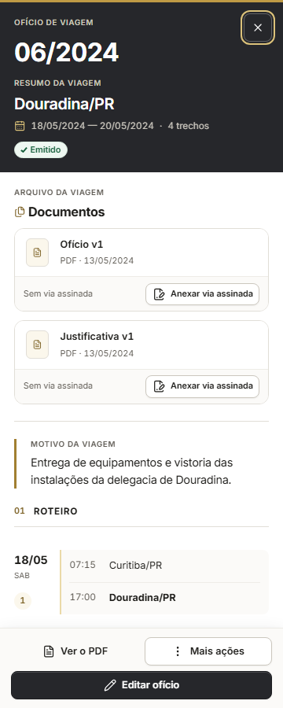

Comparação:

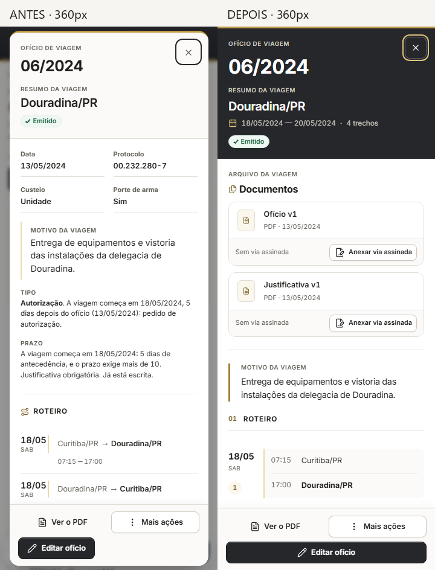

## Tablet — 768 px

Antes:

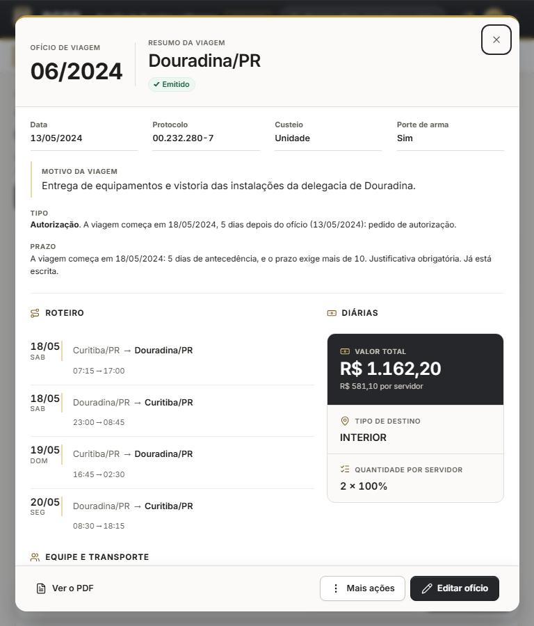

Depois:

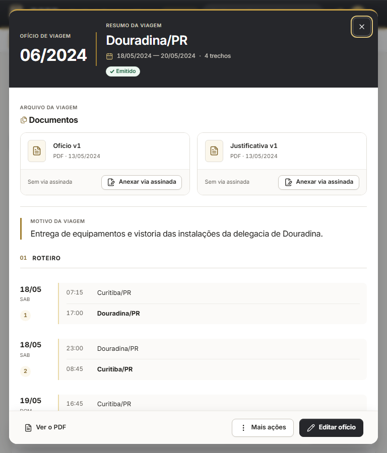

Comparação:

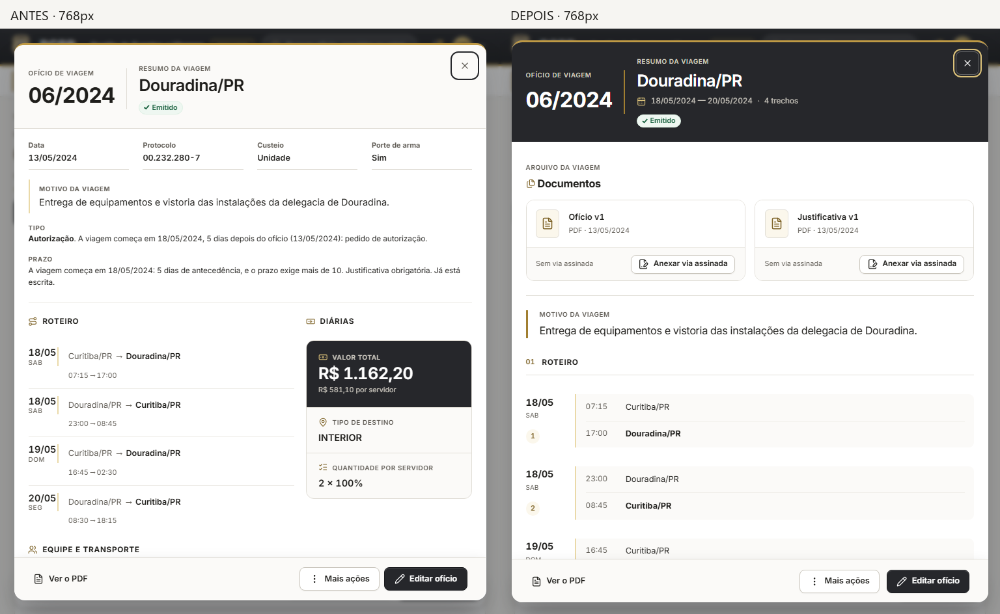

## Desktop — 1440 px

Antes:

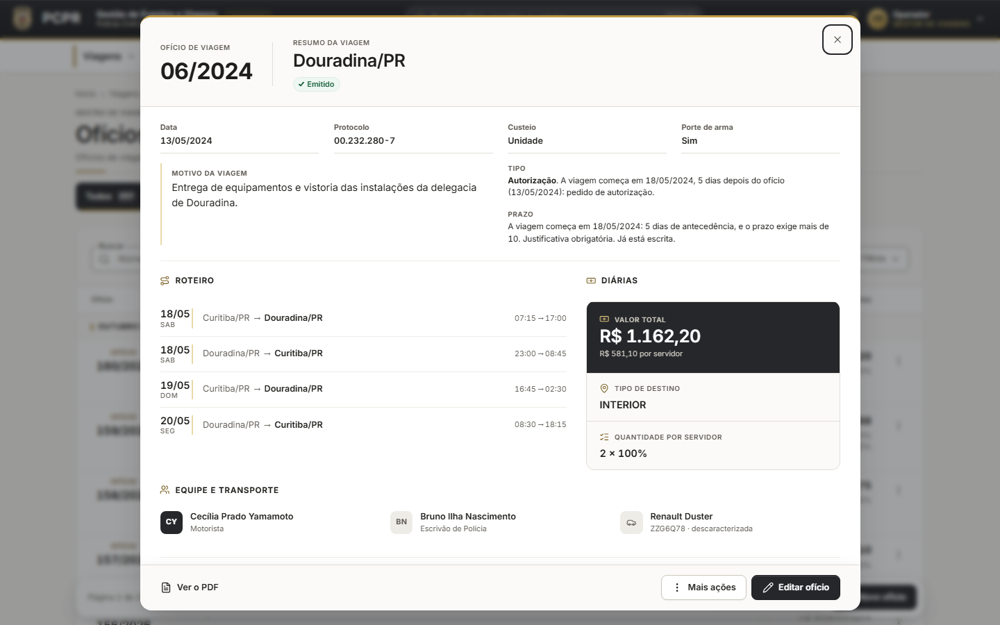

Depois:

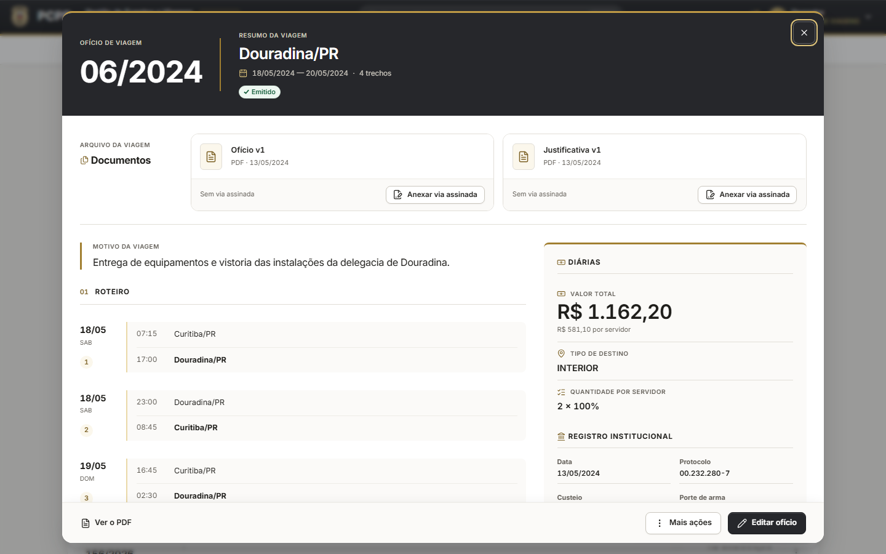

Comparação:

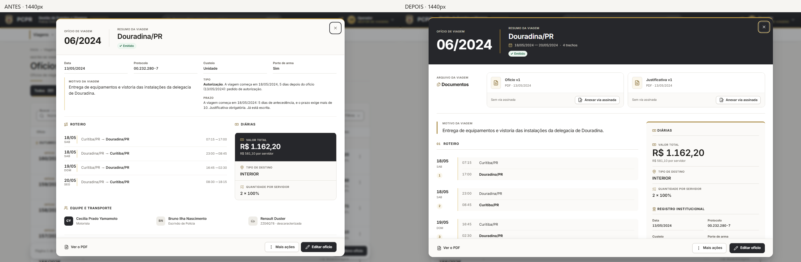

## Duas iterações reais

A primeira colocou documentos na lateral e conferência escura. A crítica mostrou repetição
de assinatura, tablet comprimido e percurso parecido com tabela. A segunda integrou arquivo
e assinatura, priorizou a estação documental em toda largura e criou leitura por trecho.

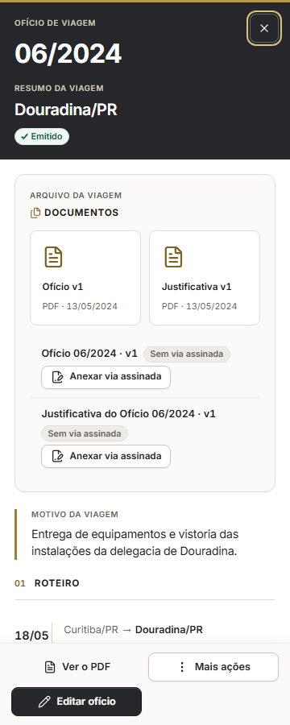

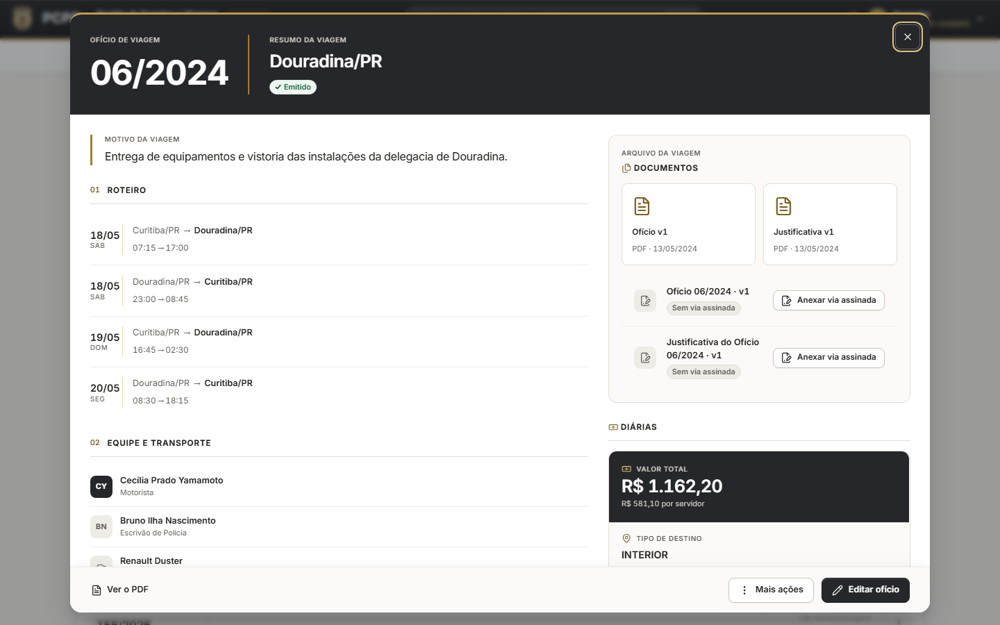

## Evidências complementares

Também existem capturas completas das fases em **390 e 1024 px**, comparações nessas
larguras, documentos e cópia em todas as cinco larguras. Estados com assinatura sem
original, upload/revogação em LAB, polling e foco ficam nas pastas `navegador/` e `axe-final/`.
Medidas de overflow, console e dimensões ficam nos JSONs de cada fase.

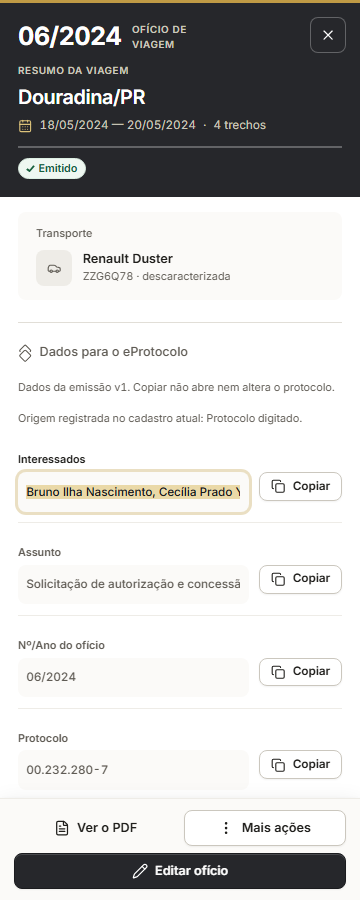

## Autocrítica

Os controles de anexação mantêm a linguagem operacional existente; roteiros extensos
continuam longos; muitos avisos de assinatura tornam a peça maior. Não comprimir dados
institucionais para caber numa captura. O registro curto deixa espaço livre no cabeçalho.
O piloto foi exercitado também com textos longos, vazio, geração e falha.

**Aprovação visual pendente do usuário.** Não aplicar a uma segunda página neste bloco.
Proposta posterior: estação de Documentos, somente após aprovação desta composição.
