# Resumo — comparações do refinamento

Mesmo Ofício 06/2024 sintético, mesmos dados. Capturas reais da aplicação, altura
900 px. Antes: direção aceita como base pelo usuário. Depois: refinamento dessa base.
360, 390, 768, 1024 e 1440 px capturados; comparações abaixo em três larguras.

## Desktop

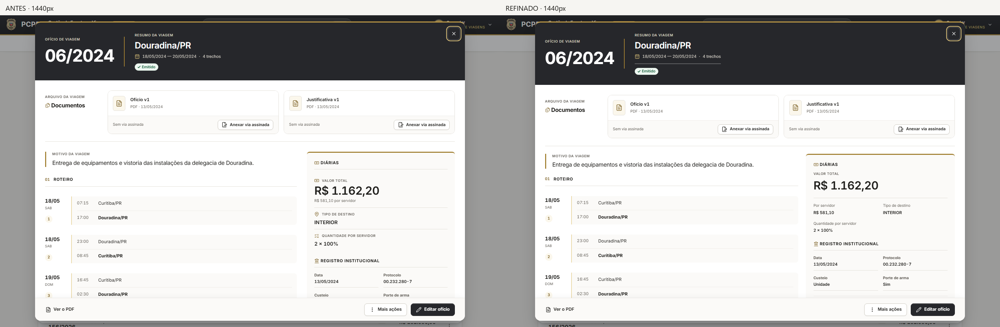

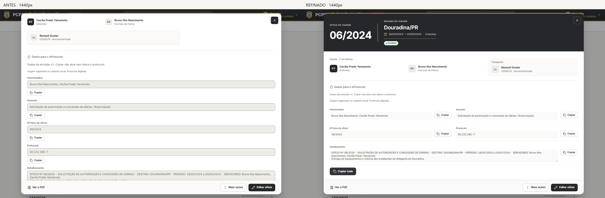

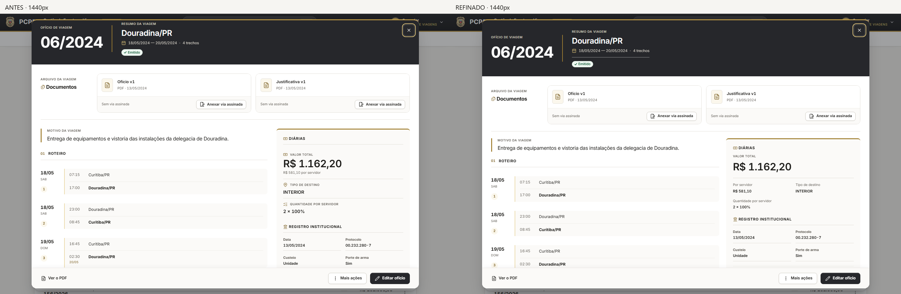

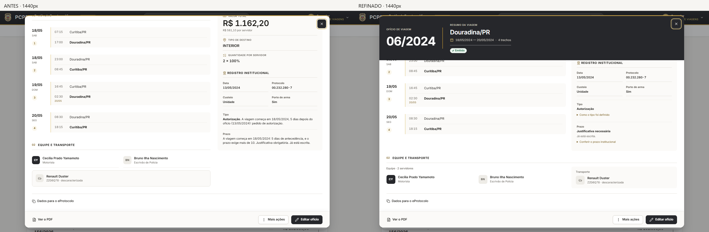

## Tablet

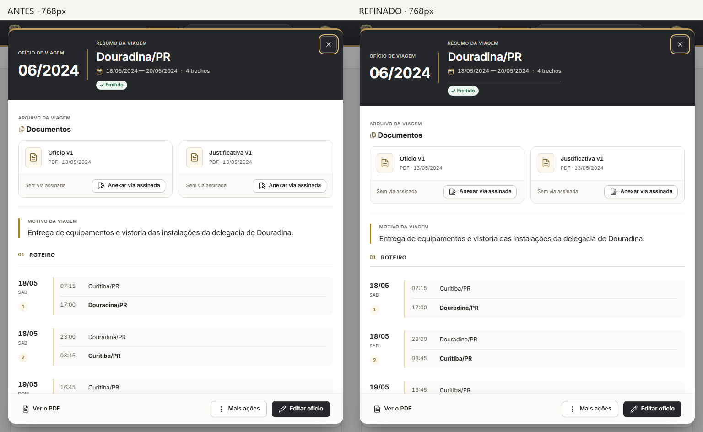

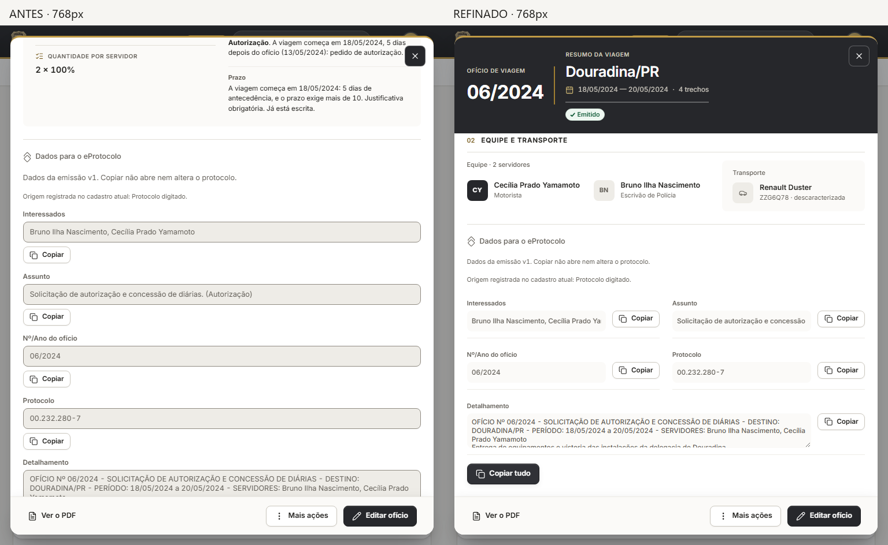

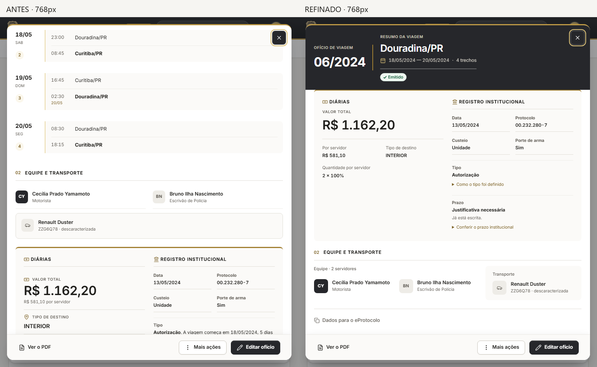

## Celular

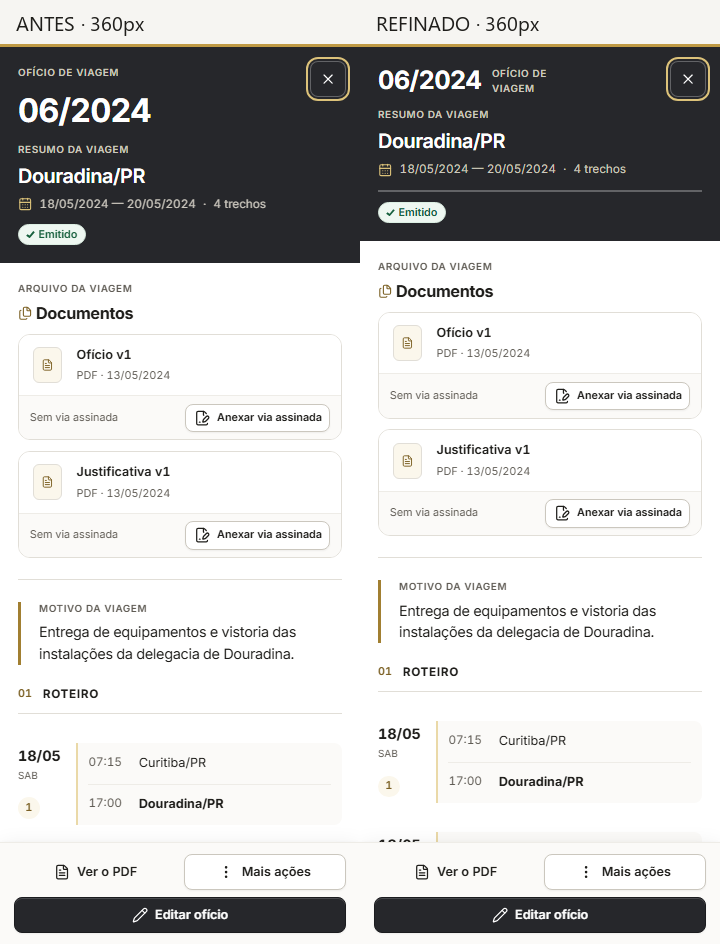

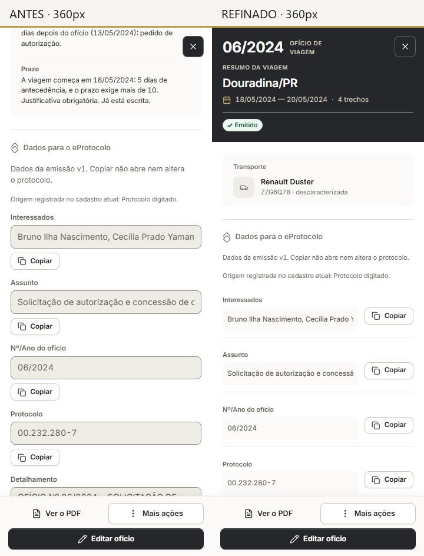

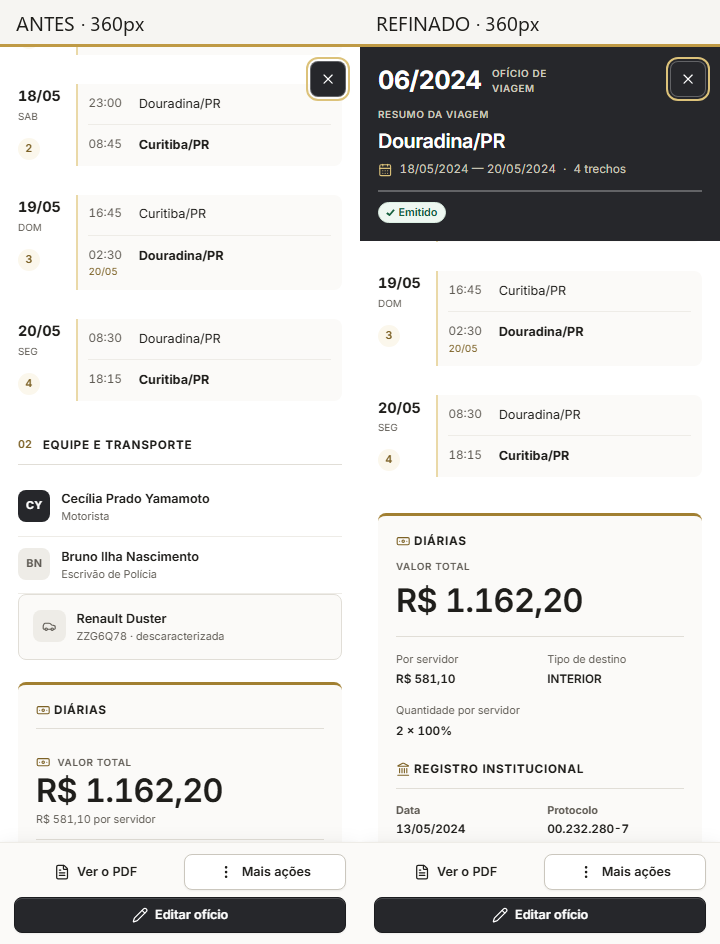

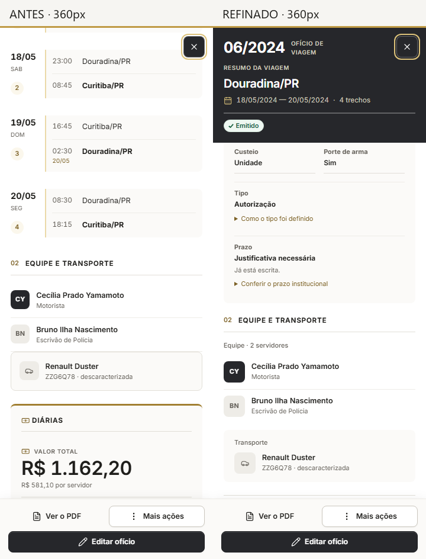

## Autocrítica e correção

A primeira versão do refinamento reservava 230 px ao cabeçalho mobile fixo e deixava
a descrição de cópia com só duas linhas. A revisão reduziu a identidade a uma linha
no celular e deu três linhas ao detalhamento (altura mínima maior no celular).
O total financeiro agora tem hierarquia própria; pessoa e veículo formam uma faixa
fechada. Os detalhes institucionais continuam disponíveis por divulgação nativa.

Limite: dados longos em inputs de leitura continuam usando seleção/rolagem nativa;
o botão copia integralmente, sem truncar o valor. A documentação institucional completa
exige abrir as explicações. Aprovação visual final depende da avaliação do usuário.
